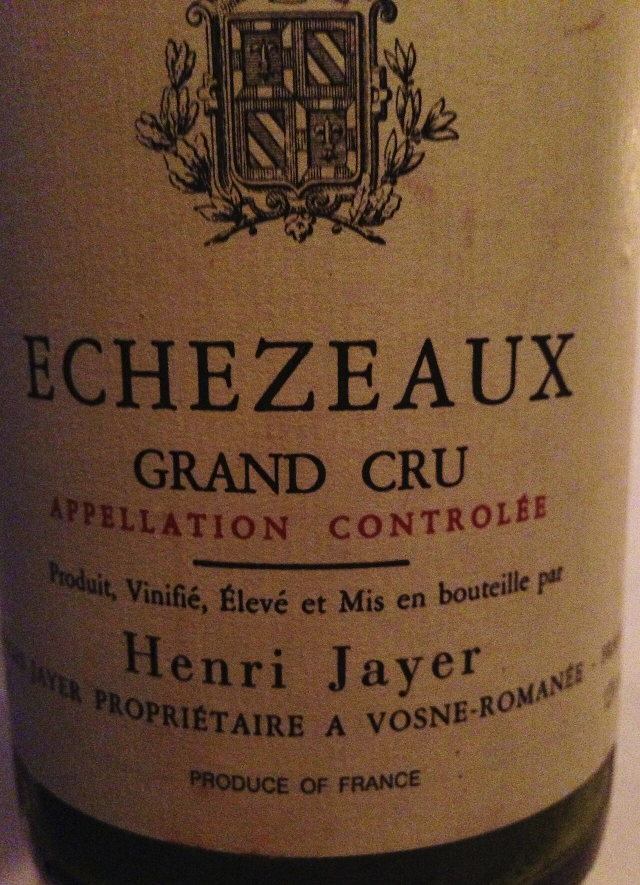

# Henri Jayer

Henri Jayer (1922–2006) was a winemaker and vine grower in Vosne-Romanée, Burgundy. His own holdings came to less than five hectares, yet he became one of the most admired Burgundian winemakers of his generation; Cros Parantoux, a slope that had been abandoned and once grew Jerusalem artichokes, is the work most often attached to his name. To understand him one has to look at the cellar choices and at the sharecropping arrangement with landowners that has almost disappeared from Burgundy today.

Figure: Henri Jayer. Image: Dale Cruse, CC BY 2.0, via Wikimedia Commons ([source page](https://commons.wikimedia.org/wiki/File:Jayer_Echezeaux_Grand_Cru_Burgundy.jpg)).

## Life

He was born in Vosne-Romanée in 1922, the third son. His father owned three small parcels bought after the phylloxera disaster, and the family was not rich. Jayer left school at sixteen; when his two elder brothers joined the army he took over the family vines, taking weekly lessons in viticulture and winemaking from a local grower, and never attended a formal oenology school.

In 1942 he married Marcelle Rouget; they had two daughters. After the war he began tending vineyards belonging to the Camuzet family, later Méo-Camuzet, and also leased other small parcels. In the 1950s he replanted some blocks; between 1959 and 1976 he bottled small quantities of Richebourg under his own name under the sharecropping agreement. In 1978 he bottled Cros Parantoux separately under the Henri Jayer label for the first time, and the vineyard became his signature.

According to domaine and trade sources, the Camuzet sharecropping arrangement ended in the late 1980s, and 1987 was the last Richebourg vintage before Méo-Camuzet took the block back. Around 1987 Jayer considered retirement; in the mid-1990s, usually given as 1996, he transferred his vineyards to his nephew Emmanuel Rouget under French retirement and inheritance rules, and continued as an adviser until about 2002. He died at Dijon on 20 September 2006, aged eighty-four.

## Timeline

- 1922: born at Vosne-Romanée, the third son.
- 1942: marries Marcelle Rouget.
- After the war: begins tending the Camuzet family's vines and leasing other parcels.
- 1950s: replants several blocks and settles on low yields and destemming.
- 1957: buys about 0.72 hectares of Cros Parantoux.
- 1959 to 1976: bottles small quantities of Richebourg under his own name.
- 1978: first separate bottling of Cros Parantoux.
- 1987: last Richebourg vintage; the sharecropping arrangement ends.
- 1996: transfers the vineyards to his nephew Emmanuel Rouget under retirement rules.
- 20 September 2006: dies at Dijon.

## Working Relationship with Burgundy: Métayage

Jayer was not a proprietor first but a sharecropper and winemaker. Under métayage the landowner supplied the land and the grower supplied labour and skill, and the crop was divided between them. That is why he could bottle his half under his own name while the owner's half was sold under a different label, and why the same vineyard appears under two producers' names.

Through the 1970s and 1980s such arrangements were wound up across Burgundy as owner families took their land back to farm themselves. Jayer lost the Richebourg holding but kept working Cros Parantoux and his own small parcels. This institutional history explains his position better than the language of genius: his reputation was built on land belonging to others, and was exposed to other people's decisions.

## Cros Parantoux

Cros Parantoux lies on the slope above Richebourg and covers about 1.01 hectares. After phylloxera at the end of the nineteenth century it fell out of use and was later used to grow Jerusalem artichokes; the soil was compacted and full of stone. Jayer began clearing it after the war, first carrying away the larger rocks by wheelbarrow and later using explosives to break the rock; accounts speak of hundreds of charges. In 1957 he bought about 0.72 hectares, and further small portions came later by purchase or lease.

In 1978 he bottled it separately as Cros Parantoux for the first time, and never made more than 300 cases a year. The site has premier cru status only, with no grand cru classification, yet it is routinely compared with the neighbouring Richebourg, and its prices have sometimes exceeded it. That inversion is the classic demonstration that classification is not the same thing as quality. Today the vineyard is held and farmed by Méo-Camuzet and by Emmanuel Rouget.

## Winemaking

Jayer's method can be reduced to five points:

- Low yields: heavy pruning in spring and thinning of fruit, so that each bunch is more concentrated.
- Full destemming: he tended to destem 100%, reducing green notes and making the fruit purer.
- Cool maceration: before [fermentation](ref:fermentation) he macerated at about 10°C for one to four days, extracting colour and aroma without over-extracting [tannin](ref:tannin).
- A high proportion of new oak: his top wines saw 100% new barrels for about eighteen months, though he treated oak as a tool for stability and micro-oxygenation rather than as a flavour.
- Minimal intervention: no filtration and little clarification before bottling, preserving the wine's own texture.

He also insisted on late picking, waiting until ripeness was complete, and argued that great wine is decided in the vineyard, with the cellar merely failing or not failing to spoil it. The saying is often quoted, but it does not mean the cellar was casual: his temperature control, hygiene and extraction were severe.

## Reputation and Disputes

The first dispute is stylistic. Jayer's destemming and high new-oak proportion stood against the whole-cluster line associated with the Domaine de la Romanée-Conti and Lalou Bize-Leroy. Supporters found his wines purer and more precise in fruit; critics thought the oak masked site differences and pushed different vineyards towards a common style. The argument has no winner, but it shows that "tradition" in Burgundy was never a single practice. The Independent's obituary records that his influence on younger growers was immense but that his practices "were hardly revolutionary", being intended to preserve the purity of the wine; casting him as a revolutionary is as reductive as casting him as a conservative.

The second dispute is the market. His [red wines](ref:red-wine) fetch very high prices at auction, and results for Richebourg 1959 or Cros Parantoux are regularly used as headlines. Price is pushed by scarcity, fame and speculation, and counterfeits follow; taking an auction price as proof of quality mistakes a market event for a sensory judgement.

The third dispute is attribution. The success of Cros Parantoux is often written as one man's achievement, but the continued farming of the same site by Méo-Camuzet and Rouget mattered too, and his succession arrangements after 1996 left a complicated relation between the label "Henri Jayer" and the person who actually made a given bottle. Reducing everything to individual genius hides the institution, the land and the later workers.

## Common Misreadings

First, attributing Cros Parantoux's success entirely to the site. Without clearing, replanting and continuous management, the abandoned slope would not have become a famous vineyard.

Second, treating low yields as the only secret. Low yields must be matched by ripeness, hygiene and controlled extraction, otherwise they are merely a small crop.

Third, treating whole-bunch fermentation as the only orthodox Burgundy method. Jayer leaned toward destemming, but practice in Burgundy is varied and one person's choice cannot stand for the whole of [France](ref:france)'s largest fine-wine region.

Fourth, treating auction prices as the only proof of quality. Price is set by scarcity, reputation and the market together.

Fifth, imagining him as a do-nothing "natural" winemaker. His new-oak proportions and extraction were deliberate; "minimal intervention" meant no filtration and no restless racking, not the absence of decisions.

## See Also

- [Red wine](ref:red-wine): the category to which Pinot Noir belongs.
- [France](ref:france): the geography and institutions of Burgundy.
- [Fermentation](ref:fermentation): the stage in which cool maceration takes place.
- [Tannin](ref:tannin): the key measure in controlling extraction.

**Short definition:** Burgundy winemaker, 1922–2006; farming Vosne-Romanée parcels as a sharecropper, he used low yields, full destemming, cool maceration and restrained new oak to make precise Pinot Noir, and turned the abandoned Cros Parantoux into a premier cru.
