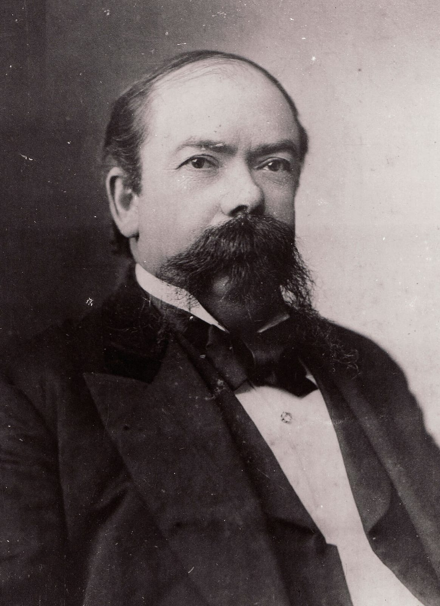

# Jack Daniel

Jack Daniel (c. 1850–1911), born Jasper Newton Daniel, was a distiller in Lynchburg, Tennessee, and the founder of the Jack Daniel's brand. In 1866 he registered Distillery No. 1 in Lynchburg and filtered new whisky through sugar-maple charcoal, the method later called the Lincoln County Process that defines Tennessee whiskey. His whiskey won gold at the 1904 St Louis World's Fair and the brand became one of America's most recognisable. Today Jack Daniel's is still made in Lynchburg, and the spring, charcoal and barrels remain the core of its identity.

Figure: Portrait of Jack Daniel. Image: Unknown author Unknown author, Public domain, via Wikimedia Commons ([source page](https://commons.wikimedia.org/wiki/File:Jasper_%22Jack%22_Daniel.jpg)).

## The Lynchburg boy and Dan Call

Jack Daniel's birth year is given as either 1846 or 1850; official material and his grave usually use 5 September 1850. He died on 10 October 1911. His childhood was poor: his mother died early, his father remarried, and he left home as a teenager. He was taken in by Dan Call, a Lutheran preacher who also ran a small distillery, and there he learned malting, mashing, fermentation, distillation and barrel ageing.

Recent research has established that Call's distillery employed an enslaved distiller, Nathan "Nearest" Green, who was one of Jack's actual teachers. Green later became free and an important figure in the Lynchburg community. In 2016 the Jack Daniel's brand publicly acknowledged Green's role and created a memorial and education programme around his contribution. This history matters: Southern whisky craft was not the invention of one white genius but the accumulation of plantation, church, Black artisan and market knowledge.

In 1866 Call decided to concentrate on preaching and sold the distillery to Jack. Jack built his plant beside Cave Spring in Lynchburg and registered it as Lincoln County Distillery No. 1. The limestone spring has low hardness and little iron, good for mashing and fermentation; the distillery still uses it. Jack placed the plant by the spring rather than in town for water, temperature and wood supply, and to avoid fire and town politics.

## The Lincoln County Process

The key difference between Tennessee whiskey and bourbon is the Lincoln County Process: before filling barrels, new whisky is slowly filtered through about ten feet of sugar-maple charcoal. The charcoal is made on site from sugar maple, stacked, set alight and quenched with water to form porous blocks. As the spirit passes through, it adsorbs some sulphides, fusel oils and coarse grain notes, softening the palate and leaving a cleaner base for oak ageing.

Jack Daniel did not invent charcoal filtration single-handedly. Distillers in the Lincoln County area had used it before; Jack Daniel's industrialised and standardised it, and the brand's success made it the defining step of Tennessee whiskey. US federal rules now require Tennessee whiskey to be made in Tennessee, from a grain recipe of at least 51% corn, filtered through the Lincoln County Process and aged in new charred oak barrels. It also meets the technical definition of straight bourbon, but both law and brand insist on the separate category "Tennessee whiskey".

Jack Daniel's mash is corn-led with barley and rye; it is distilled in copper pot stills to a white dog spirit, filtered through charcoal and aged in new charred barrels. The distillery does not use second-fill barrels and does not bottle outside Tennessee. The origin of the name Old No. 7 is not officially settled; the "seventh recipe", "seventh warehouse" and "seventh government batch" stories lack archival proof and should be treated as legend.

## From local distillery to national brand

In the 1880s Jack Daniel's whisky sold mainly in Tennessee and nearby states. At the 1904 St Louis World's Fair it won a gold medal, and its reputation spread quickly; in 1905 it also won at Liège in Belgium. Jack was not a natural advertiser, but he understood exhibitions and travelling salesmen who carried the whisky into city bars. In 1911 he died of blood poisoning after a toe injury, aged about 61; his nephew Lem Motlow took over.

Under Motlow, Tennessee introduced prohibition in 1916 and the distillery stopped; after federal Prohibition ended in 1933, the Motlow family rebuilt the business. Brown-Forman bought Jack Daniel's in 1956 and took the brand global. Today it is one of the largest-selling American whiskies, with a range from Old No. 7 to Gentleman Jack, Single Barrel and Tennessee Honey. The distillery remains in Lynchburg, and the spring, charcoal, barrels and warehouses remain the core of a visit.

## What to see in Lynchburg

At the distillery, look at four things. First, Cave Spring: the water is cold all year and the limestone filter makes it suitable for mashing; the spring house is the starting point for "why here". Second, the maple charcoal: see how the wood is stacked, burned, quenched and graded, and understand that the ten-foot bed is real equipment, not marketing. Third, distillation and barrel filling: copper pot stills, white dog, new charred barrels and warehouse temperature and humidity shape sweetness, spice and wood. Fourth, the tasting: Old No. 7's banana, vanilla, caramel and light smoke, Single Barrel's denser spice and oak, and Gentleman Jack's double-filtered softness are three different product logics.

Drink Tennessee whiskey without reducing it to "sweet bourbon". Old No. 7 works with ice, soda or cola; Single Barrel is best neat, with roast meat, smoked ribs and dark chocolate; Gentleman Jack suits beginners, nuts, cheese and light desserts. In a highball, watch the soda ratio and do not pack the glass with ice until the aroma disappears.

## Disputes and common misreadings

First, Jack Daniel did not invent bourbon. Bourbon was already mature in Kentucky and nearby; his distinct contribution was Tennessee's Lincoln County Process and the brand that carried it. Second, the legal relationship between Tennessee whiskey and bourbon is often oversimplified. It meets the technical requirements of straight bourbon, but law and brand list it separately as Tennessee whiskey. "It is just bourbon" and "it is not bourbon at all" are both inaccurate.

Third, the Lincoln County Process was not Jack Daniel's exclusive invention. It was a regional technique; Jack Daniel's standardised it and spread it through the brand. Crediting one brand erases Green, Call and other distillers. Fourth, Old No. 7 has no single official explanation. When you hear "seventh recipe", "seventh warehouse" or "seventh government batch", treat it as legend, not archive.

Fifth, Jack Daniel's birth year is disputed. Both 1846 and 1850 appear; official material usually uses 1850. A biography should say "c." or "officially", not manufacture precision. Sixth, the distillery is in Lynchburg, Moore County, a county with a long history of strict alcohol sales rules. "A distillery in a dry county" is a local paradox, but it does not mean the plant cannot produce or receive visitors.

## Place in this atlas

Jack Daniel connects three threads. The first is the craft of [whisky](ref:whisky): grain recipe, pot distillation, charcoal filtration, new-barrel ageing and warehouse management. The second is the local history of [Tennessee](ref:tennessee): Cave Spring, Lincoln County, Prohibition, the Motlow family and Brown-Forman's global distribution. The third is the American legal framework around [the United States](ref:usa): bourbon, Tennessee whiskey, Prohibition and twentieth-century brand globalisation.

To follow the American whisky map, compare Kentucky bourbon, Tennessee whiskey and rye. To follow a local brand into a global one, read Brown-Forman's acquisition and distribution. To follow how craft becomes law, read the federal standard for Tennessee whiskey and the Lincoln County Process. Jack Daniel is not an isolated brand; it is the product of Southern history, Black distilling knowledge and global markets.

## See also

- [Jack Daniel's Distillery](ref:distillery): Lynchburg, Cave Spring, the Lincoln County Process and visits.
- [Whisky](ref:whisky): grains, distillation, barrels and styles.
- [Tennessee](ref:tennessee): Lincoln County, Prohibition and the local background.
- [United States](ref:usa): bourbon, Tennessee whiskey, Prohibition and brand globalisation.
