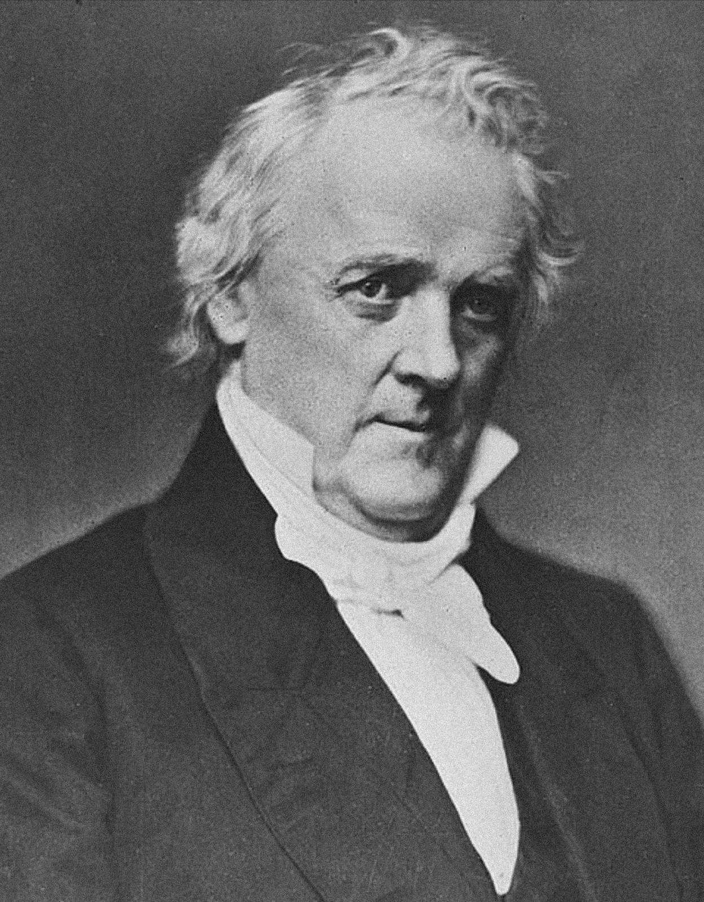

# James Buchanan

James Buchanan, 1st Baron Woolavington (16 August 1849 – 9 August 1935), was a Scotch whisky blender, brand builder and company chairman. He was not a distiller by training. He bought spirit from distilleries and Glasgow blending houses, married malt and grain in fixed proportions, and sold the result in bottles with a recognisable label. Buchanan's, and the blend eventually labelled Black & White, came out of that method.

Figure: James Buchanan. Image: From Brady daguerreotype (Mathew Brady) (1822-1896), Public domain, via Wikimedia Commons ([source page](https://commons.wikimedia.org/wiki/File:James_Buchanan_(cropped).jpg)).

## Life

Buchanan was born in Brockville, in what was then the Province of Canada, to Scottish immigrant parents. The family returned to the United Kingdom soon after his birth, and he grew up in Larne, County Antrim, where his father managed a quarry. His health as a child was poor, so he was educated privately rather than at school. At fourteen or fifteen he joined the Glasgow shipping firm William Sloan & Co as an office boy and was later promoted to clerk; in 1868 he moved into his brother's grain business. In November 1879 he went to London as agent for the Leith blenders Charles Mackinlay & Co, and so entered the whisky trade.

In 1884 he set up on his own and launched Buchanan Blend. He did not distil it himself: the spirit was supplied by the Glasgow blenders W. P. Lowrie & Co, while Buchanan handled the recipe, bottling, pricing and sales. When the firm became a private limited company in 1903 he was worth 750,000 pounds, and by 1909 Buchanan's was the best-selling Scotch in England. From there he expanded steadily upstream and converted profit into estates, racehorses and donations.

## Timeline

- 16 August 1849: born in Brockville, Canada, to Scottish parents.
- 1879: moves to London as agent for Charles Mackinlay & Co.
- 1884: sets up his own business and launches Buchanan Blend.
- 1885: begins supplying whisky to the House of Commons.
- 1898: receives Royal Warrants from Queen Victoria, the Prince of Wales and the Duke of York; opens Glentauchers malt distillery.
- 1902: opens a Paris office; Black & White moves from nickname to brand name.
- 1906: buys Lowrie's, his long-time supplier, and modernises its Glasgow plant.
- 1915: Buchanan's and Dewar's form the joint holding company Scotch Whisky Brands Ltd, renamed Buchanan Dewar Ltd in 1919.
- 1920: created a baronet; 1922: raised to the peerage as Baron Woolavington.
- 1925: the three big firms merge with the Distillers Company.
- 9 August 1935: dies at Lavington Park in Sussex, aged 85.

## Working Relationship with the Scotch Trade

Buchanan's job was that of a blender and company chairman. His central work was [blending](ref:blend): mixing malt and grain whiskies in set proportions so that aroma, body and strength stayed consistent from batch to batch. The English market at the end of the nineteenth century wanted something soft, easy to drink and even in colour, and blending met that demand. Bottling also freed customers from the bulk wine and spirit merchant: they could recognise a label and buy the same thing again.

He also controlled the supply chain. He opened the Glentauchers distillery in Speyside in 1898, bought Lowrie's in 1906 and rebuilt its Glasgow plant, and in 1907 took a stake in a bottle manufacturer and bought a packaging firm. That vertical integration gave him more room on price and supply than a pure trader had.

On the sales side he turned whisky into a recognisable commodity. The black bottle with a plain white label led customers to ask for "black and white whisky", and he drove through London in a red-wheeled buggy with a liveried footman, which was advertising in itself. Supplying the [United Kingdom](ref:united-kingdom)'s House of Commons from 1885 and holding Royal Warrants from 1898 gave the brand credentials that could be used as proof of quality. A Paris office followed in 1902 and a New York office soon after, extending the export network across the Empire and the United States.

## Brands and Products

Buchanan Blend was his first product and the ancestor of today's Buchanan's range: malt and grain whisky blended for softness, with the emphasis on a round entry rather than peat or a single distillery's strong character. The name Black & White came from customers describing the black bottle and white label, and was later adopted officially. The two terriers, a black Scottish terrier and a white West Highland white terrier, were used in advertising from the 1890s and became an early case of visual branding in whisky.

The range began to stratify in the early twentieth century, with Red Seal in 1905 and Deluxe 12 Year Old in 1925. Once the price bands were separated, the same blending and packaging skills could serve both the mass market and the gift market, a pattern later adopted by most large Scotch brands.

## Companies and Industry Structure

In 1909 Buchanan proposed a merger of Buchanan's, Dewar's and Walker's, which failed. He tried again in 1914; in April 1915 Buchanan's and Dewar's formed the joint holding company Scotch Whisky Brands Ltd, renamed Buchanan Dewar Ltd in 1919. In 1925 the three firms merged with the Distillers Company (DCL). Buchanan became a director, but age and poor health meant he attended only one board meeting. That detail is often overlooked: once the company was large, day-to-day control had passed to professional management.

This chronology also explains where the phrase "the three giants" comes from. It began as Buchanan's own reading of the industry and as a merger proposal, not as a later sales ranking. Treating it as an exact league table misreads the term.

## Reputation and Disputes

Buchanan has usually been judged as a seller rather than a maker. He never distilled, and his early product was made for him by Lowrie's; his strengths were recipe consistency, packaging, advertising and distribution. That is both his contribution and the charge against him: by turning whisky into a standardised commodity he weakened the individuality of the single distillery and the single cask, and made Scotch for the first time an industrial brand that could be assembled across distilleries.

A second dispute concerns his honours. He was made a baron in 1922, and a story later circulated that he had paid 50,000 pounds for the peerage and dated the cheque after the announcement so that payment could be stopped if the honour did not come through. The story appeared in a 2006 retrospective in The Daily Telegraph and should be treated as anecdote rather than established fact. What is documented is his large giving to hospitals, churches and universities; in 1928 he paid for a wing at Middlesex Hospital in memory of his wife.

A third point is often missed. When he died his estate was worth more than seven million pounds, making him one of the richest British businessmen of the day, but both the barony and the baronetcy became extinct because he had no surviving son.

## Common Misreadings

First, the dates. Older material often gives 1849 to 1934; he actually died on 9 August 1935, as both the Oxford Dictionary of National Biography and the contemporary obituaries record.

Second, the birthplace. He was born in Brockville, Canada, not in Scotland; some 1935 obituaries give Stirlingshire, and that variant should be flagged rather than silently repeated.

Third, that Black & White is a single malt. It is a blended whisky, sold on consistency rather than on one distillery's character.

Fourth, that blending is a cheap or inferior craft. Balancing dozens of casks across ages and batches is difficult work with a different aim from cask selection, not a lower tier of it.

Fifth, that the brand succeeded on recipe alone. Distribution, advertising, Royal Warrants and the bottling system mattered just as much, and they were Buchanan's real speciality.

## See Also

- [Whisky](ref:whisky): the category to which blended Scotch belongs.
- [Scotland](ref:scotland): where the distilleries and the industry are.
- [United Kingdom](ref:united-kingdom): the base of his business and export markets.
- [Blend](ref:blend): the core method of his business.
