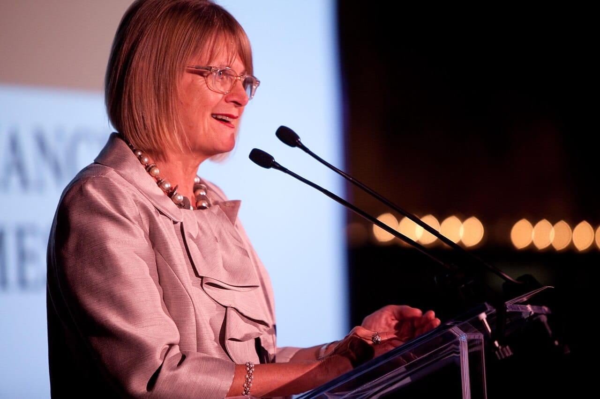

# Jancis Robinson

Jancis Robinson (born 1950) is a British wine writer, editor and critic. Her place in wine publishing rests on three checkable facts: she passed the Master of Wine examination in 1984, she has written a weekly column for the Financial Times since 1989, and she has edited The Oxford Companion to Wine since its first edition in 1994.

Figure: Jancis Robinson. Image: Financial Times, CC BY 2.0, via Wikimedia Commons ([source page](https://commons.wikimedia.org/wiki/File:Jancis_Robinson.jpg)).

## Life

- Born on 22 April 1950 in Cumbria, north-west England, and raised in a village of a few dozen people where wine was almost absent.
- Read mathematics and philosophy at Oxford, where she first encountered wine seriously.
- Passed the Master of Wine examination in 1984, one of the few at the time to do so without coming from a wine merchant or estate.
- Became wine correspondent of the Financial Times in 1989 and has written there weekly for decades.
- Edited the first edition of The Oxford Companion to Wine in 1994, followed by editions in 1999, 2006 and 2015.
- Founded JancisRobinson.com in 2000, later a subscription site for which she is editor in chief and main contributor.
- From 2001 she co-authored [The World Atlas of Wine](ref:world-atlas) with Hugh Johnson, beginning with the fifth edition.
- In 2012, with Julia Harding and the grape geneticist Jose Vouillamoz, she published Wine Grapes, a systematic account of varieties, synonyms and parentage.

## Her actual role in the wine trade

She is not a winemaker and does not run an estate; her position is at the describing and judging end. The work is concrete: a weekly newspaper column that places wine in the context of restaurants, travel, business and ordinary spending; the planning and commissioning of entries for the Oxford Companion; editing and publishing tasting notes and regional reports on her own site; and judging at international fairs and competitions.

She scores on a 20-point scale rather than the 100-point scale more common in the American market. The choice looks like a matter of arithmetic but changes the writing: a 20-point scale has coarser steps, so the note has to carry more of the explanation and the reader cannot rely on the number alone.

## The Oxford Companion to Wine: what an editor does

The Oxford Companion to Wine arranges regions, varieties, terms, regulations, people and history into entries. Its value lies less in any single article than in its consistency: a term means the same thing across entries, and cross-references carry a reader from Chardonnay to Burgundy to oak.

The editor decides which entries deserve inclusion, who writes them, how terminology is standardised and how entries link. This is organisational work, not personal authorship. Treating "editor" as "author of the whole book" both overestimates one person's output and underestimates the collaborative nature of a reference work.

## The World Atlas of Wine: from the fifth edition

The World Atlas of Wine was first published by Hugh Johnson alone in 1971. From the fifth edition in 2001 Robinson became co-author, and later editions carry both names. The book maps regions, soils, climates and village relationships so that readers can see where a wine comes from.

Maps are not decoration but a form of argument: when two villages are separated by a single slope and yet taste different, a map makes the difference visible. Her contribution to the atlas is less in the original cartography than in updating regional data, correcting boundaries and names, and bringing new varieties and regions into the frame.

## Wine Grapes and the language of varieties

Wine Grapes, published in 2012, organises 1300 grape varieties by parentage, synonyms and planting. Her co-authors were the geneticist Jose Vouillamoz and the editor Julia Harding. The book addresses an old problem in wine writing: the same variety has different names in different countries, and the same name may refer to different varieties.

Saying "this is a [wine](ref:wine)" conveys very little; saying "this comes from a particular village, is mainly one variety and was picked in a particular year" lets a reader judge style and price. Her method is to break vague approval into checkable geography, variety and craft.

## Assessment and disputes

The 2003 Chateau Pavie is her most famous controversy. She scored the Saint-Emilion wine 12/20 and called it "ridiculous", arguing that the aromas were overripe and the sweetness port-like, so that the wine had lost the outline of a dry red. Robert Parker publicly rejected the judgment as unfair, while James Lawther MW of Decanter gave it four stars and called the 12/20 unjustified.

The argument was not only about taste but about the power to score: on one side a European readership reached through the Financial Times and her own site, on the other the American market influence of The Wine Advocate. Critics often say her palate favours acidity and restraint and is ungenerous to ripe fruit; supporters say she offers reasons for a judgment rather than a number alone.

A further limitation is linguistic and commercial. Her writing assumes an English-speaking reader and the European classic regions as a default, so reading about New World wines, or about drinks other than wine, still needs local sources.

## Common misreadings

First, taking "editor" to mean author of every entry. The Oxford Companion is a collective work that she organised and supervised.

Second, treating the atlas as a travel guide. Its core is regions and geographical relationships, not restaurant recommendations.

Third, treating MW as a degree. The Master of Wine is a qualification and title awarded through an industry examination, not a university degree.

Fourth, treating her scores as absolute standards. Her value lies in method: place, year and craft before preference.

Fifth, treating a British perspective as a global one. Her writing carries the context of the British press and the European wine tradition, which must be supplemented when reading about other regions.

## Advanced judgment

Figure: Red and white wine. Image: André Karwath, CC BY-SA 2.5, via Wikimedia Commons ([source page](https://commons.wikimedia.org/wiki/File:Red_and_white_wine_in_glass.jpg)).

| Role | Main output | Effect on the trade |
| --- | --- | --- |
| Journalist | Independent criticism and columns | More transparent tasting |
| Editor | The Oxford Companion to Wine | Integrated regional and variety knowledge |
| Map author | The World Atlas of Wine | A visual language for regions |
| Educator | Master of Wine study | Professional judgement training |

**Is Jancis Robinson a winemaker?** She is known primarily as a wine writer, critic and editor, not as a winemaker. Her influence comes from decades of independent criticism, editing and education rather than estate ownership.

**What is the Master of Wine qualification?** MW is a professional wine qualification covering theory, tasting and practice. It certifies systematic training and judgement, not a single correct answer for every bottle.

**What does the Pavie dispute show?** It shows that independent criticism can collide with commercial interests and style preferences. The issue is disclosure, tasting records and openness to reply, not disagreement itself.

Further reading: [The World Atlas of Wine](ref:world-atlas) and [Wine](ref:wine).

## See also

- [Wine](ref:wine): basic definitions and craft.
- [The World Atlas of Wine](ref:world-atlas): a reference work that organises regional knowledge through maps.
- [United Kingdom](ref:uk): the background of the British wine market and media.

**Short definition:** A British wine writer and editor, born in 1950; she passed the Master of Wine examination in 1984, has written a weekly Financial Times column since 1989, edits The Oxford Companion to Wine and has co-authored The World Atlas of Wine with Hugh Johnson since 2001. 

Jancis Robinson is best read by starting with the period and the role, moving to the documented work, and ending with the sources behind the claim.

The comparison with [Wine](ref:wine) and [The World Atlas of Wine](ref:world-atlas) runs through role and period. Each answers a different question.

**Key facts.**

| Item | Detail |
| --- | --- |
| In one line | A British wine writer and editor, born in 1950; she passed the Master of Wine examination in 1984, has written a weekly Financial Times column since 1989, edits The Oxford Companion to Wine and has co-authored The World … |
| Life | 1950–? |
| Roles | wine writer、editor、wine critic |
| Regions | United Kingdom |
