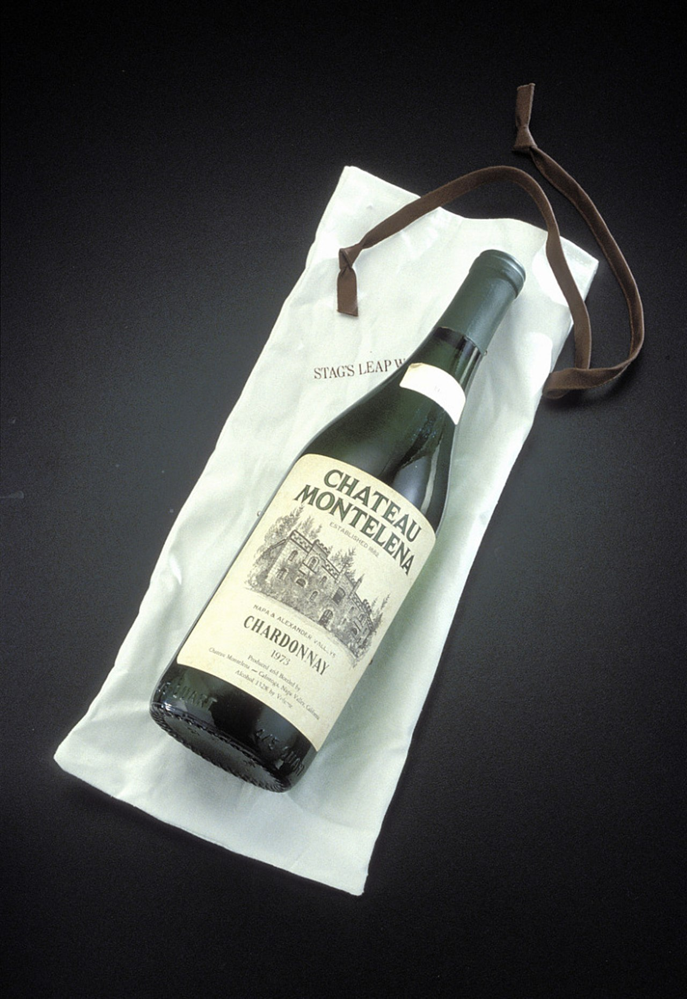

# Jim Barrett

Jim Barrett (1926–2013) was an American winery owner, lawyer and businessman. In 1972 he and Ernie Hahn bought Chateau Montelena, a stone winery in Calistoga that had been dormant since Prohibition, and brought it back into production. In the 1976 Judgment of Paris, the estate's 1973 Chardonnay won the white-wine flight. The story is often told as "a lawyer changed careers and made wine"; the more important part is how he assembled capital, land, grapes and people.

Figure: The 1973 Chateau Montelena Chardonnay that won the white-wine flight of the 1976 Judgment of Paris; Smithsonian National Museum of American History. Image: Unknown author Unknown author, Public domain, via Wikimedia Commons ([source page](https://commons.wikimedia.org/wiki/File:Judgment_of_Paris_Winner_1973_Chateau_Montelena_Chardonnay.jpg)).

## From lawyer to winery owner

Barrett was born in Chicago on 8 November 1926 to Irish immigrant parents; the family later moved to Los Angeles. He served in the U.S. Navy during the Second World War, earned a bachelor's degree from UCLA in 1946 and a law degree from Loyola in 1950. He then practised law and invested in real estate in Los Angeles: the classic buyer with money, interest and no winemaking training.

In 1972 he and Ernie Hahn bought Chateau Montelena from Lee Paschich. The estate had been built by Alfred L. Tubbs in 1882 and was once the seventh-largest winery in Napa Valley; after Prohibition it fell silent, and the vineyard was planted to Chasselas, Alicante Bouschet and Carignane, common high-yield varieties of the time. Barrett pulled out what did not fit his goal and replanted Cabernet Sauvignon. While the Cabernet matured, he bought Chardonnay grapes to keep production going.

He hired Mike Grgich as winemaker. Grgich, a Croatian immigrant who had worked in France and several California wineries, was skilled in temperature-controlled fermentation and Chardonnay. Barrett handled money, equipment, grape purchasing and sales; Grgich handled the winemaking. The 1973 Chardonnay was made from purchased grapes, not estate fruit, a detail often lost in the later "estate myth".

## The 1976 Judgment of Paris

On 24 May 1976 a blind tasting in Paris compared California and French red and white wines. In the white flight, Chateau Montelena's 1973 Chardonnay received the highest score, ahead of Meursault-Charmes 1973 and other Burgundy whites. Barrett is said to have remarked that "not bad for kids from the sticks", a line repeated ever since.

The victory turned Chateau Montelena from a revived old winery into an international name. It showed that California could make Chardonnay able to compete with Burgundy, and it put Calistoga and Napa Valley on more wine lists. But the limits are the same as for the red flight: one blind tasting, not a long-term regional comparison; one vintage; purchased grapes rather than estate fruit; and Grgich, not Barrett, as the winemaker.

## The winery after 1976

After 1976 Chateau Montelena expanded. Barrett built volume and brand, and in 1982 handed winemaking to his son Bo Barrett. The estate became an important Napa name in the 1980s and 1990s. In the early 2000s it faced public controversy over TCA (cork contamination) and wine-quality variation. In 2008 it reached a sale agreement with Michel Reybier; the deal later collapsed into litigation, and the winery remained in the Barrett family.

## The 2008 sale and later years

When the 2008 sale agreement collapsed into litigation, the Barrett family kept control of the estate. The episode showed that Montelena's brand value rested both on the 1976 trophy and on decades of operating assets and family ownership: a buyer would acquire not just a winery but a reputation that was hard to replicate and hard to price.

Barrett also served as chairman of Napa Valley Vintners and was involved in organisations such as Family Winemakers. He died in San Francisco on 14 March 2013 at the age of eighty-six. Among his five children, Bo Barrett long managed the estate and continued the family business.

## Assessment and controversy

The favourable view treats him as the operator who turned a derelict winery into a Napa name: he recognised the asset, organised capital, replanted the vineyard, hired the right winemaker and converted the 1976 fame into a business. That assessment has a factual basis, especially the 1972 purchase and the 1973 production decisions.

Criticism has three lines. First, the press often turned "the winery won" into "Barrett made the winning wine", which obscures Mike Grgich's role; Grgich later left and founded his own estate, a reminder that credit cannot belong to one person. Second, the 1973 Chardonnay came from purchased grapes, so describing it as an "estate terroir victory" is inaccurate. Third, the 2008 sale attempt and the TCA controversy showed that reputation is not fixed by a single 1976 result.

## Common misreadings

The first is to treat Barrett as the founder of Chateau Montelena. Alfred Tubbs built the estate in 1882; Barrett was its 1972 reviver.

The second is to treat him as the winemaker. His role was owner and operator; Mike Grgich made the 1973 Chardonnay.

The third is to call the 1973 Chardonnay "estate fruit". It was made from purchased grapes; the estate vineyard had to be replanted and matured.

The fourth is to read the Judgment of Paris as California's overall victory over France. It was a specific blind tasting with specific wines and vintages, not a permanent ranking.

## See also

- [Napa Valley](ref:napa): the home of Chateau Montelena and Calistoga.
- [Chardonnay](ref:chardonnay): the variety of the 1973 winning wine.
- [White wine](ref:white-wine): the category that explains the Paris white-wine flight.
- [1976 Judgment of Paris](ref:paris-1976): the event that links Montelena and Stag's Leap.
- [United States](ref:usa): the national background of California's 1970s rise.

**At a glance:** American winery owner (1926–2013) who bought and revived Chateau Montelena in Napa Valley with Ernie Hahn in 1972; the estate's 1973 Chardonnay won the white-wine flight of the 1976 Judgment of Paris. 

Read Jim Barrett through the period and the role, then the documented work, and finally the sources behind the claim. The sequence matters.

[Napa Valley](ref:napa) and [White wine](ref:white-wine) are the nearest useful comparisons: one clarifies role, the other tests period.

It is tempting to treat Jim as Barrett a brand. Its identity and use are separate questions.

Barrett owned Chateau Montelena, whose 1973 Chardonnay won the white-wine category at the 1976 Judgment of Paris.

**Key facts.**

| Item | Detail |
| --- | --- |
| In one line | American winery owner (1926–2013) who bought and revived Chateau Montelena in Napa Valley with Ernie Hahn in 1972; the estate's 1973 Chardonnay won the white-wine flight of the 1976 Judgment of Paris. |
| Life | 1926–2013 |
| Roles | winery owner、lawyer、businessman |
| Regions | United States、Napa Valley |

**Sources and limits.** The key claims about Jim Barrett are checked against the following sources: Chateau Montelena Winery, The Wine Cellar Insider, Wine History Tours and 5 sources in total. Prices, batches and status change; the body is project-written and does not reproduce source text.

**Read alongside.** Put Jim Barrett next to Napa Valley, Chardonnay, White wine: the first fixes identity and boundary, the others provide a region, process or peer comparison. Read this page first, then return to those entries; the links become coordinates, not decoration.
