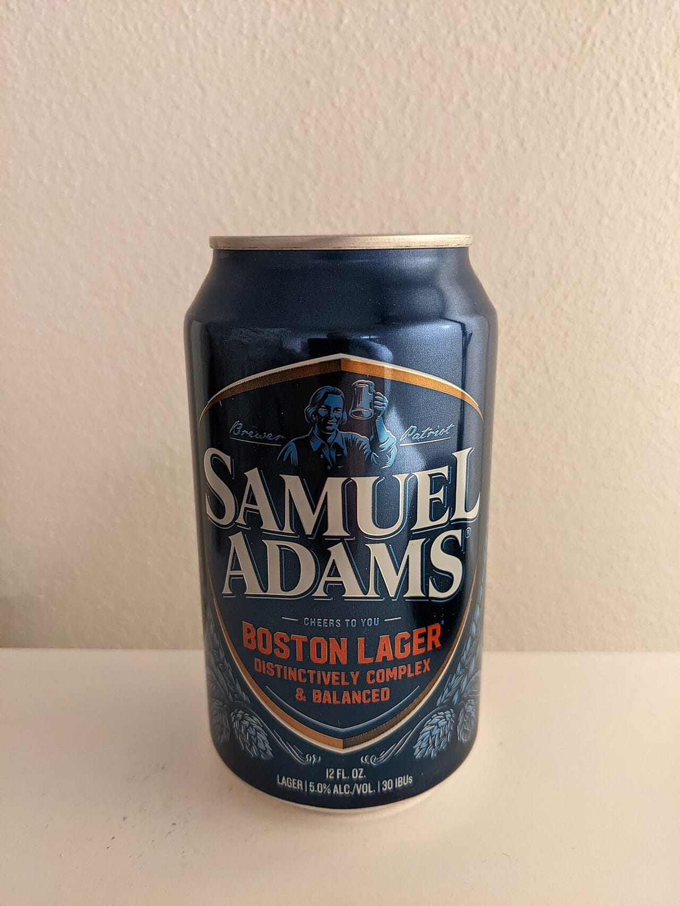

# Jim Koch

Jim Koch (born 1949) is one of the most commercially successful cases of American craft beer and, in background, one of its least likely brewers. He came from a Boston brewing family, worked as a management consultant, and in 1984 brewed his great-great-grandfather's recipe in his own kitchen before founding The Boston Beer Company. Four years later Samuel Adams Boston Lager had become one of the most recognisable “craft” beers on American shelves.

Figure: A bottle of Samuel Adams Boston Lager, the beer Jim Koch began brewing in 1984; not a portrait of Koch. Image: Pansebert, CC0, via Wikimedia Commons ([source page](https://commons.wikimedia.org/wiki/File:Samuel_Adams_Boston_Lager_(The_Boston_Beer_Co.).jpg)).

## Family and early career

Koch was born in Cincinnati, Ohio, into a family that had brewed for five generations. His father worked for a large brewery and left as the industry consolidated; Koch studied at Harvard, earned law and business degrees, and worked at a consulting firm. In 1984 he found his great-great-grandfather Louis Koch's lager recipe in the attic and decided to stop writing strategy for others and make a beer that had flavour but remained familiar to American drinkers. He later said he was already in his thirties and could return to consulting if it failed, but the first batches were far from certain successes: he had to solve recipe, cost and sales at the same time.

## 1984: the first batches

The first kitchen brew did not go smoothly. The equipment was crude, temperature control was unreliable, and the fermentation smells even lifted wallpaper. He persisted, switching to a more stable lager yeast and cooler fermentation and adjusting the malt and hop ratios. The company was founded in 1984; banks refused loans, and he raised about $200,000 from family and friends. On 15 April 1985, Boston Lager went on sale in roughly thirty-five Boston restaurants and bars.

## Signature releases

Samuel Adams Boston Lager is the central work: amber, with clear malt sweetness and restrained hop spice, more layered than the mainstream lager of the time but less unfamiliar than an English ale. In June 1985 it was voted “Best Beer in America” in the consumer poll at the Great American Beer Festival. Boston Beer subsequently applied the same logic — lager as the base, flavour as the addition — to Seasonal, Double Bock, Triple Bock and, in 2001, Utopias.

## Method and institutions

Koch's contribution was to move craft beer from the local tavern to the national shelf. He used contract brewing and multiple plants to keep supply growing, and he marketed by educating consumers, turning hops, malt and freshness into readable stories. In 2008 he launched Brewing the American Dream, providing capital, mentoring and networks to food and beverage entrepreneurs. In 1995 Boston Beer listed on the New York Stock Exchange, becoming one of the few public companies built mainly on craft beer. In 2008 the company bought an old plant in Lehigh Valley, Pennsylvania, shifting from contract brewing toward owned capacity; in 2024 it marked its fortieth anniversary, with Samuel Adams still one of the most recognised craft brands in the country.

## Assessment and disputes

Supporters say he proved craft beer could scale without losing quality: Boston Lager has kept a stable recipe for nearly four decades and was the first beer that taught many Americans that beer could have flavour. Critics note that contract brewing, a public-company structure and national distribution make Boston Beer closer to a large regional brewery than to the local-workshop image of craft; the definitions of “independent” and “small” have been repeatedly debated because of companies like this. Koch's response is blunt: if craft beer can only survive in small local taps, it cannot change everyday drinking; scale is not the sin, homogenised lager is.

## Common misreadings

First, Koch was not a self-taught brewer starting from nothing. He had a family recipe and industry resources, and he received formal education. Second, Samuel Adams is not a small Massachusetts local brewery. It used contract brewing and multiple plants early to reach national distribution. Third, Boston Lager is not an ale. It is a lager, made with lager yeast and cool fermentation. Fourth, “craft” is not a taste standard. It is an industry definition based on ownership, scale and process, not a guarantee of bitterness or strength.

**At a glance:** Founder of Samuel Adams and The Boston Beer Company (born 1949); in 1984 he brewed his great-great-grandfather's lager recipe at home, launched Boston Lager in Boston bars in 1985, and used national distribution and the Brewing the American Dream programme to shape the American craft-beer industry.

Begin with the period and the role, move on to the documented work, and finish with the sources behind the claim. That order keeps the reading of Jim Koch practical.

The comparison with [Lager](ref:lager) and [Craft beer](ref:craft) runs through role and period. Each answers a different question.

**Key facts.**

| Item | Detail |
| --- | --- |
| In one line | Founder of Samuel Adams and The Boston Beer Company (born 1949); in 1984 he brewed his great-great-grandfather's lager recipe at home, launched Boston Lager in Boston bars in 1985, and used national distribution and the … |
| Life | 1949–? |
| Roles | brewer、company founder、entrepreneur |
| Regions | united-states |

**Sources and limits.** The key claims about Jim Koch are checked against the following sources: The Boston Beer Company (Used to check Boston Lager's 1984 origin, the 2024 fortieth anniversary and brand awards; no text copied), U.S. Securities and Exchange Commission, Flatiron Books (Used to check Koch's startup, sales strategy and Boston Beer management philosophy; no text copied). Prices, batches and status change; the body is project-written and does not reproduce source text.

For Jim Koch, this profile was last checked in 2026; prices, batches and availability change, so confirm them against the sources below.

## Further reading

Boston Beer's official history and investor FAQ differ in emphasis on 1984/1985: the former highlights the recipe discovery and kitchen trials, the latter the incorporation, Patriots' Day launch and 1988 volume. The SEC annual report provides checkable revenue, capacity and brand-portfolio data. Reading marketing narrative against regulatory filings is the most reliable way to understand a public craft brewery; Koch's *Quench Your Own Thirst* is useful for the startup process but should not be treated as a financial source. On the product side, Triple Bock in 1994 and Utopias in 2001 represent another extreme: high alcohol, long wood ageing and pronounced sweetness. They are not everyday lagers but products that turn “beer can be collected like whisky” into a commercial proposition. Contract brewing also created quality-control problems: Boston Beer long placed staff in partner plants and standardised ingredients and microbiology so that Boston Lager tasted consistent across sites; the model of “brand owns the standard, plant owns the capacity” was later adopted across craft brewing.

## See also

- [Lager](ref:lager): the technical and stylistic base of Boston Lager.
- [Beer](ref:beer): the entry to Koch's product range.
- [Craft beer](ref:craft): the category he helped promote and repeatedly redefined.
- [Fermentation](ref:fermentation): the key to cool lager fermentation and flavour control.
- [Brewers Association](ref:brewers): the source of craft definitions and industry statistics.
