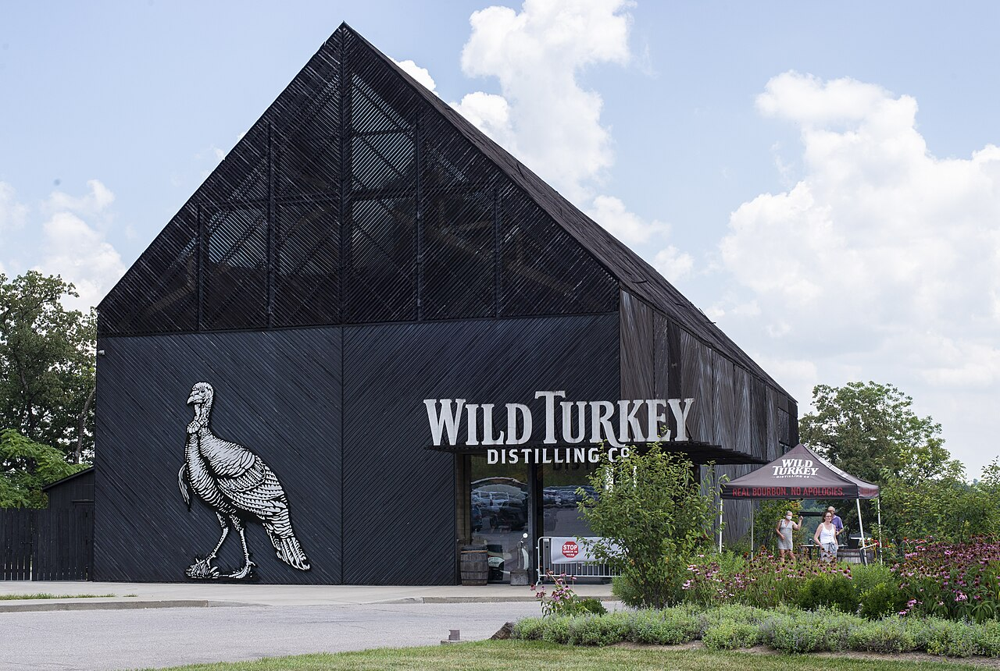

# Jimmy Russell

Jimmy Russell is the longest-serving distiller at Wild Turkey and one of the few living institutions of American bourbon. He walked into the distillery on 10 September 1954, aged eighteen, and his first job was sweeping the floor. More than seven decades later he was still tasting, selecting and talking about barrels. Colleagues call him the “Buddha of Bourbon”; he prefers to describe himself as an ordinary old Kentucky distiller.

Figure: The Wild Turkey visitor centre in Lawrenceburg, Kentucky; a distillery scene, not a portrait of Jimmy Russell. Image: Smerdis, CC BY-SA 4.0, via Wikimedia Commons ([source page](https://commons.wikimedia.org/wiki/File:Wild_Turkey_Visitor%27s_Center.jpg)).

## Early life and apprenticeship

Russell grew up about five miles from the distillery, and his father also worked there. He began in cleaning and then learned malting, mashing, distillation and barrel selection from Bill Hughes and Ernest W. Ripy Jr. In the 1960s he became Wild Turkey's master distiller; for the next half-century the core formula, the barrel-ageing standard and the 101 proof remained essentially in his hands. His son Eddie joined in 1981 as a relief operator and worked up from the bottom. In 2015 Eddie became master distiller, creating a rare father-and-son pairing in Kentucky bourbon. In 2014 the distillery designated the year “Jimmy's Year”, and both the Kentucky legislature and the U.S. Congress recorded tributes, an unusual political recognition for a working distiller.

## From floor sweeper to master distiller

Wild Turkey's process is not mysterious: a corn-led mash bill, continuous distillation, new charred oak barrels and long ageing. The difficult part was refusing to do unnecessary things when fashion changed. In the 1970s and 1980s American drinkers moved toward vodka, gin and lighter spirits, and many distillers lowered proof and shortened ageing. Russell kept the existing 101 formula. The line later became a slogan — “we didn't change a thing” — but it also preserved a recognisable house style through the downturn.

## Signature releases

Wild Turkey 101 is his central work: high proof, heavy oak, caramel and spice, equally at home over ice or in a cocktail, and a fixture of American bars. Its mash bill is corn-led with smaller shares of rye and barley; new charred American oak contributes vanilla, coconut and toasted wood, while longer ageing integrates alcohol and sweetness. Rare Breed, introduced in 1991, was an early barrel-proof bourbon rather than a uniformly diluted product. Kentucky Spirit, from 1995, took a single-barrel route. Russell's Reserve, created with Eddie, turned father-and-son barrel selection into a brand narrative. The 1976 honey bourbon later evolved into American Honey.

## Method and institutions

Russell's influence goes beyond individual bottles. He represents an internal-career path: cleaning, mashing, distilling and tasting, one layer at a time, rather than entering management straight from business school. He long insisted on new charred American oak, an open tasting routine and a stable yeast-and-grain system, keeping Wild Turkey's body heavy, dry and spice-tailed. In 2000 he entered the Kentucky Bourbon Hall of Fame. In 2015 Eddie formally received the master-distiller title, and the two worked in the same plant. In 2024 Wild Turkey marked his seventieth year with a commemorative eight-year bourbon.

## Assessment and disputes

Supporters stress his consistency and approachability: he talks about bourbon as an everyday American drink, not a luxury object. Critics note that “never changing” is also a brand strategy, helping the product stand out on shelf, and that making one distiller the face of a company can obscure the team, capital and distribution behind it. Russell treats the titles lightly, saying that if the whiskey is not good, “I'll drink it”. He has also judged international wine and spirit competitions, bringing outside tasting experience back to the plant; that loop of external judging and internal adjustment kept Wild Turkey from drifting away from the market while preserving its style. The official seventieth-anniversary release dates his start precisely to 10 September 1954 and stresses that he began by sweeping floors — a more useful historical detail than the vague label of “legendary master”.

## Common misreadings

First, he did not found Wild Turkey. The distillery's history reaches back to the nineteenth-century Ripy family; Russell was its master distiller from the mid-twentieth century. Second, “101” is not an age. It is 101 proof, not 101 years. Third, Rare Breed is not a single barrel; it is usually a multi-barrel barrel-proof blend. Fourth, “Buddha of Bourbon” is a nickname, not an official title. Fifth, he was not merely a brand mascot: he was still tasting and selecting in the 2020s, and the 2024 anniversary release drew on warehouses he favoured. Sixth, starting in 1954 did not mean becoming master distiller that year; he spent more than a decade in junior and apprentice roles.

Start with the period and the role. From there, consider the documented work, then the sources behind the claim. That is how a practical judgment about Jimmy Russell is built.

Read [Bourbon Whiskey](ref:bourbon) for the role side of Jimmy Russell, and [Kentucky bourbon trail: Frankfort, Bardstown and Loretto](ref:bourbon-trail) for the period side. Together they locate it.

**At a glance:** Master distiller at Wild Turkey in Kentucky, who joined in 1954 at eighteen, worked from the floor up and became master distiller in the 1960s; he kept the 101 formula through the bourbon downturn and helped shape Rare Breed, Kentucky Spirit and Russell's Reserve.

**Key facts.**

| Item | Detail |
| --- | --- |
| In one line | Master distiller at Wild Turkey in Kentucky, who joined in 1954 at eighteen, worked from the floor up and became master distiller in the 1960s; he kept the 101 formula through the bourbon downturn and helped shape Rare B… |
| Roles | bourbon distiller、master distiller |
| Regions | Kentucky |

**Sources and limits.** The key claims about Jimmy Russell are checked against the following sources: Wild Turkey Bourbon (Used to check the 1954, 1976, 1991, 1995, 2000, 2015 and 2024 timeline; no text copied), Oxford University Press (Used to check the grain, distillation, barrel-entry and ageing framework for bourbon; no entry copied), Voyageur Press (Used to check the late-twentieth-century decline and revival of bourbon; no text copied). Prices, batches and status change; the body is project-written and does not reproduce source text.

## Further reading

Wild Turkey's official biography emphasises titles and products, while the seventieth-anniversary release emphasises dates and the “unchanged formula” story; both carry a corporate viewpoint. To understand Russell's place, read them against the 1970s–90s bourbon downturn, when lowering proof and shortening ageing were common. The official timeline is reliable on the 2015 succession and the two-master structure. One easily missed detail is that 101 proof is about 50.5% ABV: above the standard 40% bourbon strength, but well below the extreme barrel-proof range. That middle ground is exactly where Wild Turkey built its everyday identity.

## See also

- [Bourbon](ref:bourbon): the category at the centre of his career.
- [Kentucky](ref:kentucky): the geographic heart of Wild Turkey and the bourbon industry.
- [Kentucky Bourbon Trail](ref:bourbon-trail): the travel framework linking distilleries, warehouses and towns.
- [Distillation](ref:distillation): the technical starting point from fermentation to spirit.
- [Barrel finishing](ref:finishing): an entry to Rare Breed, single barrels and age-related flavour differences.
