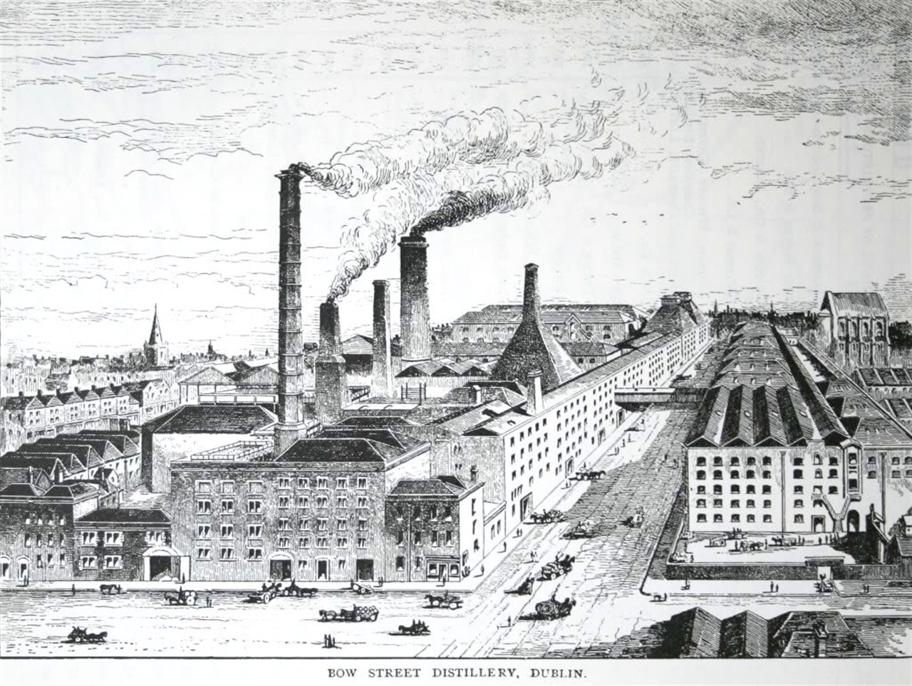

# John Jameson

John Jameson (1740–1823) gave his name to Jameson whiskey, but he began not as a distiller but as a lawyer in Alloa, Scotland. In the late 1770s he moved to Dublin and opened a distillery at Bow Street in 1780. Over the next four decades he turned a local plant into one of Ireland's most influential whiskey families.

Figure: Alfred Barnard's record of the Bow Street distillery in Dublin; a historic distillery view, not a portrait of John Jameson. Image: Alfred Barnard (1837-1918), Public domain, via Wikimedia Commons ([source page](https://commons.wikimedia.org/wiki/File:Bow_Street_distillery_Alfred_Barnard.jpg)).

## Family and early life

Jameson was born in Alloa in 1740 and trained in law. In 1768 he married Margaret Haig, whose father, John Haig, was a Scottish distillery owner; the marriage brought him into the spirits network. In the late 1770s he moved to Dublin and in 1780 established a distillery at Bow Street near Smithfield. Dublin was then the second city of the British Isles, with more than a hundred breweries and distilleries; competition was fierce, but the city market, port and imperial trade network gave a new plant room to grow. By the early nineteenth century Bow Street was one of Dublin's largest distilleries.

## From law to distilling

Jameson's advantage was not only capital but the ability to read trade, law and recipe together. He understood how taxation shaped raw-material choices and what kind of whiskey the Dublin market wanted. Between 1785 and 1825 the British state taxed both malt and spirits, so distillers were tempted to use less malt. Jameson began experimenting with the ratio of malted to unmalted barley. The result was a smoother spirit that gradually became the typical formula of Irish single-pot-still whiskey.

## Signature style and process

Jameson's core is not a single antique bottle but a process: triple distillation, a mix of malted and unmalted barley, pot stills and long maturation. Triple distillation raises strength and removes more fusel alcohols and esters, making the spirit cleaner; the trade-off is that some flavour is also stripped away, so the oily texture of the pot still and the cereal note of unmalted barley must restore complexity. Today Jameson Original still presents this process as its foundation. The Bow Street plant distilled its last pot-still whiskey on 5 June 1970 and production moved to Midleton in 1975.

## Method and institutions

Jameson's long influence was familial and institutional. Four sons entered the Irish distilling trade, creating the Bow Street and Marrowbone Lane branches; John Jameson II succeeded in 1804, and John Jameson III took over in 1851. In 1901 the firm was incorporated as John Jameson & Son Ltd; in 1966 it merged with two other Dublin distillers to form Irish Distillers. That family–firm–group path is the standard sample of Irish whiskey's move from a local trade to a modern brand. Bow Street in the late nineteenth century covered about six acres and had its own cooperage, mashing, distillation and warehouses; vertical integration let the firm control every step from raw material to bottling and helps explain how it survived Dublin competition into the twentieth century.

## Assessment and disputes

Supporters treat Jameson as the key figure in turning Irish whiskey from a local spirit into an international commodity: he seized the Dublin market, the imperial trade network and the gap created by malt taxation. Critics note that early distillery profits were bound up with colonial trade and tax policy; the brand narrative easily turns the founder into a lone hero and omits workers, coopers, merchants and the women of the family. The claim that the firm was founded in 1780 is a brand timeline, while the exact month, early partners and share structure remain archival blanks. Today's green bottle, triple distillation and “smooth” positioning are largely twentieth-century marketing, not a direct reconstruction of the 1780 liquid.

## Common misreadings

First, John Jameson was not Irish by birth. He was born in Scotland and moved to Dublin later. Second, Jameson is not a single malt. It is a single-pot-still whiskey made from malted and unmalted barley, not only malted barley. Third, triple distillation is not a legal requirement for all Irish whiskey. It is Jameson's choice, not a universal rule. Fourth, Bow Street is not the working distillery today. It is a museum and visitor centre; actual distillation moved to Midleton.

**Short definition:** Scottish-born Irish merchant and distiller (1740–1823) who opened the Bow Street distillery in Dublin in 1780; during the malt-tax era he experimented with mixing malted and unmalted barley, laying the basis for Jameson's triple-distilled single-pot-still whiskey.

John Jameson is best approached through the period and the role, then the documented work, and then the sources behind the claim. One check alone will not settle it.

Setting [Irish whiskey](ref:irish)'s role beside [Jameson Distillery Bow St.](ref:bow-street)'s period makes the boundary between them visible.

Jameson was a Scottish-born Dublin distiller who founded the company in 1780; the brand is now made at Midleton in Cork.

**Key facts.**

| Item | Detail |
| --- | --- |
| In one line | Scottish-born Irish merchant and distiller (1740–1823) who opened the Bow Street distillery in Dublin in 1780; during the malt-tax era he experimented with mixing malted and unmalted barley, laying the basis for Jameson'… |
| Life | 1740–1823 |
| Roles | merchant、distillery owner |
| Regions | Ireland、United Kingdom |

**Sources and limits.** The key claims about John Jameson are checked against the following sources: Jameson Irish Whiskey, O'Brien Press, Oxford University Press (Used to check single-pot-still whiskey, triple distillation and the malt-tax background; no entry copied). Prices, batches and status change; the body is project-written and does not reproduce source text.

## Further reading

Jameson's official timeline makes 1780 the Bow Street starting point but says little about the exact month, early partners or share structure; the product page explains triple distillation and the malted/unmalted ratio in more detail. Irish whiskey reference works fill in the eighteenth- and nineteenth-century tax code and Dublin distillery ecology. Reading the three together separates the brand creation story from verifiable institutional history and avoids treating a marketing timeline as an archive. Bow Street's scale in the late nineteenth century was unusual: about six acres, its own cooperage, mashing, distillation and warehouses. Vertical integration gave it control from raw material to bottling and explains part of its survival. The technical effect of triple distillation is higher strength and fewer congeners, producing a cleaner spirit; the cost is lost flavour, which Jameson replaces with pot-still texture and the cereal note of unmalted barley.

## See also

- [Irish whiskey](ref:irish): the category Jameson belongs to.
- [Single-pot-still whiskey](ref:pot-still): the malted/unmalted barley tradition.
- [Jameson Bow Street](ref:bow-street): the site from 1780 to 1970.
- [Ireland whiskey trail](ref:irish-trail): the travel framework linking Dublin, Cork and coastal distilleries.
- [Distillation](ref:distillation): the technical entry to triple and pot-still distillation.
