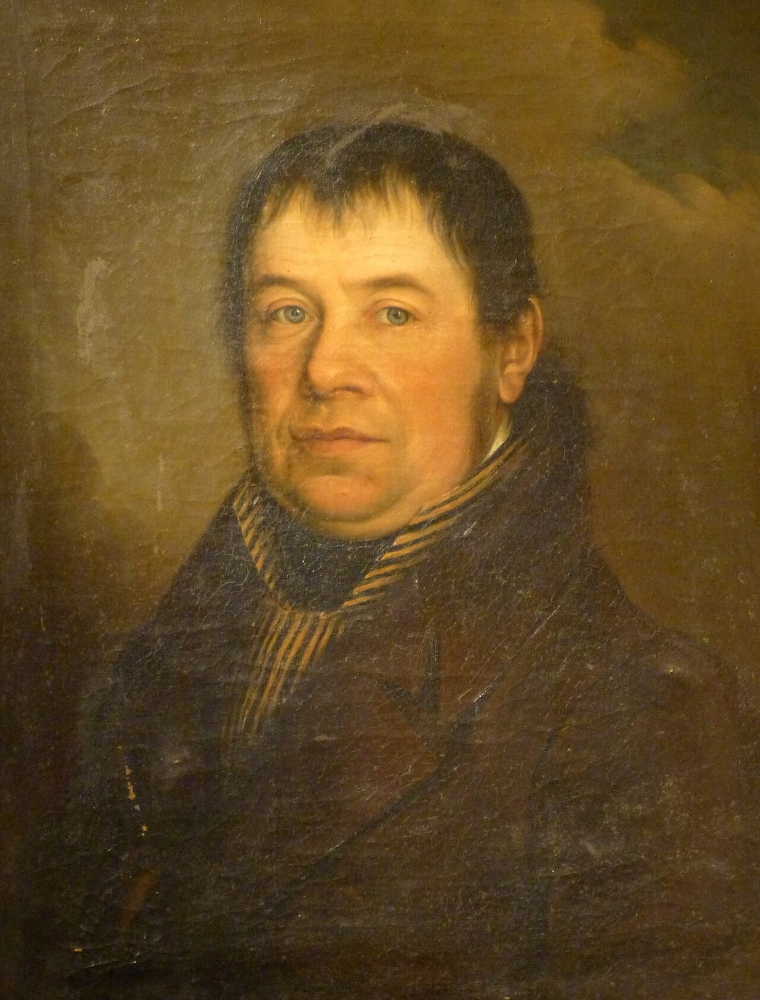

# Josef Groll

Josef Groll (1813–1887) was a Bavarian brewer and the founding figure of the modern Pilsner lager. In 1842 the citizens of Plzeň, a Bohemian city in the Austrian Empire, decided to build a municipal brewery that could compete with Bavarian beer. They hired Groll from Bavaria. In October 1842 he brewed the first golden, clear, long-lasting lager using Plzeň's soft water, Saaz hops, Moravian barley and bottom-fermenting yeast. The beer later became known as Pilsner Urquell and changed European taste.

Figure: Portrait of Josef Groll. Image: Wolfgang Sauber, CC BY-SA 4.0, via Wikimedia Commons ([source page](https://commons.wikimedia.org/wiki/File:BIB_-_Portrait_Groll.jpg)).

## Why Plzeň needed a Bavarian brewer

In the nineteenth century Bohemia was part of the Habsburg Empire. Plzeň was an industrial and commercial city with several small breweries, but quality was inconsistent. In 1838–1839 a large batch of local beer spoiled, and the citizens were furious. They raised money to build a modern municipal brewery. They wanted a "Bavarian-style" bottom-fermented, clear, keepable beer, because Bavaria had already mastered lagering in the nineteenth century.

In 1842 the brewer Josef Groll arrived from Vilshofen in Bavaria. He brought not only yeast but a complete process: pale malt, triple decoction, open fermentation and long cold maturation. Plzeň's conditions fitted perfectly: the groundwater was very soft and low in minerals, ideal for pale malt; Saaz hops gave fine aroma and clean bitterness; Moravian barley had high starch and even germination. Those conditions together produced the golden clarity of Pilsner.

On 5 October 1842 Groll brewed the first batch; on 11 November it was first served publicly at the Golden Plough inn in Plzeň. The story says the citizens came sceptically and were astonished by a golden, clear, finely foamed beer with clean bitterness. The legend has grown, but the core is clear: Plzeň's first municipal beer was completely different from the dark, cloudy, smoky beers then common.

## What he changed

First, he proved that pale lager could be stable, clear and mass-produced. Earlier lagers were often dark and cloudy; Pilsner used pale malt, soft water and cold maturation to create a golden body, making "visible clarity" a quality signal. Second, he established the process template of the Pilsner style: triple decoction, open fermentation, long cold maturation in oak casks and bottom-fermenting yeast. Today's large breweries use stainless steel and controlled temperatures, but the logic of low temperature, slow fermentation and maturation remains.

Third, he turned "Pilsner" from a place name into a style name. In the late nineteenth century breweries across Europe and America copied Pilsner, producing spellings such as Pilsener, Pilsner and Pils; by the twentieth century pale lager was the world's largest beer category. Groll did not invent lager — Bavaria had lagered beer long before — but he made the golden, clear, mass-market version.

Fourth, he left the idea of "original source". The Plzeň municipal brewery later branded itself Pilsner Urquell (Plzeňský Prazdroj, "the original source"), stressing that it was the origin of the style. The term is both a geographical claim and a brand story: styles can be copied, but water, hops and craft traditions are local.

## What to see in Plzeň

In Plzeň, look at four things. First, water: the soft, low-mineral groundwater is the base for pale malt and clean bitterness; watch the water treatment and mashing house. Second, malt and hops: the degree of pale malt kilning and the aroma of Saaz hops determine the golden body and floral notes; compare different hop varieties. Third, mashing and boiling: triple decoction is the core of the traditional process, designed to gelatinise starch, sterilise and concentrate malt flavour; modern equipment may simplify it, but the principle remains. Fourth, fermentation and maturation: open fermentation tanks, oak casks or stainless steel and cold cellars determine clarity and foam.

Drink Pilsner for more than bitterness. A good Pilsner has malt sweetness, floral and herbal hops, clean bitterness and lasting foam; serve at 6–8°C in a tall glass or tulip, with Czech roast pork, bread, sausage, fried cheese and fish. For bottles and cans, watch the expiry date and keep them away from light; hop aroma fades with time.

## Disputes and common misreadings

First, Groll did not invent lager. Bavaria had bottom fermentation and cold cellaring in the fifteenth and sixteenth centuries, long before 1842; his contribution was the pale, clear, stable Pilsner lager, not lager itself. Second, he was not the sole creator of Pilsner beer. The citizens, maltsters, hop merchants, coopers, yeast cultivators and later brewers all took part; making one man the whole story erases collective work.

Third, Pilsner was not the world's first pale beer. Europe already had pale wheat beers and other light beers; Pilsner's distinctiveness is bottom fermentation, clarity, stability and mass production, not colour alone. Fourth, Pilsner Urquell is not Groll's private brand. It belongs to the company that grew from the municipal brewery; Groll worked there only until 1845 and then returned to Bavaria.

Fifth, Groll's dates and spelling vary. He was born on 21 August 1813 and died on 22 November 1887; both Josef and Joseph appear in German sources. Sixth, Pilsner's success was not only the recipe. Railways, glass bottles, ice and advertising all mattered; in the late nineteenth century the beer went global through industrial infrastructure and export networks, not a single secret formula.

## Place in this atlas

Groll connects three threads. The first is the style and craft of [beer](ref:beer): lager, bottom fermentation, pale malt, Saaz hops, triple decoction and cold maturation. The second is the beer history of [Czechia](ref:czechia): Plzeň, Prague and the Bohemian malt and hop regions. The third is the transfer of [Bavarian](ref:bavaria) technology: from Munich and Vilshofen to Plzeň, and how Bavarian brewers carried lagering into Central Europe.

To follow how lager conquered the world, compare Munich's Oktoberfest, Heineken, Asahi and Tsingtao. To follow how local water defines a style, read about Plzeň's soft water and Saaz hops. To follow how migrant brewers changed industries, compare German brewers in the United States, Mexico and Brazil. Groll is not an isolated inventor; he is a product of nineteenth-century Central European industry, railways and brewing science.

## See also

- [Pilsner Urquell Brewery](ref:brewery): Plzeň, Pilsner Urquell, craft and visits.
- [Beer](ref:beer): lager, bottom fermentation, malt, hops and tasting.
- [Czechia](ref:czechia): Plzeň, Prague and the Bohemian beer geography.
- [Bavaria](ref:bavaria): Munich, the lagering tradition and Groll's home town of Vilshofen.

For Josef Groll, begin with the period and the role. Then look at the documented work, and finally ask the sources behind the claim. The answers point to different choices, not to a single score.

[Pilsner Urquell Brewery: Where the Golden Lager Was Born](ref:brewery) and [Czech Republic](ref:czechia) are the nearest useful comparisons: one clarifies role, the other tests period.
