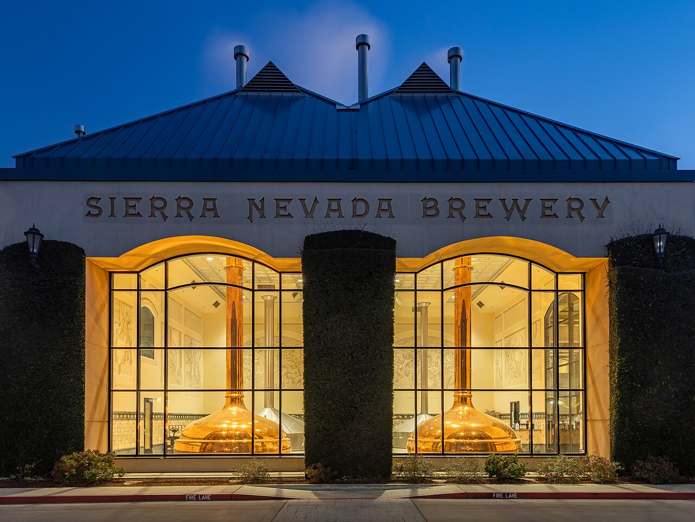

# Ken Grossman

Ken Grossman (born 1955) is the founder of Sierra Nevada Brewing and a representative figure in the transformation of American craft beer from a garage hobby into a national industry. His path had no estate-wine glamour: he bought a homebrew kit as a teenager, opened a homebrew shop in Chico, California, in 1976, and in 1980 assembled a brewhouse from used dairy equipment, salvaged pipe and second-hand valves. What made him famous was a Pale Ale built on Cascade hops.

Figure: Sierra Nevada's Chico brewery at blue hour; a brewery scene, not a portrait of Ken Grossman. Image: Frank Schulenburg, CC BY-SA 4.0, via Wikimedia Commons ([source page](https://commons.wikimedia.org/wiki/File:Sierra_Nevada_Brewery,_Chico,_during_blue_hour.jpg)).

## Early life and the homebrew shop

Grossman grew up in California and became fascinated by fermentation and machinery as a teenager. In 1969 he bought his first homebrew kit and hid it from his mother; in 1976 he opened The Home Brew Shop in Chico, selling ingredients while testing recipes in five-gallon batches. The shop connected him to local hobby brewers, farmers and equipment dealers, and showed him that the problem was not only taste but a supply chain dominated by large breweries. In 1980 he and Paul Camusi founded Sierra Nevada Brewing Co. in a Chico warehouse.

## 1980: starting with scrap

American brewing was near a historic low in 1980. Only a few dozen traditional breweries survived, and store shelves were dominated by pale lager. Grossman had no money for new equipment, so he scoured scrapyards and closed dairies for stainless tanks, pipe and valves, welding and plumbing the system himself. On 15 November 1980 the first batch was a stout. He soon shifted focus to a heavily hopped Pale Ale with pine and citrus aromas.

## Signature releases

Sierra Nevada Pale Ale is the central work. It uses whole-cone Cascade hops, has a bright aroma and a substantial bitterness, yet retains balance from caramel malt. In 1983 it placed first in the consumer vote at the second Great American Beer Festival; it became a benchmark for American pale ale and cleared a path for the later IPA boom. Celebration IPA, first released in 1981, was one of the brewery's earliest IPAs; Torpedo and later beers pushed hop intensity further.

## Method and institutions

Grossman's contribution was not only recipes. He made “fresh, whole-cone, origin-known” hop sourcing a brand principle. He insisted on breweries in both Chico and Mills River, North Carolina, close to ingredients and markets, and refused to sell the company to a large group, keeping it 100% family-owned. In 1988 the brewery moved to a 100-barrel brewhouse, lifting both volume and consistency; in 2014 the Mills River plant opened, carrying West Coast craft beer into the Southeast. Sierra Nevada also became a model for large craft-brewery sustainability through solar power, fuel cells, closed-loop water use and spent grain for cattle.

## Assessment and disputes

Supporters place him alongside Fritz Maytag and Jack McAuliffe as an American craft-beer pioneer, arguing that he turned hop aroma from a British import specialty into an American everyday pleasure. Critics note that Sierra Nevada's success depended on the market window after 1980, national distribution and economies of scale that later entrants could not easily copy; Pale Ale's benchmark status may also crowd out other styles. Grossman prefers to describe success as “stubbornly doing the same thing well”: from the first stout in 1980 to two large plants in the 2020s, the recipe can be adjusted, but hop freshness and bottle-conditioned texture cannot be lost.

## Common misreadings

First, Sierra Nevada was not founded in 1979. The official account begins with the first brew on 15 November 1980, though some sources count the preparation period. Second, Pale Ale is not a pale lager. It is a top-fermented pale ale with noticeably higher hop aroma and bitterness. Third, “family-owned” does not mean “never expanded”. The company built plants in two states and operates at regional scale. Fourth, Cascade was not bred by Grossman; it was developed by USDA and Oregon/Washington experiment stations, and he was one of the first to make it a signature.

**Short definition:** Founder of Sierra Nevada Brewing (born 1955), who opened a homebrew shop in Chico in 1976 and built a brewery from scrap dairy equipment in 1980; Cascade hops and Pale Ale helped drive the American craft-beer revolution, and the company remains family-owned. 

To read Ken Grossman, start with the period and the role, then the documented work, then the sources behind the claim; no single check settles it.

[Pale Ale](ref:pale-ale) and [Craft beer](ref:craft) answer different questions about Ken Grossman: role and period. Read them as a pair, not as alternatives.

Grossman founded Sierra Nevada Brewing in 1980 and helped drive the American craft-beer revival.

**Key facts.**

| Item | Detail |
| --- | --- |
| In one line | Founder of Sierra Nevada Brewing (born 1955), who opened a homebrew shop in Chico in 1976 and built a brewery from scrap dairy equipment in 1980; Cascade hops and Pale Ale helped drive the American craft-beer revolution,… |
| Life | 1955–? |
| Roles | brewer、brewery founder、entrepreneur |
| Regions | united-states |

**Sources and limits.** The key claims about Ken Grossman are checked against the following sources: Sierra Nevada Brewing Co., Wiley, Oxford University Press (Used to check American pale ale, Cascade hops and craft-beer style background; no entry copied). Prices, batches and status change; the body is project-written and does not reproduce source text.

## Further reading

Sierra Nevada's official history treats 15 November 1980 as the first brew, while the Pale Ale page makes the 1983 GABF first place the turning point. Grossman's book *Beyond the Pale* adds equipment, debt and partnership detail. The official account leans toward hero-founder narrative; the book is more willing to discuss failure and accident. Read together, they show that craft beer's rise depended on personal persistence and on a structural opening in the 1980s American beer market. Pale Ale's technical detail also matters: two-row pale malt, whole-cone Cascade and a long dry-hop, followed by cold conditioning. That “heavy hop, light body” combination became the shared grammar of American pale ale and IPA. The brewery's obsession with hop freshness also drove supply-chain innovation: long-term grower contracts, harvest-time lot selection and refrigerated shipping were uncommon in the 1980s, yet they made Cascade's citrus character reproducible. After the move to a 100-barrel system in 1988, Grossman kept a small pilot line for new hops and recipes, a “small lab inside a large brewery” that preserved innovation as the company grew.

## See also

- [Pale ale](ref:pale-ale): Sierra Nevada's core style.
- [IPA](ref:ipa): the later escalation of hop intensity.
- [Craft beer](ref:craft): the market category Grossman helped define.
- [Beer](ref:beer): the base entry to ingredients, fermentation and hops.
- [Brewers Association](ref:brewers): the industry body behind craft definitions and statistics.
