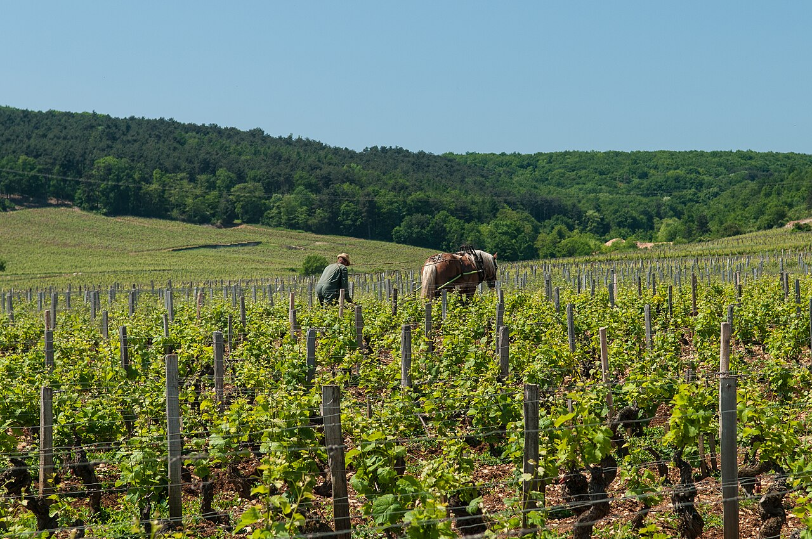

# Lalou Bize-Leroy

Lalou Bize-Leroy (born 1932) is one of Burgundy's most watched and most mythologised figures. Born Marcelle Leroy, she was the daughter of Henri Leroy, a Maison Leroy négociant and a shareholder in Domaine de la Romanée-Conti. She took over the family merchant business at twenty-three, later entered DRC management, and in 1988 bought two vineyard holdings to create Domaine Leroy. Her name now stands at once for top-level négociant wine, biodynamics and an extreme practice of very low yields.

Figure: A vineyard worker tilling the soil by hand near Vosne-Romanée; manual cultivation of the kind biodynamics emphasises, not a portrait of Lalou Bize-Leroy and not her own parcel. Image: Michal Osmenda from Brussels, Belgium, CC BY 2.0, via Wikimedia Commons ([source page](https://commons.wikimedia.org/wiki/File:A_vineyard_worker_manually_tills_the_soil_near_Vosne-Roman%C3%A9e_in_Burgundy_(7309839432).jpg)).

## Family and early career

Lalou was born in Paris in 1932 into a family tied to Burgundy merchants, vineyards and DRC. In 1955 her father handed her the Maison Leroy business; she began tasting and buying wine house by house in Burgundy, training an unusually strong sensory memory. In 1971 she became managing director of Maison Leroy; in 1974, after her father retired, she co-managed DRC with Aubert de Villaine. At DRC she handled marketing and some selection, and saw how top parcels were redefined in the 1970s; the experience later made her insist on complete control from vine to bottle.

## From merchant to estate owner

Maison Leroy is a négociant, not an estate: it buys grapes or finished wine and sells under its own label. Lalou soon found that fewer and fewer wines met her standard, so she decided to own vineyards. In 1988 she bought the Charles Noëllat holding in Vosne-Romanée and the Philippe Rémy holding in Gevrey-Chambertin, combining them into Domaine Leroy. From September 1988 the entire domaine was converted to biodynamics.

## Signature releases

Domaine Leroy's flagships include Musigny, Richebourg, Romanée-Saint-Vivant and Chambertin, alongside premiers crus and village wines. Its style is often described as concentrated, fine-textured and complex: low yields, old vines, a proportion of whole-cluster fermentation, long maceration and strict sorting produce an almost extracted expression. The domaine now covers about 22 hectares across more than twenty appellations, including nine grands crus; average yields are often below 20 hectolitres per hectare, roughly half the legal maximum. Domaine d'Auvenay, her other estate, is smaller and even rarer.

## Method and institutions

Lalou's method has three keywords. The first is massal replanting: rather than tearing out a whole block and replanting, she selects buds from old vines in the same parcel and replaces individual plants, preserving genetic diversity. The second is no hedging: vines grow naturally instead of being trimmed flat, maintaining photosynthesis and plant vigour. The third is the calendar: pruning, sprays and bottling follow biodynamic dates. She did not invent biodynamics, but she took it to an extreme in Burgundy's highest-value estates.

## Assessment and disputes

Supporters call her the “queen of Burgundy” and argue that she proved biodynamics could produce some of the world's most expensive wine and that a négociant could become a landowning estate. Critics focus on three points: the scientific controversy around biodynamics; the risk of extreme low yields and late picking, illustrated by the heavy downy-mildew losses of 1993; and the way the “Lalou myth” reinforces prices and scarcity, so the collector market sometimes overwhelms discussion of the wine itself. In 2026 Decanter inducted her into its Hall of Fame, an institutional recognition of the method. After she left DRC in 1992, her daughter Perrine Fenal took over her co-management role there while Lalou concentrated on Maison and Domaine Leroy; the split also marked the family's move from “co-manager” to “independent estate owner”.

## Common misreadings

First, Domaine Leroy is not Maison Leroy. The domaine owns vines and farms and makes its own wine; the maison is a négociant that buys wine or grapes. Second, biodynamics is not “no intervention”. It is a strict farming and preparation system with plenty of intervention. Third, Lalou was not DRC's sole manager. She co-managed with Aubert de Villaine from 1974 to 1992. Fourth, “low yield” is not merely a marketing number. Her yields are indeed far below the legal maximum, but that also magnifies vintage variation and risk.

For Lalou Bize-Leroy, begin with the period and the role. Then look at the documented work, and finally ask the sources behind the claim. The answers point to different choices, not to a single score.

Read [Burgundy](ref:burgundy) for the role side of Lalou Bize-Leroy, and [Burgundy AOC Decree](ref:aoc) for the period side. Together they locate it.

**At a glance:** Burgundy merchant and estate owner (born 1932); she took over Maison Leroy in 1955, co-managed Domaine de la Romanée-Conti from 1974 to 1992, founded Domaine Leroy in 1988 and converted it to biodynamics, influencing modern Burgundy through extremely low yields, massal selection and strict sorting.

**Key facts.**

| Item | Detail |
| --- | --- |
| In one line | Burgundy merchant and estate owner (born 1932); she took over Maison Leroy in 1955, co-managed Domaine de la Romanée-Conti from 1974 to 1992, founded Domaine Leroy in 1988 and converted it to biodynamics, influencing mod… |
| Life | 1932–? |
| Roles | wine merchant、estate owner、biodynamic advocate |
| Regions | France、Burgundy |

**Sources and limits.** The key claims about Lalou Bize-Leroy are checked against the following sources: Domaine Leroy, Made By Magazine, The En Primeur Club and 5 sources in total. Prices, batches and status change; the body is project-written and does not reproduce source text.

## Further reading

Domaine Leroy's official page supplies the family history, DRC tenure and biodynamic turn; Decanter's 2026 Hall of Fame coverage and industry profiles add the 1988 purchases, the 1992 departure from DRC, massal replanting and the 1993 mildew losses. SommSelect's article represents the collector-market view, which easily confuses scarcity with quality. Reading the official timeline, trade reporting and market narrative separately makes clear where Lalou's method ends and the myth begins. Biodynamic practice includes preparations 500 and 501, compost work and lunar calendars; these were not invented in Burgundy, but Lalou combined the system with top parcels and extremely low yields, producing what is now discussed as the “Leroy style”. After 1992 her daughter Perrine Fenal took over the DRC co-management role, while Lalou returned full-time to Maison and Domaine Leroy. The 2026 Decanter honour widened her influence from “expensive wine” to a triple narrative of women, biodynamics and family négociants.

## See also

- [Burgundy](ref:burgundy): the region of all her work.
- [Pinot Noir](ref:pinot): the variety behind Domaine Leroy's reds.
- [Burgundy AOC](ref:aoc): the institutional background for parcel hierarchy and yield limits.
- [Burgundy grands crus drive](ref:burgundy-route): the travel framework from Beaune to Vosne-Romanée.
- [Vosne-Romanée](ref:vosne): the home of Domaine Leroy's core parcels.
