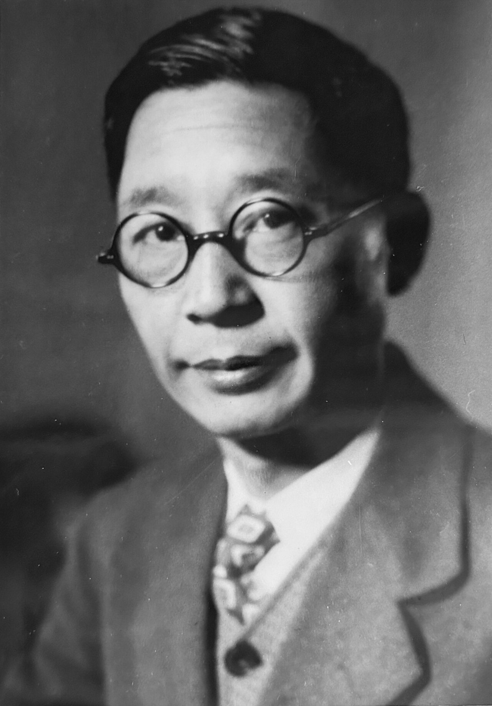

# Lao She

Lao She (1899-1966), original name Shu Qingchun, courtesy name Sheyu, was a Beijinger of Manchu descent. He wrote about ordinary people in the city and about how they negotiated business, friendship, quarrels and reconciliation around a table. Wine is rarely the lead in his work, but it often tests a person's situation: who is allowed to drink, who is forced to drink, and what is said afterwards matter more than the drink itself.

Figure: Lao She. Image: Shelburne Studios, Public domain, via Wikimedia Commons ([source page](https://commons.wikimedia.org/wiki/File:Standard_compressed_lao-she.jpg)).

## Life

He was born on 3 February 1899 and grew up in the hutongs of Beijing. In 1924 he went to Britain to teach in the Chinese department of the School of Oriental Studies at the University of London, leaving in 1929 and returning to China in 1930. In the summer of 1936 he finished Camel Xiangzi, which began serial publication in September of that year. In 1957 he published the three-act play Teahouse, first staged by the Beijing People's Art Theatre in 1958. He died in August 1966.

His language is built on Beijing speech: clean, sharp and humorous. He neither looks down on ordinary people nor beautifies them, and this gives teahouses and wine shops a voice.

## Relationship with wine

Lao She is not a writer known as a heavy drinker, and the reliable record does not support claims of daily drinking. Friends' memoirs contain fragments, but not enough to justify conclusions about his tolerance or habits. This profile does not turn such anecdotes into biography; it concentrates on the drinking spaces and drinking relationships in his work.

Start with the period and the role. From there, consider the documented work, then the sources behind the claim. That is how a practical judgment about Lao She is built.

## Images of drink in the work

Camel Xiangzi contains two drinking scenes that can be checked directly. Xiangzi buys four liang of baijiu and three coppers' worth of peanuts from a small shop, carries the bowl back to his room to warm himself, and the narrative notes the sharp smell of the spirit on the table. Here wine is fuel for a labourer and the cheapest anaesthetic in a poor life.

The other scene is Hu Niu pressing Xiangzi to drink. He says, "I don't drink!" She answers that she herself can still manage four liang, swallows most of the cup, and pushes it at him. Wine in this relationship is not hospitality but a test, a form of pressure and control; Xiangzi's refusal is an attempt to keep a little independence.

The opening stage direction of Teahouse states that the place sells tea and simple snacks and rice dishes. The teahouse does not live on wine, yet it belongs to the same kind of public space as a wine shop: people from every walk of life meet there, news is exchanged, and conflict breaks out. Wine is often absent from Teahouse, and that absence is itself significant.

## Key works and textual evidence

Camel Xiangzi, serialised from 1936, follows the rickshaw puller Xiangzi in Beiping, and wine is part of the city's lower-class life. Teahouse, published in 1957, uses three acts in the Yutai Teahouse to cover the late Qing, the Republican era and the years after the war against Japan; the space stays fixed while the characters change with the times. Four Generations under One Roof describes a Beijing alley during the Japanese occupation, and wine appears in family and neighbourhood exchanges. Beneath the Red Banner was left unfinished but preserves details of Manchu household etiquette and food and drink.

Quotation requires attention to edition: Teahouse exists in different stage and edited versions, and the serial text of Camel Xiangzi differs from later book editions. A study should name its text and not mix lines from different versions.

## The era and its wine

In late Qing and early Republican Beijing, small wine shops flourished. Establishments known as "big wine jars" sold wine with simple dishes; customers stood or sat, prices were low and sessions long, and labourers and neighbours were regulars. Baijiu, yellow wine and sweet herb-infused wines each had their consumers, and [baijiu](ref:baijiu) was especially common in northern cities, where a measure of white spirit was an ordinary way to warm up in winter.

The relation between [wine shops and the city](ref:pub-and-city) is clear: a wine shop is connected to hutongs, markets, offices and opera houses, so it works as a window on urban structure. [The history of taverns](ref:taverns) shows that public drinking spaces change with institutions, and late Qing and Republican [China](ref:china) is the coordinate for those changes.

## Reputation and controversy

Lao She's death is a controversy that cannot be avoided when reading his work. English Heritage puts it carefully: after the Cultural Revolution began in 1966 he was persecuted by the Red Guards, his body was found in Beijing's Lake of Great Peace on 25 August, and it is widely believed that he took his own life. Accounts of the exact sequence differ, and a responsible citation should keep that caution rather than turn inference into certainty.

Teahouse also has a structural limitation: it spans half a century in three acts, with many characters and no single protagonist. This "scroll" structure is both an achievement and a barrier, and stage versions can change how audiences judge the characters.

## Common misreadings

First, treating Teahouse as a "wine-shop play". It is about a teahouse, and wine is only a reference to a related public space; the teahouse sells tea and simple food, not drink in the same sense.

Second, taking anecdotes about Lao She's own drinking as the theme of his work. The work is concerned with social relations, not the author's capacity.

Third, turning street life into nostalgia. His characters calculate and struggle; the writing is not a warm filter.

Fourth, ignoring edition differences. A play changes in performance and editing, and a novel may differ between serial and book versions; quotations should name their source.

## How to read his drinking scenes

Ask who buys the wine, who pours it and who refuses it; then locate the drinking place in the city; finally look at what follows. Read this way, the white spirit in Camel Xiangzi is evidence of poverty and constraint, and the tea and food in Teahouse are clues to how a public space is squeezed by the times.

**At a glance:** A modern Chinese novelist and playwright, 1899 to 1966, a Beijinger of Manchu descent. His fiction and drama turn teahouses, wine shops and courtyard compounds into slices of history, and Camel Xiangzi and Teahouse contain verifiable drinking scenes; reliable records of his own drinking are limited and should not be exaggerated. 

[Reading a city through its bars](ref:pub-and-city) and [Baijiu](ref:baijiu) are the nearest useful comparisons: one clarifies role, the other tests period.

## Further reading

- [Wine shops and the city](ref:pub-and-city): how wine shops are embedded in urban life.
- [The history of taverns](ref:taverns): historical change in public drinking spaces.
- [Baijiu](ref:baijiu): the distilled spirit common in northern cities.
- [China](ref:china): the urban background of late Qing and Republican Beijing.
