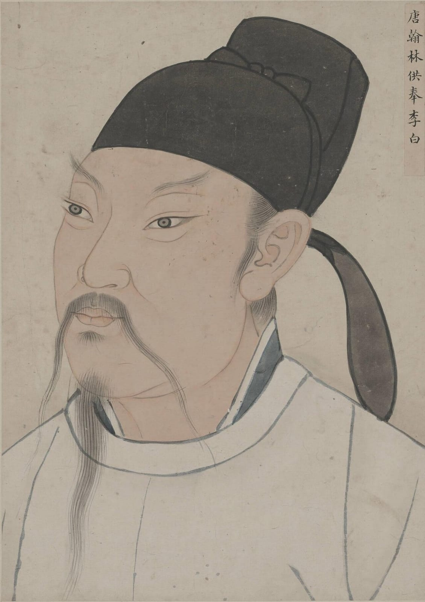

# Li Bai

Li Bai (701-762), courtesy name Taibai and self-styled Qinglian Jushi, is one of the most representative poets of the high Tang. His name is almost tied to “wine”: later portraits, opera and popular books often present him composing poetry while drunk. But the historical Li Bai and the literary figure of the “wine immortal” are not the same thing. To understand his wine poems, we need to look at the texts, at the drink of Tang times, and at how later generations shaped him.

Figure: Portrait of Li Bai from the anonymous album Tang Officials. Image: Unknown author, Public domain, via [source page](https://commons.wikimedia.org/wiki/File:%E5%94%90%E5%90%8D%E8%87%A3%E5%83%8F-14-%E5%94%90%E7%BF%B0%E6%9E%97%E4%BE%9B%E5%A5%89%E6%9D%8E%E7%99%BD.jpg).

## Life

Li Bai was born in 701 and died in 762. Accounts over the centuries do not fully agree on his birthplace and family background; common claims include Jiangyou in Sichuan and Suyab in the Western Regions, and scholars still debate them. He left home early to travel widely, later served in the Hanlin Academy in Chang'an, and left after political disappointment. During the An Lushan rebellion he was charged for joining the staff of Prince Yong, and in his late years he was exiled to Yelang, receiving a pardon on the way.

His poetry is known for extraordinary imagination and free-flowing language, with celebrated pieces among yuefu, gexing and quatrains. He is paired with Du Fu as “Li and Du”, the most common shorthand for the peak of Tang poetry. His travels crossed what are today [China](ref:china)'s Sichuan, Hubei, Henan, Shandong, Anhui and Jiangxi, and this long mobility also entered his poems.

## Poetry and wine

In Li Bai's poems, wine is first of all a setting. Banquets, farewells, drinking alone, climbing high and night outings may all involve wine; wine links the people, the time and the place. Second, wine is a medium of emotion: it can magnify boldness and also magnify solitude; it can stand for seizing the day and also for sensitivity to time passing.

Third, wine is a social language. Raising a cup, urging a drink, asking a guest to stay and giving a farewell feast were all part of how Tang scholars associated with one another. The wine in a poem was not necessarily drunk in fact, but the act of “raising the cup” is enough to bring the reader into a particular meeting or parting.

Keep these layers apart, and you will not read every mention of “wine” as heavy drinking, nor read every wine poem as the same emotion.

## Wine in “Bring in the Wine”

“Bring in the Wine” (Jiang Jin Jiu, 将进酒) is one of Li Bai's most often quoted wine poems. “Do you not see the water of the Yellow River come down from heaven, rush to the sea and never return” turns time into an irreversible flow; “When life brings success, take your joy to the full; do not let the golden goblet face the moon empty” turns drinking into an answer to time. The “golden goblet” and the “dou of wine” are literary measures and vessels; there is no need to convert them word by word into present-day volumes.

The tone of the poem is an invitation to drink and also self-persuasion. It says “I would only be forever drunk and never wake”, while placing bold words beside disappointment; a reader who takes only “when life brings success, take your joy to the full” loses the mixed feeling of the second half. When quoting, naming the title and the source is more responsible than posting a single striking line.

## What people drank in the Tang

The dominant drink of the Tang was grain-fermented wine: qu was used to saccharify and ferment the starch in grain, followed by pressing or filtration. Such drinks generally had a lower alcohol content than distilled spirits and tasted sweeter, and they kept for a limited time, which is why words such as “newly strained” and “spring wine” appear. The technical lineage of [yellow wine](ref:yellow-wine) has points in common with these grain drinks, but today's yellow wine cannot be equated directly with the drink of the Tang.

[Wine](ref:wine) was foreign or rare in Tang times, appearing mostly in records connected with the Western Regions and in a small number of poems; “grape wine in the luminous cup” comes from a Liangzhou lyric and does not mean it could be bought anywhere on the streets of Chang'an. Whether distilled spirits were already widespread in the Tang is disputed among scholars; the safe statement is that fermented drink remained the main everyday drink.

## Several functions of wine in poetry

The first is farewell. A cup raised at a farewell feast gives the parting a moment in which it can pause; the amount of wine, the vessels and the weather in the poem often convey the feeling better than the word “reluctance”.

The second is drinking alone. Drinking alone narrows the outside world until only a person and the moon, a shadow or a cup remain; wine in such poems is not festivity but a tool for talking to oneself.

The third is banqueting and social life. Drinking games, song and dance, seating order and urging others to drink make up the order of a gathering; the poem records not only what was drunk but who was present, who got drunk first and who was writing.

The fourth is time. Wine lets a person leave daily life for a while and also makes “this moment” clear; when a poet speaks of seizing the day, there is often an awareness of brevity and impermanence behind it.

## Common misreadings

First, taking “a hundred poems from a dou of wine” as a precise capacity for drink. The dou is an ancient unit of volume, measures differed between dynasties, and vessel capacities differ from those of today; the line is literary exaggeration, not a medical report.

Second, taking “wine immortal” as an established historical fact. Later painting, opera and liquor advertising together shaped this image; it reflects cultural imagination, not Li Bai's actual daily consumption.

Third, reading all wine poems as a single emotion. Li Bai's wine poems include boldness, solitude, social obligation and self-mockery; discussing “Li Bai and wine” apart from particular poems easily turns into a label.

Fourth, imagining Tang poetry through today's baijiu. The mainstream drink of the Tang was a low-strength grain wine, and mapping the “golden goblet” directly onto today's 52-degree baijiu is a mismatch.

## How to read Li Bai's wine poems

Look first at the title and the circumstances of writing, then at where wine appears in the poem: at the opening, at a turn or at the end. Wine at the end is often where the emotion lands; wine at the opening often pulls the reader into the scene. Then look at vessels and measures: golden goblet, jade bowl, dou, cup are both objects and rhetorical devices.

Finally, look at the other images that appear alongside: moon, water, sword, horse, song, friends. Wine rarely appears alone; it is always set beside something else, and the relationship between them is where the poetry lies. If you want to quote, name the edition and the title, and avoid mixing lines from different versions.

## Influence and the later image

Li Bai's influence on later ages lies half in the poetry and half in the image. The poetry offered a language of boldness, imagination and freedom from constraint; the image was continually recreated: the drunken academician, the immortal in wine, the traveller with a sword. The drinks industry, painting, opera and popular culture have all drawn on it.

This image helps spread his fame, and it also obscures. It makes “Li Bai” easy to recognise, but it can make people forget his political setbacks, his family life and the specific circumstances in which he wrote. Putting the person back into history is not about tearing down the legend; it is about giving the legend ground that can be checked.

**Short definition:** A poet of the high Tang, 701 to 762; wine in his poetry is both a setting for banquets and farewells and a metaphor for solitude, time and ambition. Reading his wine poems means separating the literary figure from the drink actually consumed in Tang times.

For Li Bai, begin with the period and the role. Then look at the documented work, and finally ask the sources behind the claim. The answers point to different choices, not to a single score.

[Time in a cup](ref:time-in-a-cup) and [Wine](ref:wine) are the nearest useful comparisons: one clarifies role, the other tests period.

## Further reading

- [Time in a cup](ref:time-in-a-cup): from the Book of Songs to Tang poetry, how wine enters the seasons and writing.
- [Drinking Alone under the Moon](ref:drinking-alone): the moon, the shadow and wine in Li Bai's poem of solitary drinking.
- [Asking Liu](ref:asking-liu): Bai Juyi's short poem inviting a guest with wine, useful as a contemporary comparison.
- [Yellow wine](ref:yellow-wine): the technical lineage of grain-fermented wine.
- [Wine](ref:wine): the definition and basic craft of wine.
