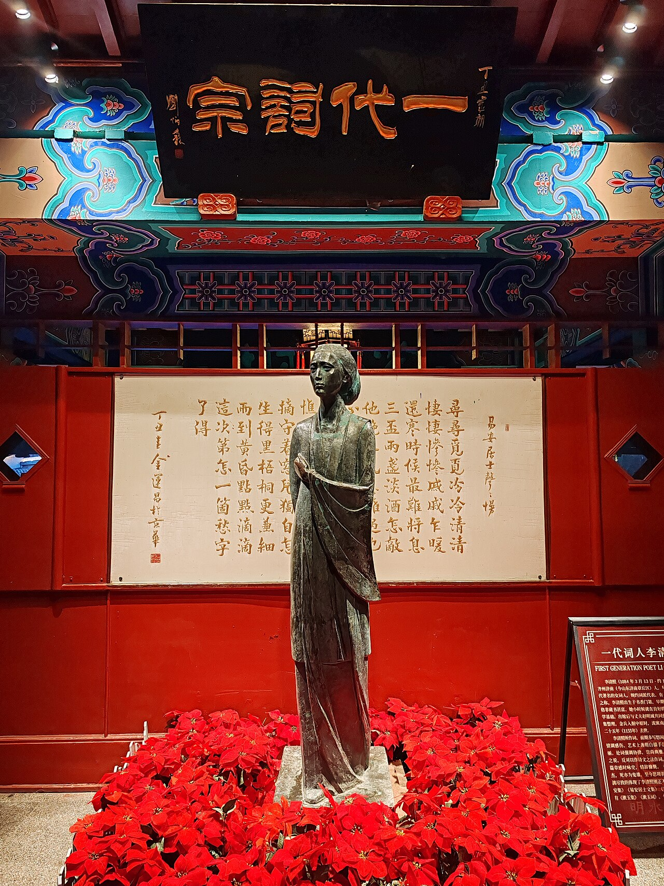

# Li Qingzhao

Li Qingzhao (1084 – c. 1155), known as Yi'an Jushi, came from Zhangqiu in Qi Prefecture and is the most celebrated woman poet of the Song dynasty. Wine appears very often in her lyrics, but the two halves of her life sound different. Before the fall of the north, wine belongs to outings, flowers and idle sorrow; after the court fled south, it belongs to solitude, memory and a life that cannot be recovered. The same cup keeps getting colder.

Figure: Li Qingzhao. Image: Vitsuha, CC0, via Wikimedia Commons ([source page](https://commons.wikimedia.org/wiki/File:%E6%9D%8E%E6%B8%85%E7%85%A7%E5%A1%91%E5%83%8F.jpg)).

## Life

Li Qingzhao was born in 1084. Her father, Li Gefei, was a vice director in the Ministry of Rites and one of the "four later masters" around Su Shi; her mother also came from a scholarly family. She read widely as a child and wrote both prose and verse, but her fame rests on her ci, collected as Rinsed Jade Lyrics.

In 1101 she married Zhao Mingcheng, a student at the Imperial Academy who became an epigrapher. Together they collected bronzes, stone inscriptions, calligraphy and painting, and their life was comfortable but busy. In 1107 Zhao Mingcheng's father, Zhao Tingzhi, fell from power and died, and the family lost its position. The couple withdrew to Qingzhou for about ten years, built the Hall of Return, and devoted themselves to cataloguing and collating their collection.

In 1127 the Jingkang crisis ended the Northern Song, and they fled south, losing much of the collection on the way. In 1129 Zhao Mingcheng died at Jiankang on his way to take up the prefecture of Huzhou, aged forty-nine. Li Qingzhao then moved alone through the Yangtze delta, in increasingly hard circumstances. In 1134 she wrote the postface to Records on Metal and Stone, recounting how the couple had built the collection and how it was scattered; it is the most important first-hand account of her life.

## Timeline

- 1084: born at Zhangqiu in Qi Prefecture.
- 1101: marries Zhao Mingcheng.
- 1107: the Zhao family loses power; the couple withdraws to Qingzhou for about ten years.
- 1127: the Jingkang crisis; she moves south with the court.
- 1129: Zhao Mingcheng dies at Jiankang.
- 1134: writes the postface to Records on Metal and Stone.
- Around 1155: dies; the exact year is given variously as 1151, 1155 or 1156.

## Marriage and the Move South

Li Qingzhao's marriage is often described as a perfect literary partnership, but the sources show something more complicated. The Qingzhou decade was the period of closest collaboration: they saved to buy rubbings and inscriptions, collated and annotated them, and while Zhao Mingcheng wrote Records on Metal and Stone, Li Qingzhao took part in the sorting. That decade gave her the material she later remembered, and it gave her something specific to lose.

The move south changed everything. After Zhao Mingcheng's death in 1129 she fled with the surviving pieces of the collection, and suffered theft and accusation along the way. In the postface she describes how she protected the objects through the chaos; the tone is restrained, the detail painful. Afterwards her lyrics are full of "in those days", "that year" and "now". This is not a stylistic tic; her life really was cut in two.

## Relationship with Alcohol

Li Qingzhao seldom writes of heavy drinking. She writes of what follows: being drunk, waking, the wine left over, the wine gone thin. Wine is how she marks time. What one drinks in spring, what one drinks on the Double Ninth, whether one still drinks at the Lantern Festival, all depend on the situation.

## Drink in Her Works

The first "Like a Dream" remembers an outing: "Often I remember the pavilion by the stream at dusk, so drunk I did not know the way home. When my pleasure was spent I rowed back late and blundered into the depths of the lotus. Fighting my way through, fighting my way through, I startled a sandbank full of gulls and egrets." The drunkenness here is light and brings not sorrow but getting lost, and then a surprise. The wine of her girlhood has a way back.

The second "Like a Dream" begins: "Last night the rain was sparse and the wind sudden; deep sleep did not clear the wine that was left. I ask the one who rolls up the blind, and she says the crab apple is as before. Do you know, do you know? The green should be fat and the red thin." The leftover wine is a hangover; the first thing she does on waking is ask about the flowers, and her judgement is more accurate than the maid's. The sadness is clear-headed, and the wine has only lengthened the night.

"Drunk under the Flowered Shadows" is set on the Double Ninth, alone: "Thin mist and thick cloud, sorrow through the long day; the incense burns down in the golden beast. The festival is the Double Ninth again; the jade pillow, the gauze screen, the chill first strikes at midnight. Holding wine by the eastern fence after dusk, a hidden fragrance fills my sleeves. Do not say it does not take the spirit out of one; the west wind rolls up the blind, and the person is thinner than the yellow chrysanthemum." Holding the wine is the action, the hidden fragrance is the chrysanthemum, and being thinner than the flower is the result. The wine solves nothing; it only helps her get through the afternoon.

"Slow, Slow Song" is set in autumn after the move south: "Three cups, two cups of thin wine, how can they hold off the evening wind?" The wine is thin and the quantity small, and it cannot even keep out the wind. "Thin" is a matter of taste and a matter of circumstance: it is not that there is no wine, but that wine no longer works.

"Joy in the Perpetual Night" is set at the Lantern Festival: "They come to invite me with fine carriages and precious horses; I thank my wine-friends and poetry-friends and decline." She refuses the invitation. Declining sociable drinking is colder than drinking alone; here wine stands for a gathering she no longer wishes to enter.

## Reputation and Disputes

The first dispute concerns a second marriage. Song dynasty sources, including Wang Zhuo's Remarks from the Green Rooster Studio and Hu Zi's Collected Remarks from the Tiaoxi Fishing Retreat, record that after Zhao Mingcheng's death Li Qingzhao remarried a man named Zhang Ruzhou and sued for divorce after ill treatment. Her own letter to the Hanlin scholar Qi Chongli contains a phrase describing herself, late in life, as matched to a base horse-dealer. Qing scholars such as Yu Zhengxie, in A Chronology of Yi'an Jushi, argued vigorously that the story was a slander by Song writers. Each side has evidence. This page treats the Song record as existing and the Qing rebuttal as serious, neither as settled fact nor as impossible.

The second dispute is her poetics. In "Discourse on Ci" she argues that ci is "a different family" from poetry, criticises Liu Yong for vulgar diction, and says that Yan Shu, Ouyang Xiu and Su Shi wrote "lines that are not even good prose, and often do not fit the music". It is one of the sharpest statements in Song poetics, and it drew return fire: some said she bound the lyric too tightly to music, others that she was too sure of her own practice. Either way, the essay shows an author with a theory, not merely a writer of sorrow.

The third dispute is attribution. Rinsed Jade Lyrics picked up poems by other hands as it circulated. "Sheng Cha Zi, Lantern Festival", with its famous opening about the lantern market of the year before, is often printed as Li Qingzhao's but is usually assigned to Ouyang Xiu or Zhu Shuzhen. Quotations must check the edition rather than assign a poem on stylistic resemblance.

## Common Misreadings

First, that every wine reference in her lyrics is the complaint of a neglected woman. Her early work has bright outings; the pronounced loneliness belongs to the later work, and the drunkenness of the first "Like a Dream" is not the thin wine of "Slow, Slow Song".

Second, that "thin wine" is a technical description of low alcohol. It is also an emotional word, stressing that wine cannot warm or console. Song wine was in any case weaker than today's spirits, but "thin" here means useless first of all.

Third, that "so drunk" records her actual capacity. Literary drunkenness is usually a state of feeling and a device of the scene, not medical data.

Fourth, that "Slow, Slow Song" sums up her whole life. It leaves out her work on the collection, her postface, and her theory of ci.

Fifth, that "Sheng Cha Zi, Lantern Festival" is hers. Its attribution is disputed and usually given to Ouyang Xiu; the point should be flagged.

## See Also

- [Time in a cup](ref:time-in-a-cup): how wine entered seasonal and literary writing.
- [Yellow wine](ref:yellow-wine): the craft lineage of Song grain wine.
- [History of Chinese wine](ref:chinese-wine-history): liquor policy and brewing over the long term.
- [China](ref:china): the geography of her life and her move south.

Further reading: [André Simon](ref:c-extra-1).

**At a glance:** Song poet, born 1084 and usually said to have died around 1155; her wine lyrics run from "so drunk I did not know the way home" to "three cups, two cups of thin wine", cooling as her life moves from Shandong to the south. 

Start with the period and the role. From there, consider the documented work, then the sources behind the claim. That is how a practical judgment about Li Qingzhao is built.
