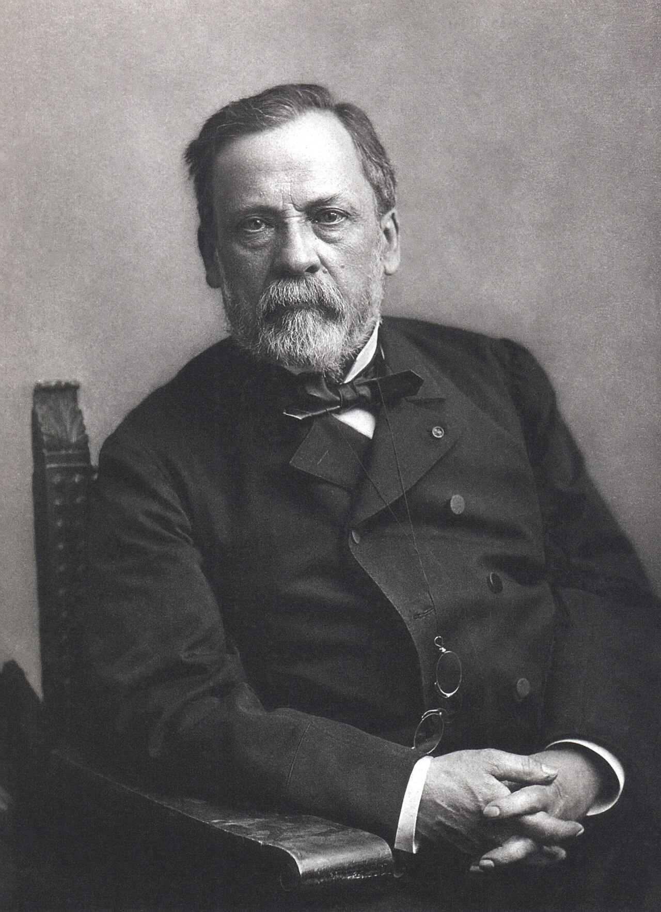

# Louis Pasteur

Louis Pasteur (1822-1895) was a French chemist and microbiologist. His name is often linked today with “pasteurisation”, but his work ranged far beyond heating food: he studied molecular asymmetry, fermentation, the theory of spontaneous generation, silkworm diseases, brewing and vaccines. For alcoholic drinks, his most important contribution was to turn fermentation from a mysterious chemical change into a process that could be explained by microorganisms and also acted upon.

Figure: Louis Pasteur. Image: Paul Nadar, Public domain, via Wikimedia Commons ([source page](https://commons.wikimedia.org/wiki/File:Louis_Pasteur,_foto_av_Paul_Nadar,_Crisco_edit.jpg)).

## Life

Pasteur was born in Dole, in the Jura region of [France](ref:france); his father was a tanner. He studied in Besançon and Paris, began in chemistry and gained attention for his work on tartaric acid crystals. He then held posts in Strasbourg, Lille and Paris, gradually turning his research towards fermentation and microorganisms.

His family life was not easy: he and his wife had five children, and only two lived to adulthood. Later writers have often used this experience to explain his commitment to disease and vaccines, but the more direct driving force came from his experiments and the needs of his time. In mid-19th-century France, brewing, vinegar making, sericulture and public health all urgently needed practical knowledge about microorganisms.

In 1888, the Institut Pasteur, named after him, was founded in Paris. The institution later became an important centre for research in microbiology, immunology and public health.

## The fermentation debate

Before Pasteur, fermentation was often explained as a kind of chemical decomposition, or believed to be the result of “spontaneous generation”. Through experiments Pasteur showed that fermentation is connected with the activity of microorganisms: when wine or a culture medium was isolated from microorganisms in the air and in dust, the speed and result of fermentation and putrefaction both changed.

This does not mean that air itself is harmful, but that microorganisms carried by the air take part. Pasteur excluded microorganisms by heating, filtration and sealing, then observed the outcome, and so pushed “spontaneous generation” towards defeat. The conclusion had a direct meaning for drink: if wine turning sour, cloudy or off-flavoured is connected with microorganisms, then controlling microorganisms can control the stability of wine.

## Pasteur and wine

In the 1860s (the 60s of the 19th century), the French wine industry faced wine turning sour and spoiling. Pasteur studied the fermentation and storage of wine and proposed that heating could kill the microorganisms that cause spoilage while damaging the wine itself as little as possible. He also studied crystals of tartaric acid and tartrates, which appear in barrels and bottles, affecting both appearance and loss.

These works did not make wine “sterile” from then on. Heating changes aroma and mouthfeel, so the more common practice afterwards was sulphur dioxide, filtration, temperature control and hygiene management. But Pasteur supplied a direction: to study the problems of wine as problems of microorganisms, rather than relying only on experience.

## Pasteurisation and beer

Pasteurisation usually means heating a liquid to a certain temperature and holding it there for a period, in order to kill pathogenic microorganisms and delay spoilage. It is not the same as boiling a liquid. Temperature, time and the object determine the effect; milk, fruit juice, beer and wine are treated under different conditions.

Beer is one of the most widespread subjects of pasteurisation. Heating can stabilise bottled or canned beer and extend shelf life, but it may also change the aroma. The modern brewing industry therefore balances “stability” against “fresh flavour”: some products choose heat treatment, some choose sterile filtration and a cold chain, and some combine the two.

For wine, pasteurisation is not a routine step in most fine wines; but historically it did offer a workable solution to the fact that “wine spoils”.

## Tartaric acid and crystals

Tartaric acid is an organic acid naturally present in grapes; during fermentation and ageing it may form tartrate crystals that attach to the walls of barrels, the bottom of bottles or corks. The crystals are usually harmless in themselves, but consumers may mistake them for impurities or fragments of glass.

Pasteur's study of tartaric acid crystals arose from his interest in molecular asymmetry. He found that certain crystals differed in optical rotation, and went on to propose a relationship between molecular structure and optical properties. This thread later became an important starting point for stereochemistry.

Handling wine thus gained another layer of understanding: sediment is not necessarily a fault; it may simply be the natural result of acids and salts under changing temperatures; whether it needs treatment depends on the type of wine, the temperature and the occasion.

## Influence on the drinks industry

First, hygiene. Pasteur's work made brewers and winemakers more clearly aware that vessels, pipes, air and raw materials may all carry microorganisms; cleaning was no longer “looking clean” but a process that could be checked by microbiology.

Second, stability. Heating, filtration, sulphur dioxide and temperature control became means of stabilising drink; which one to choose depends on the product's positioning and flavour goals.

Third, a more scientific approach. Fermentation changed from “the master's experience” into a process that can be measured, reproduced and explained; temperature curves, acidity, sugar content and microbial counts gradually entered the language of the winery.

Fourth, public health. The spread of pasteurisation in dairy products, fruit juice and beer reduced the transmission of foodborne disease. Drink is only one of its applications.

## Common misreadings

First, pasteurisation equals boiling. In practice it is heating at a lower temperature and holding it for a period, with conditions varying by liquid; boiling significantly changes flavour and nutrition.

Second, that Pasteur “invented” wine. Wine existed for thousands of years before Pasteur; he studied spoilage, fermentation and stability, not the invention of wine.

Third, that Pasteur solved all problems of spoilage in drink. Microorganisms are only one cause; oxidation, light, swings in temperature and the seal of the package can also cause problems.

Fourth, that pasteurisation makes drink completely safe. It reduces the risk from pathogenic microorganisms, but it cannot address the risks of alcohol itself, nor repair off-flavours that have already formed.

Fifth, that Pasteur studied only drink. His work on vaccines, silkworm diseases and spontaneous generation is equally important; narrowing the view to “sterilisation” misreads the range of his science.

## Scientific method and today

Pasteur's experimental method had a clear structure: propose a testable hypothesis, design an experiment that can exclude interference, then use the results to revise the hypothesis. He was not always mild-mannered, and his disputes could be sharp; but his work showed how “controlling variables” turns a vague problem into a workable answer.

Wineries and laboratories today still use this approach: first identify the change, then isolate the cause, and finally choose a means of intervention. For the ordinary drinker this means one thing: changes in the flavour of drink can be explained and can be recorded; there is no need to attribute every spoilage to “luck”.

**Short definition:** A French chemist and microbiologist, 1822 to 1895; he showed that fermentation is caused by microorganisms and proposed a method of heat treatment that kills them, with a lasting influence on wine, beer and food safety. 

## Further reading

- [Beer](ref:beer): the basics of definition, types and brewing.
- [Wine](ref:wine): the definition and basic craft of wine.
- [How does a place end up in a glass?](ref:place-and-process): the relationship between place, process and flavour.
- [Choosing your first wine](ref:first-wine): beginner steps from region and variety to price.
