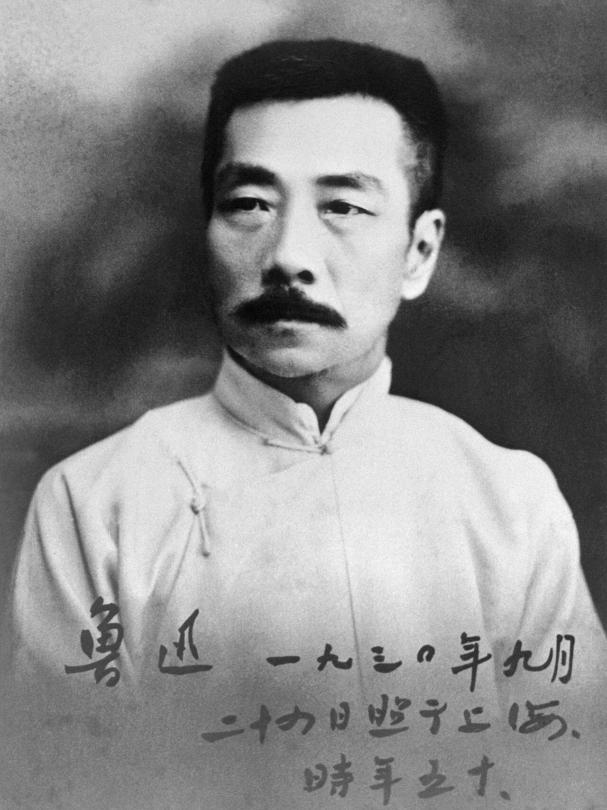

# Lu Xun

Lu Xun (1881-1936), born Zhou Shuren, courtesy name Yucai, was a native of Shaoxing in Zhejiang. Wine occupies three separate places in his work: the everyday drink of his home region, the medium of social exchange among writers, and an object of literary and political analysis. Merge the three into the anecdote that "Lu Xun liked a drink" and the most valuable part disappears.

Figure: Lu Xun. Image: Unknown author Unknown author, Public domain, via Wikimedia Commons ([source page](https://commons.wikimedia.org/wiki/File:LuXun1930.jpg)).

## The world he wrote from

Shaoxing had been a core area of yellow wine production since the Ming and Qing, and workshops, wine merchants, waterways and taverns were part of small-town life. Lu Xun was born into a declining scholar-gentry family: in 1893 his grandfather Zhou Fuqing was jailed over a bribery case in the provincial examinations, and the household began to fall apart. That experience made him unusually alert to the hierarchy of the counter. Who stands to drink, who sits, who wears a long gown and who wears a short jacket are never incidental stage directions.

After the republic was founded in 1912 he worked in the Ministry of Education. He published A Madman's Diary in 1918, became a leading writer of the New Culture Movement, settled in Shanghai in 1927 and died there in 1936. His identity was that of writer, translator and critic, not a drinks professional, so what he offers is not brewing data but the place of wine in social relations.

## Life

- Born in Shaoxing, Zhejiang, on 25 September 1881.
- Went to Nanjing in 1898, first to the Jiangnan Naval Academy and then to a mining and railway school.
- Studied in Japan from 1902, entered the Sendai medical school in 1904 and turned from medicine to literature around 1906.
- Moved to Beijing with the Ministry of Education in 1912 as a section chief; published A Madman's Diary in 1918.
- Kong Yiji appeared in New Youth, volume 6, number 4, in April 1919.
- Taught at Xiamen University in 1926 and at Zhongshan University in Guangzhou in 1927, then settled in Shanghai that October.
- Helped found the League of Left-Wing Writers in 1930.
- Died in Shanghai on 19 October 1936.

## Three relations to wine

The first is home. Shaoxing yellow wine was the familiar everyday drink, and the warmed wine, the bowls and the fava beans in his fiction are simply local detail.

The second is company. The diaries record visits, meals and book buying in great number, and wine was a normal medium of literary sociability. This layer belongs to social history; it cannot be converted directly into drinking capacity or habit.

The third is thought. The 1927 lecture placed Wei-Jin drinking inside political pressure and the clan system, making wine an entry point into the literary style of an era. This layer is the most often skipped and the most useful.

## Kong Yiji: class measured at the counter

The story opens with the rules of the room: "The wine shops in Luzhen are not arranged like those elsewhere. They all have a big counter, shaped like a carpenter's square, facing the street, and hot water is kept ready behind it so that the wine can be warmed at any time." Warming is not decoration; it is how yellow wine is drunk. The counter is not a prop; it is the line that divides the customers into two kinds.

Then come the prices. Labourers, after work, "would spend four coppers on a bowl of wine ... and drink it standing outside the counter, hot." Four coppers a bowl, eight for two, one for a dish of fava beans. When Kong Yiji asks for "two bowls of wine, warm, and a dish of fava beans" and then "pushes out nine large coppers", the arithmetic is exact. Lu Xun wrote wine concretely: price, quantity and temperature all check out.

The decisive sentence is that Kong Yiji is "the only man who stood drinking in a long gown". Standing is the place of the short-coated labourers; the long gown is the badge of a scholar. Caught between the two, he is both mocked and remembered. The class function of the wine matters far more than how much he drinks. The ending says only that "most likely Kong Yiji really was dead"; the laughter in the shop continues, and one man's disappearance changes none of the rules.

## Upstairs in the Wine Shop: one jin of Shaoxing wine

In the 1924 story Upstairs in the Wine Shop, collected in Wandering, the narrator returns to his home town and climbs to an old restaurant. He orders at once: "A jin of Shaoxing wine. Food? Ten fried beancurd cubes, and plenty of chilli sauce." More dishes follow: fava beans, cold pork, beancurd, dried fish. The order is almost a record of ordinary Shaoxing eating.

Here wine does not animate a party; it lets two disappointed men talk again. Lu Weifu describes his compromises and drift while the narrator listens, with a ruined garden and snow outside. There is no heavy drinking in the story, only slow drinking and slow speech. The temperature of the Shaoxing wine is bound to the memory of home: what is drunk is a place, and also time.

## The Wei-Jin lecture: drinking put back into politics

On 23 and 26 July 1927, Lu Xun gave a two-part lecture in Guangzhou under the title "Wei-Jin Style and Its Relation to Literature, Drugs and Wine". He began with Cao Cao's prohibition of alcohol, moved to Kong Rong's opposition, then to He Yan's drug taking and the eccentricity of the Seven Sages of the Bamboo Grove, and ended with Tao Yuanming.

One sentence shows his method: "Cao Cao was a man who had to get things done, so he had to act this way; Kong Rong was a bystander, so it was easy for him to say free words." Drinking is restored from "style" to position: ruler and bystander speak differently because they stand differently. He also warned that Tao Qian "could never rise above the dust of the world, and still cared about the government", so the image of the untroubled recluse was a later construction.

The lecture demonstrates a way of reading: when you see a famous scholar drinking, do not hurry to admire his freedom. Ask what political structure he was in, and whether the drinking was pleasure, self-protection or performance.

## Diaries and banquets

The diary runs from May 1912 to October 1936, recording reading, writing, visitors, book purchases and meals day by day. The entries are extremely brief, often a single line, with no description of mood and no tally of drinks.

The right use is to treat the diary as a ledger, not a confession. It proves that drinking with friends was routine, and it supplies dates, places and names, but it cannot prove heavy drinking or reconstruct a drinking history. Reading every occurrence of the word "drink" as evidence is a misuse of the source.

## Assessment and disputes

In the "revolutionary literature" polemic of 1928, the Creation Society and the Sun Society attacked Lu Xun in their journals; an essay by Du Quan, a pen name of Guo Moruo, called him a "feudal remnant" and a "double counter-revolutionary". Lu Xun later collected these attacks in Sanxian Ji, setting criticism and reply side by side. This is a documented criticism with a text behind it, not a polite later judgment.

A second dispute concerns method. His reading of Wei-Jin drinking as a response to political pressure carries the imprint of his own position in 1927, and scholars differ on how far he was using the past to comment on the present. There is also a limit of evidence: neither the fiction nor the lecture deals with brewing technique, wine taxes or the wine trade, so neither can serve as direct material for drinks history.

## Common misreadings

First, taking Kong Yiji as a self-portrait. The character is invented and condensed and cannot be equated with the author.

Second, reading "two bowls of warm wine" as heavy drinking. Yellow wine is low in alcohol, and warming and slow drinking were normal; judging it by today's spirits is anachronistic.

Third, treating every "drink" in the diary as proof of alcoholism. The diary records sociability, not capacity.

Fourth, romanticising Wei-Jin scholars. Lu Xun's lecture is precisely a dismantling of that romance.

Fifth, taking today's Xianheng wine shop interior as the scene of the story. The tourist site has been rebuilt and staged and cannot be used to reverse-engineer a 1919 text.

## See also

- [Yellow wine](ref:yellow-wine): the grain-fermented type to which Shaoxing wine belongs.
- [The history of Shaoxing yellow wine](ref:yellow-wine-history): workshops, waterways and the local economy.
- [The history of taverns](ref:taverns): the social function of taverns as public space.
- [China](ref:china): the regional background of Republican-era Jiangnan towns.

Further reading: [André Simon](ref:c-extra-1).
