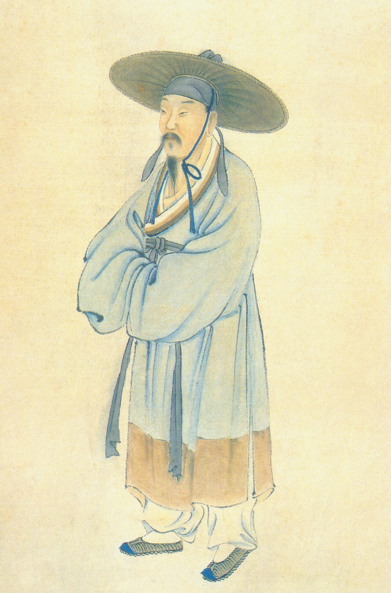

# Lu You

Lu You (1125–1210), styled Wuguan and called Fangweng, came from Shanyin in Yue Prefecture, modern Shaoxing in Zhejiang. He is among the most prolific Southern Song poets, and wine runs through his life: on the roads and in army camps in Sichuan, in farmhouse winter wine during village retirement, and in old age in a cup of yellow-sealed wine that brings back the past.

Figure: Lu You. Image: Unknown Unknown,清人 繪, Public domain, via Wikimedia Commons ([source page](https://commons.wikimedia.org/wiki/File:%E9%99%B8%E6%B8%B8_%E8%82%96%E5%83%8F.jpg)).

## Life and career

Lu You was born in 1125 and grew up as the Northern Song fell and the court moved south. In 1153 he took the locked-hall examination and came first; the next year, at the Ministry of Rites examination, he was failed after Qin Hui's grandson was affected by the ranking. In 1163 Emperor Xiaozong granted him the jinshi status, and he became assistant prefect of Zhenjiang. In 1172 he entered Sichuan and served on the staff of Wang Yan, the Sichuan military commissioner, where he saw the front. He left Sichuan in 1178, became prefect of Yanzhou in 1180, and retired to Shanyin, where he died in 1210.

He argued throughout his life for resistance to the Jin, which brought repeated obstruction. Britannica records four demotions. Career frustration and national grief form the ground of his wine poetry.

## Three settings for wine

Lu You's wine poems fall into three settings. The first is army life and travel: wine is a send-off and a sign of exhaustion. The second is village retirement: winter brewing and festival guest cups. The third is old love: wine is a switch for memory, and a single name brings back a person and a garden.

“Rain at Sword Gate” belongs to the first, “Touring West Mountain Village” to the second, and “The Phoenix Hairpin” to the third.

## Touring West Mountain Village and farmhouse winter wine

In 1167, dismissed from office and living at his Sanshan estate in Shanyin, Lu You wrote “Touring West Mountain Village”. It opens: “Do not laugh at the muddy winter wine of the farmhouse; in a good year there is chicken and pork enough for guests. Mountains repeat, waters wind, and one doubts there is a road; willows darken, flowers brighten, and another village appears.” Winter wine is brewed in the twelfth month; “muddy” means it has not been strained and still carries sediment, which is normal farmhouse practice. The chicken and pork show a good harvest.

The wine here belongs to village reciprocity: in a good year the host keeps a guest.

## The Phoenix Hairpin and yellow-sealed wine

“The Phoenix Hairpin” begins: “Red soft hands, yellow-sealed wine, spring fills the city, willows by the palace wall.” Yellow-sealed wine is wine sealed with yellow paper or yellow silk, a common official practice in the Song; “yellow-sealed” describes the closure, not a brand. “Red soft hands” is usually read as a woman's hands, though some scholars take it as a kind of pastry; either way, it joins the wine as a sensory memory of a reunion at Shen Garden.

The story behind the lyric comes from later notes, such as Chen Hu's Xitang Ji Qijiu Xu Wen and Zhou Mi's Qidong Yeyu, not from a contemporaneous account by Lu You. A lyric may have a basis in life and still be shaped by convention; treating it as strict autobiography ignores the Song lyric's use of personae and allusion.

## Rain at Sword Gate and the wine stain

In 1172 Lu You travelled from the front at Hanzhong to Chengdu and passed through Sword Gate. He wrote: “Dust of travel mixed with wine stains on my clothes; far journeys leave nowhere that does not consume the soul. Am I really meant to be a poet? In fine rain, riding a donkey, I enter Sword Gate.” The dust and the wine stain are evidence of the road; the question is self-mockery: he wanted to be a soldier and ended up a poet riding into Sichuan.

The poem places wine at the border of army life, travel and poetic identity. The stain is not the glory of a banquet but the trace of movement, and that says more than any direct declaration of heroism.

## The scale of the Manuscripts and the wine trade

The Manuscripts from south of the Sword Gate runs to eighty-five scrolls and more than 9,300 poems. Wine names recur: winter wine, village wine, official wine, yellow-sealed wine, and also wine banners, wineshops, drunken returns and solitary drinking. Read together, they show the everyday wine trade of Southern Song market towns.

The History of Song, in its treatise on finance, records the Song wine monopoly and the farming-out of wine revenue. The distinction in Lu You's poems between “official wine” and “village wine” can be set against those institutions: poetry cannot replace institutional history, but it shows how the system touched the ground.

## Reputation and dispute

Lu You is most admired for his patriotic poems, but he has also been criticised for writing too much. The General Catalogue of the Four Treasuries says his poetry is “fresh and sharply exposed, yet rounded, and truly establishes a school of its own”, then adds that “his poems run to ten thousand, and some err toward the rough and careless”. Quantity brought repeated subjects and a certain slickness.

A second dispute concerns “The Phoenix Hairpin”. The Shen Garden story is widely told, but the earliest records come from notes written after his death, and the details are not reliable; the “east wind” and the repeated “wrong, wrong, wrong” may also carry political allegory. Reading the lyric purely as a love autobiography narrows it.

## Common misreadings

First, that “muddy winter wine” means poor liquor; it is wine brewed in the twelfth month, cloudy from incomplete straining. Second, that “The Phoenix Hairpin” is literal autobiography; the Shen Garden story rests partly on later records, and poem and biography should be read separately. Third, that Lu You can be summed up by patriotic verse. Fourth, that all Song wine was today's yellow wine; the craft is related, but the two cannot simply be equated. Fifth, that “yellow-sealed wine” is a brand. It means wine sealed with yellow paper, whether official or private.

## Timeline

- 1125: born.
- 1153: first in the locked-hall examination.
- 1154: failed at the Ministry of Rites examination.
- 1163: granted jinshi status; assistant prefect of Zhenjiang.
- 1172: enters Sichuan and serves on the military commissioner's staff.
- 1178: leaves Sichuan and returns east.
- 1180: prefect of Yanzhou.
- 1210: dies.

**Short definition:** Southern Song poet, 1125–1210; his many wine poems span army life, village retirement and old love, with named drinks and precise settings in “Touring West Mountain Village”, “The Phoenix Hairpin” and “Rain at Sword Gate”. 

For Lu You, begin with the period and the role. Then look at the documented work, and finally ask the sources behind the claim. The answers point to different choices, not to a single score.

## Further reading

- [Time in a cup](ref:time-in-a-cup): wine in seasonal and literary writing.
- [Yellow wine](ref:yellow-wine): the craft lineage of fermented grain wine.
- [History of Chinese wine](ref:chinese-wine-history): the Song wine trade and policy.
- [China](ref:china): his travels and retirement in Shanyin.

Further reading: [André Simon](ref:c-extra-1).
