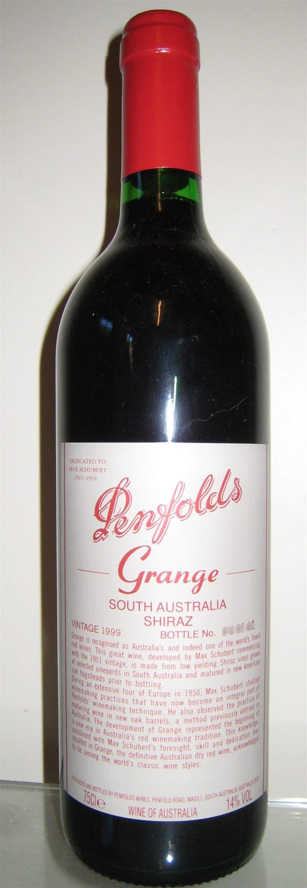

# Max Schubert

Max Schubert (1915–1994) was an Australian winemaker, Penfolds' first chief winemaker and the creator of Grange. He joined Penfolds as a messenger in 1931, became chief winemaker in 1948 at the age of 33, and in 1950 travelled to Europe, where the aged reds of Bordeaux convinced him that Australia could make a red wine capable of living for decades. He made the first experimental Grange in 1951. In 1957 the board decided the wine was too rough, too expensive and too far ahead of the market, and ordered him to stop; he continued the 1957, 1958 and 1959 vintages in secret in the Magill cellars. Grange was officially reinstated for 1960 and went on to become Australia's most celebrated red wine.

Figure: A bottle of Penfolds Grange 1999, its label dedicated to Max Schubert. Image: CocktailSteward, Public domain, via Wikimedia Commons ([source page](https://commons.wikimedia.org/wiki/File:PenfoldsGrange.jpg)).

> **Quick verdict**
> **In one line:** This profile explains why Max Schubert is remembered, and which works to look at first.
>
> - **Best for:** Anyone trying to understand what Max Schubert did and why the drink world remembers them.
> - **Not for:** If you want only want anecdotes and do not care about historical position.
> - **Check first:**
>   - In Adelaide, Penfolds Magill Estate is the place to start.
>   - Schubert was born on 9 February 1915 in Angaston, South Australia, into a German immigrant Lutheran family.

## From Nuriootpa to Magill

Schubert was born on 9 February 1915 in Angaston, South Australia, into a German immigrant Lutheran family. He attended primary school in Nuriootpa and studied at the South Australian School of Mines and Industries between 1933 and 1935. His father wanted him to learn a trade, but he wanted to work in a winery. In 1931 he heard that Penfolds was hiring at Magill and talked his way into a job, starting as a messenger and then moving through bottle washing, labelling, the laboratory and the cellars. His path was typical of Australian winemaking before formal wine schools: apprenticeship, field experience and night classes rather than a university degree.

In 1948, at 33, he became Penfolds' first chief winemaker. Until then Penfolds was known mainly for fortified wines, sweet wines and everyday table wine; Australians drank more port, sherry and cheap sparkling wine than dry red. Schubert began systematic experiments with fermentation, maturation and oak. He later said that a winemaker needed a "fertile imagination", because what happens to wine in barrel and bottle depends less on a formula than on judgment about fruit, microbes and time.

## The 1950 Bordeaux journey

In 1950 Penfolds sent Schubert to Europe to study fortified winemaking, especially sherry in Spain and port in Portugal. He took a detour to Bordeaux, where he saw estates blend Cabernet Sauvignon, Cabernet Franc and Merlot, put the wine into new oak, age it and then bottle it; he also saw wines that had spent decades in cellar and still had structure and perfume. The trip changed his direction: he wanted an Australian dry red that could "stay alive" for at least twenty years, not a wine for immediate drinking.

The Australian market did not support that ambition. Consumers liked sweet, soft, easy wine; producers feared that new oak and long ageing would smother fruit and raise costs; retailers had no patience to wait ten years. Schubert's answer was to use Shiraz rather than Cabernet as the backbone. Australian Shiraz ripened fully, had deep colour and enough tannin to stand up to oak and long maturation. He borrowed Bordeaux's ideas of blending and new barrels but changed the grape to the one Australia did best. This was not a copy of Bordeaux; it was Bordeaux's method applied to Australian fruit.

## 1951: the first experimental Grange

In 1951 Schubert used Shiraz from Magill Estate and Morphett Vale to make the first experimental Grange. The name came from Grange Cottage, the first Australian home of Penfolds' founders, Christopher and Mary Penfold. He did not use a European term such as château or domaine; he used an Australian place name, honouring the founders while signalling that the wine was local.

The technique had several key choices. First, Shiraz dominated, with a small addition of Cabernet Sauvignon for structure and acidity. Second, new American oak hogsheads gave vanilla, coconut, cedar and sweet spice. Third, the wine spent 18 to 20 months in oak so that tannin and fruit could integrate. Fourth, Grange was a multi-district blend rather than a single-vineyard wine, combining fruit from Barossa, Coonawarra, Clare and other regions according to style. This was expensive in the 1950s: new American barrels, long ageing and low yields tied up capital and carried real risk. Schubert was betting that time would prove him right.

## 1957: the three silent years

In 1957 Schubert took Grange to Sydney to show it to senior management, wine identities and friends of the board. The reaction was almost unanimously negative: the wine was too thick, too tannic and too "wild"; one critic reportedly called it "a concoction of wild fruits and sundry berries". The board then ordered production to stop. The decision looks absurd today, but it was rational at the time: the Australian market had no price tier or consumer base for such a wine, and the company had no cash flow to wait twenty years.

Schubert did not openly defy the order. He continued to make the 1957, 1958 and 1959 vintages in the Magill underground cellars, hiding them deep in the stacks. Company history calls this the "secret" period. It should not be romanticised: he was not alone, and Jeffrey Penfold Hyland and others inside the board created room for him; cellar workers, coopers and laboratory staff knew at least part of what was happening. The "secret" was more a matter of not discussing it publicly than of total secrecy.

In 1960 the board tasted the earlier Grange vintages after several years in cellar and found that the wine had not spoiled; it had developed cedar, leather, tobacco and dark fruit. Production was officially restored, with 1960 as the reinstatement vintage. The story is often told as a duel between a visionary and a timid board, but both sides had real concerns. The board worried about cash and market fit; Schubert worried that Australia would never develop a fine-wine culture without someone taking the risk.

## After 1960: Grange and the Bin system

After reinstatement, Grange gradually gained international recognition. In the 1970s it collected gold medals at Australian wine shows; the 1990 vintage was named Wine of the Year by Wine Spectator in 1995, pushing Grange into the global auction market. The word "Hermitage" disappeared from the label after the 1990 vintage. Hermitage is a French appellation in the northern Rhône, and Australia had long used the name as a synonym for Shiraz, but the European Community objected that a third-country wine could not carry a French geographical name. Penfolds therefore dropped "Hermitage" from 1990. The recipe did not change; the label did.

Schubert did not create only Grange. The Penfolds system he led also included Bin 389, Bin 28 and Bin 128, whose "Bin" numbers came from the cellar bays where the wines were stored and later became consumer shorthand for style. Bin 389 is often called "baby Grange" because it uses barrels that previously held Grange and blends Cabernet with Shiraz; Bin 28 is Barossa Shiraz; Bin 128 is Coonawarra Shiraz. They are not copies of Grange but expressions of the same ideas — multi-district sourcing, oak, and ageing potential — at different price points.

In 1962 Schubert also made Bin 60A, a Shiraz–Cabernet blend that some Australian critics regard as one of the greatest red wines the country has produced. It never became a regular product, but it shows that in the 1960s he was still experimenting and was not content to make Grange the only star.

## Retirement, honours and disputes

In 1975 Schubert retired as chief winemaker and was succeeded by Don Ditter, but he remained a Penfolds consultant and kept an office at Magill until his death in 1994. The 1975 Grange tasting note states plainly: "The year Max Schubert retired from his post of Chief Winemaker, although he remained a consultant to Penfolds and kept an office at Magill until his death in 1994." He died on 6 March 1994, aged 79; the Australian Dictionary of Biography records emphysema as the cause.

He was appointed a Member of the Order of Australia (AM) and was included in the Sydney Morning Herald's list of the 100 most influential Australians. Most of those honours arrived after Grange became famous; Schubert cared more about whether the wine could outlive him. His often-quoted line — that a winemaker needs a fertile imagination — is a statement about trusting time.

Three disputes surround him. First, was Grange Australia's first fine red? No. Other producers were making age-worthy reds in the 1950s. Grange's distinctiveness lies in the combination of Shiraz backbone, new American oak, multi-district blending and long maturation, and in the international status it eventually achieved. Second, has the "secret" episode been romanticised? Company history and trade reports agree on the fact of the hidden 1957–1959 vintages, but details — whether he pocketed the stop letter, whether the team was completely uninformed — vary. Third, have Grange's prices and allocations "financialised" Australian wine? That is a problem of the later market, not of Schubert's era; he created a style, and later generations turned it into an asset class.

## What to see and drink in Adelaide

In Adelaide, Penfolds Magill Estate is the place to start. It lies about 8 kilometres from the city centre and is a rare urban vineyard; the site includes Grange Cottage, underground cellars, a tasting room and a restaurant. Look at three things: the Magill Shiraz vineyard, to understand the urban-edge site; the underground cellars and oak barrels, to understand the conditions required for long maturation; and the Bin numbers and old labels, to understand how Grange moved from experiment to brand.

Drinking Grange does not require starting with the most expensive vintage. Younger Grange, at 10 to 20 years old, usually shows blackberry, blackcurrant, liquorice, cedar, tobacco and vanilla from American oak; the tannin is thick and the wine needs 2 to 3 hours in a decanter or further cellaring. Older Grange, at 30 years or more, develops leather, truffle, dried flowers, earth and savoury notes; the tannin softens but the acidity remains. It works with steak, lamb, roast meat, game and hard cheese at 16–18°C. Bin 389 can be enjoyed as an earlier-drinking relative of Grange, but do not expect the same depth.

## Place in this atlas

Schubert's story connects four threads. The first is [Australia](ref:australia)'s wine history: from fortified wine and everyday table wine to the fine-red revolution of the 1950s and 1960s. The second is [Barossa](ref:barossa) Shiraz: old vines, dark fruit, high ripeness and multi-district blending. The third is [Penfolds Magill Estate](ref:magill): the urban vineyard and Grange Cottage. The fourth is the craft of [wine](ref:wine): new American oak, 18 to 20 months in barrel, and the tannin and acidity of [Shiraz](ref:syrah).

To follow how one person changed a country's wine, compare Robert Mondavi and California. To follow how Old World technique was remade in the New World, read Bordeaux alongside Grange. To follow how an experiment became a brand, look at Bin 389 and its relationship to Grange. Schubert did not invent Australian wine; he was the person who put Australian Shiraz into the language of the world's fine wines.

## See also

- [Australia](ref:australia): the industry's move from fortified wine to fine red.
- [Barossa](ref:barossa): old-vine Shiraz and one of Grange's fruit sources.
- [Penfolds Magill Estate](ref:magill): Grange Cottage, the underground cellars and visiting information.
- [Wine](ref:wine): oak, maturation, tannin and ageing potential.
- [Shiraz](ref:syrah): Grange's backbone variety and the Australian style.
