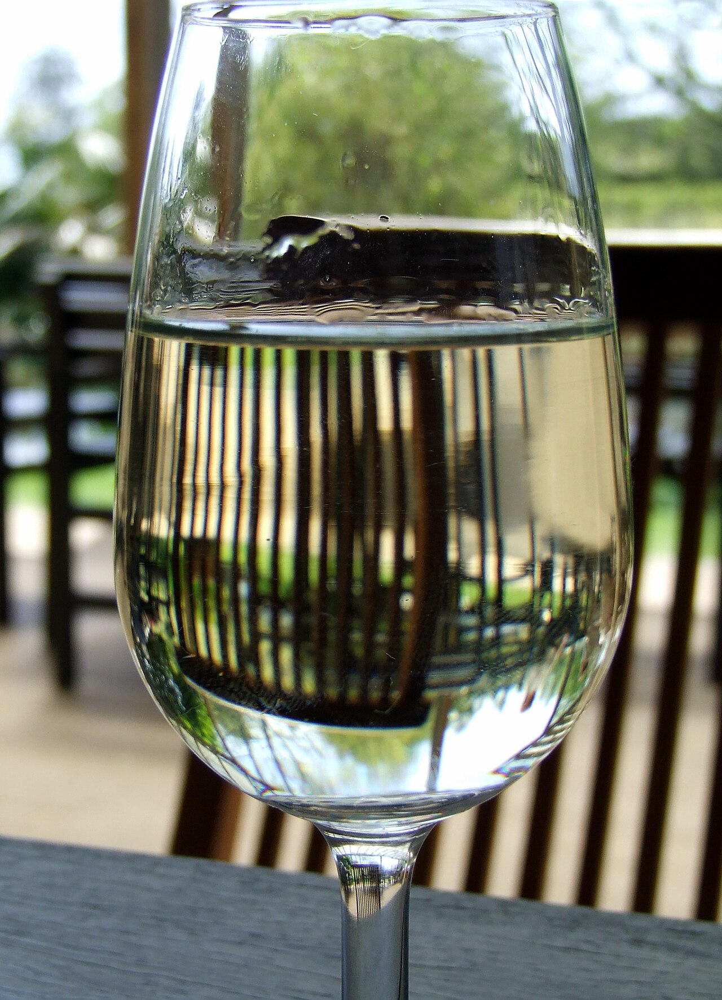

# Maynard Amerine

Maynard Amerine (1911–1998) was an American viticulturist and professor at the University of California, Davis. His name is tied to two tools. One is the Winkler heat-summation index, used to decide what grapes a place can ripen. The other is sensory evaluation, used to turn "tastes good" into descriptions that can be trained and repeated. The first shaped where vines were planted; the second shaped how wine was judged. Together they formed part of the technical foundation of California wine after Prohibition.

Figure: A white-wine tasting glass; used to illustrate sensory evaluation, not a portrait of Maynard Amerine. Image: Tim Parkinson, CC BY 2.0, via Wikimedia Commons ([source page](https://commons.wikimedia.org/wiki/File:White_wine_tasting_glass.jpg)).

## From plant physiology to viticulture

Amerine was born in San Jose, California, on 30 October 1911 and grew up on a farm near Modesto. He studied plant physiology at the University of California, Berkeley. Before completing his doctorate in 1935, he was hired by the newly created Department of Viticulture and Enology at Davis as one of its first staff members. California was just emerging from Prohibition, and the industry's technical literature, variety trials and winemaking standards were fragmented.

His first question was what to plant. During Prohibition many wineries had survived by making sweet wine, sacramental wine or grape concentrate, leaving behind high-yielding, disease-resistant but mediocre varieties. Amerine and his colleague Albert J. Winkler planted trial plots across California, compared varieties under different climates, and used chemical analysis and sensory judgment to screen them. The question was not "which variety is famous" but "which variety can reliably make good wine in this particular place".

## The Winkler heat index

In 1944 Amerine and Winkler published a climate classification based on heat summation during the growing season. Using 50°F (10°C) as the base, they added the amount by which the daily average temperature exceeded that base, producing "growing-degree days" and dividing California into five climate regions. The measure became known as the Winkler Index and became a basic tool for vineyard planning in California and elsewhere.

Its value was to turn climate from a vague impression into comparable numbers. Growers could use weather-station data to judge whether a site suited early- or late-ripening varieties; wineries could explain why the same variety performed differently in a coastal valley and an inland valley. Its limits were equally real: heat summation ignores diurnal range, soil, water, light and wind, and microclimates within one region can differ sharply. Amerine repeatedly warned that the index was a starting point, not a conclusion.

## Standardising sensory evaluation

Amerine's longer influence was on tasting itself. From the 1950s through the 1960s he worked with the statistician Edward B. Roessler and sensory scientist Rose Marie Pangborn to train panels, design blind tests and analyse scores. In 1976 he and Roessler published Wines: Their Sensory Evaluation, bringing appearance, aroma, taste, finish, defects and statistical significance into one framework.

The core of the method was not finding a "genius tongue" but reducing noise: standard glasses, temperature, light and serving order; control samples and repeated tests; separating preference from quality; using statistics to decide whether a difference was real. It allowed wineries without a celebrity taster to compare products and control quality. Many modern tasting sheets, training courses and competition scores can be traced to this kind of work.

## Books and teaching

Amerine wrote sixteen books and several hundred articles on viticulture, wine analysis, sensory evaluation, wine literature and California wine history. In 1965, with Vernon L. Singleton, he wrote Wine: An Introduction for Americans, a professional subject made usable for general readers; it was widely used as a textbook and reference in the 1970s.

He chaired the Davis department from 1957 to 1962 and retired in 1974, but continued to write, travel and consult as professor emeritus. His books and papers entered the UC Davis library special collections as the Maynard A. Amerine Room and Wine Collection; the university also established a chair named after him, endowed by Ernest Gallo. Those institutional facts show that his influence extended beyond the classroom into archival preservation and the training of new generations.

## Assessment and controversy

The favourable view calls him one of the "fathers of American wine" because he reconnected the winemaking knowledge broken by Prohibition and trained a generation of growers and winemakers in scientific method. There is a factual basis: the Winkler Index, the sensory textbook, the Davis curriculum and the extension system did change California wine.

Criticism has three main lines. First, his sensory work centred on trained panels; it could detect quality differences but did not necessarily predict what ordinary consumers would prefer. Market research later supplemented, rather than replaced, the method. Second, his research was California-centred, and old-world regions were usually treated as comparisons rather than as equally deep historical subjects. Third, the "father of American wine" label is convenient but hides the contributions of Winkler, Olmo, Ough, Singleton and the extension workers who carried the results into vineyards.

## Common misreadings

The first is to treat the Winkler Index as Amerine's solo invention. It was work with Winkler and rested on earlier climate and phenology observations.

The second is to treat sensory evaluation as "scoring wine". Amerine's method was more concerned with experimental design, panel training and statistical inference than with producing a permanent number.

The third is to treat "scientific" as "unsensory". He did not deny flavour memory or personal preference; he insisted on recording preference and quality separately.

The fourth is to treat the Davis work as isolated laboratory research. Amerine worked with wineries, growers and trade associations, and many conclusions were tested in trial plots and on production lines.

## See also

- [United States](ref:usa): the country of his work and the institutional context of post-Prohibition rebuilding.
- [Napa Valley](ref:napa): a centre of California premium wine that benefited from his variety and climate research.
- [Wine](ref:wine): the central subject of his research and teaching.
- [Chardonnay](ref:chardonnay): an important California white variety and a common sample in variety trials and sensory work.
- [Place and process](ref:place-process): the framework for understanding the relationship between site, variety and technique.

**Short definition:** American viticulturist and UC Davis professor (1911–1998) who developed the Winkler heat-summation index with Albert Winkler and standardised wine sensory evaluation through trained panels, blind tasting and statistics.

For Maynard Amerine, begin with the period and the role, then the documented work, and finish with the sources behind the claim; that order keeps the account grounded.

Start with [United States](ref:usa) for role, then read [Wine](ref:wine) for period. Seeing both keeps Maynard Amerine from being confused with a neighbouring idea.

**Key facts.**

| Item | Detail |
| --- | --- |
| In one line | American viticulturist and UC Davis professor (1911–1998) who developed the Winkler heat-summation index with Albert Winkler and standardised wine sensory evaluation through trained panels, blind tasting and statistics. |
| Life | 1911–1998 |
| Roles | viticulturist、professor、wine writer |
| Regions | United States、Napa Valley |
