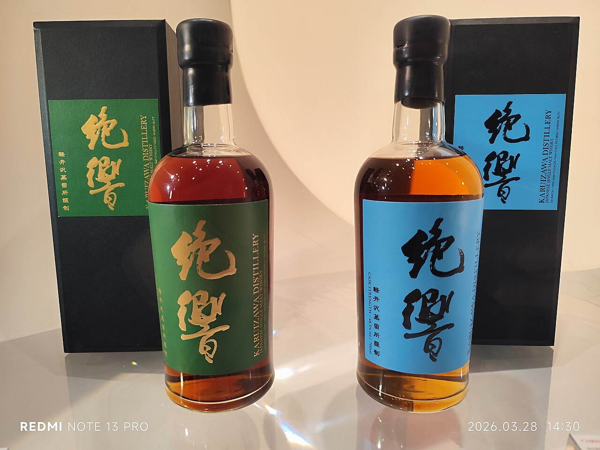

# Michael Broadbent

Michael Broadbent (1927–2020) was a British wine critic, auctioneer and writer. His career had two hinges. The first was Christie's in 1966, where he rebuilt the wine auction department and turned old and rare bottles into a publicly priced asset class. The second was a habit that began in 1952: writing every wine he tasted into a red notebook. Those notebooks eventually became tens of thousands of records and changed the way the market talked about vintages.

Figure: Bottles on display at Christie's auction preview in Hong Kong, March 2026; an auction-preview scene, not a portrait of Michael Broadbent and not a specific lot he handled. Image: Homm BoUretak BAORP, CC0, via Wikimedia Commons ([source page](https://commons.wikimedia.org/wiki/File:HK_CH_%E9%87%91%E9%90%98_Admiralty_The_Henderson_%E4%BD%B3%E5%A3%AB%E5%BE%B7%E6%8C%87%E8%B3%A3%E8%A1%8C_Christie%27s_Auction_%E9%A0%90%E5%B1%95_preview_exhibition_wine_bottles_March_2026_N13P_10.jpg)).

## From architecture student to wine trade apprentice

Broadbent was born on 2 May 1927 in the West Riding of Yorkshire. He went to London to study architecture, but the Second World War and national service interrupted the path. By his own account, at twenty-five he needed "a complete change". His mother saw an advertisement in The Times for an apprentice at Laytons, a London wine merchant; he applied, and began by sweeping floors, moving boxes and delivering orders before moving behind the counter.

At Laytons and later at Harveys of Bristol he learned the trade from the bottom: reading labels, checking vintages, handling customers and judging the condition of a bottle. In 1952 he began keeping a small red notebook for tasting notes. The habit lasted more than half a century and became the raw material for his books. He entered wine through warehouses and orders, not through theory.

## Rebuilding Christie's wine auctions

In 1966 Broadbent joined Christie's to establish a wine department. Christie's had auctioned wine in the eighteenth century, but the modern specialist department had lapsed. His task was to reconnect the line: catalogue, estimate, preview and conduct the sale.

In July 1967 he took the rostrum for the first time. In 1969 he took Christie's wine auctions to the United States, and later conducted sales in Europe and Asia. The auction house gave him a view that ordinary tasting writing rarely provides: how the same wine, from different vintages, sources and conditions, could fetch very different prices; how labels, seals and direct-from-producer records affected confidence; and how "rarity" was priced.

He later became a senior consultant to Christie's, but he did not hand his writing over to the catalogue. He kept tasting and kept writing for the press. In 1968 he published The Pocket Guide to Wine Tasting, which broke tasting into appearance, aroma, taste and aftertaste, and discussed light, glass shape and the order of service. The book was translated into several languages and became one of the most used tasting manuals in the English-speaking world in the 1970s and 1980s.

## Red notebooks and Vintage Wine

Broadbent's method was laborious. For every wine he noted the name, vintage, occasion, colour, aroma, taste, finish and judgment. He did not rely on memory and did not write up later. His red notebooks, kept from 1952 to old age, number in the hundreds. In 1980 he turned them into The Great Vintage Wine Book; a revised edition followed in 1991; in 2002 he expanded the work as Vintage Wine, covering more than ten thousand wines from 1680 to 2001.

The value of the record is traceability. A reader can follow his judgment of the same wine across vintages and see how his language changed: shorter early on, more restrained later. He rarely used the "fruit bomb" vocabulary that became fashionable later; he preferred structural descriptions such as "medium deep, maturing, softening colour, warm nose with a touch of earth". For researchers, that preserves the basis of the judgment. For ordinary readers it may be less seductive, but it is harder for marketing language to capture.

## Tasting method and influence

His method can be summed up as controlling variables: natural north light by day, a consistent glass, smell before tasting, order wines by structure and alcohol, and put price aside before returning to it. He reminded readers that light changes colour, room temperature changes aroma, and the glass changes the first impression. These details look like common sense now, but they were not common in specialist writing in the 1960s.

His influence was not only through books. As an auctioneer he helped make London a centre for old and rare wine in the second half of the century. As a writer he turned "vintage" from a producer's marketing word into comparable historical information. As an editor and consultant he helped establish cataloguing conventions: how to describe bottle condition, provenance and unverifiable vintages.

## Assessment and controversy

The favourable view treats him as a founder of the modern wine auction and a great compiler of tasting notes. Both claims have a factual basis: Christie's wine department, the London auction market and a large body of vintage records are connected to his work.

Criticism centres on three points. First, an auction house's position can shape judgments of value: auction price, rarity and collectability may be mistaken for quality itself. Broadbent did not deny the difference between market and taste, but his writing was often borrowed by the collectors' market. Second, his records are centred on Bordeaux, Burgundy, Champagne and a few old-world regions; New World wines, everyday wines and women winemakers are under-represented. That is both a period limitation and a personal one. Third, his restrained tasting language was later displaced by more extravagant sensory prose; but restraint also meant less marketing colour.

## Common misreadings

The first is to call him the "founder" of Christie's wine auctions. More accurately, he rebuilt the modern specialist department in 1966, reconnecting with an eighteenth-century auction tradition.

The second is to treat Vintage Wine as a final verdict on every vintage. It is a personal tasting archive, not a meteorological or agronomic database; the same wine varies with bottle size, transport and storage.

The third is to treat the red notebooks as a romantic anecdote. They were a working method: fixed fields, immediate recording and traceability, close to the logic of a laboratory notebook.

The fourth is to read auction prices as a quality ranking. Price is set by scarcity, provenance, condition and market mood, not by taste alone.

## See also

- [United Kingdom](ref:uk): Broadbent's professional base and the centre of the London auction market.
- [Wine](ref:wine): the central subject of his tasting and auction work.
- [History of world wine](ref:world-wine): the longer story of twentieth-century wine globalisation.
- [Burgundy](ref:burgundy): one of the regions he recorded most closely and the auction market watched most intently.
- [The World Atlas of Wine](ref:atlas): the reference for the regions, vintages and plots behind his notes.

**Key facts.**

| Item | Detail |
| --- | --- |
| In one line | British wine critic, auctioneer and writer (1927–2020) who rebuilt Christie's wine department in 1966 and recorded tens of thousands of wines in red notebooks, author of The Pocket Guide to Wine Tasting and Vintage Wine. |
| Life | 1927–2020 |
| Roles | wine auctioneer、wine writer、taster |
| Regions | United Kingdom |
