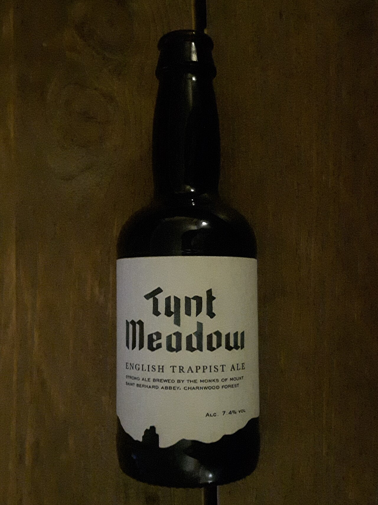

# Michael Jackson (beer writer)

Michael Jackson (1942–2007) was a British journalist, beer writer and whisky writer. His 1977 book The World Guide to Beer used a "style–history–senses–food" framework to turn the world's beers into a readable, comparable body of knowledge. He went on to write about Belgian beer, British ale, Trappist brewing and whisky, and hosted the television series The Beer Hunter. American craft brewers, Belgian breweries and Japanese beer writers all credit him with making beer a serious subject.

Figure: Tynt Meadow Trappist ale, part of the beer tradition Michael Jackson wrote about. Image: FakirNL, CC BY-SA 4.0, via Wikimedia Commons ([source page](https://commons.wikimedia.org/wiki/File:Tynt_Meadow_Trappist_Ale_(no_flash).jpg)).

## From reporter to Beer Hunter

Jackson was born on 27 March 1942 in Wetherby, Yorkshire, and grew up near Leeds. He began as a local newspaper reporter, then moved into London journalism and television, writing about drink, food and travel. In the 1970s British beer writing was dominated by brewery public relations and local guides; Jackson wanted to treat beer as a cultural phenomenon, not a product list.

The World Guide to Beer appeared in 1977. Its structure looks ordinary today but was new at the time: first the basic craft of malt, hops, yeast and water, then country and regional chapters, then each beer placed in its style, history and drinking context. There was no "best beer in the world" ranking; instead the book explained why a beer tasted the way it did. It was translated into several languages and became a shared reference for brewers in the United States, Belgium and Japan.

In the 1980s he wrote The Great Beer Book, The Beer Companion, Belgian beer studies and English ale guides. In 1989 he published the Malt Whisky Companion, applying the same sensory method to whisky. In the 1990s he hosted The Beer Hunter, visiting breweries in Belgium, Germany, the Czech Republic, Britain and the United States and bringing the idea that beer could be discussed like wine into ordinary homes. He died in London on 30 August 2007, aged 65, after years of Parkinson's disease.

## What he changed

First, he made "style" a public language. Today's talk of British ale, Belgian dubbel, Trappist beer, Pilsner and stout can often be traced to Jackson's writing. He did not invent the styles; brewers and regions did. His contribution was to organise scattered local knowledge into a comparable framework so consumers, brewers and judges could sit at the same table.

Second, he brought Belgian beer into global view. In the 1970s and 1980s, Belgian Trappist beer, lambic, witbier and strong ale were little known internationally. Jackson's books and television put these beers into the context of history, religion, local food and fermentation science, and directly influenced American craft brewers. Today's American revival of abbey styles, saison and lambic bears his imprint.

Third, he changed the tone of beer writing. He avoided empty phrases about "fine foam and mellow body" and instead used specific aromas, temperatures, glass shapes, food pairings and origin stories so readers could follow the trail. He wrote about whisky too, stressing "nose, add water, nose again, taste" and pulling tasting back from mystique into trainable sensory work.

Fourth, he left an archive for beer education. Oxford Brookes University holds his notes, manuscripts, books and correspondence as the Michael Jackson Collection; brewers' associations, Belgian beer groups and Japanese craft brewers have continued his work through awards, lectures and reprints. Today's style guides and blind-tasting scoresheets follow his method.

## How to read him

If you have time for one book, read the country chapters of The World Guide to Beer, then Belgian Beer. The first builds a map of style, place and craft; the second shows how a country's beer is entangled with religion, food and politics. Read with three cautions. First, he wrote about the beers of his time; many breweries, recipes and brands have changed. Second, his categories are descriptive aids, not legal definitions; do not argue about a borderline saison or farmhouse beer as if the label were law. Third, his sensory preferences are personal: British ale and Belgian sour beer get more space than commercial lager. That is a writing choice, not a verdict.

To practise his method, look at colour and foam, smell malt, hops, yeast and fermentation by-products, then judge sweetness, bitterness, acidity, body and finish before thinking about food. British ale suits roast meat, fish and chips and cheese; Belgian dubbel suits stews, chocolate and hard cheese; lambic suits seafood, salads and fruit desserts; Pilsner suits light fish, chicken and fried food. For whisky, start low and mild, add a few drops of water, and avoid heavy smoke or high strength until the palate is warmed up.

## Disputes and common misreadings

First, he is not the pop singer Michael Jackson. The shared name causes constant confusion; his website carried a clarification. Second, he did not invent beer styles. Styles emerge from brewers, regions and consumers over time; he organised them into language, but the namer is not the creator.

Third, he did not write only about British beer. His books cover Belgium, Germany, the Czech Republic, the United States, Japan and China; his promotion of Belgian beer was especially important. Fourth, his categories are not legal standards. The EU, the United States and Japan each have their own regulations and geographical indications; distinguish descriptive style from legal category.

Fifth, his writing has period limits. Brewery information in the 1970s and 1990s was less transparent than today, and some historical passages have been revised by later archaeology and archives. His "tradition" is sometimes the market narrative of the time, not a continuous centuries-old fact. Sixth, his taste leaned British and Belgian; readers need not adopt his preferences. Use his method, not his conclusions.

## Place in this atlas

Jackson connects three threads. The first is the style and craft of [beer](ref:beer): malt, hops, yeast, water and the split between British, Belgian, German, American and Czech traditions. The second is [Trappist beer](ref:trappist) and Belgian brewing: abbey styles, lambic, witbier and strong ale. The third is the writing and tasting of [whisky](ref:whisky): from malt whisky to Japanese, American and Irish spirits.

To follow beer into the craft era, read the American craft movement, Gary Regan's cocktail writing or the modernisation of Belgian breweries. To follow whisky's systematisation, compare the Malt Whisky Companion with today's style guides. Jackson is not an isolated author; he is a hub in the late-twentieth-century globalisation of beer and whisky knowledge.

## See also

- [Beer](ref:beer): styles, ingredients, fermentation and tasting.
- [Trappist beer](ref:trappist): Trappist and abbey styles, and the Belgian tradition.
- [Whisky](ref:whisky): malt, pot stills, oak and styles.
- [United Kingdom](ref:uk): British ale, cask beer and the 1970s beer-writing context.
- [Gary Regan](ref:gary): cocktail writing and bar culture, a contemporary of Jackson in drinks education.
