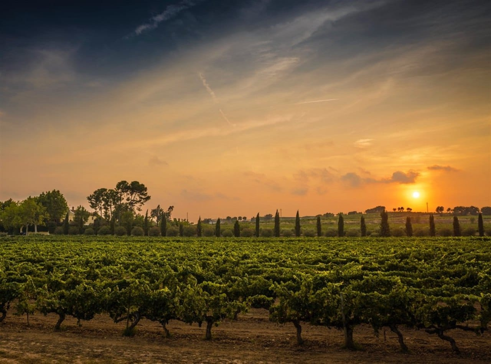

# Miguel A. Torres

Miguel A. Torres (born 1941) is a Spanish winemaker, family-business president and promoter of wine. His family firm, Familia Torres, is one of the best-known wine dynasties of Penedès. He joined the business in 1962, made Mas La Plana in 1970, and in 1979 saw that Cabernet Sauvignon defeat several celebrated French wines at the Paris Wine Olympics. He later expanded the family's reach to Chile and California, and in later life made climate action a central part of the company's identity. To understand how modern Spanish wine moved from a domestic table wine to an international point of comparison, he is difficult to avoid.

Figure: Familia Torres vineyard in Penedès. Image: Bodega torres, CC0, via Wikimedia Commons ([source page](https://commons.wikimedia.org/wiki/File:Familia_torres_bodega_vinedo.jpg)).

> **Quick verdict**
> **In one line:** This profile explains why Miguel A. Torres is remembered, and which works to look at first.
>
> - **Best for:** Anyone trying to understand what Miguel A. Torres did and why the drink world remembers them.
> - **Not for:** If you want only want anecdotes and do not care about historical position.
> - **Check first:**
>   - Mas La Plana is a site in Penedès where the family planted Cabernet Sauvignon in 1966.
>   - In Penedès, start at the family winery in Vilafranca del Penedès, where the 1870 buildings, modern tasting room and cellars sit together.

## The fourth generation in Penedès

The Torres family's winegrowing record goes back to 1559, but the export-oriented winery was founded in 1870 by the brothers Jaime Torres Vendrell and Miguel Torres Vendrell in Vilafranca del Penedès. The second generation, Juan Torres Casals, began distilling brandy from Penedès white wines in 1928. The third generation, Miguel Torres Carbó, rebuilt the cellars after the 1939 bombing during the Spanish Civil War and decided to move from bulk wine to bottled wine. That decision mattered: bottling meant brands, labels, exports and quality control, and it meant the family was no longer merely a buyer of local grapes.

Miguel A. Torres was born in 1941, the son of Miguel Torres Carbó. He studied winemaking in Dijon, France, and joined the family firm in 1962. The official family page gives 1962 as the year he joined, while the company timeline places "Miguel A. Torres joins the company" at 1963; the discrepancy is a dating problem, not evidence of two separate events. After his father died in 1991, he became president. More precisely, he is the fourth-generation manager of a family business, not a self-made founder.

## Mas La Plana in 1970

Mas La Plana is a site in Penedès where the family planted Cabernet Sauvignon in 1966. Rather than follow the Spanish convention of blending Cabernet into a multi-variety "top red", Miguel wanted a single-variety, single-site wine that could be compared with aged Bordeaux. The first vintage was 1970, initially sold under the Gran Coronas black-label name and only later separated as Mas La Plana. His father was sceptical: "A Spanish Cabernet in a Burgundy bottle — can that be a good wine?" The remark captures the market prejudice of the time: Spanish wine was expected to be cheap, soft and everyday, not structured enough to argue with French classified growths.

In 1979 the father and son entered the 1970 vintage in the Gault & Millau Wine Olympics in Paris. The result placed Mas La Plana ahead of several Bordeaux and Burgundy wines and put Penedès on the international wine map overnight. The distinction matters: this was not the 1976 Judgment of Paris, where California wines faced French wines. The 1979 Wine Olympics was a different competition, with a Spanish Cabernet as its surprise. Chinese-language sources often merge the two events; they had different dates, organisers and entries.

After Mas La Plana, Torres used French varieties to make Milmanda, a Chardonnay from Conca de Barberà, and from the 1980s began recovering Catalan ancestral varieties, eventually bottled as Grans Muralles. This shows that his "internationalisation" was not a simple copy of France: French varieties, local soils and Catalan old vines were placed on the same wine list.

## Chile, California and the family network

In 1979 Torres established Miguel Torres Chile in Curicó. The political and economic environment was not easy, but Chile offered dry conditions, low disease pressure and land at a workable cost, all suited to export wine. Torres brought Penedès winemaking, temperature control and French oak to Curicó, while keeping Chilean heritage varieties such as País and Carignan; in time those "old" grapes became a selling point for Chilean boutique wine. Miguel Torres Chile now exports to more than 100 countries, and wines such as Manso de Velasco regularly earn high scores in international tastings.

In 1982 the family bought land in Sonoma, California, where Miguel's sister Marimar Torres established Marimar Estate. Unlike Chile, the California project was closer to a family member's independent venture: Marimar moved to San Francisco in 1975 to run the American market, bought Sonoma land in 1982, planted Chardonnay and Pinot Noir in 1986, and completed the winery in 1992. The Torres network was therefore not a single-centre empire but a triangle — Penedès, Chile and California — with each point serving a different market.

Inside Spain, the fifth generation later opened projects in Priorat, Costers del Segre, Ribera del Duero, Rioja, Rueda and Rías Baixas. In 2012 Miguel Torres Maczassek became general manager and Mireia Torres Maczassek took charge of knowledge and innovation. Miguel A. Torres remained president, but day-to-day management passed to the fifth generation. The succession shows that the family's success was not one person's longevity but the conversion of the fourth generation's relationships and judgment into fifth-generation institutions and teams.

## Climate: Torres & Earth and IWCA

In 2008 Torres launched the Torres & Earth programme to reduce the carbon footprint of every bottle through renewable energy, energy efficiency, electric transport and regenerative agriculture. The official history links the programme directly to climate change: higher temperatures, earlier ripening, drought and extreme weather alter acidity, sugar and variety performance. Torres has set a goal of a zero-emission winery by 2040; this is not a public-relations slogan, because it requires accounting for vineyards, winemaking, packaging, transport and energy together.

In 2019 Miguel co-founded the International Wineries for Climate Action (IWCA) with Katie Jackson of Jackson Family Wines. The alliance asks members to measure emissions according to scientific standards, set reduction targets and publish progress. Its significance is that it turns a single winery's environmental project into an industry-wide, comparable and verifiable commitment. Miguel was named Decanter Man of the Year in 2002, but the identity he may prefer to be remembered for in later life is the person who put climate on the wine industry's board agenda.

## What to see and drink in Penedès

In Penedès, start at the family winery in Vilafranca del Penedès, where the 1870 buildings, modern tasting room and cellars sit together; then visit the Mas La Plana vineyard to understand how gravel, drainage and Mediterranean light shape the Cabernet; and then look at the Cava lines, which are a separate sparkling-wine business and should not be confused with Mas La Plana.

Three wines are a good introduction. Mas La Plana Cabernet Sauvignon offers blackcurrant, cedar and spice, with evident tannin; it works with steak, lamb, game and hard cheese, served at 16–18°C after 45–90 minutes in a decanter. Milmanda Chardonnay shows citrus, white flowers, hazelnut and cream, and suits grilled fish, seafood, white meat and mushrooms at 10–12°C. Grans Muralles leans toward Mediterranean herbs, dark fruit and minerality, and works with braised meat and roasts. In a restaurant, read the whole label: Spanish bottles often combine producer, region and ageing level, and the word "Torres" alone does not identify the wine.

## Misreadings and disputes

First, Mas La Plana did not win the 1976 Judgment of Paris. It won the 1979 Gault & Millau Wine Olympics with the 1970 vintage. Second, Miguel was not the only force behind Spanish wine's internationalisation. Marqués de Riscal, Vega Sicilia and the Ribera del Duero producers, as well as Spain's market opening after joining the European Community in the 1980s, were pushing in the same direction. Torres's distinctive contribution was to combine family capital, French technique, Chilean and Californian projects and climate policy into a durable international network.

Third, Torres was not a "colonial" owner in Chile. The Chilean project had local teams, local grapes and local regulation, and it later made heavy use of Chilean heritage varieties such as País and Carignan. Calling it "Spanish capital extracting Chilean terroir" ignores the Chilean partners, winemakers and vineyard workers. Fourth, a family firm is not a one-man dictatorship. Miguel is president, but the fifth generation took over day-to-day management in 2012; attributing every decision after 2012 to him overstates his operational control.

Fifth, dates and titles contain small errors. He was born in 1941, but official pages do not give a single agreed date; his entry into the firm appears as both 1962 and 1963; his presidency began in 1991, but "owner" and "president" are not the same thing. Keeping those boundaries clear lets us credit his influence without flattening half a century of family teamwork into one biography.

## Place in this atlas

Torres's story connects four threads. The first is [Spain](ref:spain): Penedès, Cava, Rioja, Ribera del Duero and Rías Baixas make up the geography of modern Spanish wine. The second is [Chile](ref:chile): Curicó, Manso de Velasco and the País/Carignan heritage. The third is [Napa Valley](ref:napa) and Sonoma: Marimar Estate and the American market. The fourth is the language of [wine](ref:wine): how [Cabernet Sauvignon](ref:cabernet) travelled from Bordeaux to Spain and acquired a different structure in Penedès.

To follow the family-winery route, compare Robert Mondavi and Opus One. To follow the Old World/New World encounter, read the 1976 Judgment of Paris alongside the 1979 Wine Olympics. To follow climate and wine, look at Torres & Earth, IWCA and regenerative viticulture. Torres is not an isolated hero; he is one of the best-connected figures in the late twentieth-century wine network.

## See also

- [Spain](ref:spain): Penedès, Rioja, Ribera del Duero and the regions of Spanish wine.
- [Chile](ref:chile): Curicó, the Central Valley and Chile's export-wine history.
- [Napa Valley](ref:napa): California fine wine, Sonoma and the transatlantic network.
- [Wine](ref:wine): varieties, fermentation, oak and ageing.
- [Cabernet Sauvignon](ref:cabernet): the variety behind Mas La Plana and its global travels.
