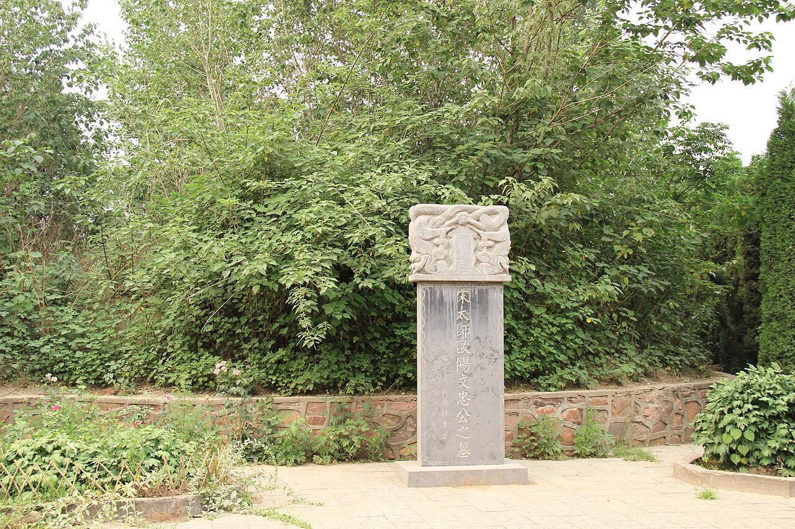

# Ouyang Xiu

Ouyang Xiu (1007–1072), styled Yongshu, called the Old Drunkard and in later life the Lay Scholar of Six Ones, came from Yongfeng in Ji Prefecture. He led the Northern Song movement to reform prose and poetry and was one of the chief editors of the New Book of Tang and the New History of the Five Dynasties. His famous line “the Old Drunkard's meaning is not in the wine” is known to almost everyone, but the original emphasis is actually on the pleasure of landscape. More telling still, he was not a heavy drinker: the same record says that he got drunk after drinking little.

Figure: Ouyang Xiu. Photograph: Tomb of Ouyang Xiu - 10318310225. Credit: Gary Todd, CC0, via Wikimedia Commons ([source](https://commons.wikimedia.org/w/index.php?curid=114245921)).

## Life

Ouyang Xiu was born in 1007 and died in 1072. His father died when he was young and his mother raised and taught him; the story of her teaching him to write by scratching characters in the ground with a reed became a much-cited example of Song family upbringing. He passed the examination in 1030 and served as an academic editor, a remonstrance official, prefect of Chuzhou, governor of Yangzhou and Yingzhou, and finally as a vice councillor of state.

In the Qingli period he was demoted for supporting Fan Zhongyan's reforms, and in 1045 he took up the Chuzhou post; the following year he wrote “Record of the Pavilion of the Old Drunkard”. In 1054 he was commissioned to work on the New Book of Tang; in 1057 he presided over the Ministry of Rites examinations, where Su Shi, Su Zhe and Zeng Gong were recognised. In later life he repeatedly asked to retire, withdrew to Yingzhou in 1071 and died there in 1072.

He made contributions to prose, poetry, ci, historiography and the study of inscriptions, and he promoted or influenced Su Shi, Zeng Gong and Wang Anshi. Politically he was not always successful; the Chuzhou and Yingzhou years were precisely a time when, as a local official, he could settle his personal temperament into public life.

## Relationship with alcohol

Ouyang Xiu's wine belongs first to the life of a local official. At Chuzhou he shared his pleasures with the people, toured Mount Langya and drank at the Pavilion of the Old Drunkard. “Record of the Pavilion of the Old Drunkard” turns a picnic into a genre scene of springs, wild dishes, pitch-pot, chess and the laughter of crowds, ending with “the prefect is drunk”. This was not a lavish official banquet but an occasion where a local official shared landscape with guests and ordinary people.

Second, wine is one component of his self-portrait in old age. “Biography of the Lay Scholar of Six Ones” says he has ten thousand volumes of books, a thousand scrolls of inscriptions, one lute, one chessboard and one pot of wine; with one old man added, that makes “six ones”. Wine stands alongside books, inscriptions, music and chess as part of a cultural life, not as proof of heavy drinking.

Third, wine is a lyrical device in his ci. “Waves Washing the Sand: Raising Wine to the East Wind” opens with “raising wine to the east wind, let us take our time”, turning the act of lifting a cup into a plea to spring and to meetings and partings. The “Caught in the Mulberry Trees” series on the West Lake at Yingzhou opens with “a light boat and short oar, the West Lake is good”, joining wine to lake light and the ease of his later years. In his writing wine is mostly a medium of scene and feeling, not a record of capacity.

## Drink in his works

The central sentence of “Record of the Pavilion of the Old Drunkard” is “the Old Drunkard's meaning is not in the wine, but in the landscape between mountain and water. The joy of landscape is grasped in the heart and lodged in wine.” The first half is often quoted alone; the second completes the logic, making wine the medium of landscape pleasure. The text also says “he drinks little and is often drunk, and he is the oldest, so he calls himself the Old Drunkard”, tying the name to a small capacity and greater age, with a touch of self-mockery.

“Biography of the Lay Scholar of Six Ones” arranges his possessions as a list, in a tone that is self-mocking and calm. Wine is placed last, beside the old man himself, to form a late-life self-image: no longer pursuing office, only wishing to grow old among five things. The “six ones” are five objects plus one person, not six kinds of wine or six wine vessels.

“Record of the Pavilion of Abundant Joy” was written in the same Chuzhou years as the more famous record: the first describes a spring and a pavilion, the second a mountain and a picnic, and both link a local official's administration with landscape and the life of the people. Wine is not the protagonist of the first, but the attitude of sharing pleasure with the people runs through both.

## Chuzhou and Yingzhou

Chuzhou was Ouyang Xiu's first important post after demotion. It is in present-day Anhui, and Mount Langya, the Niang spring and the Pavilion of the Old Drunkard form the most concrete landscape coordinates in his writing. The pavilion was not built by Ouyang Xiu himself: it was built by the monk Zhixian of Mount Langya, and Ouyang named it and wrote the record. This detail is often missed, yet it shows that the name came from his own style-name, not from a pavilion that already had one.

Yingzhou is present-day Fuyang in Anhui, with the West Lake of Yingzhou to the west of the city. Ouyang Xiu was deeply attached to that lake and wrote a series of “Caught in the Mulberry Trees” ci repeatedly singing of light boats, green water and leisurely life. In old age he withdrew to Yingzhou and died there. The two places therefore mark two stages: Chuzhou is local governance and landscape pleasure after demotion; Yingzhou is retirement and memory.

Confusing the two obscures the direction of his later life. The keyword for Chuzhou is “sharing pleasure with the people while in exile”; the keyword for Yingzhou is “settling down after retirement”. Wine is not the protagonist in either stage, but it is the thread that ties landscape, friendship and time together.

## The drinking culture of Northern Song literati

Drinking among Northern Song literati was not only a private habit but behaviour inside a social and fiscal system. The Song operated a wine monopoly system, and in some periods the production and sale of wine were controlled or taxed by the state, making wine revenue part of local finance; local officials therefore came into administrative contact with wine offices and wine taxes. Ouyang Xiu's writing about wine has this institutional background.

On the social side, literati gatherings, farewells and seasonal banquets all involved wine. Pitch-pot, chess, drinking games and poetic exchange were the concrete content of the kind of picnic described in “Record of the Pavilion of the Old Drunkard”; the village drinking ceremony placed wine inside a ritual order of seniority and rank. Wine was both a medium of relaxation and a carrier of social ties and status.

Daily drink in the Song was mostly fermented grain wine, usually lower in alcohol than today's baijiu, and it was often warmed before drinking. Distilled liquor left traces in the Song but was not yet mainstream. It is therefore inaccurate to equate Song wine directly with today's yellow wine, or to read every “drunk” as intoxication caused by strong liquor. In Ouyang Xiu's writing, “drunk” is more often a posture and a rhetorical device.

## Timeline

- 1007: born.
- 1030: passes the examination.
- 1045: demoted to prefect of Chuzhou.
- 1046: writes “Record of the Pavilion of the Old Drunkard”.
- 1054: commissioned to compile the New Book of Tang.
- 1057: presides over the Ministry of Rites examinations.
- 1071: withdraws to Yingzhou.
- 1072: dies at Yingzhou.

## Quotations and sources

“The Old Drunkard's meaning is not in the wine, but in the landscape between mountain and water” comes from “Record of the Pavilion of the Old Drunkard”. It should be read with the next sentence, “the joy of landscape is grasped in the heart and lodged in wine”, so that “not in the wine” is not mistaken for a rejection of wine. “He drinks little and is often drunk, and he is the oldest, so he calls himself the Old Drunkard” also comes from that record and explains the origin of the name.

The “six ones” of the biography are books, inscriptions, lute, chess and wine plus one old man, not six wine vessels. The original lists them one by one: “my family has ten thousand volumes of books, a thousand scrolls of inscriptions from the three dynasties, one lute, one chessboard, and always one pot of wine”, closing with “with me, one old man, growing old among these five things”. When quoting these short phrases, state that they are public-domain texts and name the piece.

## Common misreadings

First, that “the Old Drunkard's meaning is not in the wine” is advice to drink less. The original describes landscape pleasure expressed through wine.
Second, that “Lay Scholar of Six Ones” means six kinds of wine. It means five objects plus one person.
Third, that Ouyang Xiu was an official who feasted every day. The Chuzhou picnic had a political meaning of sharing pleasure with the people and a background in local custom, and he himself said he drank little and was often drunk.
Fourth, that Song wine was the same as today's yellow wine. The craft is related, but the drinks, alcohol levels and ways of drinking are not identical.
Fifth, that Ouyang Xiu built the Pavilion of the Old Drunkard. The monk Zhixian of Mount Langya built it; Ouyang named it and wrote the record.
Sixth, that Chuzhou and Yingzhou were the same episode. Chuzhou was governance after demotion; Yingzhou was retirement and the place of his death.

## Further reading

- [Time in a cup](ref:time-in-a-cup): how wine entered seasonal and literary writing.
- [History of Chinese wine](ref:chinese-wine-history): the Song wine trade, wine taxes and liquor policy.
- [Yellow wine](ref:yellow-wine): the craft lineage of fermented grain wine.
- [China](ref:china): the geography of his offices, Chuzhou and Yingzhou.

Further reading: [André Simon](ref:c-extra-1).
