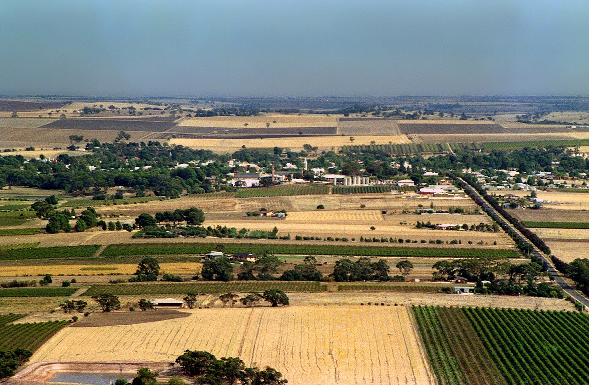

# Peter Lehmann

Peter Lehmann (1930–2013) was one of the Barossa Valley's most emblematic winemakers. His reputation rests less on a single trophy than on a concrete choice: when the big wineries stopped buying growers' grapes and a government scheme paid farmers to pull up vines, he promised to buy the fruit at a fair price. That promise became a company, and the company helped keep old vines and farming families in the district.

Figure: Barossa Valley vineyards in 1987; a regional scene, not a portrait of Peter Lehmann and not his winery. Image: Phillip Capper, CC BY 2.0, via Wikimedia Commons ([source page](https://commons.wikimedia.org/wiki/File:Vineyards_in_Barossa_Valley,_South_Australia,_1987.jpg)).

## Early life and training

Lehmann was born in Angaston on 18 August 1930, the son of a local Lutheran pastor. His father died when he was young, and he left school at seventeen to become an apprentice at Yalumba. Unlike winemakers who spent their whole careers inside a large corporate laboratory, he dealt directly with growers year after year. He learned how each block yielded, which family farmed it and what kind of fruit it could deliver. That knowledge later became a commercial asset as well as a personal network.

## From Yalumba to Saltram

After joining Yalumba in 1947, Lehmann trained under figures such as Rudi Kronberger. In 1960 he moved to Saltram as chief winemaker and stayed for about two decades. The job taught him both sides of the industry: the volume logic of a large winery and the difference between blocks that could make memorable wine and those that could not. He also saw how quickly a corporate buyer could withdraw from a district when the market turned.

## 1979: a market for growers

In the late 1970s Barossa faced a serious grape surplus. Saltram and other large buyers cut their intake, while a government vine-pull scheme encouraged growers to remove old vines. Lehmann had already promised to take fruit and did not want to break his word. He helped set up a new company with the deliberately risky name Masterson Barossa Vineyards, found equipment and markets, and began buying grapes. The company started in 1979 and was renamed Peter Lehmann Wines in 1982. It was not a luxury estate at first; it was a lifeline that kept old vines in the ground.

## The wines

Lehmann's style generally let the fruit speak. His Shiraz showed ripe black fruit, spice and structure; Eden Valley Riesling kept acidity and citrus; Cabernet Sauvignon retained a firm frame rather than being buried under new oak. In 1987 he decided to make a special Shiraz named after the Stonewell district. The 1989 Stonewell Shiraz won the Jimmy Watson Trophy, one of Australia's most important wine prizes. Eight Songs Shiraz, first made in 1996, offered a softer, velvet-textured reading of Barossa Shiraz.

## Institutional legacy

Lehmann left more than wines. His company at its peak bought from about 140 growers, many of them small family farms. Long-term contracts and handshake agreements kept old vines in production. In 1992, when an original investor exited, the company used a public share offering that allowed growers and staff to subscribe; writing grower relationships into the share register was unusual in Australian wine. That network is part of the reason Barossa can now present old-vine Shiraz as a regional treasure. The winery was sold to the Swiss Hess group in 2003 and later joined Casella Family Brands in 2016, but the brand continued to trade on his name and on Barossa.

## Assessment and disputes

The positive case calls him the “Baron of Barossa” and argues that he took market risk at the worst possible moment for the district. The criticism has two parts. First, the saviour narrative can flatten a complex crisis into one man's generosity, ignoring government subsidies, bank credit and global market cycles. Second, successive ownership changes expanded the brand, creating tension between the early “guardian of small growers” image and capitalised production. Lehmann retired in 2002, received a lifetime achievement award from the International Wine Challenge in 2009, and died in Adelaide on 28 June 2013. His funeral and memorial brought together growers, winery workers and competitors; that cross-section of the district mattered more than any medal. On the founding date, Wine Spectator uses 1979 while the winery's own narrative treats the first 1980 vintage as the starting point. The two claims are not contradictory: one marks incorporation, the other the first wine.

## Common misreadings

First, he was not an outside investor who discovered Barossa. He was born in the district and trained inside its wineries. Second, Masterson was not merely a commercial speculation. It was a gamble, but the stake was whether growers could stay on their land. Third, Stonewell is not a single vineyard in the strict sense; it is a district-level selection drawn from several old-vine blocks. Fourth, “Baron of Barossa” is an industry nickname, not a title of nobility.

Start with the period and the role. From there, consider the documented work, then the sources behind the claim. That is how a practical judgment about Peter Lehmann is built.

[Barossa](ref:barossa) and [Syrah](ref:shiraz) are the nearest useful comparisons: one clarifies role, the other tests period.

**At a glance:** Barossa Valley winemaker (1930–2013) who founded Masterson Barossa Vineyards in 1979 to buy grapes from growers facing a vine-pull scheme, renamed the company Peter Lehmann Wines in 1982, and shaped modern Barossa through Stonewell Shiraz and long-term grower contracts.

**Key facts.**

| Item | Detail |
| --- | --- |
| In one line | Barossa Valley winemaker (1930–2013) who founded Masterson Barossa Vineyards in 1979 to buy grapes from growers facing a vine-pull scheme, renamed the company Peter Lehmann Wines in 1982, and shaped modern Barossa throug… |
| Life | 1930–2013 |
| Roles | winemaker、winery founder |
| Regions | Australia、Barossa |

**Sources and limits.** The key claims about Peter Lehmann are checked against the following sources: Peter Lehmann Wines (Used to check the winery's Barossa location, four-decade history and founder's standing; no text copied), Wine Spectator, The Wandering Palate and 5 sources in total. Prices, batches and status change; the body is project-written and does not reproduce source text.

## Further reading

Wine Spectator's obituary supplies the skeleton of dates, appointments and ownership changes, while the winery's own blog adds Stonewell, Eight Songs and grower relationships. The Wandering Palate's remembrance concentrates on the district-rescue narrative. The three sources have different positions: the obituary favours facts, the winery favours brand story, and the remembrance favours assessment. Reading them together avoids turning Lehmann into a solitary hero or crediting him with every later commercial success. He received the Order of Australia, but sources differ between AM and AO; this profile keeps the verifiable fact of the honour without forcing a grade.

## See also

- [Barossa](ref:barossa): the district he worked for and defended.
- [Barossa wine trail](ref:barossa-trail): an entry to the estates, old vines and towns of the region.
- [Shiraz](ref:shiraz): the variety behind Stonewell and Eight Songs.
- [Red wine](ref:red-wine): the wider category for his style.
- [Australia](ref:australia): the longer story of Australian wine exports and regional revival.
