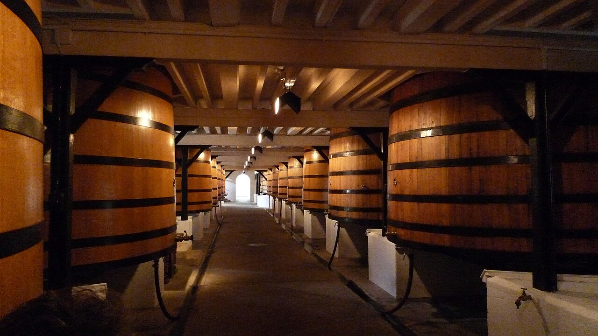

# Baron Philippe de Rothschild

Baron Philippe de Rothschild (1902–1988) was a French estate owner, entrepreneur and promoter of wine. In 1922, still in his early twenties, he took over Château Mouton Rothschild in Pauillac and turned a Second Growth into one of the most recognisable wine brands in the world. He pushed château bottling in 1924, began the annual artist labels in 1945, launched Mouton Cadet in 1930, secured Mouton's promotion to First Growth in 1973, and in 1979 co-founded Opus One with Robert Mondavi.

Figure: The Grand Chai at Château Mouton Rothschild. Image: MPW57, Public domain, via Wikimedia Commons ([source page](https://commons.wikimedia.org/wiki/File:Chateau_Mouton_Gaerkeller.jpg)).

## An heir who broke the rules

Philippe was born in Paris on 13 April 1902 into the French branch of the Rothschild family. Mouton had been classified a Second Growth in 1855, and its vines sit at the northern end of Pauillac next to Lafite. When he took over in 1922, Bordeaux was still organised around merchants who bought wine in bulk and sold it under their own names; the estate's identity could disappear behind a négociant's label. He concluded that unless "Mouton" reached the consumer directly, the estate would remain a supplier of raw material.

In 1924 he took the radical step of bottling the wine at the estate and printing "Château Mouton Rothschild" on the label. This is the heart of mise en bouteille au château: not a packaging trick, but the unification of growing, vinifying, ageing, bottling and brand control under one owner. In 1926 he built the Grand Chai, the great barrel hall that still anchors visits and ageing.

In 1930 he launched Mouton Cadet, a Bordeaux brand made from grapes outside the First Growth, aimed at everyday drinking. It is often mistaken for Mouton's second wine; it is a separate brand, designed to put the name in more hands and give the estate steadier cash flow. In 1933 he bought Château d'Armailhacq, renamed it Mouton Baronne Philippe in 1956 and saw it revert to the d'Armailhac name in 1989. In 1970 he added Château Clerc Milon. Mouton was no longer a single estate but a small wine group.

## Artist labels and the 1973 promotion

In 1945, with the war over, Philippe designed the label himself: a white field, a large "V", olive branches and grapes. From then on he invited an artist each year to design the label. The list includes Jean Cocteau, Marc Chagall, Pablo Picasso, Salvador Dalí, Andy Warhol and Francis Bacon. The tradition tied wine, art and the collectors' market together and made Mouton a label that could hang on a wall.

The artist label is not an original painting on every bottle. Labels are printed, the original works may sit in the estate's museum, and different years and print runs vary. In 1962 Philippe created the Museum of Wine in Art at Mouton, collecting paintings, sculpture, objects and manuscripts related to wine. Visitors should keep two things apart: the annual label is a commercial design; the museum is a long-term collection.

In 1973 Mouton was promoted from Second to First Growth, the only official change to the 1855 classification since its creation. Philippe had campaigned for more than two decades, arguing that Mouton's quality, prices and international reputation already matched the First Growths. The promotion did not make the wine better overnight; it made the institution recognise a long record. It also created a lasting anomaly: Mouton is the only First Growth that does not fit the original 1855 list.

In 1979 Philippe met [Robert Mondavi](ref:mondavi) at Mouton and agreed, in about an hour, to make one wine together. Opus One used Napa fruit, Bordeaux blending and a shared label; the dedicated winery opened in Oakville in 1991. For Philippe, it was the first time Mouton's name and method were applied to vines outside France. For Mondavi, it was California entering Bordeaux's own language.

## How to read Mouton

At Pauillac, look at three layers rather than simply ticking off a First Growth. First, the vineyard: Mouton's gravel terrace is next to Lafite, but the microclimate, blocks and drainage differ, and so do Cabernet ripeness and the blend. Second, the Grand Chai and label wall: the barrel hall shows how vintages are managed, while the wall turns the artist labels since 1945 into a visual history. Third, the Museum of Wine in Art: look at how objects, paintings and manuscripts are arranged as a narrative about wine, not as a room full of label originals.

Drinking Mouton is not only about price. A classic vintage shows blackcurrant, cedar, pencil lead, tobacco and violet, with powerful but polished tannin; with age, leather and mushroom notes appear. Young vintages lean more on fruit and oak. Pauillac Cabernet works with steak, lamb, hard cheese and game; avoid very spicy or very sweet dishes that overwhelm the structure.

Mouton Cadet follows a different logic. It is not built for decades of ageing but for consistency and everyday tables. Treat it as an entry point to Bordeaux rather than a cheap Mouton, and the brand architecture makes sense: the First Growth at the top, the second wine Le Petit Mouton below it, and Mouton Cadet as a separate commercial brand.

## Disputes and common misreadings

First, Mouton was not always a First Growth. It was a Second Growth from 1855 until 1973; projecting today's status back into the nineteenth century misunderstands the classification. Second, the 1973 promotion was not a matter of buying votes. It followed a formal procedure involving the French agriculture ministry and was based on decades of quality and market performance. "Bribery" is a lazy explanation.

Third, artist labels are not hand-painted originals on every bottle. Most are printed labels; originals may be held by the estate or by collectors. Fourth, Mouton Cadet is not Mouton's second wine. It is a separate brand with different fruit and different aims; the actual second wine, Le Petit Mouton, arrived only in 1993.

Fifth, Philippe was not the sole founder of Opus One. The venture is owned equally by Mouton and Mondavi, with shared teams and decisions; crediting one side erases the transatlantic structure. Sixth, he was not merely an aristocratic marketer. Estate bottling, the Grand Chai, vineyard management, vintage selection and the museum all required capital and patience. Marketing followed the substance, not the other way round.

## Place in this atlas

Mouton connects three threads. The first is the institutions of [Bordeaux](ref:bordeaux): the 1855 classification, Second Growth status, the 1973 promotion, estate bottling and the changing role of merchants. The second is the terroir of [Pauillac](ref:pauillac): gravel terraces, Cabernet Sauvignon and the proximity of Lafite, Mouton and Latour. The third is the modern language of [wine](ref:wine): artist labels, museums and wine tourism as part of the brand.

To follow the estate-as-brand thread, compare Mondavi's varietal labelling and visitor experience. To follow the classification thread, read the 1855 list and the 1973 promotion. To follow the joint-venture thread, read Opus One's 1978 agreement and 1991 winery. Mouton is not an isolated castle; it is a meeting point of Bordeaux institutions, the art market and global wine trade.

## See also

- [Château Mouton Rothschild](ref:mouton): Pauillac, First Growth, artist labels and visits.
- [Wine](ref:wine): Bordeaux blending, oak ageing and vintage variation.
- [Bordeaux](ref:bordeaux): the 1855 classification, left and right banks, and the merchant system.
- [Pauillac](ref:pauillac): gravel terraces, Cabernet Sauvignon and the Lafite-Mouton-Latour geography.
- [Robert Mondavi](ref:mondavi): the other half of Opus One and California's entry into Bordeaux's language.
