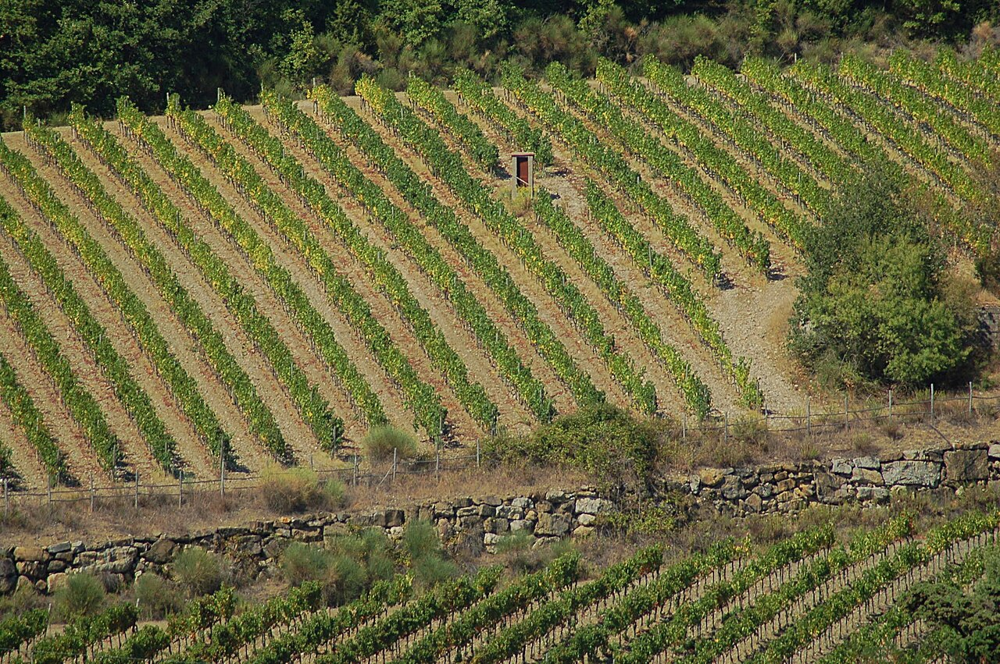

# Piero Antinori

Piero Antinori (born 1938) is an Italian wine producer and the 26th generation of the Marchesi Antinori family in Tuscany. His name is inseparable from Tignanello: a Tuscan red first released in 1971, made from Sangiovese blended with Cabernet, aged in small oak, and no longer containing white grapes. It was a break with the old rules of Chianti and a sign that the Italian wine industry was seeking a new international position in the 1970s.

Figure: Vineyards in the Chianti Classico valleys; a core Antinori regional scene, not a portrait of Piero Antinori. Image: Tom Chance, CC BY-SA 2.0, via Wikimedia Commons ([source page](https://commons.wikimedia.org/wiki/File:Vineyards_in_the_Chianti_Classico_valleys.jpg)).

## Family and succession

The Antinori family's connection with Florence goes back centuries. In 1385 a family member was registered in the Florentine wine merchants' guild, the formal entry into the wine trade. The family subsequently ran farms, estates and commerce in Tuscany; by Piero's generation it was the 26th. Piero was born in Florence in 1938 and was trained not only in agriculture but in the business and commercial side of a family firm.

In 1966 Piero took over the family business. It was a turning point for Italian wine: the post-war sharecropping system was ending, farmers were leaving the land, and the old relationship between landowners and tenants was collapsing. Many estates kept planting high-yield clones, and Chianti's reputation was damaged by cheap, diluted wine. Piero looked outward: he studied estate management and winemaking in France and the United States, then returned to push changes in varieties, equipment and marketing.

## The Tignanello break

Tignanello comes from the single vineyard of Tenuta Tignanello, at about 350–400 metres, with limestone and tuff soils. In 1970 the vineyard was vinified separately for the first time; in 1971 the wine was named Tignanello and sold as a Tuscan table wine (vino da tavola), not as Chianti Classico. In 1975 the blend dropped white grapes entirely; from 1982 it was fixed with Sangiovese as the majority, plus Cabernet Sauvignon and Cabernet Franc.

The break had three layers. First, it put Sangiovese in small oak barriques, changing the large-cask style of traditional Chianti. Second, it blended a non-traditional variety, Cabernet, breaking the rule that Chianti had to be made from local varieties. Third, it abandoned white grapes when Chianti regulations still required a small proportion. Because it did not fit the rules, it had to be sold as a simple table wine; that is the background to the later term "Super Tuscan".

## Solaia and the estate network

In 1978 Antinori released Solaia, also from prime plots at the Tignanello estate, based on Cabernet Sauvignon with Sangiovese and Cabernet Franc. The two formed a pair: Solaia leaned toward international power, Tignanello toward Sangiovese aroma and structure. Both became references for premium Italian wine and emblems of the Super Tuscan movement.

Piero also expanded the family business beyond Tuscany: Castello della Sala in Umbria, Guado al Tasso in Bolgheri, Pian delle Vigne in Montalcino, and partnerships in Chile, the United States and Hungary. The portfolio includes Chianti Classico, Brunello, Bolgheri and Cervaro della Sala. The network turned Antinori from a Florentine family estate into a multinational wine group, but it also raised a new question: how to keep each region's style distinct rather than simply attaching one family name to every bottle.

## Rules and family succession

Tignanello's importance was not only in the wine. It pressed the Italian system to respond. In the 1990s Italy created the IGT (Indicazione Geografica Tipica) category, giving a legal identity to wines that did not fit traditional DOC/DOCG rules but had a clear region and quality ambition. Tignanello-type "table wines" thus acquired a clearer institutional place, and Tuscan estates gained more freedom to use international varieties and small oak.

Piero's three daughters, Albiera, Allegra and Alessia, gradually entered management; he became honorary chairman. The family business used trusts and long-term shareholding to prevent short-term sale of control. That arrangement gave Antinori unusual continuity in Italian wine, but it also concentrated decision-making inside the family and limited space for outside managers.

## Assessment and controversy

The favourable view treats Piero as a driver of the Italian wine renaissance: he helped move Tuscan wine away from a cheap, confused image into the international premium market; Tignanello and Solaia showed that Italy could compete with France and California; the family network and marketing gave Italian wine better positions in global distribution.

Criticism has three main lines. First, "Super Tuscan" is a marketing label that packages "leaving the old rules" as "higher quality", which is not always true; some critics argue it encouraged excessive new oak and a high proportion of international varieties. Second, Tignanello's success produced imitation, with many estates copying Cabernet and barriques and diluting the local character of Tuscany. Third, multinational expansion under one family name can dilute the brand: quality and style vary widely, and consumers need to look at the specific wine, not just "Antinori".

## Common misreadings

The first is to call Tignanello "the first Super Tuscan". More accurately, it was one of the most representative early wines in that category; the term became common later, and other estates were making similar wines at the same time.

The second is to call Tignanello a "Chianti". When released in 1971 it was a Tuscan table wine, not Chianti Classico; the IGT category came later.

The third is to treat Piero as a lone genius. Tignanello was the work of family, vineyard teams, winemakers and a marketing network; his role was closer to strategic decision-making.

The fourth is to treat "26 generations" as a quality guarantee. Continuity shows endurance, not that every generation or every wine reached the same level.

## See also

- [Tuscany](ref:tuscany): the core region of the Antinori family and Tignanello.
- [Italy](ref:italy): the national background of the Super Tuscan and IGT system.
- [Sangiovese](ref:sangiovese): the main variety in Tignanello.
- [Red wine](ref:red-wine): the category that explains Tignanello and Solaia.
- [Place and process](ref:place-process): the wider framework for his variety, site and oak choices.

Piero Antinori is best approached through the period and the role, then the documented work, and then the sources behind the claim. One check alone will not settle it.

[Tuscany](ref:tuscany) and [Sangiovese](ref:sangiovese) are the two useful reference points for Piero Antinori. [Tuscany](ref:tuscany) sets out role; [Sangiovese](ref:sangiovese) brings in period. Read them together.

**Short definition:** Italian wine producer (born 1938), 26th generation of the Marchesi Antinori family; his Tignanello, first released in 1971, blended Sangiovese with Cabernet and used small oak, rewriting the expression of Tuscan red wine.

**Key facts.**

| Item | Detail |
| --- | --- |
| In one line | Italian wine producer (born 1938), 26th generation of the Marchesi Antinori family; his Tignanello, first released in 1971, blended Sangiovese with Cabernet and used small oak, rewriting the expression of Tuscan red wine… |
| Life | 1938–? |
| Roles | winery owner、wine producer、family-business leader |
| Regions | Italy、Tuscany |

**Sources and limits.** The key claims about Piero Antinori are checked against the following sources: Marchesi Antinori, Comitato Grandi Cru d'Italia, Oxford University Press (Used for the background of Tignanello, Super Tuscan and the Tuscan IGT system; no entry copied) and 5 sources in total. Prices, batches and status change; the body is project-written and does not reproduce source text.
