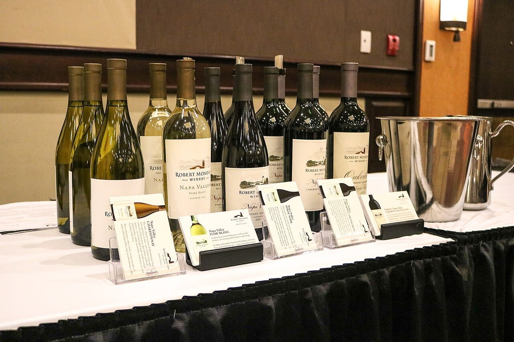

# Robert Mondavi

Robert Mondavi (1913–2008) was an American winemaker, winery owner and promoter of wine. In 1966 he founded the winery that carries his name in Oakville, Napa Valley, bringing varietal labelling, French oak, temperature-controlled fermentation and wine tourism into Californian wine. In 1979 he co-founded Opus One with Baron Philippe de Rothschild. For many observers he is the person who helped turn California wine from a bulk agricultural product into a subject of international comparison.

Figure: Wine bottles on the tasting table at Robert Mondavi Winery. Image: U.S. Embassy and Consulates in Canada, Public domain, via Wikimedia Commons ([source page](https://commons.wikimedia.org/wiki/File:Robert_Mondavi_Winery_(40781401945).jpg)).

> **Quick verdict**
> **In one line:** This profile explains why Robert Mondavi is remembered, and which works to look at first.
>
> - **Best for:** Anyone trying to understand what Robert Mondavi did and why the drink world remembers them.
> - **Not for:** If you want only want anecdotes and do not care about historical position.
> - **Check first:**
>   - Mondavi's parents emigrated from Sassoferrato in the Marche region of Italy.
>   - The site was not chosen by accident.

## From Lodi to Oakville

Mondavi's parents emigrated from Sassoferrato in the Marche region of Italy. They first settled in Minnesota, where Robert was born in Virginia in 1913, then moved to Lodi, California, where his father, Cesare, ran a fruit and grape business. The family sold grapes to Italian-American households who made wine at home, so Robert grew up close to the practical side of the trade rather than the salon side.

He studied economics at Stanford and graduated in 1936. In 1943 his father bought Charles Krug in St Helena, and Robert and his younger brother Peter joined the family business. Charles Krug gave him a full apprenticeship: winemaking, cellar work, sales, and the politics of a family firm. It also gave him a conviction that quality, not volume, was the future of Napa.

In 1965 a serious disagreement over the direction of the business split the brothers. Robert left, bought land in Oakville, and opened Robert Mondavi Winery in 1966. The timing looked wrong. Napa was still recovering from Prohibition and most growers sold bulk wine; few believed a small California winery could charge Bordeaux prices. Mondavi's answer was to build a winery that behaved like a European estate and a California brand at the same time.

## The 1966 winery

The site was not chosen by accident. To Kalon, an alluvial fan in Oakville, has well-drained soils, strong afternoon sun and cool nights: conditions that can ripen Cabernet Sauvignon while keeping enough acidity for structure. Mondavi made To Kalon the centre of the estate and used it to argue that California had sites, not just sunshine.

Three technical choices mattered. First, he put the variety on the label. Instead of "California red" or "Burgundy type", the bottle said Cabernet Sauvignon, Chardonnay or Sauvignon Blanc. This taught American consumers to think in varieties and helped [the United States](ref:usa) enter the international language of wine. Second, he used stainless steel and temperature control to make cleaner, fruitier whites, and French oak barrels to give structure and spice to the reds. Third, in 1968 he turned the then-unfashionable Sauvignon Blanc into a dry, oak-aged wine called Fumé Blanc, sidestepping the market's prejudice with a new name.

The winery was also a stage. Mondavi gave tours, hosted tastings, invited chefs and journalists, and argued that wine belonged with food and everyday life. He helped restore the Napa Valley Opera House and supported arts and education in the valley. In 2001 UC Davis named its wine and food science institute after him, a public legacy he valued more than another vintage.

## Opus One and two traditions

In 1978 Mondavi met [Baron Philippe de Rothschild](ref:philippe) at Mouton. The two men agreed in about an hour to make one wine together: Napa fruit, French and American winemaking, a single shared label. The first vintage was 1979; the dedicated winery opened in 1991. The name Opus One borrows the language of classical music: a first work, and a complete one.

Opus One is often reduced to "California beating Bordeaux". It is more accurately a marriage of institutions. Mouton brought Bordeaux blending, ageing and brand narrative; Mondavi brought Napa ripeness, vineyard management and access to the American market. The venture showed that California could be discussed in Bordeaux's own terms, and that a first growth was willing to treat a New World partner as an equal. But it was never Mondavi's solo achievement, and it is not proof that California "overtook" Bordeaux. It is one wine, shaped by two teams, specific years and a particular market moment.

## What to look for

At the Oakville estate, look past the postcard architecture. Three things explain the wines. First, the position of To Kalon: different blocks on the same fan drain differently, and that shows up in Cabernet ripeness and acidity. Second, the fermentation and ageing spaces: stainless steel, barrels and the tasting room layout reveal the 1960s idea of opening a winery to the public. Third, the tasting list: Fumé Blanc is the clearest example of Mondavi's naming strategy, while the Reserve Cabernet is the clearest expression of To Kalon structure.

Drink the wines as a lesson in California varietal language rather than as a trophy. Fumé Blanc balances citrus and herbal notes; Reserve Cabernet offers blackcurrant, cedar and vanilla. Fumé Blanc works with seafood, white meat and soft cheese; Reserve Cabernet with steak, lamb and hard cheese. For Opus One, focus on how the aroma unfolds after decanting and on the texture of the tannin, not on the label alone.

## Misreadings and disputes

First, Mondavi did not invent California wine. Napa already had Montelena, Stag's Leap, Inglenook and many growers in the 1960s; UC Davis research, field trials and the 1976 Judgment of Paris were pushing in the same direction. His distinctive contribution was to combine technique, marketing, media and lifestyle into a repeatable estate model.

Second, he was not merely a salesman. Varietal labelling, temperature control, French oak and vineyard selection all required capital and patience, and his wines performed consistently in blind tastings. The opposite error is also common: he did not change California alone. Without his family's capital, his team and Napa's particular soils, the model would not have lasted fifty years.

Third, Opus One is not a "Mouton California branch". It is a separate joint venture, owned equally, with its own fruit, winery and team. Fourth, the Mondavi family later sold and restructured the business; today's ownership is not the 1966 family structure, and visitors should not confuse brand storytelling with family control.

Finally, small facts matter. Mondavi was born on 18 June 1913 and died on 16 May 2008. Chinese transliterations of his name vary; both common forms refer to the same person. Keeping these boundaries clear lets us credit his influence without flattening the complex history of California wine into one biography.

## Place in this atlas

Mondavi's story connects three threads. The first is the craft of [wine](ref:wine): varietal labelling, temperature-controlled fermentation and oak ageing are part of the modern language of wine. The second is the history of [Napa Valley](ref:napa): from a post-Prohibition bulk region to the quality revolution of the 1970s and the international partnership behind Opus One. The third is the transatlantic network of estates, merchants and markets that made wine global in the late twentieth century.

To follow the estate-as-brand thread, compare Mouton's artist labels and 1973 promotion. To follow the blind-tasting thread, read the 1976 Judgment of Paris. To follow the Spanish, Chilean and Californian exchange, look at Familia Torres and Opus One's international investments. Mondavi was not an isolated hero; he was one of the network's best connectors.

## See also

- [Robert Mondavi Winery](ref:winery): Oakville, To Kalon and visiting information.
- [Wine](ref:wine): varieties, fermentation, oak and ageing.
- [Napa Valley](ref:napa): the history and sub-zones of California's flagship region.
- [United States](ref:usa): Prohibition, the California wine industry and the 1976 Judgment of Paris.
- [Baron Philippe de Rothschild](ref:philippe): Mouton, artist labels and the other half of Opus One.

For Robert Mondavi, begin with the period and the role. Then look at the documented work, and finally ask the sources behind the claim. The answers point to different choices, not to a single score.

Mondavi founded the Robert Mondavi Winery in Napa Valley in 1966 and championed cold fermentation, French oak and varietal labelling.
