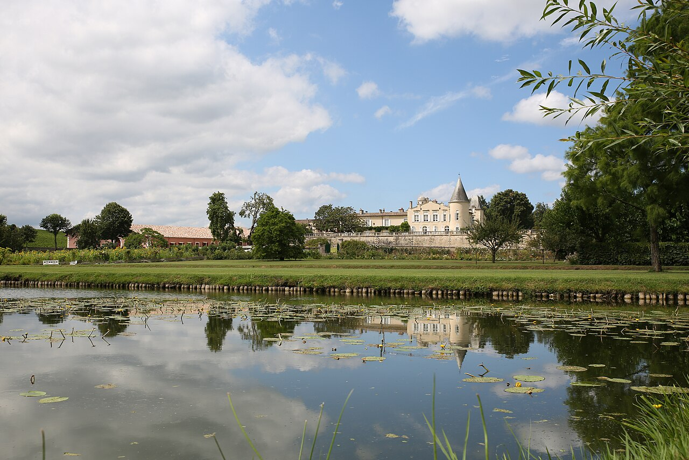

# Robert Parker

Robert Parker (born 1947) is an American wine critic and one of the most influential reviewers in the modern wine market. His method was simple: take no advertising, accept no hospitality from estates, score wines on one common scale and sell the results to subscribers. That was novel in 1970s America and later changed how the trade talked about wine.

Figure: Robert Parker. Photograph: File:Château Lafite-Rothschild.jpg. Credit: PA, CC BY-SA 4.0 ([source page](https://commons.wikimedia.org/wiki/File:Ch%C3%A2teau_Lafite-Rothschild.jpg)). Category image; not a claim that it shows the exact product, site or event.

## Life

- Born on 23 July 1947 in Baltimore, Maryland.
- Read history at university, then law, and worked as a lawyer; in the 1970s he began tasting and writing about wine.
- In 1978 he founded The Wine Advocate in Maryland at his own expense, initially typed and copied and sent to subscribers, with no advertising.
- In 1983 his high scores for 1982 Bordeaux barrel samples drew controversy; most critics thought the year too ripe to age, but later performance supported him.
- In 1984 he left the law to run the publication full time.
- In December 2012 he stepped back from full-time editing, and Lisa Perrotti-Brown became editor in chief.
- In 2017 Michelin acquired 40% of the publication and became sole owner in 2019; Parker retired in May 2019 at the age of 71.

## His actual role in the wine trade

Parker was neither a winemaker nor an estate owner; his position was at the judging and pricing-information end. The work was concrete: tasting at the barrel in Bordeaux, the Rhone and California; scoring wines and writing descriptions; running a subscription publication that refused advertising; and selling reviews worldwide.

The relationship was indirect but powerful. Estates could not order a score, yet they adjusted viticulture, picking and winemaking toward his preferences; importers and retailers printed scores on shelf talkers; the en primeur market used his ratings as a pricing reference. The market, not he alone, wanted one uniform signal.

## The institutional design of The Wine Advocate

The core model was "readers pay, the critic stays independent". It carried no advertising and the reviewer did not depend on estates, which gave independence an institutional basis. The newsletter covered [Bordeaux](ref:bordeaux) and [American](ref:usa) wines early on, then expanded to regions worldwide.

This model was uncommon at the time. Most wine writing depended on advertising or estate relationships, and readers could hardly judge whether a review had been influenced. He made independence a selling point and built subscriber trust; once trust was established, scores carried market power. Independence does not mean the absence of preference; it only removes one kind of conflict.

## The 100-point scale in practice

In the 1980s Parker adopted a 100-point scale that compressed quality into a number. The system was not his invention, but in his newsletter it was systematised and widely quoted. Its bands are: 96-100 extraordinary, 90-95 outstanding, 80-89 very good, 70-79 average, 60-69 below average and 50-59 unacceptable.

The advantage is directness: readers can compare quickly. The disadvantage is coarseness: aroma, structure, ageing potential and food pairing are hard to sum up in one number. This is especially true of [vintage](ref:vintage) judgments, where differences between one estate in different years are far more than a single score can express. A score is one reviewer's judgment under particular conditions, not an objective property of the wine.

## The 1982 Bordeaux vintage and the en primeur market

The 1982 vintage was the turning point in Parker's reputation. After tasting barrel samples in 1983 he published high scores, while many colleagues thought the year too ripe and lacking the ability to age. Later performance proved him right, subscribers increased, and he was able to leave the law in 1984.

The significance was not only that he "got a vintage right": an independent critic could judge earlier and more publicly than merchants and magazines, and turn judgment into tradable information. The en primeur market was especially sensitive: buyers order before bottling, and scores became one of the few references.

## Representative works

Beyond the newsletter, Parker published books in the 1980s, including Bordeaux and The Wine Buyer's Guide, which turned regional reports and buying advice into reference manuals.

His more lasting "work" was institutional: subscription only, no advertising and critics assigned by region. Many later wine publications adopted a similar structure.

## Assessment and disputes

Supporters say he raised expectations of quality, pushed improvements in hygiene, temperature control and winemaking, and brought attention to neglected regions. Critics use the term "Parkerization" for estates moving toward ripe, concentrated, overtly oaky styles in pursuit of high scores, at the cost of regional difference and lightness.

The 2003 Chateau Pavie is a concrete case. According to the tasting note published in the Financial Times and the public exchange that followed, Jancis Robinson scored the Saint-Emilion wine 12/20 and called it overripe with port-like sweetness; Parker publicly rejected the judgment as unfair. The argument was about taste and also about the power to score.

A further criticism is score inflation: as high scores become denser, the scale loses discrimination. That is the result of a single rating system being overused, not of one person alone.

## Common misreadings

First, treating 100 points as absolute quality, or assuming the scale starts at zero. It is a reviewer's judgment and begins at 50.

Second, treating Parkerization as his personal decree. Homogenisation was a market outcome and cannot be attributed to one person alone.

Third, treating a high score as "suitable for everyone". A high-scoring wine may not suit your budget, your food or your taste.

Fourth, treating independent criticism as free of bias. Every critic has preferences; what matters is that methods and interests are disclosed.

Fifth, confusing his 2019 retirement with death. Parker retired in May 2019 and is still alive; retirement and the sale of the publication are separate events.

## How to use scores

First see who is scoring, by what method and under what conditions, then read the description behind the number instead of the number alone. Use scores as a screening tool, not a conclusion. Most important, drink: buy two bottles of different styles at the same price, compare and keep notes, and you will learn your own preferences better than any score can.

## See also

- [Wine](ref:wine): definitions, craft and main types.
- [Bordeaux](ref:bordeaux): one of the regions where Parker's influence was strongest.
- [Vintage](ref:vintage): why the same year means different things at different estates.
- [United States](ref:usa): the background of the modern wine-review and consumer market.

**At a glance:** An American wine critic, born in 1947; in 1978 he founded the independent newsletter The Wine Advocate, and his 100-point scale shaped the global wine market, while the “Parkerization” debate over homogenised taste made him a focus of the industry. He retired in 2019.

**Key facts.**

| Item | Detail |
| --- | --- |
| In one line | An American wine critic, born in 1947; in 1978 he founded the independent newsletter The Wine Advocate, and his 100-point scale shaped the global wine market, while the “Parkerization” debate over homogenised taste made … |
| Life | 1947–? |
| Roles | wine critic、publisher |
| Regions | United States |
