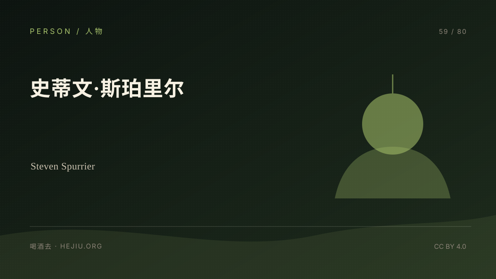

# Steven Spurrier

Steven Spurrier (1941–2021) was a British wine merchant, educator and writer. He ran a wine shop and a wine school in Paris for many years and is best remembered for organising the 1976 Judgment of Paris tasting; later he wrote for and judged with Decanter, becoming a bridge between the old European hierarchy and the rising wine world.

Figure: Steven Spurrier. Project-generated or category illustration used for bar and drinks context; not a photograph of the subject.

## Life

Spurrier was born in England in 1941. According to his archive and his own account, he entered the wine trade in 1964 and learned the business as an apprentice merchant. In 1971 he moved to France and bought Les Caves de la Madeleine, a wine shop near the Madeleine church in Paris. In 1973 he founded the Académie du Vin next door, often described as one of the first bilingual wine schools in [France](ref:france).

His career was never confined to one role. He was a merchant, a teacher, a taster and a columnist, and in later life a grower and winemaker. In 2009 he turned his farm in Dorset, England, into Bride Valley Vineyard, and in 2014 he presented his own wines for the first time. He died at Bride Valley on 9 March 2021, aged 79. The dates matter: second-hand sources sometimes move his death to 2020 or 2022, or attribute the Paris tasting to someone else.

Spurrier was not a university-trained oenologist. His knowledge came from the shop, the tasting room and travel: in Paris he selected wines for customers and took clients to wine regions, and the school turned that apprenticeship model into a curriculum. This background made him care about what was in the glass and how the market responded, not only about official rank. It also helped him explain California to the French and French regions to English-speaking readers.

## The Judgment of Paris

In 1976 Spurrier and Patricia Gastaud-Gallagher, director of the Académie du Vin, staged a blind tasting framed around the American Bicentennial. Twenty wines were entered, ten from California and ten from France, and the samples were served without labels and identified only by number. The judges were mostly French wine professionals. A 1973 Chardonnay from Chateau Montelena won the white flight, and a 1973 S.L.V. Cabernet Sauvignon from Stag's Leap Wine Cellars won the red flight.

The event became known as the [Judgment of Paris](ref:judgment). Its original purpose was closer to a promotional comparison that would introduce [California](ref:usa) wine to Paris than to a campaign to overthrow French rank. But when George Taber of Time reported the result, it was quickly read as a symbolic victory of the New World over the Old. Spurrier himself repeatedly insisted that a single tasting could not prove the superiority of a whole region; what it changed was the willingness to admit that fine wine could appear outside the established hierarchy.

## From merchant to writer

After the tasting, Spurrier continued to run his shop, host tastings and expand his business. In 1979 he moved with his family to New York to try to repeat the Paris wine school, but the venture failed and they returned to Britain. In 1982 he was invited to design and direct the Christie's Wine Course. From 1989 to 2014 he was a wine consultant to Singapore Airlines, a role that kept him travelling across wine regions.

In 1993 he began writing for Decanter and later became a consultant editor. He helped develop the Decanter World Wine Awards in 2004 and served as its chair, and in 2017 he was named Decanter Man of the Year. The title matters: "consultant editor" is not editor-in-chief, and the role did not give him final authority over the magazine. His writing and judging connected tasting language, regional knowledge and market judgment for a wide readership.

## Influence on the wine world

First, he made blind tasting a public method of argument. Before 1976, origin, estate reputation and price often came before what was in the glass; afterwards, journalists, merchants and schools were more willing to compare wines without labels. Second, he helped bring [American](ref:usa) wine, especially from Napa Valley, into international wine lists and auction talk. He was not the only cause: research at UC Davis, field trials by growers and sustained marketing also mattered.

Third, he built a transnational educational network through schools, courses and awards. The Académie du Vin trained not only consumers but also people who later entered criticism, sommellerie and the trade. Fourth, his late publishing project, the Académie du Vin Library, reissued classic wine writing for a new generation. The Decanter World Wine Awards, grouped by region and price band, gave newer regions a steady route to exposure; the model has also been criticised for the sheer number of medals and for commercial pressure. Taken together, his influence was that of a connector of worlds rather than the inventor of a technique.

## Disputes and common misreadings

First, the Judgment of Paris was not his alone. Gallagher handled much of the preparation and contact work, and the judges, estates and press made the event what it was. Second, the ranking of twenty wines is not a region-wide verdict. Sample size, vintage, transport and storage, and serving order all affect results, and later re-tastings have not always reproduced the same order.

Third, media and film dramatised the story. Documentaries, popular books and the movie Bottle Shock strengthened the "underdog" narrative, but the film takes liberties with people and details and should not be read as a historical record. Fourth, Spurrier was not anti-French. He sold and promoted [French](ref:france) wine for decades and knew the old regions well; the tasting challenged a rigid hierarchy, not France itself.

Fifth, he is sometimes called "editor-in-chief of Decanter", and the tasting is sometimes described as the invention of blind tasting. Blind tasting was already practised in the trade; his contribution was to turn a comparison into a public event with lasting reach. Sixth, assessments of him swing between two poles: a hero who broke Europe's monopoly on fine wine, and a marketing stunt that later became over-mythologised. The defensible view is that he changed how quality was publicly argued, but the change was gradual and cannot be credited to one person or one event. Keeping these limits in view makes it possible to see both his influence and the event's boundaries.

**Key facts.**

| Item | Detail |
| --- | --- |
| In one line | A British wine merchant, educator and writer, 1941–2021; he founded the Académie du Vin in Paris in 1973, organised the 1976 Judgment of Paris with Patricia Gallagher, and later served as a Decanter consultant editor, sh… |
| Life | 1941–2021 |
| Roles | wine merchant、wine educator、wine writer |
| Regions | United Kingdom |

## Further reading

- [The 1976 Judgment of Paris](ref:judgment): the format, judges and later disputes.
- [Wine](ref:wine): definitions, winemaking and main styles.
- [France](ref:france): the old-world hierarchy and its regions.
- [United States](ref:usa): California after Prohibition.
- [United Kingdom](ref:uk): the British market, publishing and trade.
