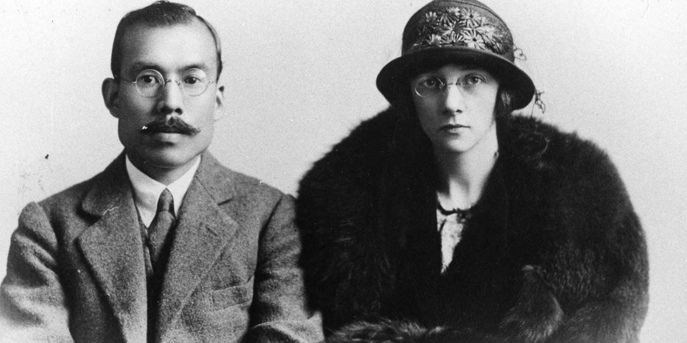

# Masataka Taketsuru

Masataka Taketsuru (1894–1979) was a central figure in the Japanese whisky industry. Born into a sake-brewing family in Hiroshima Prefecture, he went to Scotland to learn whisky distilling and blending, returned to help build Japan's first malt whisky distillery, and later founded his own distillery in Yoichi, Hokkaido. The modern story of him as the "father of Japanese whisky" is built largely around that arc.

Figure: Masataka Taketsuru. Image: Unknown photographer, Public domain, via Wikimedia Commons ([source page](https://commons.wikimedia.org/wiki/File:Masataka_and_Rita_Taketsuru.jpg)).

## Early life and change of direction

Taketsuru was born in 1894 in Takehara, Hiroshima Prefecture, the third son of a sake-brewing family. He grew up around a brewery and learned the practical difficulties of fermentation early. He went on to study brewing at Osaka Technical High School, now Osaka University, and joined Settsu Shuzo in 1916, initially working on liqueurs and imitation Western spirits.

The Japanese whisky market of the time was full of "imitation whisky" made from neutral alcohol, sugar and flavouring. Settsu Shuzo realised that genuine Scotch imports would eventually make such products hard to sell and began planning authentic whisky production. Taketsuru, with his chemistry and brewing background, was chosen to go to [Japan](ref:japan)'s source of inspiration: Scotland. He travelled alone in 1918, a decision that gave the Japanese industry its technical starting point. It is worth noting that his interest in whisky came not from the family business but from curiosity about Western spirits; sake brewing gave him a grounding in microbes and fermentation, yet continuous distillation, cask maturation and blending were a new body of knowledge.

## Two years in Scotland

In July 1918 Taketsuru left Kobe, stopped in San Francisco and other places, and reached Scotland in December. He enrolled as an auditing student at the University of Glasgow and the Royal Technical College, now the University of Strathclyde, attending chemistry classes and reading technical books on whisky. Convinced that books were not enough, he went to Speyside in April 1919 and persuaded Longmorn Distillery to let him learn the full process, from malting and mashing to fermentation, distillation and maturation.

He later studied grain whisky production with a Coffey still near Edinburgh. Because note-taking was forbidden on site, he wrote observations on scraps of paper and reorganised them from memory in the evening; these became the famous "Taketsuru Notes". In January 1920 he married Jessie Roberta Cowan, known as Rita, and in November 1920 the couple returned to Japan. A common simplification should be avoided: he did not first go to Scotland in 1919. He left in 1918, arrived in December 1918, studied in [Scotland](ref:scotland) through 1919 and 1920, and returned in November 1920.

## Yamazaki and the parting of ways

Back in Japan, Settsu Shuzo abandoned its whisky plan because of the post-war economy, and Taketsuru taught chemistry for a time. In June 1923 he joined Kotobukiya, now Suntory, and took part in building the Yamazaki distillery. Construction began in 1923 and the site was completed in November 1924 as Japan's first malt whisky distillery; Taketsuru was its factory manager and brought Scottish equipment, process and management experience to the floor.

Differences emerged here. Taketsuru wanted a site in Hokkaido whose cool climate and air resembled Scotland; Shinjiro Torii chose Yamazaki for its water, transport links and proximity to the Kyoto-Osaka market. On style, Taketsuru was marked by heavily peated, full-bodied Scotch; Torii cared more about the delicate palate of Japanese consumers. The 1929 launch of Shirofuda, Suntory's first whisky, sold poorly, and the episode is often used to explain the tension between the two approaches. The collaboration was productive but not harmonious in every respect: the later success of Kakubin in 1937 showed that Torii's reading of the Japanese palate had commercial force. In March 1934, after his contract ended, Taketsuru left Kotobukiya for Hokkaido. The "disagreement" is a useful summary in industry history, but it should not be written as a public feud or personal attack.

## Yoichi and Nikka

On 2 July 1934 Taketsuru established Dai Nippon Kaju in Yoichi, Hokkaido, using apple juice and other products to support cash flow while the whisky project matured. The Yoichi distillery was completed in October 1934. The site faces the Sea of Japan, with a cool, humid climate and water that matched his idea of a northern distillery. Apple juice was not a sideline in the modern sense: it gave the young company a product while whisky matured, a practical lesson in cash flow that many craft distillers still face. The first Nikka whisky was released in 1940, and in 1943 Taketsuru became president. The company was renamed Nikka Whisky in 1952.

After Yoichi, Nikka added distilleries such as Miyagikyo and built a system of multiple sites and styles. Taketsuru insisted on direct-fired pot stills, moderate peat and long maturation in wood, choices that gave Nikka [whisky](ref:whisky) a clear Scottish lineage while gradually developing a Japanese expression. Calling Nikka a simple copy of Scotland is inaccurate: equipment and process can be learned, but raw materials, climate, water and consumer taste must be adapted.

## Method and legacy

Taketsuru's first legacy was reproducible knowledge. The "Taketsuru Notes" recorded still design, operating points, staff management and alcohol taxation, turning oral Scottish craft into a technical document that could travel. The second was the idea of distillery siting: whisky is not made in the same way everywhere, because climate, water and airborne microbes affect maturation. The third was product layering, from mass-market blends to single malts, which gave Nikka a range of prices and flavours.

In the international reputation of [Japanese whisky](ref:japanese-whisky), Taketsuru is often cast as a lone pioneer. That image has a factual base, but it hides the collaborators: Rita's support with language and daily life, the resources of Settsu Shuzo and Kotobukiya, and the work of Yoichi staff and later blenders. His approach to [distillation](ref:distillation) was not fixed either; successors kept adjusting equipment, raw materials and maturation. Parts of the Yoichi distillery and its direct-fired stills are still preserved, and the 2014–2015 NHK television drama Massan, based on Taketsuru and Rita, brought the story to a mass audience. Drama strengthens the narrative of individual struggle, however, and readers should return to company histories and archives for dates.

Masataka Taketsuru is best read by starting with the period and the role, moving to the documented work, and ending with the sources behind the claim.

[Whisky](ref:whisky) and [Scotland](ref:scotland) answer different questions about Masataka Taketsuru: role and period. Read them as a pair, not as alternatives.

**Key facts.**

| Item | Detail |
| --- | --- |
| In one line | A pioneer of Japanese whisky, 1894–1979; he studied distilling and blending in Scotland from 1918 to 1920, helped build the Yamazaki distillery, and founded Dai Nippon Kaju, the predecessor of Nikka, in Yoichi, Hokkaido,… |
| Life | 1894–1979 |
| Roles | whisky maker、entrepreneur |
| Regions | Japan |

## Further reading

- [Whisky](ref:whisky): definitions, raw materials and main types.
- [Japanese whisky](ref:japanese-whisky): the industry's history and style.
- [Scotland](ref:scotland): Scotch regions and regulation.
- [Japan](ref:japan): the geography of Japanese drinks production and consumption.
- [Distillation](ref:distillation): pot stills and continuous distillation.
