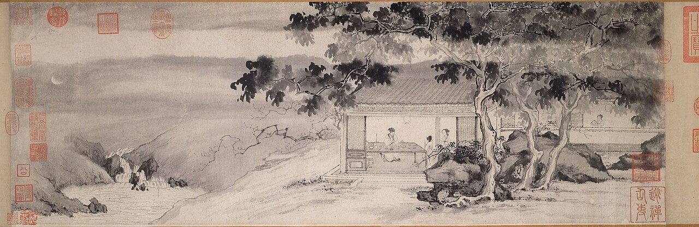

# Tang Yin

Tang Yin (1470-1524), courtesy name Bohu and also Ziwu, called Liuru Jushi and Master of the Peach Blossom Cottage, was a native of Wuxian in Suzhou. He was one of the most celebrated talented painters of Ming Suzhou and the author of the literary figure known as the Peach Blossom Immortal. Later centuries added many romantic stories; reliable sources are comparatively thin. The safest way into his relation with wine is through the official history, his poems and his paintings.

Figure: Tang Yin's Drinking at Night, a literati drinking scene set in a misty courtyard. Image: Tang Yin, Public domain, via [source page](https://commons.wikimedia.org/wiki/File:Tang_Yin_-_Drinking_at_Night_-_1955.761_-_Art_Institute_of_Chicago.jpg).

## A man buried under legend

"The finest talent south of the Yangtze" and "Tang Bohu flirts with Qiuxiang" come mostly from late-Ming popular fiction, ballads and opera, not from examination records or epitaphs. The real Tang Yin had a hard life: early fame, a scandal that closed the road to office in middle age, and a late career selling paintings to survive. Legend turned him into a carefree womaniser and erased exactly the experience that mattered most.

Three coordinates separate legend from record: the chapter on literature in the History of Ming, the poems collected in the works of Liuru Jushi, and the inscriptions on surviving paintings. Only where these agree is quotation safe.

## Life

- Born in 1470 in Wuxian, Suzhou; his father Tang Guangde ran a food and drink business.
- As a young man he was "sharp by nature and drank wildly with the local eccentric Zhang Ling, neglecting the student's trade"; after Zhu Yunming remonstrated with him, he shut himself away for a year to study.
- In 1498, at the provincial examination in Yingtian, he took first place and was known as the Tang Supreme Graduate.
- In 1499 he went to the capital for the metropolitan examination and was implicated in the case of Xu Jing, a candidate from Jiangyin who bribed a servant of examiner Cheng Minzheng for the questions. He was jailed, stripped of his degree and reduced to a minor clerk; ashamed, he refused the post and returned to Suzhou.
- From about 1505 he built a studio at Peach Blossom Hollow and lived by selling paintings.
- In 1514, invited by Prince Ning, Zhu Chenhao, he went to Nanchang, saw that the prince had rebellious intentions, "feigned madness and made himself drunk, exposing his own filth", and was sent home.
- He died in 1524, aged fifty-four.

## After the examination case: wine as a position

The examination case was the turning point of his life. He had been on the road to office through the examinations; after it he lost his degree and was offered only a petty clerkship, which closed that road for good. He returned to Suzhou and built a life out of painting, drinking, flowers and poetry.

Wine in that life is not a record of parties but a statement of position. The History of Ming says he "built a room at Peach Blossom Hollow and drank there daily with guests", and also that when Prince Ning summoned him he "feigned madness through drink". The same act has different functions in different situations: ordinary company in calm times, a disguise for refusing cooperation in danger. Read the two passages together and wine becomes both pleasure and strategy.

## The Peach Blossom Cottage Song: flowers, wine and cyclical time

The Peach Blossom Cottage Song is the central text for his image of wine; the full [poem](ref:peach-blossom-song) has its own page. It begins by linking place, person and livelihood: "The Peach Blossom Immortal plants peach trees, and picking peach blossom, trades it for wine money." Planting, selling flowers and exchanging them for wine form a small self-sufficient world in which wine circulates rather than dazzles.

Then comes time: "Awake, I sit before the flowers; drunk, I sleep beneath them. Half awake and half drunk day after day, flowers fall and flowers open year after year." Days repeat with the blooming and falling of flowers, and sobriety and drunkenness stop being opposites; they are two halves of one life.

The decisive line is the choice: "I would rather die old among flowers and wine than bow before carriages and horses." Flowers and wine are set against carriages and horses, freedom against service in a powerful household. Read this far and the poem's pleasure is clearly a refusal of the official order, not a celebration of consumption.

Variants matter. Copies differ, for example in the line commonly printed as "the dust of carriages and horses is the taste of the noble, the wine cup and flower branch the lot of the poor", where some editions read "the affairs of the prominent" and "the lot of the recluse". Quotations should name the edition rather than claim one text as the only original.

## Drinking Wine Facing the Moon: drinking with Li Bai

Another frequently quoted poem is Drinking Wine Facing the Moon. It starts from Li Bai's moon and moves to the poet's own situation: "Li Bai could write poetry and could drink; I today can drink a hundred cups and write a thousand poems." This is not a boast about capacity but a search for a predecessor with whom he can stand in line.

The second half makes the posture explicit: he does not board the emperor's boat, does not sleep in the capital, but wants only a thatched cottage outside Suzhou with flowers and moonlight. Wine here is the choice not to go to the capital, the same meaning as "not bowing before carriages and horses", expressed differently.

Read together, the two poems share a structure: an idealised predecessor (the Peach Blossom Immortal, Li Bai), the poet's own situation, and a spatial choice (beneath the flowers, in a cottage) that fixes the position.

## Wine in the paintings and colophons

Tang Yin was a painter, and wine enters both his pictures and their inscriptions. Literati painting often took gatherings, drinking and flower viewing as subjects; wine was a prop and a lubricant of social life. His Tea Brewing Scene is about tea, his Fan in Autumn about a discarded beauty, but both continue the practice of using an object to carry a meaning.

The inscription on Fan in Autumn reads: "Autumn comes and the silk fan should be put away; why should the fair one grieve again? Look closely at the ways of the world: who does not follow the heat and shun the cold?" There is no wine in the poem, yet it shares the cool gaze of the wine poems: once the world is seen through, withdraw into your own small space. That posture recurs throughout the tradition of [wine and painting](ref:wine-and-painting).

## Ming wine and Suzhou wine culture

Ming Suzhou was an economic and cultural centre with a developed trade in wine shops, gardens and paintings. The literati drank mainly grain-fermented wine, and low-alcohol types such as [yellow wine](ref:yellow-wine) were common; distilled spirits existed and were spreading, but gatherings still favoured the lighter drink. Equating Tang Yin's wine with today's strong baijiu would be anachronistic.

Wine was also tied to the art market. Tang Yin lived by selling paintings, and wine money, picture prices and friendships formed his economy; the wine shop was a place of business and company and appears often in his poems. Understanding this is more useful than counting how much he drank.

## Assessment and disputes

The History of Ming judges him with regret: "In his poetry and prose he first valued talent and feeling; in old age he let himself go, saying that posterity would not know him for this, and those who judged him grieved." The historian acknowledges the talent and criticises the drift. The same passage adds that in the Wu region, from Zhu Yunming onward, men were noted for unconventional behaviour, and "their talent was light and alluring, moving their contemporaries; those who told stories added and embellished, so that they often fell outside the bounds of the teaching." That is a crucial observation: already in the Ming, contemporaries saw the machinery of embellishment at work.

A second dispute concerns attribution. Tang Yin's fame was so great that forgeries multiplied, and connoisseurship and textual authentication remain difficult. A poem signed with his name needs the support of editions and catalogues before it can be treated as his.

## Common misreadings

First, taking "Tang Bohu flirts with Qiuxiang" as history. It is a later invention, elaborated in Feng Menglong's story and in opera; common scholarship identifies the prototype of Qiuxiang as Lin Nuer, a Nanjing courtesan of the Chenghua era who was older than Tang Yin.

Second, taking "the finest talent south of the Yangtze" as an examination title. It is a later label; his actual degree was first place in the provincial examination, which made him a supreme graduate.

Third, reading the Peach Blossom Cottage Song as pure pleasure-seeking. Its flowers and wine reject the official order rather than celebrate consumption.

Fourth, reducing him to a painter of beautiful women and erotica. Landscapes, figures and flower-and-bird paintings all survive, and his range is much wider.

Fifth, imagining Ming wine through today's drinks. The mainstream was still low-alcohol fermented wine, and the wine of [wine and poetry](ref:wine-and-poetry) must be read in the brewing conditions of the time.

## See also

- [Wine and painting](ref:wine-and-painting): drinking and gatherings in literati painting.
- [Wine and poetry](ref:wine-and-poetry): the common functions of wine in Chinese poetry.
- [Yellow wine](ref:yellow-wine): the craft lineage of grain-fermented wine.
- [China](ref:china): the regional background of Ming Suzhou.
- [The Peach Blossom Cottage Song](ref:peach-blossom-song): the page for the poem quoted here.
