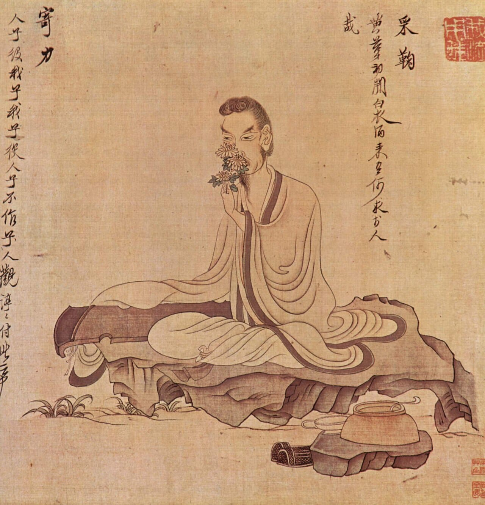

# Tao Yuanming

Tao Yuanming (365–427), also named Qian, styled Yuanliang, came from Chaisang in Xunyang and is known posthumously as Jingjie. He made resignation, farming, drinking and writing into a single way of life. Readers remember “picking chrysanthemums by the eastern fence”, but they often overlook a plain sentence in the preface to “Returning Home”: one reason he took the post at Pengze was that “the revenue of the public fields was enough to make wine”.

Figure: Tao Yuanming. Image: Chen Hongshou, Public domain, via Wikimedia Commons ([source page](https://commons.wikimedia.org/wiki/File:Ch%27en_Hung-shou_002.jpg)).

## Life

Tao came from a declining gentry family; his great-grandfather Tao Kan had been a famous Eastern Jin minister, but the household had fallen by his own time. He held minor posts in early life, including state libationer and staff positions under regional commanders, and his official career was intermittent. In 405 he became magistrate of Pengze. After a little over eighty days he resigned rather than dress formally to greet an inspector sent from the commandery, and wrote “Returning Home” to explain his decision.

He then lived in the countryside, farming for his own support and drinking and writing with his neighbours. His last years were poor, and he sometimes depended on friends. He died in 427 and was given the private posthumous name Jingjie. Xiao Tong included his works in the Wenxuan anthology and wrote a preface to his collection, which shaped his later reputation.

## Milestones

- 365: born.
- Around 393: becomes state libationer in Jiangzhou and soon resigns.
- 405: magistrate of Pengze; resigns after a little over eighty days and writes “Returning Home” in the eleventh month.
- 420: Liu Yu replaces the Jin dynasty; his later poems often reflect on dynastic change.
- 427: dies.

## Reclusion and wine

Wine in Tao Yuanming is first a fact of life. In “Biography of Mr Five Willows” he says of himself: “addicted to wine, but the family was poor and could not often obtain it. Relatives and old friends, knowing this, sometimes prepared wine and invited him; when he went he drank until he was satisfied, and his aim was to be drunk.” The passage ties drinking to income: he wanted wine but could not always afford it.

Second, wine belongs to the life of the returned farmer. “Moving House” describes dealings with neighbours: “passing the gate, they call to one another, and when there is wine they pour it out.” “Reading the Classic of Mountains and Seas” says: “happily we pour the spring wine and pick vegetables from my garden.” Wine here is not social performance but the everyday texture of work and neighbourhood.

Third, drinking carried a political meaning. After leaving office, drinking his own wine and farming his own fields were parts of the same refusal to be absorbed into official order. Yet he was not a purely private recluse: he wrote “In Praise of Jing Ke” and the line “Xingtian dances with shield and axe, his fierce will always present”, showing that public affairs were not absent from his mind.

There is also counter-evidence. The preface to “Leisure on the Ninth Day” says “the autumn chrysanthemums fill the garden, but there is no way to get the wine”, so he had no wine on the Double Ninth; “Stopping Wine” writes “all my life I did not stop drinking, and stopping brings no joy”. He did not always have wine, and he did not only write about being drunk.

## Wine in the major works

The preface to the twenty “Drinking Wine” poems is the clearest statement: “I live in idleness with little joy, and the nights are now long; whenever good wine comes my way I drink every evening. I empty the cup alone before my shadow and am suddenly drunk again. After I am drunk I write a few lines for my own amusement.” This gives a complete writing scene: solitude, a long night, wine, and poems composed after drunkenness. Wine is the condition that triggers writing, not its subject.

“Drinking Wine, number five” contains “picking chrysanthemums by the eastern fence, I see the southern hills at ease”, and ends with “in this there is a true meaning, but when I would explain it, words fail”. Wine's role is to let him leave, for a time, the calculations of reputation and gain.

“Drinking Wine, number seven” is more concrete: “the autumn chrysanthemums have a fine colour; wet with dew I pick their petals. I float them in this thing that forgets sorrow, and it carries me far from worldly feeling.” Chrysanthemum petals are floated in the wine, and wine is called “the thing that forgets sorrow”. This is the closest Tao comes to explaining what wine is for.

“Biography of Mr Five Willows” gives the most direct statement: “addicted to wine, but the family was poor and could not often obtain it.” The line is often quoted as proof of his love of wine; read whole, it also records his poverty.

## Public fields and millet: a magistrate's access to wine

The preface to “Returning Home” is explicit: “Pengze is a hundred li from home, and the revenue of the public fields is enough to make wine. So I sought the post.” One reason for taking office was that the public fields would yield enough for brewing. The sentence connects the history of literati drinking to the local fiscal system.

The Book of Jin adds a more concrete detail. As magistrate of Pengze he ordered all the public fields to be planted with glutinous millet, saying “let me be constantly drunk on wine and that is enough”; his wife insisted on planting ordinary rice, and the compromise was two hundred and fifty mu of millet and fifty mu of rice. Millet is sticky and suited to brewing; rice was daily food. That a magistrate could decide what grew on public land shows that wine in his life was not only a purchased commodity but was tied to land, rent and the power of office.

Eastern Jin wine was mainly fermented grain wine, low in strength and short-lived, drunk from bronze or pottery vessels. The difference between cloudy and clear wine lay in filtration. Imagining today's strong liquor in Tao's cup, or reading every “drunk” as spirit-induced stupor, misreads both the drink and the poems.

## Reputation and disputes

Xiao Tong's preface to the collection already made the key point: “some suspect that every poem of Tao Yuanming contains wine; in my view his intention is not wine, and wine is merely the trace he lodges in.” The sentence corrects the “drunkard” reading and shows that Liang-dynasty readers already noticed how much wine the poems contain.

The dispute concerns rank. Zhong Rong's Shipin (Grades of Poetry) placed Tao in the middle grade, praising his “plain and clean style, almost without superfluous words” while noting that “the world sighs at his bluntness”; this does not match the later honour of “ancestor of the recluse poets”. By the Song dynasty Su Shi said Tao's poetry is “plain but actually patterned, lean but actually rich”, and his standing rose markedly.

Modern readers also tend to make him too serene. Lu Xun remarked in “Untitled Drafts” that Tao Qian is great precisely because he is not “serene all over”. The line is a reminder that Tao's wine contains acceptance and also frustration: there is “I see the southern hills at ease”, and there is also “his fierce will always present”.

## Common misreadings

Tao Yuanming is often read as a purely private recluse. After returning to the fields he still wrote about dynastic change and the uncertainty of human life.

“Addicted to wine” is often taken as proof of his capacity, but the sentence continues with poverty; the tension between craving and poverty is the point.

His pastoral poems are sometimes treated as travel writing. They describe his own farming, drinking and dealings with neighbours.

Imagining today's strong liquor in an Eastern Jin cup is a serious error: the dominant drink was still fermented grain wine, lower in alcohol and short-lived.

Resignation, too, was probably not only idealism. “The revenue of the public fields was enough to make wine” shows that he had practical reasons for seeking the post, and that leaving was the result of several pressures together.

## Quotations and sources

“Picking chrysanthemums by the eastern fence, I see the southern hills at ease” comes from “Drinking Wine, number five”; “addicted to wine, but the family was poor and could not often obtain it” from “Biography of Mr Five Willows”; “the revenue of the public fields was enough to make wine” from the preface to “Returning Home”; “I float them in this thing that forgets sorrow” from “Drinking Wine, number seven”; “the autumn chrysanthemums fill the garden, but there is no way to get the wine” from the preface to “Leisure on the Ninth Day”. Name the piece when quoting, and distinguish prefaces from the poems themselves.

## See also

- [History of Chinese wine](ref:chinese-wine-history): grain wine and liquor policy over the long term.
- [Time in a cup](ref:time-in-a-cup): how wine entered seasonal and literary writing.
- [Yellow wine](ref:yellow-wine): the craft lineage of fermented grain wine.
- [China](ref:china): the geography of his life and return to the fields.

Further reading: [André Simon](ref:c-extra-1).

**At a glance:** Eastern Jin poet, 365–427; he described himself as “addicted to wine” and made drinking part of the same choice as leaving office and returning to the fields.
