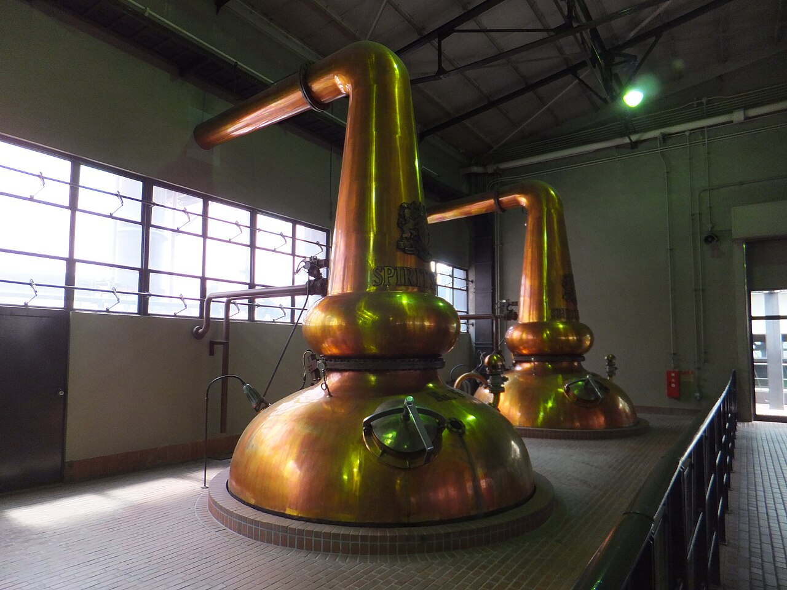

# Shinjiro Torii

Shinjiro Torii (1879–1962) was a Japanese entrepreneur and the founder of Suntory. In 1899 he opened Torii Shoten in Osaka, starting with imported wine and spirits. In 1907 he launched Akadama Port Wine, sweetened and priced for Japanese taste. In 1923 he built Japan's first malt whisky distillery at Yamazaki, outside Kyoto, and hired Masataka Taketsuru, recently returned from Scotland. In 1929 he released Shirofuda, Japan's first commercial malt whisky. His motto, "Yatte minahare" — try it and see — became a company saying.

Figure: Copper pot stills at Yamazaki Distillery. Image: Toukou Sousui, CC BY 2.0, via Wikimedia Commons ([source page](https://commons.wikimedia.org/wiki/File:Yamazaki_Distillery_%E5%B1%B1%E5%B4%8E%E8%92%B8%E7%95%99%E6%89%8017.jpg)).

> **Quick verdict**
> **In one line:** This profile explains why Shinjiro Torii is remembered, and which works to look at first.
>
> - **Best for:** Anyone trying to understand what Shinjiro Torii did and why the drink world remembers them.
> - **Not for:** If you want only want anecdotes and do not care about historical position.
> - **Check first:**
>   - Torii was born in Osaka in 1879.
>   - Torii hired Masataka Taketsuru at the Yamazaki build.

## From Osaka liquor shop to whisky pioneer

Torii was born in Osaka in 1879. In Meiji Japan, sake and shochu dominated; wine, port and whisky were imported luxuries with high prices and a narrow audience. He apprenticed in a liquor wholesaler, then set up Torii Shoten in 1899, selling imported wine and liqueurs. He quickly learned that simply copying European flavours did not sell: Japanese drinkers wanted something sweeter, softer and easier.

In 1907 he launched Akadama Port Wine. It used a Portuguese-style sweet wine base, adjusted for a sweeter, smoother profile and priced for ordinary households. Its success was not only the recipe but the distribution: Torii put it into grocers, restaurants and railway stations, making imported-style liquor a purchasable everyday product for the first time. Akadama remains a Suntory product and a landmark in the popularisation of Western liquor in Japan.

In 1921 Torii Shoten became Kotobukiya and moved into actual spirits production. In 1923 he built the Yamazaki distillery in the town of Oyamasaki, Kyoto Prefecture. The site sits where the Katsura, Uji and Kizu rivers meet: soft water, humid air and a basin climate suited to malting, fermentation and oak ageing. It was Japan's first true malt whisky distillery.

## Taketsuru and Shirofuda

Torii hired Masataka Taketsuru at the Yamazaki build. Taketsuru had gone to Scotland alone in 1918, studied chemistry at the University of Glasgow and trained in several distilleries; in 1920 he married a Scottish woman, Rita. Back in Japan in 1923, he joined Torii's team and took charge of distillery design, yeast selection and distillation. In 1929 Suntory released Shirofuda, Japan's first commercial malt whisky.

Shirofuda did not sell well. Japanese consumers were not used to peat, smoke and strong malt, and many found it medicinal or harsh. Torii and Taketsuru also disagreed on direction: Torii wanted a softer, more Japanese-friendly product; Taketsuru wanted a style closer to Scotland. In 1934 Taketsuru left Kotobukiya and founded his own distillery in Yoichi, Hokkaido, which became Nikka. The split is often described as Japan's two whisky roads: Yamazaki toward refinement and market fit, Yoichi toward direct-fired distillation, peat and Scottish tradition.

In 1937 Suntory launched Kakubin. The square bottle, white label and rounder palate made it a fixture in Japanese restaurants and homes. Kakubin proved Torii's judgement: Japanese whisky could not merely imitate Scotland; it had to find a taste Japanese drinkers would return to. Today's Yamazaki, Hakushu and Hibiki share the same commercial logic: first make Japanese drinkers drink it.

## What he changed

Torii's contribution has three layers. First, distribution and popularisation: Akadama turned imported-style liquor into an everyday product, and Kakubin made whisky a restaurant staple. Second, industrial infrastructure: Yamazaki was not just a factory but Japan's first complete malt whisky system, from malting and mashing to fermentation, distillation, oak ageing and quality control. Third, people and organisation: he was willing to hand technical authority to a specialist like Taketsuru, and to keep investing after Shirofuda failed. After his death in 1962, his son-in-law Keizo Saji took over and expanded Suntory into drinks, beer, food and culture.

In 1961 the Suntory Museum of Art opened in Tokyo, collecting Japanese and Western ceramics, paintings and crafts. It looks unrelated to liquor, but it continues Torii's logic: a brand should enter everyday life, not just sell a product. In 1963 Suntory entered beer, later oolong tea, mineral water and health drinks. Today's Suntory is a global drinks group, but its starting point is still a small imported-liquor shop in Osaka.

## Reading Yamazaki

At Yamazaki, look at three things. First, terrain and water: the distillery sits in a humid river basin, and the water and climate shape mashing, fermentation and barrel ageing. Second, equipment: the mashing house, fermentation tanks, pot stills and warehouses show the full path from malted barley to new-make spirit; Yamazaki uses several still shapes, one technical source of its layered style. Third, the tasting: Yamazaki, Hakushu and Hibiki differ by distillery, cask type and blend ratio; do not judge them only by age.

For Japanese whisky, start with Kakubin or an entry-level Yamazaki to build a baseline. Kakubin is soft, with vanilla and honey, good with ice or in a cocktail; Yamazaki adds citrus, white flowers and the sandalwood-coconut note of mizunara oak. Food-wise, Japanese whisky suits sushi, yakitori, tempura and light kaiseki; peaty Yoichi stands up to grilled meat, smoked fish and strong cheese. For high-age Yamazaki or Hibiki, drink neat or with a drop of water rather than overpowering it with food.

## Disputes and common misreadings

First, Torii was not the sole founder of Japanese whisky. There were other distillation experiments in 1920s Japan, and Taketsuru, Kiichiro Iwai and others contributed to technology transfer. Torii's distinctive achievement was combining technology, distribution, branding and mass-market demand into a sustainable industry. Second, Yamazaki was not "Japan's first bottle of whisky". Shirofuda was the first commercial malt whisky, but experimental products and imported whisky came earlier; "first" must be qualified as the first malt distillery and the first commercial malt whisky.

Third, Taketsuru was not a co-founder of Suntory. He worked at Kotobukiya from 1923 to 1934, then left to found Nikka; conflating the two companies erases their competition and their different styles. Fourth, Shirofuda was not worthless because it failed commercially. It established technical standards and brand awareness that paved the way for Kakubin, Yamazaki and Hibiki.

Fifth, Yamazaki is not in Osaka city but in Oyamasaki, Kyoto Prefecture; equating the Osaka merchant with the Kyoto distillery misses the water and terrain. Sixth, "try it and see" was not blind gambling. Torii tested flavours and channels for Akadama and Kakubin, and adjusted after Shirofuda failed. The adventure was backed by repeated experiment and market observation.

## Place in this atlas

Torii connects three threads. The first is the industrial history of [Japanese whisky](ref:japanese-whisky): from imported spirits and Akadama, through Yamazaki, Shirofuda and Kakubin, to today's high-end market. The second is the craft and visitor experience of [Yamazaki distillery](ref:yamazaki): water, stills, casks and tasting. The third is the contrast with [Masataka Taketsuru](ref:taketsuru) and Nikka: one technical expert, two companies, two roads.

To follow how Japanese whisky was received abroad, compare Yamazaki, Hakushu and Hibiki in international competitions. To follow how a drinks brand enters daily life, look at the Suntory Museum of Art, oolong tea and beer. To follow how a local liquor trader became a global group, read Suntory's 120-year history. Torii is not an isolated founder; he is a condensation of Meiji, Taisho and Showa-era transformation in Japanese liquor.

## See also

- [Yamazaki distillery](ref:yamazaki): Kyoto, malt whisky craft and visits.
- [Japanese whisky](ref:japanese-whisky): Yamazaki, Hakushu, Yoichi, Miyagikyo and styles.
- [Japan](ref:japan): sake, shochu, whisky and the imported-liquor market.
- [Masataka Taketsuru](ref:taketsuru): from Scotland to Yoichi, the other Japanese whisky road.

**Key facts.**

| Item | Detail |
| --- | --- |
| In one line | Japanese entrepreneur (1879–1962) who founded Torii Shoten in Osaka in 1899, launched Akadama Port Wine in 1907, built the Yamazaki distillery in 1923, hired Masataka Taketsuru and released Japan's first commercial malt … |
| Life | 1879–1962 |
| Roles | Entrepreneur、Whisky pioneer、Brand founder |
| Regions | Japan、Kyoto |

**Sources and limits.** The key claims about Shinjiro Torii are checked against the following sources: Suntory Holdings (Used to check Torii Shoten in 1899, Akadama Port Wine in 1907, Yamazaki in 1923 and Shirofuda in 1929; Used to check Torii's biography, management philosophy and the early product structure), House of Suntory, Suntory Beverage & Food Europe (Used to check the stages from an Osaka liquor trader to a global drinks group). Prices, batches and status change; the body is project-written and does not reproduce source text.
