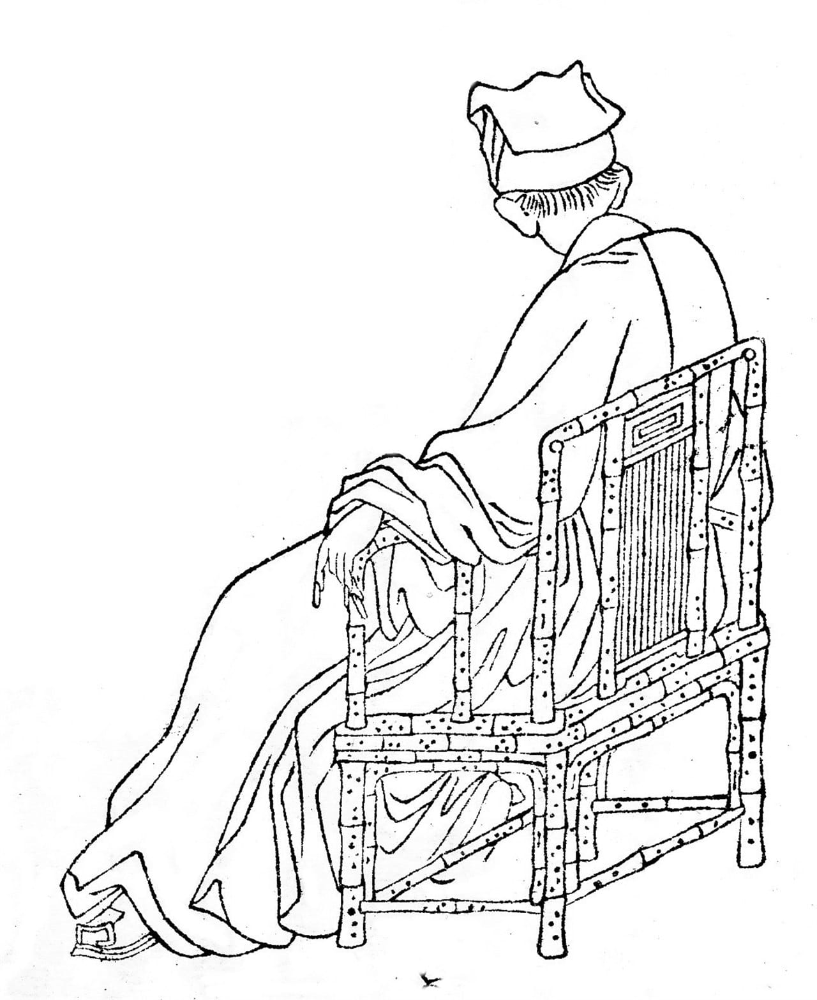

# Wang Wei

Wang Wei (701–761), styled Mojie, came from a family registered in Qi county, Shanxi, and lived in Puzhou on the Yellow River. A poet, painter and musician, he puts wine into a precise occasion rather than into a scene of drunkenness: to read his wine poems, one first sees the hour, the weather and the place, and the cup arrives last.

Figure: Wang Wei. Image: Wikimedia Commons contributor, Public domain, via Wikimedia Commons ([source page](https://commons.wikimedia.org/wiki/File:Wang_Wei.jpg)).

## Life and career

Wang Wei was born in 701. He passed the jinshi examination in 721 and entered office. After a demotion to Jizhou he was recalled to Chang'an in 734 and given a post in the censorate. In 756, when An Lushan's troops took Chang'an, he was captured and taken to Luoyang, where he was forced to accept an office under the rebels. After the two capitals were recovered in 758, he was spared disgrace because of a poem he had written in captivity and because his brother Wang Jin interceded for him. He later rose to Right Assistant Director of the Secretariat, hence the name Wang Youcheng. In old age he retired to the Wangchuan estate in Lantian and died in 761.

That career made him sensitive to occasion: what could be said depended on the political moment, and wine in his poetry often belongs to that same sense.

## Where wine sits in the poems

Wang Wei rarely writes heavy drunkenness. Wine appears at three kinds of moment: seeing a friend off, drinking with a friend, and stepping aside from office into landscape.

"Farewell" begins with "I dismount and offer you wine, and ask where you are going." The cup comes before the question, and the order of the actions is itself a form of detaining. "Young Men at Play" is completely different: "New Feng's fine wine costs ten thousand a measure; how many young gallants are there in Xianyang? Meeting by chance, we drink for spirit's sake, tethering our horses by the willows below the high tower." Here wine is youthful bravado and the high note of city life. "Drinking Wine with Pei Di" turns low again: "I pour wine for you, and you must console yourself; human feelings turn over like waves." The same poet can make wine mean swagger or consolation.

## A Farewell to Yuan Er on His Mission to Anxi, line by line

The poem has four lines: "Morning rain in Weicheng wets the light dust; around the guest house the willows are newly green. I urge you to finish one more cup of wine; west of Yangguan there are no old friends." The first two lines set the hour and the willows; the third puts the cup in the friend's hand; the fourth explains why it must be emptied.

"Finish one more" is a request, not a command. Yangguan was a Han-era pass on the road into the western regions and was still an important gateway in the Tang; "no old friends" is a plain description of the frontier, not rhetorical exaggeration. The poem was later sung under the titles "Weicheng Song" and "Yangguan Song", and the qin melody "Three Refrains of Yangguan" repeated the four lines in three sections.

## Other wine poems: from bravado to retirement

"New Feng's fine wine costs ten thousand a measure" in "Young Men at Play" borrows the line "fine wine costs ten thousand a measure" from Cao Zhi's "Worthy Ones in the Capital", joining the spending power of Chang'an's young men to their swagger.

"Farewell" turns the cup into the first gesture of parting: the poet dismounts, offers wine, and asks where the friend is going; the friend says he has failed and will lie down south of the mountains, and the poet stops asking. "A Winter Day at Wangchuan, Written for Pei Di" says, "Again I meet Jieyu drunk, singing wildly before the five willows." Drunkenness is the pose of a recluse, built from the madman Jieyu and Tao Yuanming's five willows, and it signals a wish to leave office.

## The Wangchuan estate and daily life

Wangchuan lies in Lantian county. Wang Wei kept an estate there, exchanged poems with Pei Di, and produced the twenty quatrains of the Wangchuan Collection. These poems are mostly landscape, and wine is not their subject, but the rhythm of life that wine stands for is clear: visiting friends on a day off, watching the hills after rain, listening to a spring in the evening, keeping a guest for a drink. Wangchuan was a retreat, not a total withdrawal: he still held office, owned land and kept servants. Wine in that life was a medium for guests and for solitude alike.

## Text, music and the Three Refrains of Yangguan

The poem also circulated as "Weicheng Song" and "Yangguan Song". The later qin song "Three Refrains of Yangguan" divides it into three sections and sings it repeatedly; "three refrains" names musical repetition, not three poems by Wang Wei.

## Reputation and dispute

Wang Wei's acceptance of a rebel office is the fact later readers cannot avoid. The Old Book of Tang records it and says he was spared because of his "Bathing in the Clear Pool" poem and his brother's intercession. Some criticise him for not choosing death; others say he preserved his life and left a clear political statement.

In painting, Dong Qichang made Wang Wei the founder of the Southern school, but Britannica notes that his art can only be reconstructed from records and later copies, and no certain original survives. The idea that his poetry contains painting therefore rests partly on Su Shi's judgement and later imagination, not on checkable paintings.

## Common misreadings

First, that "one cup" is an exact measure. It is a unit of action, not a volume. Second, that Yangguan was a Tang invention. It was established in the Han and still used in the Tang. Third, that the "Three Refrains of Yangguan" is Wang Wei's original work. The poem is a four-line quatrain; the qin melody is a later musical reworking. Fourth, that Wang Wei wrote only landscape poetry. Fifth, that "poetry in painting, painting in poetry" is Wang Wei's own phrase. It is Su Shi's judgement on a landscape attributed to Wang Wei.

## Timeline

- 701: born.
- 721: passes the jinshi examination.
- 734: recalled to Chang'an and given a post in the censorate.
- 756: Chang'an falls; he is taken to Luoyang and accepts a rebel office.
- 758: the capitals are recovered and he is spared.
- 761: dies.

**Short definition:** Tang poet and painter, 701–761; “A Farewell to Yuan Er on His Mission to Anxi” turns one cup of wine into the definitive Chinese image of farewell, later set to music as the “Three Refrains of Yangguan”.

Wang Wei is best read by starting with the period and the role, moving to the documented work, and ending with the sources behind the claim.

Setting [Time in a cup](ref:time-in-a-cup)'s role beside [Wine](ref:wine)'s period makes the boundary between them visible.

## Further reading

- [Time in a cup](ref:time-in-a-cup): how wine entered seasonal and literary writing.
- [Yellow wine](ref:yellow-wine): the craft lineage of Tang grain wine.
- [Wine](ref:wine): the sources and records of Tang wine.
- [China](ref:china): the geography of his travels and the Wangchuan estate.

Further reading: [André Simon](ref:c-extra-1).
