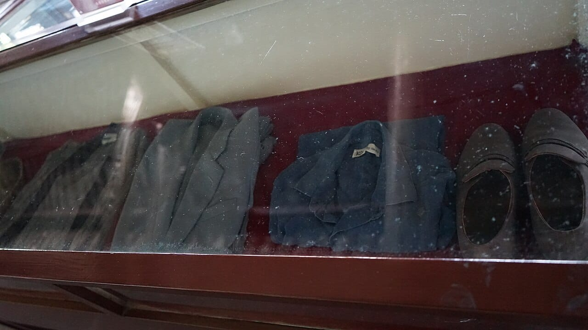

# Wang Zengqi

Wang Zengqi (1920–1997) was a native of Gaoyou in Jiangsu. He is one of the best writers of food in contemporary Chinese literature and a writer who made ordinary life taste good. Wine in his essays is rarely discussed on its own; it appears together with dishes, people and places: a plate of salted duck eggs, a bowl of fried rice, a dish of dried tofu, and a little wine, and the day is complete.

Figure: Wang Zengqi. Photograph: Wang Zengqi relics 4. Credit: Huangchenhai, CC BY-SA 4.0, via Wikimedia Commons ([source](https://commons.wikimedia.org/w/index.php?curid=58249647)).

## Life

He was born on 5 March 1920, the fifteenth day of the first lunar month, into an old-fashioned family in Gaoyou. In 1939 he entered the Chinese literature department of the National Southwestern Associated University, where he studied under Shen Congwen and also attended the classes of Wen Yiduo and Zhu Ziqing. In the 1940s he taught and wrote in Kunming and Shanghai. After 1949 he settled in Beijing and worked for many years as an editor.

In 1958 he was wrongly labelled a rightist and sent to the Shalingzi Agricultural Science Institute in Zhangjiakou for labour. In January 1962 he was transferred back to Beijing and became a full-time playwright at the Beijing Peking Opera Troupe, now the Beijing Peking Opera Theatre. In 1964 he took part in adapting the Shanghai opera Reeds and Bonfire, which later became the modern Peking opera Shajiabang. In 1980 he published “Ordination”, and in 1981 “The Story of Da Nao”. He died in Beijing on 16 May 1997.

## Milestones

- 5 March 1920: born in Gaoyou, Jiangsu.
- 1939: enters the National Southwestern Associated University and studies under Shen Congwen.
- 1958: wrongly labelled a rightist and sent to Shalingzi in Zhangjiakou.
- 1962: transferred to Beijing as a playwright for the Peking Opera Troupe.
- 1964: participates in the adaptation that becomes Shajiabang.
- 1980: publishes “Ordination”.
- 1981: publishes “The Story of Da Nao”.
- 16 May 1997: dies in Beijing.

## Wine in his essays

Wang Zengqi writes about wine with his eye on the dishes that go with it and the people who drink it. He often describes small restaurants, a little table at home, local produce brought by friends; wine is what makes a meal complete, not something used to compare vintages and prices.

This method has a leveling quality: Gaoyou duck eggs, Kunming mushrooms and Beijing bean milk can all accompany wine; a rich banquet and an ordinary family dinner can both be written about with interest. Wine here is the glue of social life, not a status label.

He himself liked to drink, and friends' memoirs often record it; but there is no systematic account of how much or what he drank. Taking the quantities in his essays as the author's real capacity mistakes literature for a documentary record.

## Key texts

“The Rain of Kunming” recalls life in Kunming in the 1940s. He remembers sheltering from the rain with Zhu Dexi in a small restaurant by Lotus Pond: they bought a plate of pig's head meat and half a catty of wine and drank while waiting for the rain to stop; in the courtyard a banksia rose was soaked through. Forty years later he turned the mood into a poem: “Beyond Lotus Pond few people pass; moss marks an inch deep on the wild inn's step. A cup of cloudy wine and the day is past noon; the banksia rose is wet and the rain is heavy.”

These four lines are his most concentrated writing on wine. “Cloudy wine” is an old literary term, not a precise description of quality; what a small Kunming restaurant sold in the 1980s was probably local white liquor or rice wine, strong and cheap. “A cup and the day is past noon” describes time slowed by rain and drink, not capacity. The function of wine here is to keep people at the table: while the rain continues and the wine is not finished, the conversation can go on.

“Food of My Hometown” describes Gaoyou's salted duck eggs, fried rice and parched rice flour. It says that “Gaoyou salted duck eggs are fine in texture and rich in oil”, linking food to childhood, custom and local character. Wine often appears as the background of the table: a guest comes, an extra cup is set out; the dishes arrive, a little wine is poured. It does not steal the scene, but it completes it.

“Duck Eggs of the Dragon Boat Festival” has the line “when the tip of a chopstick goes in, zhi — the red oil comes out”. Such sentences rely on sound and action rather than adjectives; the same method is used for wine. He does not say how good the wine is, only whether it suits the dish and whether the people at the table are enjoying themselves.

“Five Flavours” begins with sour, sweet, bitter, hot and salty, and opens with “the people of Shanxi really can drink vinegar”. The strength of such writing is that it does not rank flavours; it simply describes them clearly. Wine is treated the same way: no league table of famous bottles, only specific pairings and occasions.

## Wine and food on the table

Wang Zengqi's food geography has roughly three places. Gaoyou is childhood and home: salted duck eggs, fried rice, parched flour, arrowhead and wild vegetables, with a salty, savoury taste and local rice wine or ordinary white liquor. Kunming is youth: mushrooms, pig's head meat, small restaurants, cheap bulk liquor, with wine tied to rain, friends and poor days. Beijing is the second half of his life: bean milk, cornmeal cakes, home cooking, and the white liquor ordinary people could afford.

Together these three places produce a way of writing in which wine never leaves the table. He seldom describes aroma or vintage on its own; he describes wine's place at the table: who poured it, what it accompanied, what was said. In today's terms, he cares about the scene, not the score.

In the later twentieth century, urban Chinese consumption of [baijiu](ref:baijiu) became increasingly everyday, and white liquor was common at banquets, family meals and gatherings of friends; yellow wine, beer and local spirits were also popular in different regions. The wine in Wang's essays is mostly what ordinary people could afford, not collector's bottles. The old tradition of [wine and poetry](ref:wine-and-poetry) becomes, in his hands, wine and prose: no rhyme, no heroics, just a table described clearly.

## Reputation and disputes

Wang Zengqi's reputation is high. An article from the National Museum of Modern Chinese Literature notes his description as “the last pure man of letters in China”, and many younger writers treat his language as a model. But assessments differ. An article published by the Institute of Literature of the Chinese Academy of Social Sciences, “The Ills of the Prose Essay”, argues that Wang inherited Shen Congwen's lineage but shows “a retreat of spirit”: the “wild force” present in Shen's texts reaches Wang “in very small measure, almost not at all”. The article also characterises his prose as “anti-sublime, anti-heroic and anti-grand”. This is a criticism grounded in spiritual intensity and literary ambition, and it stands in tension with the praise of him as the last pure man of letters.

Another dispute concerns editions. Wang's essays have been selected and published by many presses, and the contents and wording occasionally differ; “Five Flavours” is both the title of an essay and often the title of a collection, so a reader who does not cite an edition can easily mix material from different selections. This is not the author's fault, but it is a technical problem that anyone studying his food writing must handle.

Where wine is concerned there is a further limitation: he writes as a diner and hardly touches on brewing, prices or changes in the trade. Anyone hoping to learn about the Chinese liquor industry in the twentieth century from Wang's essays will find a sidelight on social history, not industrial data.

## Common misreadings

Wang Zengqi is often treated as an early food blogger. His food essays have literary structure and observe human relations; they are not merely recipes.

The drinking in his essays cannot be taken as his whole life either. Writing selects and omits, and cannot serve as a complete biography.

Reading only “Ordination” and not the essays misses an essential part of his verbal wit.

“Delicious” does not mean “expensive”. He mostly writes about cheap, home-style food, whose value lies in technique and people.

Nor is “cloudy wine” in “The Rain of Kunming” inferior liquor. It is a literary term for ordinary wine that is unfiltered or only roughly filtered; it is not fake wine and not a judgement of poor quality.

## See also

- [Baijiu](ref:baijiu): the main type of Chinese distilled spirit.
- [Wine and poetry](ref:wine-and-poetry): the tradition of wine among Chinese writers and in literature.
- [China](ref:china): the background of life in Gaoyou, Kunming and Beijing.

Read Wang Zengqi through the period and the role, then the documented work, and finally the sources behind the claim. The sequence matters.