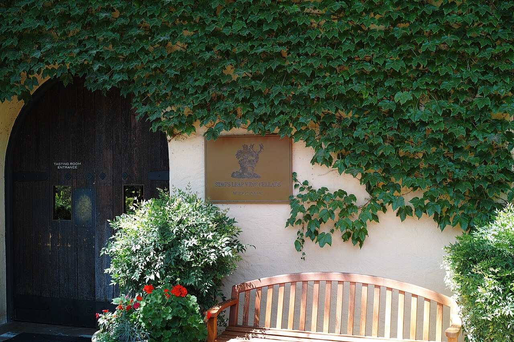

# Warren Winiarski

Warren Winiarski (1928–2024) was a Napa Valley winemaker and the founder of Stag's Leap Wine Cellars. In 1976 his 1973 Cabernet Sauvignon beat several Bordeaux estates in the blind tasting known as the Judgment of Paris, a moment that helped bring California wine into international view. To tell the story only as "America beats France", however, misses the more important part: he spent six years finding land, learning winemaking and testing grapes before the winning wine existed.

Figure: The tasting room at Stag's Leap Wine Cellars; an estate scene, not a portrait of Warren Winiarski. Image: Jun Seita, CC BY 2.0, via Wikimedia Commons ([source page](https://commons.wikimedia.org/wiki/File:Stag%27s_Leap_Wine_Cellars_tasting_room.jpg)).

## From Chicago to Napa

Winiarski was born in Chicago on 22 October 1928, into a Polish immigrant community. His father made mead and wine at home, and the family name is related to the Polish word for a winemaker; but he did not enter the trade early. He received a liberal-arts education, studied at the University of Chicago and St. John's College, taught, and wrote on political thought. In 1964 he moved his family to Napa Valley and decided to turn wine from an interest into a profession.

He first apprenticed at Souverain Cellars under Lee Stewart. By his own account it was a two-person workshop: washing tanks, moving barrels and watching fermentation by day, reading winemaking books by night. In 1966, when Robert Mondavi built the first new Napa winery after Prohibition, Winiarski became its first winemaker and stayed two years. In 1968 he made wine for Ivancie Cellars in Colorado, fermenting California grapes in Denver; the experience showed him that quality depended not only on variety but on transport and handling.

## Finding Stags Leap

In 1969 Winiarski visited Nathan Fay's vineyard below the Stags Leap Palisade on the east side of Napa Valley and tasted Fay's 1968 Cabernet. He later recalled that from the first glass he knew this was the Cabernet he wanted to make. Fay would not sell the vineyard, but the prune orchard next to it was for sale. In 1970 the Winiarskis sold their Howell Mountain land and, with partners, bought the orchard, replanted it to Cabernet Sauvignon and Merlot, and named it Stag's Leap Vineyard, later S.L.V.

In 1972 they bought the winery site nearby; in 1973 Stag's Leap Wine Cellars opened. The first 1973 Cabernet came from young vines at S.L.V. Winiarski wanted a structure he called "an iron fist in a velvet glove": enough backbone and ageing capacity, but not harsh on entry. He adjusted picking dates, maceration length and oak proportions so the wine could be drunk young and still open up with age.

## The 1976 Judgment of Paris

On 24 May 1976 a blind tasting took place at the InterContinental hotel in Paris: nine French judges compared California and French red and white wines. In the red flight, Winiarski's 1973 Stag's Leap Wine Cellars Cabernet received the highest score, ahead of Mouton Rothschild 1970, Haut-Brion 1970 and other Bordeaux. The result shocked journalists and merchants; California wine entered a discussion previously reserved for France.

Both the significance and the limits need stating. It proved that California could make a structured, ageworthy Cabernet rather than only a "New World" fruit wine, and it put the Stags Leap District on the international map. It was also a single blind tasting with limited samples, judges, vintages and conditions; it could not prove that California was "better than France" in general, nor replace long-term regional comparison. Winiarski himself later stressed that the Judgment of Paris was a historical moment, not the end of quality science.

## Appellation rules and land protection

In 1989 Winiarski chaired the Napa Valley Vintners committee that pushed California Senate Bill 771, the Conjunctive Labeling Law. The law required that, from 1 January 1990, a wine labelled with an internal Napa Valley AVA must also carry "Napa Valley" on the label. At first glance a labelling detail, it tied sub-appellations to the parent brand: the district gained recognition, and Napa Valley gained collective credibility.

He was also long involved in Napa agricultural land protection. In 2007 he sold Stag's Leap Wine Cellars but kept Arcadia Vineyards, continuing to grow Chardonnay, Cabernet and Merlot. He died in Napa Valley on 7 June 2024, one season short of what would have been his sixtieth harvest.

## Assessment and controversy

The favourable view treats him as one of the winemakers who brought California wine into world-class discussion, and stresses his long work on land, appellation rules and philanthropy. Induction into the California Hall of Fame, collections at the Smithsonian and UC Davis's memorial are institutional forms of that assessment.

Criticism has three main lines. First, the Judgment of Paris is often reduced to "America defeated France", hiding the role of the French judges, media and merchants in spreading the story, and hiding the continued strength of French wine in later vintages. Second, the names Stag's Leap and Stags' Leap have long been confused: the first is Winiarski's estate, the second another historic property; consumers often treat them as one. Third, the "iron fist in a velvet glove" style was widely imitated in Napa, but imitators often copied the power without the restraint, producing unbalanced alcohol and tannin.

## Common misreadings

The first is to treat the 1973 winning wine as the product of an established estate. The winery opened in 1973, and the wine came from young vines, not long-aged stocks.

The second is to treat the Judgment of Paris as a scientific experiment. It was a commercial and media event with a controlled blind format, but limited samples and judges.

The third is to treat Winiarski only as a winemaker. His finding of land, organisation of partnerships, work on labelling law and land protection were equally important.

The fourth is to confuse Stag's Leap with Stags' Leap. Two names, two estates and two histories; check the label and the record.

## See also

- [Napa Valley](ref:napa): where Winiarski found land, built the estate and worked on appellation rules.
- [Cabernet Sauvignon](ref:cabernet): the variety behind the 1973 wine and S.L.V.
- [Red wine](ref:red-wine): the category that explains the "iron fist in a velvet glove" structure.
- [1976 Judgment of Paris](ref:paris-1976): the event that connects his wine to the wider California story.
- [United States](ref:usa): the national background of California's rise in the second half of the twentieth century.

**Short definition:** American Napa Valley winemaker (1928–2024) who founded Stag's Leap Wine Cellars in 1973; his 1973 Cabernet Sauvignon won the red-wine flight of the 1976 Judgment of Paris and helped bring California wine international attention.

For Warren Winiarski, begin with the period and the role. Then look at the documented work, and finally ask the sources behind the claim. The answers point to different choices, not to a single score.
