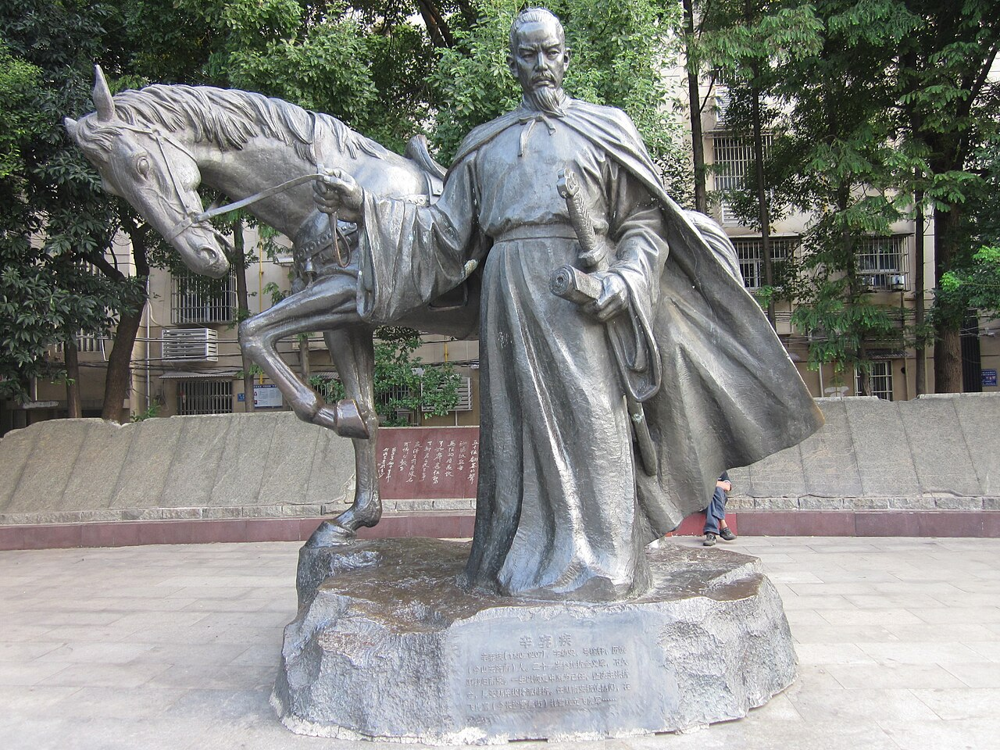

# Xin Qiji

Xin Qiji (1140–1207), styled You'an and known as Jiaxuan, came from Licheng in Jinan. In his early twenties he joined an anti-Jin uprising in the north; after crossing to the south he served for years as a local official, then spent two long periods in retirement, together nearly twenty years. Wine in his lyrics is not decoration. It is the switch that turns memory on, the gesture that starts a scene, and the place where he sets down an ambition he could not carry out. More than 620 of his ci survive in the collection Long and Short Lines of Jiaxuan.

Figure: Xin Qiji. Image: Lei Yixin / Nie Shihua / Xiao Xiaoqiu, CC BY 3.0, via Wikimedia Commons ([source page](https://commons.wikimedia.org/wiki/File:The_statue_of_Xin_Qiji.JPG)).

## Life

Xin Qiji was born in 1140, when Shandong was already under Jin rule. His grandfather Xin Zan held office under the Jin but often took the boy to high ground and pointed out the lost territory; Xin later recalled this in the preface to his Ten Discourses on the Art of War. In 1161, when the Jin ruler Wanyan Liang invaded the south, uprisings broke out across the north. Xin raised some two thousand men and joined Geng Jing's force as secretary.

In 1162 he carried Geng Jing's memorial south to the court at Jiankang. On the way back he learned that Geng Jing had been killed by Zhang Anguo; he led a cavalry raid into the Jin camp, seized Zhang and delivered him to Jiankang, where he was executed. The History of Song records the episode; Hong Mai's Record of Jiaxuan gives the raiding party as fifty horsemen.

After returning south he held a series of posts: assistant magistrate at Jiangyin, prefect of Chuzhou, judicial commissioner in Jiangxi, deputy transport commissioner in Hubei, and pacification commissioner in Hunan. In 1175 he put down the tea-merchant rebellion led by Lai Wenzheng; in 1180 at Changsha he created the Flying Tiger Corps, buying land, building barracks and recruiting men. In 1181 he was impeached and dismissed, and retired to Dai Lake in Shangrao, taking the name Jiaxuan. Dismissed again in 1194, he moved to Piao Spring in Yanshan. In 1203, as Han Tuozhou prepared a northern campaign, he was recalled as pacification commissioner for eastern Zhejiang, then made prefect of Zhenjiang in 1204, and was impeached once more soon after. He died at Yanshan in 1207, aged sixty-eight, and received the posthumous name Zhongmin.

He also wrote political treatises, including the Ten Discourses and the Nine Arguments, on the military balance with the Jin, training and finance. To see him only as a "heroic poet" is to lose that half of his life.

## Timeline

- 1140: born at Licheng, Jinan, with Shandong already under Jin rule.
- 1161: raises two thousand men and joins Geng Jing's uprising as secretary.
- 1162: carries a memorial south; on his return he captures Zhang Anguo and delivers him to Jiankang.
- 1175: judicial commissioner in Jiangxi; suppresses the tea-merchant rebellion.
- 1180: pacification commissioner in Hunan; creates the Flying Tiger Corps.
- 1181: impeached and dismissed; retires to Dai Lake in Shangrao.
- 1194: dismissed again; moves to Piao Spring in Yanshan.
- 1203: recalled as pacification commissioner for eastern Zhejiang; prefect of Zhenjiang in 1204.
- 1207: dies at Yanshan; posthumous name Zhongmin.

## Wine in His Life: Three Uses

The first use is memory. "Broken Lines, a heroic lyric for Chen Tongfu" opens: "Drunk, I trim the lamp and look at my sword; in dreams I hear bugles from the camps." He still wants to see the sword after drinking, which means wine has not made him forget the army but has brought its sounds back. Here wine is not consolation; it returns him to a scene he has lost.

The second use is a question put to time. "To the Tune of Taichang Yin, Mid-Autumn at Jiankang, for Lu Shuqian" has him raise his cup and ask the moon: "Holding wine, I ask Heng'e: what is to be done about white hair that cheats a man?" In 1174 he was not yet forty, and the question was already about ageing and unfinished work.

The third use is self-mockery, and even negotiation with drink. "Moon over the West River, Giving Vent to Feeling" turns drunkenness into stage action; "Spring in a Shallow Garden: I Will Stop Drinking, and Warn the Cup to Keep Away" treats the cup as something that can be scolded, bargained with and ordered out of the room. Wine is both the enemy and the only listener that stays.

## Principal Works

- "Broken Lines, a heroic lyric for Chen Tongfu": written around 1188 during his retirement at Dai Lake, after Chen Liang's visit.
- "To the Tune of Taichang Yin, Mid-Autumn at Jiankang": 1174, at Jiankang.
- "Moon over the West River, Giving Vent to Feeling": from the Dai Lake years, exact date unknown.
- "Spring in a Shallow Garden: I Will Stop Drinking": late retirement at Piao Spring.
- "Green Jade Cup, Lantern Festival": set in the Lantern Festival crowds of Lin'an; no wine appears in it.
- The Ten Discourses and Nine Arguments: prose treatises, not lyrics, but they show his military and fiscal thinking.

## Textual Evidence: How Wine Enters the Lyrics

"Broken Lines" runs ten lines. The first nine accelerate in one direction: trimming the lamp and looking at the sword, bugles from the camps, roast meat divided among the troops, frontier music, the autumn review, the galloping horse, the bowstring like thunder, finishing the ruler's business, winning a name in life and after death. The last line, "how pitiful, my hair has turned white", slams the brake and returns everything to the present. Wine is the door into the memory; white hair is what he sees on the way out.

One phrase needs care. "Eight hundred li" in "eight hundred li of roast meat divided among the troops" is not a distance but a name for an ox, taken from the story in A New Account of Tales of the World about Wang Kai's prize ox, "Eight Hundred Li". The line describes beef roasted and shared with the soldiers, not an army marching eight hundred li. Read the allusion as geography and the whole line collapses.

The second half of "Moon over the West River" is almost a small play: "Last night I fell drunk by the pine; I ask the pine how drunk I am. I thought the pine would move to steady me; with my hand I push it and say, go away." There is a question, a suspicion, a push and an order. The last line drops prose syntax straight into the lyric, a habit of Xin's that sits oddly beside the charge that he stuffed his poems with book learning; here the effect is colloquial, physical, immediate.

"Green Jade Cup, Lantern Festival" has no wine at all. It is all lanterns, crowds and searching: "I look for her in the crowd a thousand times; suddenly I turn, and there she is, where the light is failing." The absence is useful evidence: his "heroic" manner does not mean every famous poem is a drinking poem, and making wine the only key to him narrows his range.

## Reputation and Disputes

Liu Kezhuang, writing in the Southern Song, gave one of the sharpest assessments: Xin and Lu You "swept away the ornate and made no show of carving", but Xin "was forever dropping his book bag; it was a habit". The criticism names a real feature, a density of allusion that sometimes lets learning press down on the situation.

A second dispute concerns the label "heroic" itself. Xin did write vigorous pieces such as "Broken Lines" and "Water Dragon Chant", but delicate, pastoral and comic poems are equally numerous. Treating "heroic" as his whole manner turns a changing person into a single tone. The late Qing critic Chen Tingzhuo, in White Rain Studio Remarks on Ci, insisted on the "deep gloom" in Xin's work precisely to correct the "heroic only" reading.

There is also a source problem. The History of Song and Hong Mai's Record of Jiaxuan do not agree in every detail about the raid that captured Zhang Anguo, including the size of the party. Quotations should say which account they follow rather than presenting the detail as settled.

## Common Misreadings

First, that "drunk, I trim the lamp and look at my sword" records camp life. It was written in retirement and is memory and imagination, not a diary entry.

Second, that "eight hundred li" is a distance. It is an ox, and the allusion comes from A New Account of Tales of the World.

Third, that "drunk, I will enjoy the laughter while I can; where would I find time to worry?" means he had made peace with failure. The next stanza has him falling drunk by a pine and pushing it away, and the harder he drives the feeling off, the more visible it is.

Fourth, that Song wine was today's strong baijiu. The main drink was still fermented grain wine of modest strength; the craft lineage of [yellow wine](ref:yellow-wine) is closer to daily drinking then than distilled spirits.

Fifth, that his drinking was simply a taste for liquor. His wine is always tied to a situation, a camp, a mid-autumn moon, a retirement, a vow to stop, and the meaning changes with the occasion.

## See Also

- [Time in a cup](ref:time-in-a-cup): how wine entered seasonal and literary writing.
- [Yellow wine](ref:yellow-wine): the craft lineage of Song grain wine.
- [History of Chinese wine](ref:chinese-wine-history): the Song wine trade and liquor policy.
- [China](ref:china): the geography of his career and retirement after returning south.

**At a glance:** Southern Song poet and soldier, 1140–1207; after crossing south from the Jin-occupied north in his twenties, he spent two long retirements writing ci in which wine opens memory, questions old age and mocks its own consolation. 
