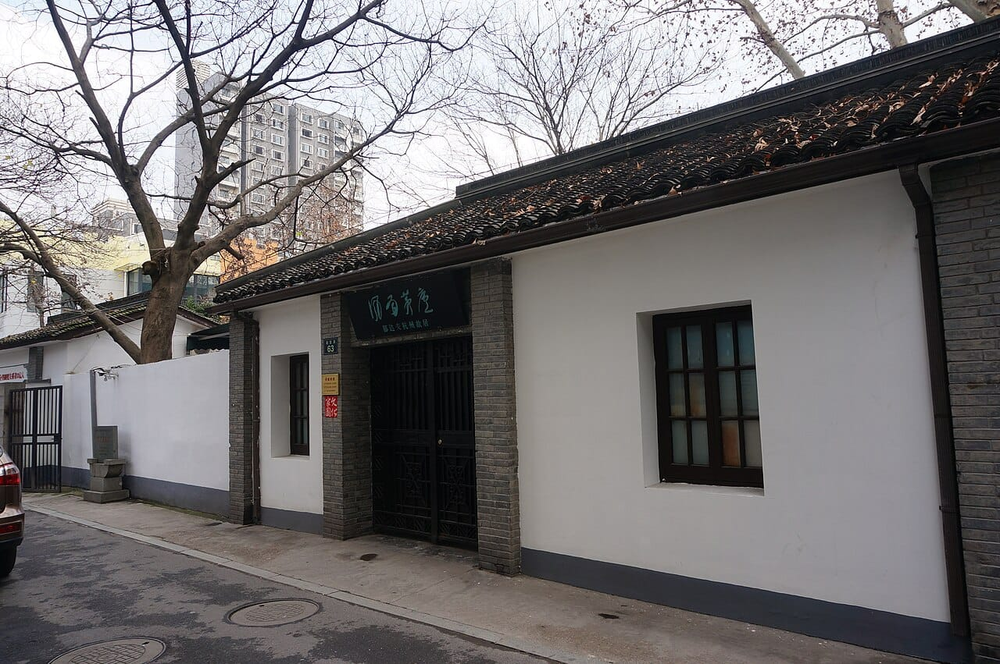

# Yu Dafu

Yu Dafu (1896–1945), original name Yu Wen, was a native of Fuyang in Zhejiang. He is one of the most candid self-writers in modern Chinese literature and a founding member of the Creation Society. He wrote excellent classical-style poetry, and wine appears in it often; the most famous line, “once, drunk, I whipped a famous horse; I fear too much feeling burdens a beauty”, has become almost his self-portrait. But his relationship with wine goes beyond verse: in 1942, after fleeing to Sumatra, he used the identity of a distillery owner to cover a group of Chinese cultural workers.

Figure: Yu Dafu. Photograph: Former Residence of Yu Dafu in Hangzhou 01 2020-01. Credit: 猫猫的日记本, CC BY-SA 4.0, via Wikimedia Commons ([source](https://commons.wikimedia.org/w/index.php?curid=88154498)).

## Life

He was born on 7 December 1896 into a declining scholarly household in Fuyang. In 1913 he went to Japan, first studying medicine and then economics, and graduated from the economics faculty of Tokyo Imperial University in 1922. In 1921 he founded the Creation Society in Tokyo with Guo Moruo, Cheng Fangwu, Zhang Ziping, Tian Han and others; that year he published the story collection Sinking, which shocked the literary world with its bold self-exposure and is often described as one of the earliest modern Chinese story collections.

In the 1920s he wrote, taught and edited in Shanghai and Hangzhou, publishing such works as Spring Fever and A Humble Tribute. In 1930 he helped found the League of Left-Wing Writers. In 1932 he published Late Osmanthus. He moved to Hangzhou in 1933 and built the “Wind and Rain Thatched Cottage” in 1936. In 1938 he went to Singapore, edited the literary supplement Morning Star at Sin Chew Daily and took part in anti-Japanese cultural work. After Singapore fell in 1942 he withdrew to Sumatra; in September 1945 he was killed by Japanese military police.

## Milestones

- 7 December 1896: born in Fuyang, Zhejiang.
- 1913: goes to Japan to study.
- 1921: helps found the Creation Society and publishes Sinking.
- 1930: helps found the League of Left-Wing Writers.
- 1936: publishes the essay “Food and Sex in Fuzhou”.
- 1938: goes to Singapore and edits a newspaper supplement.
- 1942: takes the alias Zhao Lian, settles in Payakumbuh in Sumatra and runs the Zhao Yuji distillery.
- September 1945: killed by Japanese military police.

## Wine in his writing

Yu Dafu often writes wine between indulgence and self-harm. Drinking in his work is not for elegance but to push suppressed emotion to a threshold; the emptiness after waking often deserves more attention than the liveliness while drunk. This way of writing is representative of the self-narrative after the May Fourth era: personal feeling is placed in the foreground, and wine amplifies it.

His classical-style poetry is the key to this method. The old-style poems were not a sideline but one of his most direct forms of expression; the metre is old, the emotion modern. Wine in such poems carries not an allusion but the present moment: a night of drinking, a farewell, a feeling he cannot bring under control.

At the same time, the literary image should not be equated with a life record. He did drink, and friends' memoirs often mention it; but there is no reliable statistic for how much or how often. Treating a poetic line as evidence of alcoholism mistakes rhetoric for a medical record.

## Key texts

Written on the Diaotai Wall is the most frequently quoted example: “It is not that I treasure my body before the wine cup; feigned madness is hard to keep from becoming real. Once, drunk, I whipped a famous horse; I fear too much feeling burdens a beauty.” The four lines place wine, feigned madness, feeling and self-mockery together. The first line denies that he is careful of his health, the second admits that a pose of madness can become real, the third gives an extreme example, and the fourth turns back to guilt towards another person.

“Once, drunk, I whipped a famous horse” need not be taken as a literal event. It is more like a highly compressed self-image: loss of control after drinking, talent and wilfulness together. A reader who remembers only the bravado of this line will miss the next line's fear of burdening others with too much feeling, which is both an apology and a warning to himself. The language moves from excuse to self-mockery, and wine is the pivot of that turn.

His prose and travel writing also often contain wine shops, night drinking and solitary cups on the road. These passages put wine back into concrete space: a small town, a river bank, an inn, a friend's house. Wine is not an abstract symbol but part of the mobile life of Republican-era literati. “Food and Sex in Fuzhou”, an essay on local eating, belongs to this group: it cares about local flavours, street life and small restaurants rather than the vintages and prices of famous wines.

## The South Seas: the Zhao Yuji distillery

In February 1942 Singapore fell. Yu Dafu and cultural workers including Hu Yuzhi and Wang Renshu withdrew, and after several moves reached Payakumbuh in Sumatra in mid-April. He took the alias Zhao Lian, grew a short moustache and presented himself as a Fujian merchant.

To support the exiles, the group opened a distillery called Zhao Yuji. Yu Dafu, as Zhao Lian, appeared as the owner; Zhang Chukun was manager and Hu Yuzhi kept the accounts. The distillery filled its liquor into petrol drums and sold it to Japanese soldiers; the local Indonesian population was largely Muslim and did not drink, so the customers were mainly the occupying army and some Chinese residents. The arrangement served two purposes at once: it provided a living and it covered their identities. Through it Yu Dafu dealt with the Japanese military police and, according to friends' recollections, spoke up for many detained Chinese.

This episode shows that his relation to the liquor trade was not merely literary. The distillery was a wartime economic organisation and a screen for hidden identities; liquor was a commodity, a cover and a means of buying room to survive. After Japan surrendered in August 1945 Yu Dafu remained in the area and was killed by Japanese military police in September.

## Reputation and disputes

Yu Dafu was controversial in life and after death. The scholar Liang Xihua criticised his “shifting loyalty”, a judgement highlighted in a China News Service retrospective; it represents an evaluation that puts moral and political consistency first. A different assessment comes from C. T. Hsia's A History of Modern Chinese Fiction, which acknowledges Yu's talent while noting that his fiction often rests on self-pity and exposes emotion with little artistic restraint. The two criticisms differ, but both warn against reducing him either to a “decadent talent” or to an “anti-Japanese martyr”.

Where wine is concerned there is also a textual limitation: he writes about the scene and mood of drinking but seldom about the type, price, origin or production of the liquor. A reader hoping to learn about the Republican-era drinks trade from Yu Dafu will find scattered impressions, not a systematic record. This is a common limit of the writer's approach to wine.

## Common misreadings

“Once, drunk, I whipped a famous horse” is often taken as a confirmed autobiographical statement. It is a poem, not a confession.

Yu Dafu's drinking is also easily romanticised. His wine writing often carries self-harm and apology, not simple bravado.

Reading only the fiction and not the classical-style poems misses his most direct emotional outlet and misjudges his wine imagery.

The Sumatra venture is often called the “Zhao Lian distillery”. The firm's name was Zhao Yuji; Zhao Lian was his alias, and the two should not be confused.

Nor was it a literary salon. Zhao Yuji was a partnership run by exiles, with a manager, an accountant and a customer base, and its first tasks were survival and cover.

## See also

- [Wine and poetry](ref:wine-and-poetry): wine imagery in classical-style poetry.
- [Yellow wine](ref:yellow-wine): the fermented wine common in Republican Jiangnan.
- [China](ref:china): the background of literati mobility and city life in the Republican era.

Further reading: [André Simon](ref:c-extra-1), [André Tchelistcheff](ref:c-extra-2).

**Short definition:** A modern Chinese writer, 1896 to 1945, from Fuyang in Zhejiang and a founding member of the Creation Society. His classical-style poems and prose often mention wine, and in 1942 he ran the Zhao Yuji distillery in Sumatra under the alias Zhao Lian; he was killed in 1945.
