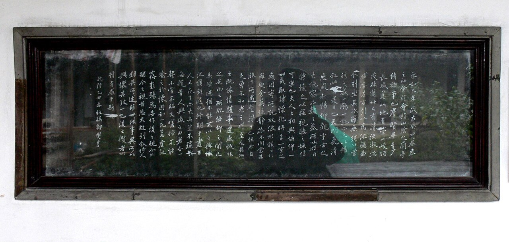

# Zheng Banqiao

Zheng Banqiao (1693-1766), personal name Xie, courtesy name Kerou, style name Banqiao, was a native of Xinghua in Jiangsu. He is the best known of the Eight Eccentrics of Yangzhou, painting orchids, bamboo and rocks, writing in the "six-and-a-half script" and producing poems and family letters. His wine was not that of a great drinker but of a man who sold paintings, received guests and inscribed pictures with a clear sense of price and proportion.

Figure: Zheng Banqiao. Photograph: Zheng Banqiao Lanting. Credit: Gisling, CC BY 3.0, via Wikimedia Commons ([source](https://commons.wikimedia.org/w/index.php?curid=5321435)).

## Life

He was born in 1693. He became a provincial graduate in 1732 and a metropolitan graduate in 1736. In 1742 he was appointed magistrate of Fan county in Shandong, and in 1746 he was transferred to Wei county; in 1753 he was dismissed after relieving famine and offending local notables. Leaving office, he returned to Yangzhou and lived by selling paintings; he died in 1766.

His work circulated widely, and authenticity is complex. His poems are best read in modern editions and reliable inscription records, not folk stories treated as evidence. In 1759 he posted the Banqiao Price List, which set out his prices in public; this text is the key to his later life.

## Relationship with wine

Wine in Zheng's writing is tied to three things: guests, inscriptions and selling paintings. After dismissal his life depended on the art market, and wine appears in dedications, gatherings and letters as both courtesy and expense.

He did not present himself as a drunkard. Unlike Tang Yin's "flowers and wine", Zheng's wine is closer to daily detail: a friend arrives and wine is brought out; a painting sells and money comes in; when he feels aggrieved he writes a few lines. Wine is embedded in livelihood, not romanticised as escape.

## Textual evidence in inscription poems

The inscription on the first bamboo painting made after his return to Yangzhou reads: "Twenty years ago I carried the wine jar; in the spring breeze I was drunk at the Bamboo West Pavilion. Now I plant Yangzhou bamboo again, and the Huainan landscape is still green." Here the wine jar is not a banquet display but a memory of earlier Yangzhou life; wine, bamboo and spring wind together create his sense of returning.

Another inscription is more direct: "Year after year I paint bamboo to buy clear wind; the price of clear wind comes cheap. If elegance is to cost more money and less, most of it goes to the wine-shop keeper." The poem turns painting, selling, earning and paying the wine shop into a single chain, with a self-mocking tone. Wine is not a symbol of transcendence but one destination of a painter's income.

## The Banqiao Price List: paintings, wine money and livelihood

The Banqiao Price List states the rates plainly: "Large works six taels, medium works four taels, small works two taels. A calligraphy strip or a couplet, one tael. A fan or a square album leaf, five mace." It adds that gifts of food are less welcome than silver. It is cited as one of the early texts where a literatus publicly set prices for his work.

The price list does not mention wine, but it explains where the wine money came from. A literatus out of office lived on the orchids and bamboo under his brush; only when a painting sold was there wine, food, paper and ink. Reading "selling paintings" with "drinking wine" makes his economic life clear, instead of leaving only the word "aloof".

The date matters: the Palace Museum places the price list in 1759, when he had been out of office for six years and was selling paintings in Yangzhou. It is not a young man's gesture but an arrangement for earning a living in old age.

## The era and its wine

In Qing Yangzhou, salt merchants, art dealers and literati formed an active painting market. A literatus could live by selling paintings without office. Wine shops, gardens and gatherings were its social spaces; [yellow wine](ref:yellow-wine) and local drinks were common, and distilled spirits were spreading, though literati described low-alcohol wine drunk slowly.

The relation between [wine and painting](ref:wine-and-painting) appears in the Eight Eccentrics as an everyday cycle: paintings are bought, wine is drunk. Painters paid rent, bought paper and wine, and the cultural market of Qing [China](ref:china) is the background.

## Reputation and controversy

"Hard to Be Muddy" is Zheng's most famous inscription, but the stories around it must be separated from the object. The stone in the Weifang Municipal Museum reads: "To be clever is hard, to be muddy is hard; to turn from cleverness into muddiness is harder still. Let one thing go, take one step back, and the mind is at peace now, not for the sake of later reward." It is dated to the ninth month of the xinwei year, that is, 1751. Some popular accounts give 1752 and say he was fifty-nine, so the dating is not uniform.

The story of meeting a "muddy old man" on Yunfeng Mountain circulates widely and has a complete plot, but it is a later legend, not a record of the scene. Taking it as history turns a piece of calligraphy into a moral fable and obscures its text and date.

A further limitation is authenticity: Zheng's fame produced many imitations, ghostwritten works and composite inscriptions. The "Eight Eccentrics" was not a formal group but a later label, with varying lists of members. Quotations should name the modern edition or museum object used.

## Common misreadings

First, treating the folk story of "painting for dog meat" as history. Such anecdotes lack reliable documentary support.

Second, treating the Eight Eccentrics as a formal school. It is better understood as a later label, with no fixed membership or boundary.

Third, turning Zheng Banqiao into an aloof literatus above worldly concerns. The price list shows that he set prices and managed his business seriously.

Fourth, taking the wine in his inscriptions as a drinking diary. Inscription texts include social courtesy and rhetoric and cannot be read line by line as factual record.

## How to read his wine writing

Read the inscription poems for how wine relates to painting, money and place; then the price list for the structure of his income; finally the chronology for when a text was written. Wine then becomes a clue to how a Qing literatus lived from the painting market.

Zheng Banqiao is best approached through the period and the role, then the documented work, and then the sources behind the claim. One check alone will not settle it.

[Wine and painting: four ways to look at a drinking scene](ref:wine-and-painting) and [China](ref:china) answer different questions about Zheng Banqiao: role and period. Read them as a pair, not as alternatives.

## Further reading

- [Wine and painting](ref:wine-and-painting): the relation between literati painting, inscriptions and drinking.
- [Yellow wine](ref:yellow-wine): the basic craft of the grain-fermented wine common in the Qing.
- [China](ref:china): the background of Qing Yangzhou and the Jiangnan cultural market.
