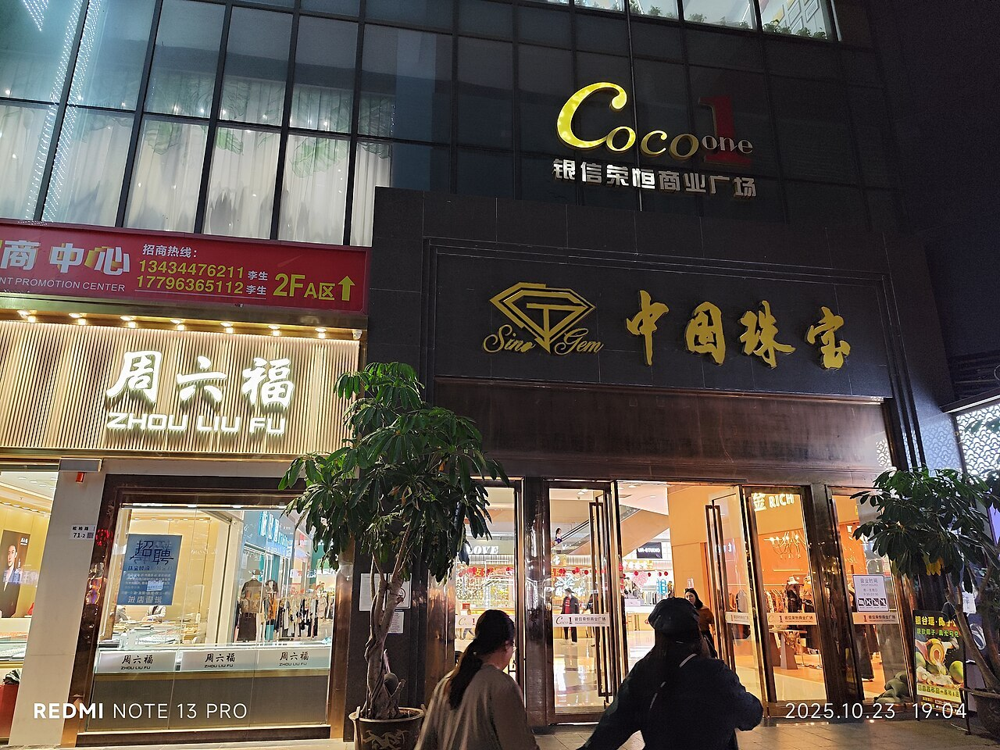

# Zhou Henggang

Zhou Henggang (1918-2004) was a baijiu technologist from Luda, now Dalian, Liaoning. His most important work was not the invention of a drink but the conversion of scattered distillery experience into written processes that could be copied, taught and argued over. The Yantai trials of 1955 and 1962, the Maotai trial of 1964-1966 and dozens of later technical campaigns earned him the name of "the man who legislated for Chinese baijiu". The phrase is exaggerated but captures his role in the shift from workshop practice to industrial standards.

Figure: Zhou Henggang. Photograph: SZ 深圳 Shenzhen 龍崗 Longgang 松柏路 Songbai Road 橫崗街道 Henggang Streets 銀信榮恒商業廣場 YinXin Rong Heng Shopping Mall CoCo One shop China Jewellery n Zhou Liu Fu October 2025 N13P 09. Credit: HSeqao MLSGA, CC0, via Wikimedia Commons ([source](https://commons.wikimedia.org/w/index.php?curid=177355500)).

## Life

Zhou was born in Luda, Liaoning, in 1918. From 1937 to 1942 he studied applied chemistry at Harbin Institute of Technology. After graduation he worked as a technician in a private distillery. In April 1949 he joined the Northeast tobacco and liquor administration. In 1953 he moved to the liquor division of the Ministry of Light Industry.

He led the Yantai trial in 1955, the second Yantai trial in 1962 and the Maotai trial from 1964 to 1966, and took part in dozens of trials in the 1970s. He died on 16 June 2004, aged 86.

## Timeline

- 1918: born in Luda, Liaoning.
- 1937-1942: studied applied chemistry at Harbin Institute of Technology.
- 1949: joined the Northeast tobacco and liquor administration as a technician.
- 1953: transferred to the liquor division of the Ministry of Light Industry.
- 1955: led the Yantai trial.
- 1962: led the second Yantai trial and summarised the sixteen-character method.
- October 1964 to April 1966: organised the Maotai trial.
- 1979: organised judge testing and reform of the third national judging conference.
- 16 June 2004: died, aged 86.

## Work in the drinks trade

The 1955 Yantai trial was the first large, inter-provincial technical collaboration in the baijiu industry after 1949. The local industry ministry brought technicians from 13 provinces and cities to Yantai, and Zhou was one of the leaders. The trial broke production into raw materials, starter culture, fermentation, distillation and storage, recorded temperature, moisture, acidity and yield, and produced the "Yantai method".

In 1962 he led the second Yantai trial and revised the method into sixteen characters: "fuqu and yeast, rational blending, low-temperature pit entry, fixed-temperature distillation." The industry later called it the "basic law of baijiu production". Nationwide promotion raised the yield from ordinary raw materials by 3% to 5% on average.

From October 1964 to April 1966 he organised the Maotai trial, which studied sauce-aroma starter cultures, process, microbes and aroma compounds and identified ethyl hexanoate and caproic-acid bacteria. A distinction is essential here: ethyl hexanoate is a main aroma compound of strong-aroma baijiu, not of sauce-aroma baijiu. The importance of the Maotai trial lies in bringing the idea that flavour comes from microbial metabolism into baijiu research.

On strong-aroma baijiu he later promoted research on pit-mud microbes and the artificial cultivation of pit mud, trying to explain old-pit flavour.

## Major works and institutions

Zhou's first "work" was a method. The sixteen-character Yantai formula, the microbial and aroma research of the Maotai trial, and the sensory testing and aroma-based grading of the 1979 judging conference were institutional results that could be used again and again.

He also left a large body of text. According to Guangming Daily, he wrote 16 books totalling about 1680 wan characters, roughly 16.8 million characters, published more than 400 papers and trained more than 2,800 engineers and technicians.

## Technical method

Zhou's method can be summarised as "analysis, microbes, process, in reverse order": first detect aroma compounds in the finished liquor, then trace them back to microbes and starter culture, and finally fix the source through process parameters. This reversed the traditional master-apprentice order but suited problems shared across factories and regions. He also insisted on staying on the shop floor: living in the distillery, recording temperature, turning the qu, filling pits and distilling with the crew.

## Influence

First, he established the organisational model of the baijiu "trial": gather experts, factories and local technicians in one place, solve a specific problem within a fixed period, and write the conclusion into a transferable method.

Second, he advanced the fuqu route. Fuqu reduced the amount of starter, shortened fermentation and raised yields, which mattered when grain was scarce; it also involved a trade-off in flavour and should not be described simply as "more advanced".

Third, he helped build the aroma-typing system and the judging system. The 1979 conference began grading by aroma type, saccharifying agent and alcohol strength, and introduced sensory testing for judges, turning "aroma type" from a description into a working classification.

Fourth, he trained a technical workforce. More than 2,800 trainees spread across producing regions and became the backbone of baijiu process, tasting and quality management.

## Assessment and disputes

In its obituary, Guangming Daily called him "the man who legislated for Chinese baijiu" and noted that the Yantai method was hailed as the basic law of Chinese baijiu production. The assessment is commemorative, but not groundless: the Yantai trial did turn local experience into a national technical document.

There are three disputes. First, the attribution of the Maotai trial: Zhou was one of its organisers, but Fang Xinfang, Qin Hanzhang and others also took part. Second, the ethyl hexanoate finding is often misreported: it concerns the main aroma of strong-aroma baijiu, not sauce-aroma baijiu. Third, the scope of the Yantai method: it was aimed mainly at fuqu baijiu, not at every baijiu process, and treating it as a universal starter formula ignores the differences of daqu sauce-aroma and light-aroma production.

## Common misreadings

First, that Zhou invented Maotai. He did not; he organised trials that studied Maotai's starter cultures, process, microbes and aroma compounds.

Second, that the Maotai trial proved ethyl hexanoate is the main aroma of sauce-aroma baijiu. It did not. Ethyl hexanoate is a main aroma compound of strong-aroma baijiu; the Maotai trial also identified caproic-acid bacteria and the microbial-metabolism approach.

Third, that the Yantai method applies to all baijiu. It was mainly for fuqu baijiu, with fuqu and yeast, rational blending, low-temperature pit entry and fixed-temperature distillation; daqu sauce-aroma and light-aroma processes have their own rules.

Fourth, that Zhou only did technical work and wrote nothing. He wrote 16 books totalling about 1680 wan characters, roughly 16.8 million characters, published more than 400 papers and trained more than 2,800 technicians.

Fifth, that he alone invented artificial old pits. The artificial cultivation of pit mud was a subject advanced by many researchers; Zhou was an important organiser and promoter.

## See also

- [Baijiu](ref:baijiu): definition, aroma types and basic craft.
- [Strong-aroma baijiu](ref:strong): ethyl hexanoate and the role of pits.
- [Fermentation pit](ref:pit): pit-mud microbes and old pits.
- [Luzhou Laojiao](ref:luzhou): strong-aroma baijiu and pit tradition.
- [Fenjiu](ref:fenjiu): light-aroma baijiu and trial background.
- [GB/T 10781.1-2021](ref:strong-standard): the national standard for strong-aroma baijiu.

**At a glance:** A Chinese baijiu technologist, 1918 to 2004; he led the 1955 and 1962 Yantai trials and the 1964-1966 Maotai trial, summarised the Yantai method, and advanced research on fuqu, caproic-acid bacteria and pit mud. 
