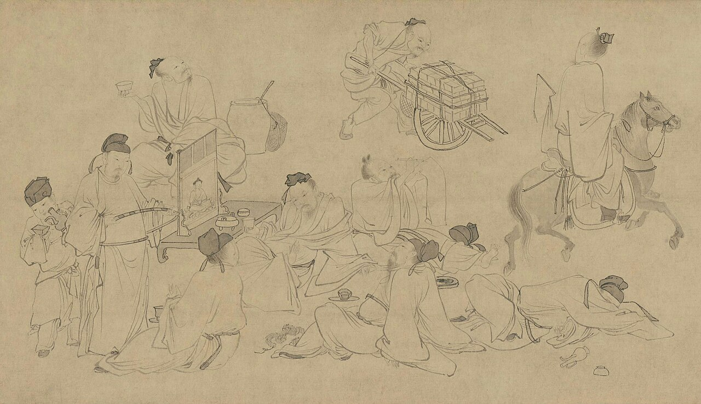

# Song of the Eight Immortals of the Wine Cup: Du Fu's portrait gallery of High Tang

The Song of the Eight Immortals of the Wine Cup is often read as a list of Tang drunks: eight men, eight ways of being drunk, a contest in capacity and comedy. The reading is lively, but it loses half of Du Fu. The eight are not ranked by how much they can drink. They are arranged by status, character and profession: a prince, a chancellor, a poet, a calligrapher, a commoner. Wine is what lets them step outside their assigned places. What Du Fu writes is the small gap between the place and the loss of place.

Figure: A section of Du Jin's Scroll of Ancient Worthies, illustrating the drinkers of Du Fu's poem. This is a later poetic painting, not a record of a Tang banquet. Image: Du Jin, Public domain, via Wikimedia Commons ([source page](https://commons.wikimedia.org/wiki/File:%E6%9D%9C%E5%A0%87%E7%94%BB%E5%8F%A4%E8%B4%A4%E8%AF%97%E6%84%8F%E5%8D%B7%E5%B1%80%E9%83%A8_%E9%A5%AE%E4%B8%AD%E5%85%AB%E4%BB%99.jpg)).

> **Quick verdict**
> **In one line:** This poem entry explains why Song of the Eight Immortals of the Wine Cup: Du Fu's portrait gallery of High Tang matters, and how to read it in its drinking context.
>
> - **Best for:** Anyone who wants Song of the Eight Immortals of the Wine Cup: Du Fu's portrait gallery of High Tang in its literary and drinking context, not just as a famous line.
> - **Not for:** If you want only want exam points or one famous line without context.
> - **Check first:**
>   - The Eight Immortals of the Wine Cup is not a group name invented by Du Fu; it is a later summary of the eight drinkers in the poem.
>   - He Zhizhang rides a horse as if he were in a boat; his eyes blur, he falls into a well and sleeps at the bottom.

## Title and text

The Eight Immortals of the Wine Cup is not a group name invented by Du Fu; it is a later summary of the eight drinkers in the poem. They are He Zhizhang, Li Jin the Prince of Ruyang, the former chancellor Li Shizhi, Cui Zongzhi, Su Jin, Li Bai, Zhang Xu and Jiao Sui. The poem uses the song form, with a few lines for each figure, like a series of sketches rather than a regulated verse with neat parallels. The form itself says that this is a group portrait, not a biography of one man.

The status range is wide. He Zhizhang was a senior official and secretary of the palace library; Li Jin was a prince; Li Shizhi had been chancellor; Cui Zongzhi came from a great family; Su Jin was a Buddhist layman; Li Bai was a commoner poet; Zhang Xu was a calligrapher; Jiao Sui was an ordinary scholar. Du Fu puts them in one poem not because they all drank well, but because in wine each of them revealed a self that official rank could not cover.

## Text

> He Zhizhang rides a horse as if he were in a boat;
> his eyes blur, he falls into a well and sleeps at the bottom.
> The Prince of Ruyang needs three dou before he will face the court;
> on the road he meets a cart of yeast and his mouth waters,
> and he wishes he could move his fief to Wine Spring.
> The chancellor spends ten thousand coins a day on his pleasure,
> drinking like a great whale swallowing a hundred rivers;
> cup in hand, he praises the sage and calls himself a man avoiding worthies.
> Cui Zongzhi, free and elegant, a beautiful young man,
> raises his cup, rolls his white eyes and looks at the blue sky,
> bright as a jade tree in the wind.
> Su Jin keeps a long fast before an embroidered Buddha,
> yet when drunk he often likes to run away from meditation.
> Li Bai, with a dou of wine, writes a hundred poems;
> he sleeps in the wine shops of Chang'an.
> When the emperor calls him, he will not board the boat,
> and calls himself a minister who is an immortal in wine.
> Zhang Xu, after three cups, is known as the sage of cursive script;
> he takes off his cap and bares his head before princes,
> and his brush falls on the paper like clouds and smoke.
> Jiao Sui, after five dou, is at last outstanding;
> his bold talk and debate astonish the whole table.

This is the received text. One line reads praising the sage or praising the worthy; Li Bai's measure is given as a dou of wine or one dou; bold debate also appears as bold argument.

## Eight men, eight kinds of drunkenness

He Zhizhang comes first. He rides a horse as if he were in a boat; his eyes blur, he falls into a well and sleeps at the bottom. The couplet describes an old man's drunken body and his office: he was a senior official of the crown prince and the palace library. Riding a horse like a boat turns a land route into a water route; falling into a well and sleeping at the bottom turns an accident into a nap. Du Fu does not say why he drank. He draws the body after wine, like a cartoon.

The second is Li Jin, Prince of Ruyang. He needs three dou before he will face the court; on the road he meets a cart of yeast and his mouth waters; he wishes he could move his fief to Wine Spring. These lines are about a prince's appetite and his privilege. Other people who drink fail at work; he can drink and still face the court. Other people's watering mouth is greed; his is charming. Wine Spring is a place name and a pun: a fief where wine flows like a spring.

The third is Li Shizhi, the chancellor. He spends ten thousand coins a day on pleasure, drinks like a great whale swallowing a hundred rivers, raises his cup to praise the sage and calls himself a man avoiding worthies. Li Shizhi had been chancellor under Xuanzong and was later pushed out by Li Linfu. The surface is bold drinking; underneath is politics. A dismissed chancellor uses avoiding worthies as self-mockery and puts himself inside the wine. The whale's appetite and the retreat of the worthy are two sides of one man.

The fourth is Cui Zongzhi. He is a free and elegant beautiful young man; he raises his cup, rolls his white eyes and looks at the blue sky, bright as a jade tree in the wind. The white eyes allude to Ruan Ji, who used blue eyes for friends and white eyes for ordinary people. Cui Zongzhi's white eyes are not arrogance. They are a pose: at the wine table he can temporarily stop looking at people by social rank. The jade tree is his appearance and his bearing.

The fifth is Su Jin. He keeps a long fast before an embroidered Buddha, yet when drunk he often runs away from meditation. This is the shortest portrait and the neatest. A Buddhist layman leaves his meditation when drunk. He is not less devout; the drunk Su Jin simply does not want to be Su Jin for a while. Du Fu neither blames nor praises. He places the contradiction on the table.

The sixth is Li Bai. A dou of wine, a hundred poems; he sleeps in the wine shops of Chang'an. When the emperor calls him, he will not board the boat, and calls himself a minister who is an immortal in wine. These lines are the most famous part of the poem and the core of the Li Bai image: poetry, wine, refusal and self-divinisation. A dou of wine producing a hundred poems is literary exaggeration, not a precise output. The refusal to board the imperial boat is a story-scene, not Li Bai's daily political attitude. It writes his self-image in wine: I am not your minister; I am an immortal in wine.

The seventh is Zhang Xu. After three cups he is known as the sage of cursive script; he takes off his cap and bares his head before princes; his brush falls on the paper like clouds and smoke. This is the drunken artist. Wine does not make him confused; it removes his restraint. Taking off his cap is a breach of etiquette and an entry into creation. Zhang Xu's cursive script was famous for its wildness, and Du Fu writes drunkenness and calligraphy as one act.

The eighth is Jiao Sui. After five dou he is at last outstanding; his bold talk and debate astonish the whole table. He is a commoner with no office, yet at the wine table he acquires presence. The first seven have status, talent or fame; Jiao Sui has only a mouth. Wine gives him the right to speak. Putting him last is a deliberate closing move: the Eight Immortals are not all noble, and the wine table is not all officialdom.

## A group portrait of High Tang at the wine table

The deep structure of the poem is a descent from court to street. He Zhizhang, Li Jin and Li Shizhi represent the court; Cui Zongzhi and Su Jin represent great families and religion; Li Bai and Zhang Xu represent art; Jiao Sui represents the common scholar. The eight are like eight steps, pulling the Eight Immortals from the princely palace to the market of Chang'an. Wine is the only thing that can put them at one table.

Wine is also a medium of de-roling. He Zhizhang is no longer the secretary; the Prince of Ruyang is no longer a prince; the chancellor is no longer a chancellor; Su Jin is no longer a lay Buddhist; Li Bai is no longer an awaiting edict; Zhang Xu is no longer a calligrapher before officials. After wine they show another body: a body riding a horse like a boat, a watering mouth, a whale swallowing rivers, white eyes at the sky, a runaway from meditation, a man who will not board the boat, a bare head, a voice that astonishes the table. These bodies are what Du Fu writes.

But Du Fu does not turn de-roling into pure liberation. Some of the eight drink by choice, some are pushed by politics, some use wine to play mad, some simply lose their composure. Du Fu's tone moves between affection and reserve. He likes their truth and knows that truth has a price. The chancellor's avoiding worthies is not happiness; Li Bai's refusal to board the boat is not daily life; Jiao Sui's astonishing the table may last only one night. The wine table is a section through High Tang, not the whole of it.

In material terms, Tang wine was mostly grain wine of modest strength. Three dou, five dou and ten thousand coins are rhetorical figures of wealth and status, not amounts to be copied. Vessels, yeast and wine shops differed greatly from today. Treating the Eight Immortals as capacity heroes rewrites Tang social life through modern alcohol experience. A better reading is that wine is an occasion on which Tang people displayed character, status and political attitude. The craft lineage of [yellow wine](ref:yellow-wine) helps explain Tang grain wine, but the two are not identical.

## Du Fu's method: praise or irony?

The title has song in it, and the tone has praise: free and elegant, bright as a jade tree, sage of cursive script, at last outstanding. But it is not a simple hymn. Du Fu writes He Zhizhang falling into a well, the prince watering at the mouth, the chancellor avoiding worthies, Su Jin running from meditation, Li Bai refusing the boat, Zhang Xu baring his head, Jiao Sui astonishing the table. By ritual standards none of this is dignified, yet Du Fu writes it in a light rhythm that makes the reader laugh before thinking.

The method is close to the comic tradition: exaggerated action reveals character, and the ridiculous and the lovable coexist. Du Fu is not judging them and not beautifying them. He puts the eight in wine and lets them show their cracks; after the laugh, the reader sees the pressure of status behind the crack. He Zhizhang's fall is an old minister's relaxation; Li Shizhi's avoiding worthies is a dismissed chancellor's self-mockery; Li Bai's refusal is a genius's tantrum against power. The laugh and the ache are the same event.

So the poem is neither a hymn to Tang drinking culture nor a satire on drunkards. It is closer to a gallery of character sketches, with Du Fu's particular eye: he sees a person's office and also the person under the office who waters at the mouth, falls into a well and rolls his eyes. Wine merely brings the second person forward for a while.

## Common misreadings

First, treating the Eight Immortals as a capacity ranking. Three dou, five dou and ten thousand coins are rhetoric, not measurement; the eight are ordered by status and type, not by how much they drink. Second, treating immortal in wine as Li Bai's official title. It is his self-description in the poem, a literary image, not a Tang court title. Third, treating the refusal to board the imperial boat as Li Bai's real political behaviour. It is a story-scene that expresses his attitude to power, not a daily act of disobedience. Fourth, treating Su Jin's running from meditation as a rejection of Buddhism. He still keeps the fast before the Buddha; leaving meditation when drunk is a human contradiction, not the collapse of faith. Fifth, treating the poem as pure praise. Du Fu's praise carries reserve, and the laughter carries ache.

One detail deserves attention: among the eight, only Jiao Sui has no prominent status. Putting him last says that the Eight Immortals are not a noble club. The equality of the wine table is the poem's implicit claim. But that equality is brief. After the wine, Jiao Sui is still a commoner, and the chancellor is still dismissed. Du Fu does not say it outright. He arranges the order and lets you see it.

## Related entries

- [Du Fu](ref:du-fu): the person page, with the An Lushan rebellion, Qinzhou and Chengdu periods.
- [Li Bai, Bring in the Wine](ref:li-bai): another poem that expands the self through drinking, readable against the immortal in wine.
- [Cao Cao, Short Song](ref:cao-cao): wine and political ambition in a late Han banquet poem.
- [Yellow wine](ref:yellow-wine): an entry into the grain-wine craft lineage of the Tang.
- [Time in a cup](ref:time-in-a-cup): how wine enters seasons, gatherings and writing.
