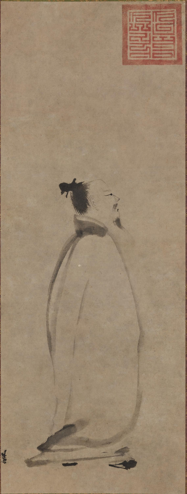

# Holding a Cup and Asking the Moon: Li Bai on people, time and the moon

Holding a Cup and Asking the Moon begins with a very specific occasion. The note under the title says that an old friend, Jia Chun, told Li Bai to ask the question. Li Bai did not suddenly start questioning the moon on his own; a friend asked him to. This detail matters. It puts a poem that looks enormously cosmic back inside a request between friends. Li Bai raises a cup, asks when the moon began, asks why people cannot catch it, and finally asks about the relation between himself, the ancients and the people of today. Wine is not the answer. Wine is what has to be in the hand while the question is asked.

Figure: Li Bai Strolling, attributed to Liang Kai of the Southern Song. This is not a manuscript of the poem or a record of Li Bai drinking under the moon. Image: Liang Kai, Public domain, via Wikimedia Commons ([source page](https://commons.wikimedia.org/wiki/File:Liang_Kai_-_Li_Bai_Strolling.jpg)).

> **Quick verdict**
> **In one line:** This poem entry explains why Holding a Cup and Asking the Moon: Li Bai on people, time and the moon matters, and how to read it in its drinking context.
>
> - **Best for:** Anyone who wants Holding a Cup and Asking the Moon: Li Bai on people, time and the moon in its literary and drinking context, not just as a famous line.
> - **Not for:** If you want only want exam points or one famous line without context.
> - **Check first:**
>   - Holding a cup is a physical action; asking the moon is a conversation.
>   - When did the moon first appear in the blue sky?

## Title and text

Holding a cup is a physical action; asking the moon is a conversation. The title is not a static subject like "moon worship" or "facing the moon". It is an action. Li Bai does not call the poem "singing of the moon"; he calls it "asking", which treats the moon as someone who can answer. The note adds a social layer: this is a piece written because a friend named the task.

The poem has sixteen lines, turning every four lines. The first four ask about the moon's origin and the human attempt to follow it. The next four describe its light and its rising and setting. The next four enter the myths of the white rabbit and Chang'e. The last four gather the ancients, the people of today and the cup in front of the poet. The structure is like a breath: ask outward, look down, go into myth, return to the hand.

## Text

> When did the moon first appear in the blue sky?
> I stop my cup today and ask it.
> People try to climb the bright moon and cannot reach it;
> the moon moves on, yet follows people.
> It is bright as a flying mirror over the red palace;
> green mist clears and its pure light comes out.
> We see it come up from the sea at night;
> who knows how it vanishes into the clouds at dawn?
> The white rabbit pounds medicine through autumn and spring;
> Chang'e lives alone, and who is her neighbour?
> The people of today do not see the ancient moon,
> but this moon once shone on the ancients.
> Ancients and people of today are like flowing water;
> all who look at the bright moon see it thus.
> I only wish that when I sing and face the wine,
> moonlight will long shine in my golden cup.

This is the received text. Some editions punctuate the bright mirror couplet differently, and some read only wish with a different particle.

## Reading section by section

The first two lines are a sudden pause. The word stop is crucial: the wine was about to be drunk, the cup was already raised, and then the question arrived. “When did the moon first appear in the blue sky?” This is not an astronomy question. It is a child's question. Li Bai knows no one can answer it, and still asks. The act of asking is the beginning of the poem.

The next two lines describe the relation between people and the moon. People try to climb the bright moon and cannot; the moon moves on, yet follows them. The pairing of cannot reach and follows is the seed of the whole poem: a person cannot catch eternity, but eternity keeps shining on the person. The next two lines describe the light: a flying mirror over the red palace, green mist clearing, pure light coming out. Then the moon's route: we see it come up from the sea at night, but “who knows how it vanishes into the clouds at dawn?” The moon has its own path; people see only a segment.

The next two lines enter myth. The white rabbit pounds medicine through autumn and spring; “Chang'e lives alone, and who is her neighbour?” The myths are not there for storytelling. They are there for repetition and solitude. The rabbit's work repeats; Chang'e's dwelling is lonely. The more eternal the moon, the more its inhabitants seem trapped by eternity.

The next two lines are the famous turn. The people of today do not see the ancient moon, but this moon once shone on the ancients. The direction of time flips: from people looking at the moon to the moon looking at people. The moon is a witness across generations; people are one batch after another that it has shone on.

The next two lines generalise the witness. Ancients and people of today are like flowing water; all who look at the bright moon see it thus. The ancients and the people of today pass like a river, but everyone sees the same moon. There is no simple pessimism here, and no simple consolation: people do pass, but the shared act of looking connects the generations.

The last two lines return to wine. I only wish that when I sing and face the wine, moonlight will long shine in my golden cup. Li Bai does not ask the moon for an answer, and does not ask for long life. He asks only that when he sings with wine in hand, the moonlight will enter the cup in front of him. The cosmic question lands in a specific, liftable object. This is not escape. It is a change of scale: since a person cannot keep the moon, let the moon enter the wine for this moment.

## The moon, time and wine

The centre of the poem is not the moon but the frame of reference. The moon is a constant reference: it has seen the ancients and sees the people of today; it comes from the sea and vanishes into the clouds; its rabbit and Chang'e repeat their days. Once a person uses the moon as a reference, his own life looks short. But Li Bai does not stop at the shortness of life. He asks the next question: if it is short, how should this moment be lived?

Wine is his way of answering. Wine cannot lengthen life or stop the moon; wine can give weight to the present. Singing, facing wine, moonlight in the golden cup: three things happen at once. The song is the human voice, the wine is the human action, the moon is the light of heaven. They overlap for a moment inside one cup. Li Bai does not want eternity. He wants this moment to be full.

This is also a common feature of Li Bai's drinking poems: wine is not a tool for forgetting sorrow but a medium that brings an abstract question back to the body. In Drinking Alone under the Moon, wine turns the moon and the shadow into a gathering of three. In Bring in the Wine, wine turns the irreversibility of time into a banquet. In Holding a Cup and Asking the Moon, wine brings the cosmic scale into a golden cup. The three poems do different things, but they all use a cup to give an unanswerable question a bearable form.

In material terms, Tang wine was mostly grain wine of modest strength, and the vessels included golden cups, jade bowls and measures. A golden cup need not be solid gold; gold in poetry often signals value and brightness. Reading it as a modern precious-metal cup loses its rhetorical function. The drink is close to the craft lineage of [yellow wine](ref:yellow-wine), but Tang drinking methods and alcohol strength were not the same as today's.

## Li Bai's Tianbao setting

The common dating of the poem is the Tianbao era (742–756), after Li Bai had left Chang'an. Jia Chun, named in the note, has no detailed biography, but old friend shows that the two had a past. The poem does not have the clear banquet scene of Bring in the Wine, nor the flowers and solitary drink of Drinking Alone under the Moon. It reads more like an impromptu question on a moonlit night, perhaps at Mid-Autumn, with the exact place and year impossible to pin down.

The Tianbao years were a period of political disappointment for Li Bai. He had served in the Hanlin Academy, was later dismissed with a gift of gold, and returned to a life of travel. This background should not be forced onto every line, but it explains two tones in the poem: the question, when did the moon first appear, and the withdrawal, I only wish that when I sing and face the wine. The first is Li Bai's curiosity about the universe; the second is his accommodation with reality. Between them is a person who will not give up entirely and will not stop hoping entirely.

In Chinese poetry the moon is often linked to homesickness, missing someone and reunion. This poem has that layer too, but it does not stop at I miss home or I miss my friend. It turns the moon into a witness across time and makes a personal feeling into a human condition. That is why it is often quoted at Mid-Autumn: it is not about one family's reunion but about everyone who looks at the moon.

## Common misreadings

First, reading the people of today do not see the ancient moon as complete nihilism. The next line, this moon once shone on the ancients, immediately builds a connection: people cannot see the ancient moon, but this moon has seen the ancients. Second, reading ancients and people of today are like flowing water as meaning that life has no meaning. A river is a process, not a void; the emphasis is on flow, not disappearance. Third, reading moonlight will long shine in my golden cup as pure carpe diem. Li Bai wants the fullness of this moment, not the abandonment of tomorrow. Fourth, treating the white rabbit and Chang'e as a children's story. In the poem they are images of repetition and solitude, not plot. Fifth, treating the golden cup as literal. The gold is a response to light, not necessarily a cup of pure gold.

One detail is easily overlooked: the note says Jia Chun told Li Bai to ask. Put that back and the poem is not one man talking to himself under the moon; it is a writing task between friends. Li Bai accepts the task and turns it into a question about human time. That leap from a private request to a universal proposition is his particular skill.

## Related entries

- [Li Bai](ref:li-bai): the person page, with his Tianbao years, travels and drinking poems.
- [Drinking Alone under the Moon](ref:drinking-alone): another poem that turns the moon, the shadow and wine into a gathering.
- [Su Shi, Water Melody](ref:su-shi): a Song Mid-Autumn ci that also asks the blue sky with wine in hand.
- [Yellow wine](ref:yellow-wine): an entry into the grain-wine craft lineage of the Tang.
- [Time in a cup](ref:time-in-a-cup): how wine enters seasons, gatherings and writing.
