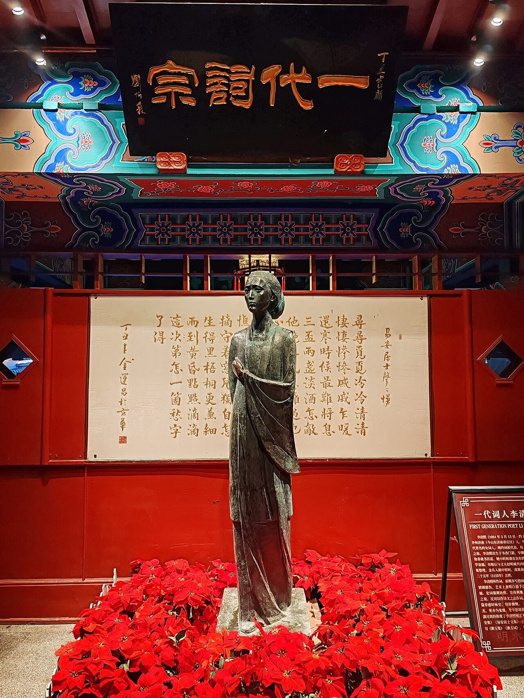

# Ru Meng Ling: A Thirty-Three-Character Little Film

Li Qingzhao's Ru Meng Ling, on often remembering the dusk at the brook pavilion, has only thirty-three characters, yet it plays like a small film: dusk, a pavilion by the water, drunkenness, the boat home, lotus flowers, a struggle to cross, gulls and egrets. It never says I am sad or I am happy. It shows actions and sounds, and the evening stays in the mind. Li Qingzhao's skill is not in making the scene beautiful. It is in turning a memory into a clip that can be replayed.

Figure: A statue of Li Qingzhao. It is a later work, not a Song portrait or a manuscript of the lyric. Image: Vitsuha, CC0, via Wikimedia Commons ([source page](https://commons.wikimedia.org/wiki/File:%E6%9D%8E%E6%B8%85%E7%85%A7%E5%A1%91%E5%83%8F.jpg)).

## Title and text

Ru Meng Ling is a ci tune, originally called Yi Xian Zi and said to come from the Later Tang emperor Zhuangzong; it was renamed after the line like a dream, like a dream. The tune is very short and suits a single moment. Li Qingzhao uses it for an outing, not for a whole life's reflection, and because it is short, no word can be wasted.

The phrase often remember tells us that this is memory, not the present scene. She is not writing at the dusk of the brook pavilion; she is writing later, when she often thinks back to that evening. Often remember opens a gap in time: the writer is no longer in that evening, and she walks through it again in memory. This frame matters. It gives the whole lyric a tenderness that knows it cannot return.

## Text

> I often remember the dusk at the brook pavilion,
> deeply drunk and not knowing the way home.
> When the mood was exhausted, I returned by boat late,
> and mistakenly entered the depths of the lotus flowers.
> Racing to cross, racing to cross,
> I startled a whole bank of gulls and egrets.

This is the received text. Zheng du also appears as zen du; often remember as once remember; deeply drunk as sunk in drunkenness.

## Reading section by section

The first line gives time and place. A brook pavilion is a pavilion by the water; dusk is evening. No weather, no companions, only a place and an hour. The second line gives the state: deeply drunk and not knowing the way home. Deeply drunk can mean wine, and it can mean the scenery. She may have drunk, and she may have been captivated by the dusk and the lotus. Li Qingzhao does not say which, and the reader does not need to choose at once. What matters is not knowing the way home: she has not forgotten the road; she does not want to go back.

The third line turns. When the mood was exhausted, I returned by boat late. She goes back only after the pleasure is spent, and late adds darkness, preparing for the mistake. The fourth line, “mistakenly entered the depths of the lotus flowers,” is the most beautiful accident in the lyric. She does not deliberately steer into the lotus; she loses her way. She is not anxious about losing it; she enters a deeper, quieter, more fragrant space. The depths of the lotus are enclosed and different from the road she came by.

The last two lines are sound. “Racing to cross, racing to cross” can be the action of rowing hard to get through, and it can be the repeated question of how to cross. Both readings work: the first is movement, the second is mood. Either way, the result is I startled a whole bank of gulls and egrets. The oars and the water wake the birds, and the birds rise. The image lifts from the water to the sky. The lyric ends in sound and flight, with no comment.

## The brook pavilion, the lotus and youth

The lyric is often placed in Li Qingzhao's early period, after she arrived in the capital and before her marriage. In that period her family was comfortable, her father Li Gefei had a large library, and she had the means to go on outings, drink and write. The pavilion, the lotus and the birds need not be one specific garden; they may be the water country around Jinan. The exact place is disputed, but the atmosphere of a young woman's pleasure in an outing is clear.

Still, the lyric should not be read as Li Qingzhao's diary. The I in a ci is a literary voice. It may come from real experience, and it may be selected and shaped. She writes often remember, not today. She stands in a later time and looks back, distilling one outing into thirty-three characters. That later time may be years later, or longer. The lighter her brush, the more the reader feels that the time has already passed.

The depths of the lotus also carry symbolism. Lotus in Song literature is often linked to summer, women and purity. The depths of the lotus are a place deeper and more secluded than the everyday world. Entering them by mistake is not a disaster; it is a small trespass. There she can lose her way, row hard, and startle the birds. This space belongs neither to the household nor to official life. It belongs to an evening in which the rules can be suspended for a while.

## Is "deeply drunk" wine or scenery?

Deeply drunk is the word most likely to be forced into a choice. Some read it as wine: Li Qingzhao liked wine, and wine appears often in her lyrics. Some read it as scenery: she was captivated by the dusk at the pavilion and need not have drunk at all. Both explanations make sense, and they need not exclude each other. Wine can relax her, scenery can make her forget the road; together they produce the state of not knowing the way home.

In Song women's lives, an outing with wine was not impossible. Wine appears frequently in Li Qingzhao's lyrics: drinking by the eastern fence in Zui Hua Yin, three cups of weak wine in Sheng Sheng Man, and a heavy sleep that does not clear the residual wine in another Ru Meng Ling. She writes wine not always as sorrow, but also as daily life. To make deeply drunk purely wine is too literal; to make it purely scenery loses the link between wine and leisure in Song ci.

A better reading: wine is a possible medium, scenery is the direct object. She may have drunk, and she may not have. Deeply drunk describes a state carried away by environment and mood together. The reader need not give her a medical check. The ambiguity is not a defect. It is the capacity of the small lyric.

## Common misreadings

First, reading zheng du only as racing to cross. It can also be zen du, a question asked to oneself when lost. Second, reading mistakenly entered the depths of the lotus as a dangerous predicament. It is a beautiful accident, not a mishap. Third, reading the startled birds as damage to the scenery. The birds rising are part of the picture, a meeting of stillness and motion. Fourth, treating this lyric as the whole of Li Qingzhao's life. It is one outing from her early period, not a summary of her later sorrow. Fifth, insisting that deeply drunk must be wine. Wine is possible, scenery is possible; do not turn a deliberately blurred word into a single conclusion.

There is also a formal misreading: treating the lyric as a landscape poem. It has landscape, but its core is narrative: often remember, dusk, drunk, return by boat, mistake, cross, startle. Seven actions make a line. Landscape is where the actions happen, not the purpose. Li Qingzhao is not describing a still lotus pond. She is recording a movement in which she loses her way.

## Related entries

- [Li Qingzhao](ref:li-qingzhao): the person page, with her family, marriage, flight south and changing style.
- [Zui Hua Yin](ref:zui-hua-yin): another lyric of wine, flowers and longing.
- [Sheng Sheng Man](ref:sheng-sheng-man): the post-migration Li Qingzhao, writing wine into sorrow.
- [Yellow wine](ref:yellow-wine): an entry into the grain-wine craft lineage of the Song.
- [Time in a cup](ref:time-in-a-cup): how wine enters seasons, gatherings and writing.

Ru Meng Ling is best approached through the poet and date, then the text and translation, and then what it is cited for here. One check alone will not settle it.

[Li Qingzhao](ref:li-qingzhao) and [Sheng Sheng Man: Three Cups and Two Cups of Thin Wine against the Evening Wind](ref:sheng-sheng-man) are the nearest useful comparisons: one clarifies author, the other tests text.
