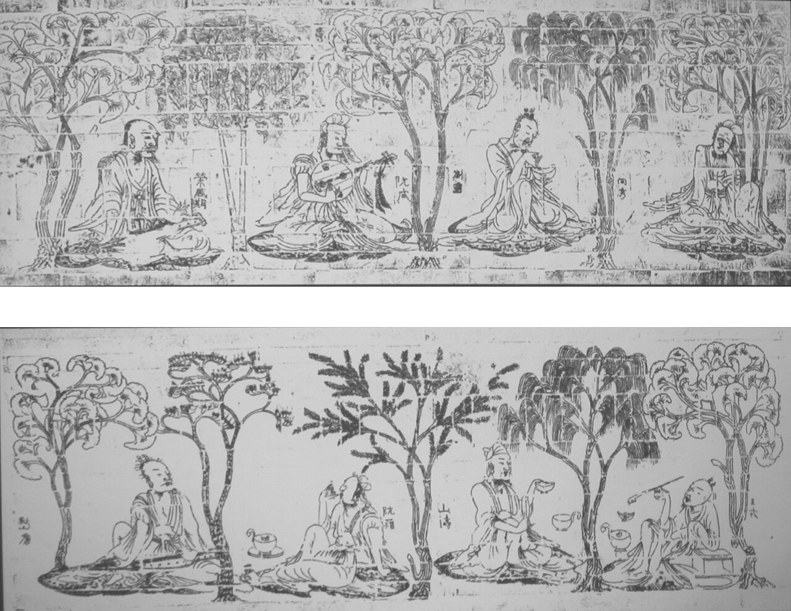

# In Praise of the Virtue of Wine: Liu Ling's drinking as political fable

In Praise of the Virtue of Wine is short enough to read in one sitting, and difficult enough to resist a comfortable reading. Liu Ling is not describing a banquet. He is describing how a person might pull himself out of ritual law, rank and the gaze of others. The virtue in the title is not capacity for drink, and not good behaviour at table. It is a stance on life taken under the name of drunkenness. To read the piece only as a drunkard's defence is to miss the political fear that the Seven Sages kept behind their cups.

Figure: A painting of the Seven Sages of the Bamboo Grove; the group included Liu Ling. This is not a portrait of Liu Ling or a manuscript of the essay. Image: Unknown author Unknown author, Public domain, via Wikimedia Commons ([source page](https://commons.wikimedia.org/wiki/File:Seven_Sages_of_the_Bamboo_Grove.jpg)).

## Title and text

Song is a literary form normally used to praise a person or a virtue. Liu Ling uses this solemn form for a Great Man who does not live by ordinary time, does not live in an ordinary house, and does not act by ordinary ritual. The title and the content therefore sit at an angle: the virtue being praised is exactly what the defenders of ritual law do not want to recognise.

The text is short, and the variants are mostly particles and individual words. Common differences include there was a Great Man versus there was a Great Man, the eight directions as a courtyard versus as a doorway, and sky as a curtain versus twilight as the sky. None of these changes the argument, but they change the tone: some readings are closer to prose, others closer to the parallel phrasing of a fu. There is no need to insist on one original wording, and still less to treat one edition's particles as Liu Ling's exact speech.

## Text

> There was a Great Man who took heaven and earth as a single morning, ten thousand years as a moment, the sun and moon as his window and door, and the eight directions as his courtyard. He walked without leaving tracks, lived without a house, used the sky as a curtain and the ground as a mat, and went wherever his mind led. When he stopped he held a cup or a goblet; when he moved he carried a jar or a pot. Wine was his only business; what else was there to know?
>
> A noble young lord and a retired scholar in official dress heard of his reputation and began to discuss what he was about. They rolled up their sleeves, glared and ground their teeth, expounded ritual law, and set up arguments like a thicket of blades. The gentleman, meanwhile, was holding a wine jar under the tap, sipping from a cup, rinsing his mouth with unfiltered wine; he bristled his beard, sat with legs spread, used a wine press as a pillow and wine lees as a mat. Without thought or care, he was happy and at ease. He got drunk without knowing how, and sobered up with a start. Listening, he did not hear thunder; staring, he did not see Mount Tai; he did not feel cold or heat on his skin, and profit or desire did not move him. Looking down on the world, he saw it bustling like duckweed carried on the Yangtze and the Han; the two grandees at his side were like the wasp and the caterpillar of the old poem.

This is the received text. Some editions differ in wording such as the Great Man, the courtyard, or twilight as the sky; see below.

## Reading section by section

The opening sets the scale of the Great Man. Heaven and earth are one morning, ten thousand years are a moment, the sun and moon are a window and a door, and the eight directions are a courtyard. This is not decorative landscape writing. It dismantles the ordinary units of time and space. Once the world is seen at this scale, promotion and loss, praise and blame, have much less power to make a person tremble. The next lines describe his movements: no tracks, no house, sky as a curtain, earth as a mat, going wherever he wishes. The point is not poverty but deliberate unloading.

The second section describes his daily life. When he stops he holds a cup or a goblet; when he moves he carries a jar or a pot. All his attention goes to wine, and nothing else is worth knowing. This passage is often read as a portrait of a drunkard, but notice its parallel structure: stillness and movement, cup and goblet, jar and pot, indoors and on the road. Liu Ling is writing a rhythm of drinking that can happen anywhere, at any time; the vessels are the points where he touches the world.

The third section turns suddenly to conflict. A noble young lord and a retired scholar hear of him and begin to talk. They roll up their sleeves, glare, grind their teeth, invoke ritual law, and set up arguments like blades. This is the political core of the piece: the Great Man has not attacked anyone. The defenders of ritual law have decided that he is a problem. The answer is not a debate. The gentleman holds a wine jar, sips, spreads his legs, uses the wine press as a pillow and the lees as a mat, and is perfectly at ease. There is no argument and no rebuttal, only a refusal to enter the other person's language.

The ending moves from drunkenness to sobriety. He gets drunk without knowing how and wakes with a start; he does not hear thunder, does not see Mount Tai, does not feel cold or heat, and is not stirred by profit or desire. He looks down and sees the world like duckweed on a great river; the two grandees beside him are like the wasp and the caterpillar. The old poem used these insects for a mistaken relationship, a small creature treating another as its own child. Liu Ling uses the image to shrink the grandees' righteous anger into the busyness of an insect.

## The politics of the virtue of wine

The virtue of wine has at least three layers. The first is non-contention: when ritual men attack, the Great Man does not explain himself, he keeps drinking. This is not weakness but a refusal. You may judge me by ritual law; I do not accept your court. The second is the power to revalue: by renaming heaven, earth, ten thousand years, sun, moon and the eight directions, he removes the measures on which the social order depends. The third is bodily self-protection: the dulling of the senses is both escape and a way of keeping fear from breaking through under political pressure.

This also explains why the piece uses the solemn form of a song. Liu Ling knows the weight of ritual law; that is precisely why he can parody it. The noble lord and the retired scholar are not cartoon villains. They represent a social order that really had power. The Great Man's victory is not a debating win. He was never on the same field.

Wine also has a material history here. In the Wei-Jin period the everyday drink was a grain wine of modest strength, made and drunk differently from today's distilled spirits. The phrases about holding a wine jar, sipping, and using lees as a mat point to unfiltered wine and wine lees, not to a clear spirit. To read the piece as the story of strong liquor ruining a man is to apply a modern alcohol content to an ancient moral choice. The craft lineage of [yellow wine](ref:yellow-wine) is close to Wei-Jin grain wine and helps explain the physical drink, though the two are not the same product.

## The Wei-Jin setting and the Seven Sages

Liu Ling, courtesy name Bolun, came from Pei in the Western Jin and was one of the Seven Sages of the Bamboo Grove. Very little reliable biography survives. The Book of Jin presents him as taciturn, indifferent to property, and given to unrestrained drinking. His surviving writing is equally sparse; In Praise of the Virtue of Wine is almost the only piece by which he is known. The essay makes sense only inside the world of the Seven Sages.

The group was active in the last years of the Cao Wei and the early Western Jin, when the Sima family was tightening its hold on power and moral orthodoxy was being used as a political instrument. Their drinking, pure conversation and eccentric behaviour were not only lifestyle choices. They were strategies for preserving a self inside a narrowing political space. Ruan Ji stayed drunk to avoid a marriage alliance and to avoid political commitment; Ji Kang refused to cooperate and was executed; Liu Ling wrote drunkenness into a self-contained hymn. Their choices differ, but the question is the same: in a system that does not permit a clear no, how can a person still say no?

The piece never names the Sima family and never attacks a specific official. Its edge is structural. The more furious the ritual men become, the calmer the Great Man is. The more complete their moral order, the larger the world after wine. This is safer than direct protest and also more cutting. It lets the reader draw the conclusion: if ritual law can only be maintained by glaring and grinding teeth, it is probably not as strong as it claims.

## Common misreadings

First, reading the piece as a drinking invitation. It invites no one to drink and praises no capacity for liquor. It describes how a person moves himself outside social judgement. Second, identifying the Great Man directly with Liu Ling. There is autobiography in the figure, but the Great Man is a constructed persona; not every sentence is a record of Liu Ling's day. Third, taking without thought or care as an absence of thought. It is closer to a deliberate shutdown: when the external order cannot be changed, switch off the internal anxiety first. Fourth, romanticising Wei-Jin drinking. The drunkenness of the Seven Sages carried political risk and physical cost; the freedom of Ruan Ji and Liu Ling is not a lifestyle template. Fifth, reading the text through modern vessels, alcohol strength and drinking games. Cups, goblets, jars and pots are ancient vessels, and unfiltered grain wine is not distilled spirits.

One more point is easily missed: the critique of ritual law is not a rejection of all norms. It rejects the use of ritual as a weapon against outsiders, not the basic order between people. The Great Man harms no one and asks no one to get drunk with him. He simply refuses to be defined by another person's sense of right and wrong. That measure is why the essay survives better than a ordinary piece of invective.

## Related entries

- [Tao Yuanming, Drinking Wine V](ref:tao-yuanming): another way of placing wine inside a rural, self-explaining life.
- [Cao Cao, Short Song](ref:cao-cao): wine and political ambition in a late Han banquet poem.
- [Li Bai, Bring in the Wine](ref:li-bai): how a Tang drinking song turns disappointment into bravado.
- [Yellow wine](ref:yellow-wine): an entry into the grain-wine craft lineage of the Wei-Jin period.
- [Time in a cup](ref:time-in-a-cup): how wine enters seasons, gatherings and writing.
