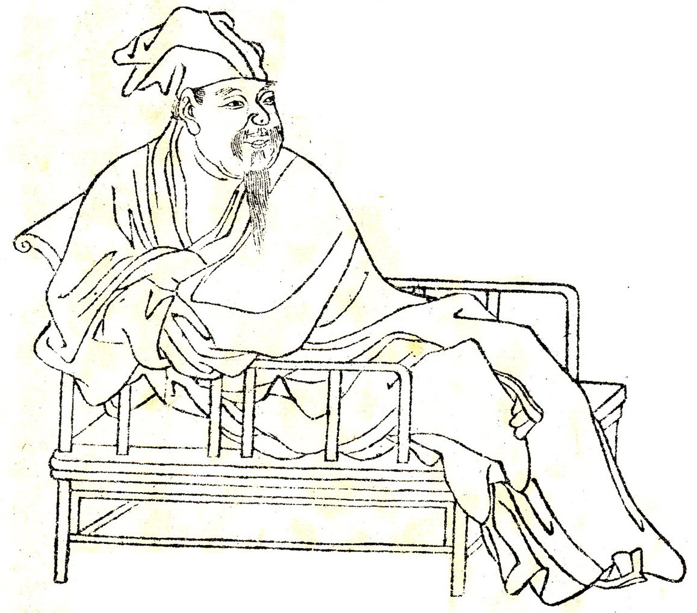

# The Pavilion of the Old Drunkard: Ouyang Xiu on exile, landscape and local government

The Pavilion of the Old Drunkard is so famous that one of its lines has become a everyday idiom. People use the old drunkard's meaning is not in the wine to mean that someone has an ulterior motive. They rarely return to the essay to ask where the meaning actually lies. Ouyang Xiu moves from mountains to a spring, from a spring to a pavilion, from the pavilion to people, from days and seasons to the outings of Chuzhou residents and the banquet of the magistrate. Only at the end does he place himself in the scene with the question, who is the magistrate? Wine runs through the whole piece, but wine is not the subject. It is a key that opens a question: after exile, how does a official live with the people of one place?

Figure: A portrait of Ouyang Xiu. This is not a view of the Pavilion of the Old Drunkard or a manuscript of the essay. Image: Wikimedia Commons contributor, Public domain, via Wikimedia Commons ([source page](https://commons.wikimedia.org/wiki/File:Ouyang_Xiu.jpg)).

> **Quick verdict**
> **In one line:** This poem entry explains why The Pavilion of the Old Drunkard: Ouyang Xiu on exile, landscape and local government matters, and how to read it in its drinking context.
>
> - **Best for:** Anyone who wants The Pavilion of the Old Drunkard: Ouyang Xiu on exile, landscape and local government in its literary and drinking context, not just as a famous line.
> - **Not for:** If you want only want exam points or one famous line without context.
> - **Check first:**
>   - In 1046 Ouyang Xiu was sent to Chuzhou as magistrate after the failure of the Qingli reforms, which he had supported.
>   - All around Chu is mountain.

## Title and text

In 1046 Ouyang Xiu was sent to Chuzhou as magistrate after the failure of the Qingli reforms, which he had supported. Chuzhou was not a rich metropolis, but it had Mount Langya and the Brewing Spring. A monk named Zhixian built a pavilion beside the spring; Ouyang Xiu named it the Pavilion of the Old Drunkard and wrote this record. The old drunkard is his own self-mocking title: he had a low tolerance for wine, got drunk after a little, and was older than the people around him, so he called himself an old man.

A ji is a common form of Song prose. It can describe scenery, people or objects, and it can use a place as a starting point for an argument. Ouyang Xiu did not write a simple travel guide. He used the form to put a observation of local government inside a landscape essay. This matters: read only the scenery and the piece looks like a beautiful excursion; read to the last line about the magistrate's joy and the centre of gravity moves from landscape to people.

## Text

> All around Chu is mountain. In its southwest, the peaks and wooded valleys are especially fine; the one that looks dense and deep from afar is Langya. Walking six or seven li into the mountain, one gradually hears water murmuring and pouring out between two peaks: this is the Brewing Spring. The path turns and the peak turns, and a pavilion, like a bird with spread wings, stands above the spring: this is the Pavilion of the Old Drunkard. Who built it? The monk Zhixian of the mountain. Who named it? The magistrate named it after himself. The magistrate came here to drink with guests, got drunk after a little, and was the oldest among them, so he called himself the Old Drunkard. The Old Drunkard's meaning is not in the wine; it is in the mountains and water. The joy of mountains and water is obtained in the heart and lodged in wine.
>
> When the sun rises and the forest mist opens, when clouds return and the rocky caves darken, this is the mountain's morning and evening. Wild flowers bloom with a hidden fragrance, fine trees flourish in deep shade, wind and frost are high and clean, water falls and stones appear: this is the mountain's four seasons. Going out at dawn and returning at dusk, the scenery differs in each season, and the joy is also endless.
>
> As for the bearers singing on the road, the walkers resting under trees, those in front calling and those behind answering, old people and children being led by the hand, coming and going without cease: these are the people of Chu on an outing. Fishing by the stream, where the water is deep and the fish fat; making wine from the Brewing Spring, where the spring is fragrant and the wine clear; mountain dishes and wild vegetables spread out in a miscellaneous array: this is the magistrate's banquet. The joy of a drunken banquet is not silk and bamboo; when a thrower hits the mark, when a chess player wins, when cups and counters cross and people rise and sit and shout: this is the guests' delight. A pale face and white hair, tottering among them: this is the magistrate drunk.
>
> Then the sun sets behind the mountain, the shadows of people scatter, and the magistrate returns while the guests follow. The woods grow dark, birds call above and below, and the visitors leave while the birds rejoice. Yet the birds know the joy of the woods and mountains, but not the joy of people. People know the joy of following the magistrate on an outing, but not that the magistrate rejoices in their joy. To be drunk and share their joy, to be sober and set it down in writing: this is the magistrate. Who is the magistrate? Ouyang Xiu of Luling.

This is the received text. Some editions read the monk of the mountain was named Zhixian, and the water clears and the stones appear instead of the water falls.

## Reading section by section

The first paragraph moves from a large view to a small one. All around Chu is mountain places the prefecture inside a ring of peaks. Then the focus narrows to the southwest, to Langya, to a six or seven li walk, to the sound of water, to the Brewing Spring, and finally to the pavilion, which stands above the spring like a bird with spread wings. The camera advances from prefecture to mountain, from mountain to spring, from spring to pavilion. Two questions then establish the pavilion's origin: who built it? The monk Zhixian. Who named it? The magistrate himself. The paragraph ends with the famous line. It does not reject wine. It puts wine back inside the relationship between landscape and people.

The second paragraph is about time. Sun rises, forest mist opens; clouds return, caves darken: morning and evening. Wild flowers, fine trees, wind and frost, water falling and stones appearing: the four seasons. Ouyang Xiu does not describe each season at length. Four short parallel phrases compress the mountain's changes into a rhythm. Go at dawn, return at dusk; the scenery differs, the joy is endless. This joy is not the pleasure of a tourist ticking off a site. It is the pleasure of a local official who can enter the same landscape again and again without becoming bored.

The third paragraph is about people. Bearers sing on the road, walkers rest under trees, those in front call and those behind answer, old people and children come and go: the people of Chu on an outing. Fishing by the stream, making wine from the spring, mountain dishes and wild vegetables: the magistrate's banquet. The joy is not silk and bamboo; a thrower hits the mark, a chess player wins, cups and counters cross, people rise and sit and shout: the guests' delight. Then a pale face and white hair, tottering among them: the magistrate is drunk. The camera moves from the crowd back to the self. The magistrate's drunkenness is not a collapse on the table. He sits tottering in the middle of the pleasure. He is the person who makes the scene possible, and the person who steps slightly back inside it.

The fourth paragraph is the dispersal. The sun sets, shadows scatter, the magistrate returns and the guests follow. The woods darken, birds call, the visitors leave and the birds rejoice. The people are gone, the birds begin to be happy. It is a light touch, but it opens the layers of joy. Birds know the joy of the woods, not the joy of people. People know the joy of following the magistrate, not that the magistrate rejoices in their joy. The ending names the writer: drunk, he could share their joy; sober, he could set it down in writing. Who is he? Ouyang Xiu of Luling. The official title falls away and a specific person remains.

## The pavilion, Chuzhou and local government

To understand the essay, look not only at the pavilion but at Chuzhou. Ouyang Xiu arrived just after the failure of the Qingli reforms. The reforms had been accused of creating factions, and their supporters were sent to provincial posts. Chuzhou was a low point in his political career. He could have written about disappointment, grievance or unrecognised talent. Instead he wrote about the people of Chu on an outing, the magistrate's banquet and the guests' delight. He wrote about how a local official might allow the people under his care to have leisure, pleasure and an orderly day in the mountains.

Behind this is Ouyang Xiu's idea of light and simple government. Light does not mean doing nothing; simple does not mean cutting corners. It means less harassment, fewer petty regulations, and room for people to live their own lives. Chuzhou was not wealthy, but in the essay the people of Chu can lead their old and young up the mountain, fish by the stream and picnic by the pavilion. These scenes need not be read through the lens of modern tourism, but they convey a result of governance: the local official did not squeeze the people so hard that they had no breath left, and so the joy of the landscape could become a public joy.

The pavilion's building history supports this. According to Chuzhou material, the pavilion was first built in 1046 by Zhixian for Ouyang Xiu. It was open on four sides, with a hip-and-gable roof and upturned eaves, and later grew into a complex of eight pavilions and nine courtyards. In 1095 Su Shi, at the request of the magistrate Wang Zhao, rewrote the record and had it carved on stone, creating the pairing of Ouyang's text and Su's calligraphy. The pavilion is not an isolated attraction. It is a container of local memory: text, calligraphy, stele, pavilion, spring and mountain layered on one another.

## Where the old drunkard's meaning lies

The old drunkard's meaning is not in the wine is often explained as having an ulterior motive, but in the original it is first of all a self-explanation. Ouyang Xiu had a low tolerance for wine and got drunk after a little, so drunk is not a measure of capacity but a pose. He puts the joy of landscape before wine, and puts obtained in the heart and lodged in wine after it. Wine is a vehicle, not the destination. Landscape is not the destination either. Landscape is the place where a person recovers a sense of ease.

Further on, the magistrate rejoices in their joy is the real landing point. The magistrate's joy is not that he himself drinks well. It is that he sees the people of Chu on an outing, the guests enjoying themselves and the birds rejoicing. The phrase is deliberately awkward: the magistrate takes other people's joy as his own. In modern terms, this is the perspective of a public administrator. A place is in good shape not when the office is quiet, but when ordinary people can safely spend a day in the mountains. The essay does not say the government is harmonious. It shows a spring outing and lets the reader see it.

Wine in this picture performs a social function. The Brewing Spring makes wine; the spring is fragrant and the wine clear. Cups and counters cross; people rise, sit and shout. Wine turns strangers into people at the same table, and turns an official banquet into an occasion where laughter is allowed. But it does not outweigh the landscape, and it does not outweigh the people. Ouyang Xiu writes drunkenness as tottering among them, not as a heavy collapse. He writes the banquet as not silk and bamboo, not as luxury. This restraint is what separates the essay from ordinary banquet writing.

## Common misreadings

First, reading the old drunkard's meaning is not in the wine as the idiom's meaning. In the original it explains why Ouyang Xiu called himself the Old Drunkard; it is not a lesson in speaking indirectly. Second, reading the essay as pure landscape writing. Landscape is the entrance; the real subject is the joy shared by the people of Chu, the magistrate, the guests and the birds. Third, taking sharing joy with the people as political propaganda. It is closer to an ideal of local government: people have leisure, and officials do not disturb them. Fourth, taking drunk as excessive drinking. Ouyang Xiu says explicitly that he gets drunk after a little. Drunk here is self-mockery and a pose. Fifth, ignoring the ending. Without who is the magistrate? Ouyang Xiu of Luling, the essay is only scenery. With it, the author returns from an office to a name.

There is also a textual misreading: changing the water falls and the stones appear to the water clears and the stones appear turns the dry season of autumn and winter into clear spring water. Both readings make sense, but water falls fits the change of the four seasons better and answers the high and clean wind and frost before it. When reading a classical text with variants, look at the context first, not at which character is prettier.

## Related entries

- [Ouyang Xiu](ref:ouyang-xiu): the person page, with his role in the Qingli reforms, his exile and the ancient-style movement.
- [Su Shi, Water Melody](ref:su-shi): another Song writer asking the moon a question with wine in hand.
- [Li Bai, Bring in the Wine](ref:li-bai): Tang drinking-song disappointment and bravado, readable against Song banquet prose.
- [Yellow wine](ref:yellow-wine): the grain-wine background to making wine from the Brewing Spring.
- [Time in a cup](ref:time-in-a-cup): how wine enters seasons, gatherings and writing.
