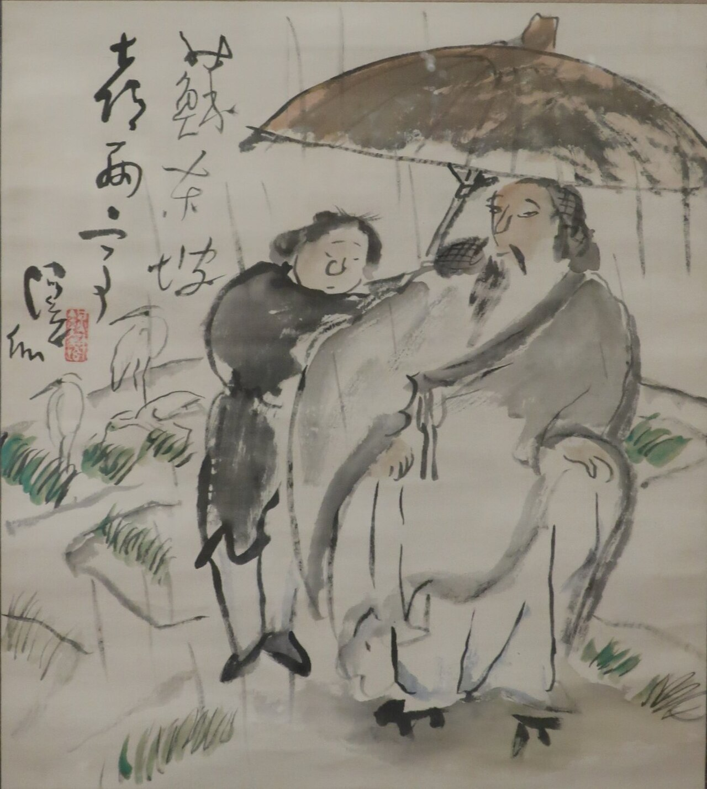

# Linjiang Xian: A Door That Would Not Open, a River That Could Be Heard

The song has a small dramatic scene. Su Shi drank all night at Dongpo, woke and drank again, and returned to Lingao around the third watch. The servant boy was asleep and snoring like thunder; no one answered the door. He had to lean on his staff and stand by the river, listening to the water. The whole song begins with a door that will not open. The door does not open, the man does not go in, but the river comes in. All of Su Shi's later reflection rests on this moment of being shut out.

Figure: A portrait of Su Dongpo by the Japanese painter Tomita Keisen. This is not a view of Su Shi drinking at Dongpo or a manuscript of the lyric. Image: Tomita Keisen, Public domain, via Wikimedia Commons ([source page](https://commons.wikimedia.org/wiki/File:%27Su_Dongpo%27_by_Tomita_Keisen,_Honolulu_Museum_of_Art_13215.1.JPG)).

## Title and text

Linjiang Xian is a ci tune, originally a Tang court piece and later a common lyric form. The title appears in different editions as Drinking at Night at Dongpo, Waking and Drunk Again or Returning to Lingao at Night. Dongpo is the plot Su Shi cleared and farmed east of Huangzhou; Lingao is his home by the river. The two place names fix the space of the song: drinking in the east, returning to the river, with a drunken night road in between.

The line “drinking at night at Dongpo, waking and drunk again” is both narrative and state. Waking and drunk again is not a summary of a long night; it is a repetition. He wakes, drinks, wakes, drinks. It is not linear but circular. Because it is circular, time blurs, and the word seemed in it seemed already the third watch has something to stand on: he is not reading a clock, he is guessing.

## Text

> Drinking at night at Dongpo, waking and drunk again,
> I returned, and it seemed already the third watch.
> The servant boy's snoring was already like thunder.
> I knocked, and no one answered;
> I leaned on my staff and listened to the river.
>
> I have long regretted that this body is not mine;
> when will I forget the bustling and striving?
> The night was late, the wind still, the ripples on the water flat.
> A small boat departs from here,
> and I entrust my remaining life to the rivers and seas.

This is the received text. Some editions read it seemed already the third watch, leaning on a curtain instead of leaning on a staff, and remaining life with a different character.

## Reading section by section

The first half is action. Drinking at night at Dongpo, waking and drunk again, returning around the third watch. Three short sentences give the place, the state and the time. Then the camera moves to the door: the servant boy's snoring is already like thunder. It is a very domestic detail and a very harsh one. The person inside is sleeping soundly; the person outside cannot get in. I knocked, and no one answered: five characters, no emotion, only fact. Then leaning on my staff and listening to the river moves the body from the door to the riverbank. The staff shows that he has stood there a long time and that he has stopped knocking.

The second half is the mind. I have long regretted that this body is not mine; “when will I forget the bustling and striving?” The song jumps from a specific door to an abstract self. This body is not mine does not mean that he does not exist. It means that the body is not under his control: it is pushed by office, duty, other people's expectations, even by the sentence of exile. Yingying means bustling, running around, seeking advantage. He is not asking when he will be promoted. He is asking when he will stop being busy with all this.

Then “the night was late, the wind still, the ripples on the water flat” pulls the abstract back into the landscape. The night is ending, the wind has stopped, the water is flat as fine silk. The word flat matters. It is not that his mind is calm; it is that the river is calm. Because the river is flat, he can see far, and because he can see far, he can think of a small boat. A small boat departs from here, “and I entrust my remaining life to the rivers and seas” is a wish, not a plan. The boat disappears from here and leaves the rest of life on the water. It is not I will take a boat tomorrow. It is if there were a boat, this is what I would want.

## The door, the river and the self

The core images are the door and the river. The door is a boundary: inside there is a servant, sleep and daily life; outside there is a drunk man, a night road and a person who cannot enter. The river is a passage: it has no door, its sound comes from far away, and its surface extends without end. Su Shi is stopped by the door, but he hears the river. This turn is crucial: when the door of society will not open, the river of nature is still there.

This body is not mine is the heaviest line. It is often read as a Daoist forgetting of the self, but in the Huangzhou setting it is first of all a political feeling. Su Shi was exiled to Huangzhou after the Wutai poetry case. His status changed from a court official to a deputy militia commander placed under local supervision, with restrictions on movement and speech. His body was still there, but it had to obey the exile system, not his own will. So not mine is not metaphysics. It is a very concrete loss of control.

Yingying then points that loss at daily life. Why do people strive? For promotion, for not being pushed aside, for family, for reputation. Su Shi knows all this. He is simply tired. He wants to forget the striving, but the word when shows that he knows he cannot. The song gives no answer, only a wish. The lighter the wish, the heavier the long regret before it.

“A small boat departs from here” is also often misread as Su Shi really wanting to live in seclusion. It certainly has that flavour, but it is more like a literary exit: the door will not open, a boat can leave; the road is blocked, the river can pass. The boat is not a vehicle. It is a carrier of if. It puts the predicament of this body is not mine temporarily inside a picture of rivers and seas. The song ends on entrusting the remaining life. The remaining life has not happened yet, so it is still a wish.

Wine has a place here, but it is not the protagonist. Night drinking is the cause, drunkenness is the state, waking and drinking again is the rhythm; what drives the song is that no one answered the door. Wine brings Su Shi to the door, the door makes him stop, and the river sound turns him toward the inner movement between the two halves. Without wine, he might not have come home at the third watch. Without the door, he might not have heard the river. Wine is the lead, the door is the turn, the river is the exit.

## The Huangzhou setting

Su Shi was exiled to Huangzhou in 1080 and left in 1084, about five years. Huangzhou was one of the high points of his literary life: the Red Cliff prose poems, Nian Nu Jiao: Memories of the Red Cliff, and Ding Feng Bo were all written there. He cleared land east of the city, called himself Dongpo Jushi, and built the Snow Hall; Lingao was his home by the river. These places are not a backdrop. They determine the space of the song: Dongpo is the place of labour, friends and wine; Lingao is the place of home, river and night.

In Huangzhou Su Shi was politically marginalised and not well off. He was not an official by West Lake; he was a man in exile who farmed, built a house and mixed with local people. That life gave his ci more domestic detail: the servant's snoring, the unanswered door, the ripples on the river. These details are not literary invention. He really lived them. That is why this body is not mine does not sound empty.

The exact year of the song is debated, but it is commonly placed around 1082. The night drinking at Dongpo need not be one specific party; it may be a distillation of several nights. A ci should not be read as a diary, but it should not be made entirely abstract either. The place names of Huangzhou and the river sound at Lingao were real.

## Common misreadings

First, treating a small boat departs from here as Su Shi actually leaving by boat. The song writes a wish, not an itinerary; he was still in Huangzhou the next day. Second, treating this body is not mine as a purely philosophical proposition. It is first the loss of control under exile, and only then the Daoist forgetting of the self. Third, treating yingying as a criticism of all people. It is closer to self-mockery: Su Shi knows that he too is striving, and he is tired. Fourth, treating leaning on my staff and listening to the river as leisure. The staff, the late night and the locked door are not leisurely; listening to the river is a forced stop. Fifth, treating this song and Nian Nu Jiao: Memories of the Red Cliff as the same mood from the same period. Nian Nu Jiao is a dialogue between history and the self; Linjiang Xian is a dialogue between a door and a river. They cannot replace each other.

There is also a textual detail: leaning on a staff appears in some editions as leaning on a curtain. If it is a curtain, the picture is someone leaning inside the house, listening to the river through a curtain; if it is a staff, the picture is someone standing outside the door. Both work, but the staff connects better with I knocked and no one answered: he knocked, no one came, and he stood by the river with his staff. When reading variants, check whether they connect with the action before and after.

## Related entries

- [Su Shi, Water Melody](ref:shuidiao): another song that asks the moon with wine and places longing on a cosmic scale.
- [Su Shi, Nian Nu Jiao: Memories of the Red Cliff](ref:niannujiao): a dialogue between history and the self from the Huangzhou years.
- [Li Bai, Drinking Alone under the Moon](ref:drinking-alone): another poem that turns solitude into a gathering.
- [Yellow wine](ref:yellow-wine): an entry into the grain-wine craft lineage of the Song.
- [Time in a cup](ref:time-in-a-cup): how wine enters seasons, gatherings and writing.
