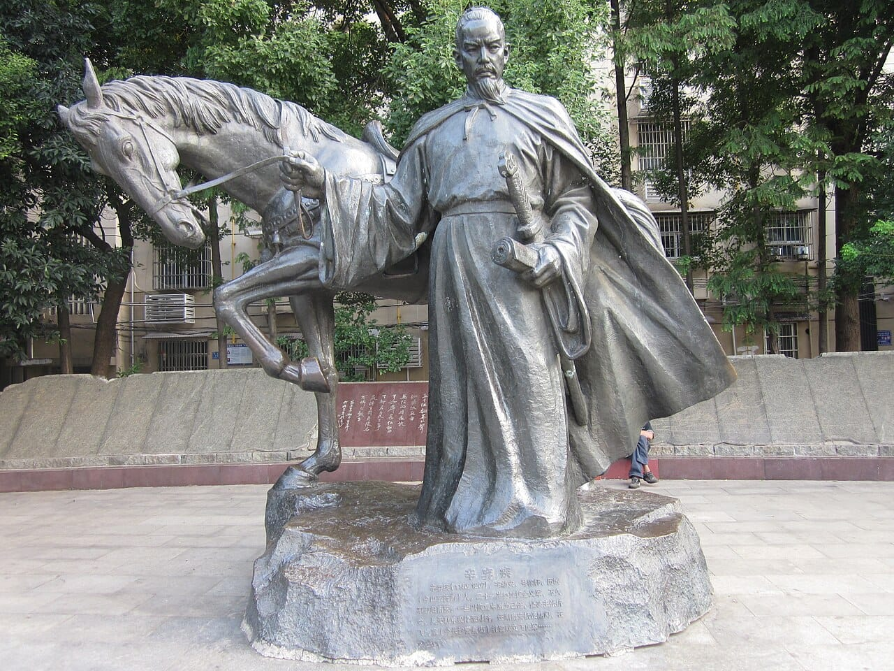

# Xi Jiang Yue: Pushing the Pine Away, a Joke and a Temper

Xi Jiang Yue, on diverting the mood, reads like a joke. A man gets drunk, falls by a pine tree, asks the pine how drunk he is, then suspects the pine is coming to help him and pushes it away with a go. The whole lyric is only fifty characters, but the action is complete: laugh, worry, read, fall, ask the pine, push the pine. Xin Qiji turns a drunken night into a small play. But after the laugh, the reader sees that the go is pushing away not the pine but a reality he cannot push.

Figure: A statue of Xin Qiji. It is a modern memorial sculpture, not a Song portrait or a manuscript of the lyric. Image: Lei Yixin / Nie Shihua / Xiao Xiaoqiu, CC BY 3.0, via Wikimedia Commons ([source page](https://commons.wikimedia.org/wiki/File:The_statue_of_Xin_Qiji.JPG)).

> **Quick verdict**
> **In one line:** This poem entry explains why Xi Jiang Yue: Pushing the Pine Away, a Joke and a Temper matters, and how to read it in its drinking context.
>
> - **Best for:** Anyone who wants Xi Jiang Yue: Pushing the Pine Away, a Joke and a Temper in its literary and drinking context, not just as a famous line.
> - **Not for:** If you want only want exam points or one famous line without context.
> - **Check first:**
>   - Xin Qiji is usually thought to have written this lyric during a period of retirement.
>   - Xi Jiang Yue is a ci tune, originally a Tang court piece; its name comes from Li Bai's lines in Su Tai Lan Gu, only the Xi River moon remains.

## Title and text

Xi Jiang Yue is a ci tune, originally a Tang court piece; its name comes from Li Bai's lines in Su Tai Lan Gu, only the Xi River moon remains, once shining on the palace of the King of Wu. Diverting the mood is the title, meaning to dispel a mood or express a momentary feeling. The title sounds light, as if written casually. But Xin Qiji's diverting the mood is often not light. The smaller the form, the more colloquial the language, the more likely there is fire underneath.

The language is close to speech. What time is there to be sad, ask the pine how drunk I am, push the pine with my hand and say go: none of this sounds like conventional ci. It sounds like a man talking to himself after wine. Xin Qiji is not incapable of elegance; he deliberately uses the colloquial. The colloquial makes the drunkenness real and makes the anger sudden: you laugh, and halfway through the laugh you realise he is cursing.

## Text

> While drunk, I just crave laughter;
> what time is there to be sad?
> Lately I have begun to feel that the books of the ancients,
> if you believe them, are completely without use.
>
> Last night I fell drunk by a pine;
> I asked the pine how drunk I was.
> I only suspected the pine was moving to help me,
> and pushed it with my hand, saying, go.

This is the received text. Some editions write believe it, there is nothing right with a different particle and add quotation marks around go.

## Reading section by section

The first line, while drunk, I just crave laughter, turns on the word just. Just means for the time being, not to the full. He is not really without sorrow; he is putting sorrow down for a while. He is not naturally fond of laughing; he uses laughter to block sorrow. The second line, what time is there to be sad, is even better: it is not that there is no sorrow, it is that he is too busy to be sad. Busy with what? Busy drinking, busy laughing, busy getting through the days. This busyness is self-mockery and resistance at once.

The third and fourth lines turn suddenly to reading. Lately I have begun to feel that the books of the ancients, if you believe them, are completely without use. This is not anti-intellectualism, and it does not reject all knowledge. It reworks Mencius: if you believe all books, it is better to have no books. Xin Qiji is not cursing books. He is cursing the people who turn old books into dogma and use them to suppress dissent. He spent his life arguing for the northern expedition and was kept out by the appeasement faction. The old books speak of loyalty and restoration; reality speaks of peace treaties and comfort. The books are not wrong. The wrong is in who uses them and how.

The second half is action. Last night I fell drunk by a pine; I asked the pine how drunk I was. He treats the pine as a person and asks it how drunk he is. It is a charming action and a lonely one: there is no one else to ask, so he asks a tree. Then I only suspected the pine was moving to help me, and pushed it with my hand, saying, go. He suspects the branch is moving to help him, so he pushes it and says go. The push moves the pine away, and moves the help away. He does not want to be helped, and does not want to admit that he needs help.

Go is the eye of the lyric. It can be said to the pine, to himself, to reality. He pushes away a tree, but what he wants to push away may be the appeasement faction, the court's comfort, the dogma of the books of the ancients, the self that has to live in retirement. One go is both drunken talk and temper.

## Laughter and cursing inside the drunkenness

The feeling is double-layered. The surface is laughter: craving laughter, asking the pine, pushing the pine, all comic actions. The inside is cursing: the books of the ancients are completely without use is anger at the official ideology of the time; pushing the pine and saying go is a refusal of help and a resistance to being arranged. Xin Qiji hides the curse inside the laugh and the fire inside the drunk, because direct cursing could bring trouble and drunken talk can be played off as confusion.

This method is not rare in Southern Song ci. Many of Xin Qiji's diverting the mood or casual pieces seem to be about retirement, landscape and wine, and all of them have injustice underneath. His bold ci is often compared with Su Shi's, but the two are different. Su Shi's openness is more a digestion of fate; Xin Qiji's openness is often a hard holding-up against reality. Su Shi says a straw cloak in the rain, let the whole life go; Xin Qiji says push the pine with my hand and say go. One receives the wind and rain; the other pushes away the hand that would help.

Wine here is a permit. Drunk, he can crave laughter; drunk, he can ask the pine; drunk, he can push the pine. Wine lets a dismissed official stop being Xin Qiji for a while and become a man talking nonsense by a pine. But wine is also a cover: his laughter is forced, his push is defensive, and every line of his drunken talk is true. Wine does not solve the problem. It lets him tell the problem as a joke.

In material terms, Song wine was mostly grain wine of modest strength, drunk differently from today. Xin Qiji's drunk need not be read through the strength of modern baijiu; he may have drunk yellow wine or a local rice wine. Vessels, wine shops and drinking games differed greatly from today. Reading drunk as having drunk a lot of strong liquor misses the clarity inside the lyric. The craft lineage of [yellow wine](ref:yellow-wine) helps explain Song grain wine, but the two are not identical.

## The pine, the old books and the late Xin Qiji

Xin Qiji is usually thought to have written this lyric during a period of retirement. He spent his life advocating war against the Jin, had formed the Flying Tiger Army, and presented the Ten Essays and Nine Discussions, but the Southern Song court favoured peace. He was dismissed several times and lived for long periods in Shangrao and Yanshan in Jiangxi. Daihu, Piaoquan and Jiaxuan are the homes and names of his retirement years. A man who had led troops was placed in the mountains, where he could only write ci, drink and farm. This gap is the background of the lyric.

The pine is not an arbitrary tree. In traditional culture the pine stands for firmness, longevity and unchanging integrity. Xin Qiji called himself Jiaxuan, the farm hut, and lived among pines in his later years; the pine was an everyday sight. Treating the pine as a person is the drunken eye; pushing it and saying go is the temper. The pine will not really come to help him, but he needs an object to refuse. That object can be the pine, the court, or himself.

The books of the ancients are not a vague reference either. Xin Qiji read history, military texts and earlier poetry. He spent his life devoted to restoration; the loyalty, strategy and rise and fall in old books were his spiritual resources. But when the appeasement faction used those books to argue that war was impossible, the books became a yoke. So if you believe them, they are completely without use is not hatred of knowledge. It is hatred of knowledge misused. The line is anger, not his scholarly position.

## Common misreadings

First, treating the lyric as a simple drunken joke. It has comic action, but there is anger under the laugh; go is not a playful ending but an outlet of temper. Second, treating the books of the ancients are completely without use as Xin Qiji's anti-intellectualism. He reworks Mencius and curses dogmatic old books, not all learning. Third, treating the push of the pine as merely cute drunken behaviour. It is cute, and it is pitiful: a man who needs help insists on pushing the helping hand away. Fourth, treating Xin Qiji's retirement as voluntary reclusion. He retired because he was pushed out, not because he had seen through the world; his landscape lyrics often contain defiance. Fifth, equating this lyric with Su Shi's openness. Su Shi's openness is more digestion; Xin Qiji's is more hard holding-up. Their drunkenness is not the same.

There is also a formal detail: Xi Jiang Yue has two halves of three lines, a short rhythm that suits action. Xin Qiji does not use a long slow tune to develop the scene; he uses the shortest space for the fastest action, the push. Form and content join here: the shorter it is, the stronger; the more colloquial, the more real.

## Related entries

- [Xin Qiji](ref:xin-qiji): the person page, with his war against the Jin, the Flying Tiger Army, dismissal and retirement.
- [Po Zhen Zi: A Heroic Lyric for Chen Tongfu](ref:po-zhen-zi): another lyric of dream, battlefield and unfulfilled ambition.
- [Su Shi, Nian Nu Jiao: Memories of the Red Cliff](ref:niannujiao): a dialogue between history and the self in Song bold-style ci.
- [Yellow wine](ref:yellow-wine): an entry into the grain-wine craft lineage of the Song.
- [Time in a cup](ref:time-in-a-cup): how wine enters seasons, gatherings and writing.

Xi Jiang Yue is best read by starting with the poet and date, moving to the text and translation, and ending with what it is cited for here.