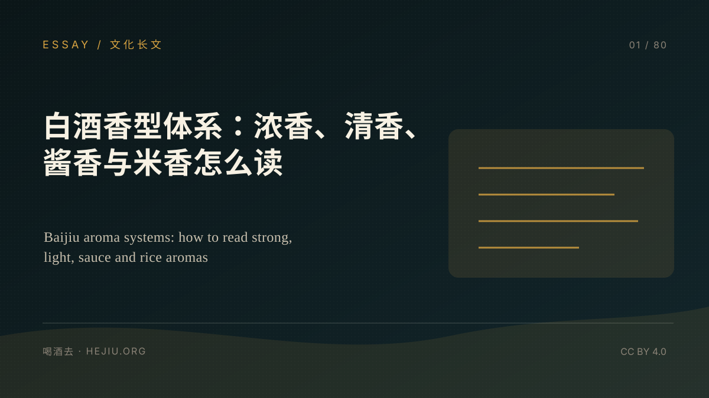

# 白酒香型体系：浓香、清香、酱香与米香怎么读

在白酒货架上，“浓香”“清香”“酱香”是出现频率最高的词之一。它们看起来像等级，其实更像一套描述香气风格与工艺传统的分类语言。理解这套语言，能帮助饮者知道自己买的是什么，也能避免把“香型”误当成质量保证。

图：白酒香型体系：浓香、清香、酱香与米香怎么读 类型示意图。图片：Doubao Seedream 5.0 AI 辅助绘制（项目自有），不是白酒香型体系：浓香、清香、酱香与米香怎么读的实拍。

## 问题从哪来

白酒的原料多为高粱、小麦、大米、玉米等谷物，制曲、发酵、蒸馏与贮存的方式又因地域而异。不同产区的酒在香气上差异明显，行业需要一个可以交流、比较与教学的词汇，于是逐步形成了“香型”这一分类。它最初服务于生产经验与行业评比，后来进入标准、教材、标签与市场话术。

问题也随之出现：当香型被当作卖点，消费者容易把复杂的工艺差异压缩成一个词。有人把“酱香”当成高级，有人把“清香”当成廉价，还有人以为香型是法律规定的好坏等级。这些理解都跳过了中间那一步：香型首先描述的是一类风格如何被做出来。

## 体系与原理

香型不是单一化合物带来的气味，而是原料、曲种、发酵容器、发酵方式、蒸馏工艺与贮存条件共同作用的结果。以常见的几类为例：浓香型多采用泥窖固态发酵、续糟配料与混蒸混烧，窖池中的微生物群落参与生香；清香型强调低温、清洁的发酵环境，常使用地缸或陶缸，追求干净、爽净的香气；酱香型以高温制曲、高温堆积和多轮次发酵取酒为特征，香气层次复杂；米香型以大米为主要原料，使用小曲糖化发酵，风格偏清甜。这些概括只是入口，具体工艺仍要看产区、酒厂与产品标准。

从风味化学角度看，不同香型的差异常被描述为酯类、醇类、醛类、酚类等成分的比例与阈值不同。浓香的讨论常围绕己酸乙酯等酯类，清香常围绕乙酸乙酯等酯类，米香则常提到β-苯乙醇一类的香气成分。但“某一种成分高”并不等于“某一种香型好”，香气是整体感知，还受酒精度、温度、杯型与个人嗅觉影响。

## 关键分类或参数

中国白酒常见的香型包括浓香、清香、酱香、米香，此外还有凤香、特香、豉香、芝麻香、老白干香、馥郁香、兼香等。不同资料对香型的统计口径并不完全一致，因此不宜给出一个固定的“总数”。判断一款酒的香型，通常要结合标签、执行标准、产区与工艺描述，而不是只看广告词。

可观察的参数包括：制曲温度与曲种、发酵容器（泥窖、石窖、地缸等）、发酵周期、蒸馏轮次与取酒段、贮存容器与时间，以及成品酒精度与总酸、总酯等理化指标。理化指标的具体限值属于标准文本的内容，应以官方发布的标准为准。阅读标签时，香型、原料、酒精度、执行标准与生产日期通常比“年份故事”更有信息量。

[白酒](ref:baijiu)是一个大类，[浓香型](ref:strong)是其中常见的一支；若想理解蒸馏环节，可先看[蒸馏](ref:distillation)。术语层面的基础可参考[白酒工业术语](ref:gbt15109)，它属于行业术语体系的一部分，不等于某一款产品的质量承诺。香气的感知与描述，还可参考[香气](ref:aroma)这一术语页。

## 案例

四川的浓香型产区常以泥窖、续糟与混蒸混烧的组合被讨论，[四川](ref:sichuan)的气候与微生物环境也被视为风格形成的重要背景。贵州的酱香型产区常以高温制曲、堆积发酵与多轮次取酒为特征，[贵州](ref:guizhou)的河谷气候与季节节奏影响制曲和发酵安排。华南的米香型传统则把大米、小曲与相对简洁的工艺联系在一起。

把这些案例放在一起看，会发现“香型”更像一条条工艺路线，而不是一张从高到低的排行榜。同一香型内部，不同产区、不同酒厂、不同批次也可能有明显差异；跨香型的比较，则更像比较两种审美，而不是比较两个分数。

## 常见误解

第一，把香型当成质量等级。香型描述风格与工艺传统，不直接等于品质高低。第二，把香型数量说成固定不变。行业分类会随研究、标准与市场变化而调整，具体以官方与行业资料为准。第三，认为酱香一定优于清香，或浓香一定更“传统”。这属于个人偏好与场景选择，不是可被单一指标证明的结论。第四，把香型等同于香精。规范生产的香型来自发酵、蒸馏与贮存；外加香与不当标注是另一类问题，应看标签与监管信息。第五，认为所有白酒都必须标注香型。标签要求因产品类别与标准而异，遇到不熟悉的产品，先看执行标准与配料表。

## 争议与边界

香型体系的争议主要有三处。其一是科学边界：风味化学可以测出成分差异，却很难把“风格”完全量化；跨香型、兼香型产品的出现，也让边界更模糊。其二是历史与市场：行业评比、地方品牌与消费者记忆共同塑造了香型的知名度，知名度不等于普遍适用。其三是标准与标签：不同标准对术语、指标与标注的要求不同，具体条款应以官方文本为准。

因此，本页只提供理解框架，不提供“某香型必须如何”的绝对规则。涉及具体产品的质量、年份、等级与执行标准，应回到产品标签与官方标准。若要把香型当作选购依据，最好把它和产区、工艺、酒精度与个人口味一起考虑。

## 怎么用

选酒时，可以先问自己想要哪种体验：偏浓郁绵甜，还是偏清爽干净；偏烘焙与陈香，还是偏米香清甜。把香型当作第一层筛选，再用产区、酒精度与价格做第二层筛选。品鉴时，尽量在相同温度、相同杯型下对比同香型的两款酒，记录香气、入口、回味与空杯留香，而不是只记“好不好喝”。

配餐上，浓香与酱香常被建议搭配风味较重的菜肴，清香与米香更适合清淡或鲜味突出的食物；但这类建议只是经验，仍要以实际口味为准。储存方面，避免阳光直射与温度剧烈波动，开瓶后尽快饮用。最后，任何关于“年份”“陈酿”“特供”的说法，都应回到标签与可核实的生产信息。

## 另见

- [白酒](ref:baijiu)：大类概览。
- [浓香型](ref:strong)：常见香型之一。
- [白酒工业术语](ref:gbt15109)：术语与分类的背景。
- [四川](ref:sichuan)、[贵州](ref:guizhou)：两个常被讨论的产区。
- [蒸馏](ref:distillation)：从发酵液到酒的过程。
