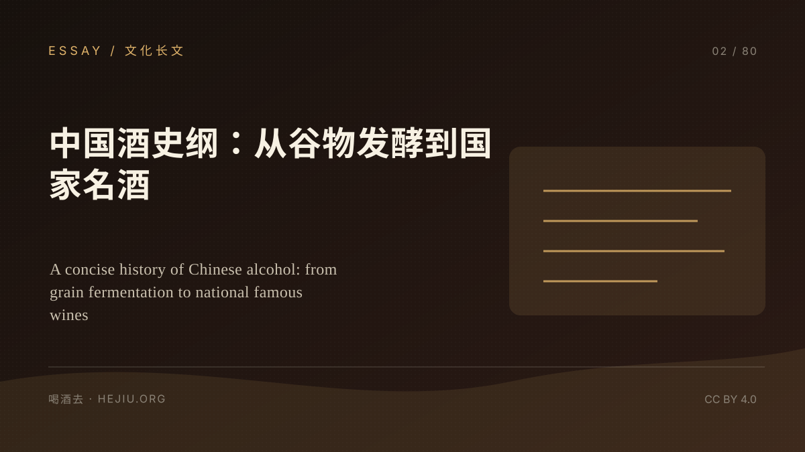

# 中国酒史纲：从谷物发酵到国家名酒

中国酒的历史很容易被写成一条直线：起源很早，中间越来越进步，最后进入现代工业。真实情况更曲折。考古材料能证明早期存在发酵饮料，却不能直接说明它是什么酒；农书详细记录制曲与酿酒，却只覆盖特定地域；诗文与城市笔记提供场景，却常带文学修饰。把这几类材料分开，才能写出一部不夸大的酒史。

本文按时间顺序梳理几个关键转折：早期谷物发酵、唐宋酒肆与酒政、元明蒸馏酒、近现代工业化与国家评酒制度。每一段都标注证据类型，并在最后说明仍有争议的问题。

图：中国酒史纲：从谷物发酵到国家名酒 类型示意图。图片：Doubao Seedream 5.0 AI 辅助绘制（项目自有），不是中国酒史纲：从谷物发酵到国家名酒的实拍。

## 早期：发酵饮料与谷物酒

目前常被引用的早期证据来自河南舞阳的贾湖遗址。研究者分析陶器残留物，认为其中存在由稻米、蜂蜜与水果等原料发酵而成的饮料，年代约在 9000 年前。这项研究支持“新石器时代已掌握发酵技术”的判断，但它不等于今天意义上的某一种酒；原料、工艺与饮用方式都需要跨学科推断。

进入有文字的时代，酒与祭祀、礼制的关系变得清楚。商周青铜器中有爵、觚、尊、卣等酒器，甲骨文与金文留下“酒”字；《诗经》则有“为此春酒，以介眉寿”这样的句子。这里的酒主要是谷物发酵酒，用曲把淀粉糖化再发酵，酒度不高，保存时间有限。它与今天[黄酒](ref:yellow-wine)的工艺谱系相通，但不能直接画等号。

早期酒的生产多与家庭、宗族和祭祀相连，国家则以礼制与禁令介入。酒既是祭品，也是宴饮与馈赠的媒介；它的社会意义从一开始就超过“饮料”本身。

## 汉唐：酒政、酒肆与诗文

汉代出现明确的酒类专卖讨论与“酒榷”政策，国家在财政需要与民间消费之间反复调整。魏晋南北朝时期，制曲与酿酒经验被写入农书；北魏[《齐民要术》](ref:qimin-yaoshu)卷七集中记录神曲、笨曲等曲种与配套酿酒法，是现存最早的系统文本之一。

唐代城市商业扩大，酒肆、酒旗与酒户成为城市生活的一部分。李白、白居易等人的诗把酒写进送别、独酌与宴集；这些诗是文学文本，不是饮酒统计，但它们能说明酒在社交中的位置。唐代主流仍是低度谷物酒，蒸馏酒是否已经普及，学界并无一致结论。

宋代酒政更细。官府通过酒户、酒税与专卖管理生产销售，城市中出现“正店”与“脚店”的分层：正店可酿造并批发，脚店零售。《东京梦华录》记汴京中秋前“诸店皆卖新酒”，市民争饮；[《清明上河图》](ref:qingming)则把酒肆、酒旗与城市运输画在同一条街上。文献与图像互相印证，比单看一条材料可靠。

## 元明：蒸馏酒与地方名酒

关于蒸馏酒的起源，常见说法是元代从外来技术传入并逐渐普及。明代李时珍在《本草纲目》中写“烧酒非古法也，自元时始创其法”，这句话被后世广泛引用。但考古与文献研究也提示，蒸馏技术可能出现得更早，或在不同地区分别出现；把“元代起源”当成定论并不稳妥。

可以较有把握地说：宋元以后，蒸馏酒逐渐进入中国酒的版图；明清时期，高粱等原料与不同曲种结合，形成今天所熟悉的香型雏形。地方名酒在这时积累声誉，绍兴黄酒、山西汾酒、四川泸州等地的产品进入更大的市场。名酒不是一夜出现的，它与水质、粮食、曲种、窖池与长期经营共同形成。

## 近代：工业化与名酒制度

19 世纪末，中国出现近代意义的酿酒工业。1892 年张裕酿酒公司成立，引入葡萄种植与葡萄酒生产；1903 年青岛出现外资啤酒厂，啤酒进入沿海城市。这些企业带来新的设备、标准与品牌意识，但传统酒坊仍是大多数。

1952 年，第一届全国评酒会在北京举行，从 103 个酒样中评出八种中国名酒，包括四种[白酒](ref:baijiu)、绍兴加饭酒与三种张裕产品。此后 1963、1979、1984、1989 年继续举办全国评酒会。评酒制度把地方名酒纳入国家体系，也推动了感官术语、检测指标与样品管理的标准化；但它同时带有行政认定与行业推荐的色彩，不能简单等同于现代盲品。

## 时间线

- 约 9000 年前：贾湖遗址出现发酵饮料的化学证据。
- 商周：青铜酒器、甲骨文与金文中的酒，酒与祭祀礼制紧密结合。
- 北魏：约 533—544 年，《齐民要术》成书，卷七系统记录制曲与酿酒。
- 北宋：960—1127 年，汴京酒肆繁荣，正店与脚店分层。
- 1892：张裕酿酒公司成立。
- 1903：青岛出现外资啤酒厂。
- 1952：第一届全国评酒会，评出八大名酒。
- 1989：第五届全国评酒会，此后全国性评酒会停办。

## 争议与写法说明

第一，起源叙事容易被民族情绪放大。贾湖的研究很重要，但“中国最早的酒”这类标题会省略原料、工艺与定义上的争论。第二，蒸馏酒起源没有单一答案。元代说、更早说与多中心说各有证据，写作时应并列，而不是选一个最顺耳的。第三，“仪狄造酒”“杜康造酒”是传说，不是可核实的历史人物事件；它们可以解释文化记忆，不能当作年代证据。第四，诗文不能当酒类统计。李白写“三百杯”是修辞，宋代酒税数字才是财政材料。第五，名酒评选是历史制度，不是永恒排名；名单会变，市场也会变。

## 结论

中国酒史的主线不是“从低级到高级”，而是发酵技术、酒政、城市商业、文学想象与工业标准不断叠加的过程。早期谷物酒与今天的黄酒有谱系关系，蒸馏酒后来改变了酒的强度与消费场景，近现代工业与国家评酒制度又重塑了品牌与市场。读这条线，最好同时握住证据的边界：哪些是考古数据，哪些是文本记载，哪些是后人的解释。

## 相关条目

- [黄酒](ref:yellow-wine)：谷物发酵酒的工艺谱系。
- [白酒](ref:baijiu)：蒸馏酒的定义、香型与工艺。
- [中国](ref:china)：国家产区与管理制度框架。
- [齐民要术](ref:qimin-yaoshu)：北魏制曲与酿酒的农书。
- [酒经](ref:jiujing)：宋代制曲与酿酒的专著。
- [1952年全国评酒会](ref:evaluation-1952)：八大名酒与评选制度的起点。
- [清明上河图](ref:qingming)：汴京酒肆与城市商业的图像材料。
