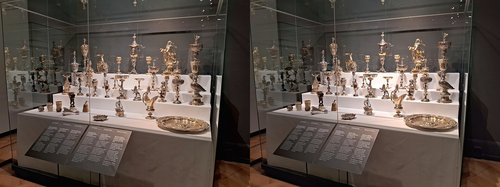

# 酒器史：杯子如何改变喝法

同一杯酒，放在陶碗、青铜爵、瓷盏或薄壁水晶杯里，喝起来不一样。器型改变的不只是手感：杯口的大小影响香气，杯壁的厚薄影响温度，容量决定一次喝多少，器物组合则决定礼仪中的次序。酒器史因此不只是工艺史，也是饮用方式的历史。

这篇文章不按朝代罗列器名，而是追问一个更具体的问题：器物的哪一个特征，改变了哪一种喝法。答案可以归为四个变量：容量、杯口、材质、组合。六段分期只是这四个变量在不同技术条件下的展开。

图：酒器史：杯子如何改变喝法相关实景照片。图片：VasuVR，CC BY 4.0，via Wikimedia Commons（[原图页面](https://commons.wikimedia.org/wiki/File:SW45-B-18-Bern_History_Museum_Humorous_drinking_vessels_3D.jpg)）。

## 论点

酒器是“饮用方式的硬件”。它先于语言，规定动作：小杯让人慢饮，大杯鼓励一口喝完；收口聚香，敞口散香；金属导热快，陶瓷保温好，玻璃中性；成套器皿让次序可见。器物的变化，往往不是审美先变，而是酒种、技术或礼仪先变，器型随后跟上。

但器型不是被动反映。它一旦定型，就会反过来训练身体：用爵的人学会双手举器，用耳杯的人学会传递，用高脚杯的人学会摇杯闻香。器物的历史，因此是“物—酒—动作”三者互相塑造的历史。

## 证据链之一：新石器陶器与蛋壳陶

早期发酵饮料需要容器：陶罐、陶瓮、陶鬶、陶盉。大汶口文化的陶鬶有流、有鋬、有三足，便于倾倒与加热，说明当时已经考虑到“倒酒”这个动作。陶器透气、保温，适合发酵与储存，器型的分化先从“容器”开始，而不是从“杯”开始。

龙山文化的蛋壳黑陶高柄杯是另一个节点。这类器物壁厚可薄至 0.5 至 1 毫米，器身轻、柄高，适合手持。它说明新石器时代晚期已经出现专门用于饮用的器型，饮酒开始从共用的容器中分离出来。此时酒还没有成为独立的消费商品，但它已经拥有专门的器物。

## 证据链之二：商周青铜酒器与礼制

商周青铜器把酒器推到礼制中心。二里头文化已出现青铜爵，是目前所见较早的青铜酒器之一。爵有三足、流与尾，用于温酒与献酒；觚是细长饮器；尊、卣、壶用于盛酒；觥用于大型宴饮。殷墟妇好墓（约公元前 1200 年）出土了大量青铜酒器，包括爵、觚、斝、尊、卣、壶，数量与组合都指向墓主人的高等级身份。

器物的数量与组合常与身份相关，形成“列器”的制度。[酒与礼](ref:wine-and-ritual)中的次序，正是通过这些器物落实的：谁用爵、谁用觚、酒盛在哪个器里，都有规定。青铜器铭文还记录了作器缘由，使酒器同时成为历史文本。考古发现中的酒器组合，比单件器物更能说明墓主人的身份，因为数量与摆放本身就是关系。

## 证据链之三：汉晋漆耳杯与唐宋金银器

汉代漆器轻便、耐腐蚀，耳杯成为常见饮器。椭圆形杯身配双耳，便于双手持握与传递。长沙马王堆一号汉墓出土的漆耳杯，器形、纹饰与铭文都保存较好，为理解汉代宴饮提供了实物。曲水流觞的记载让羽觞进入文学：东晋永和九年（353）兰亭修禊，杯子顺水而流，停在谁面前谁饮酒。器物在这里不仅是容器，还是游戏规则的一部分。

唐代金银器工艺成熟，酒壶、酒杯出现多曲、花口等造型，配合胡瓶、执壶等新器型。1970 年西安何家村窖藏出土千余件唐代金银器，其中舞马衔杯纹银壶把“衔杯”的动作直接铸在壶身上，说明酒器与表演、礼仪关系密切。金银器多为上层使用，瓷器则覆盖更广的市场。

宋代瓷窑林立，注子（执壶）与温碗配套，先把酒温热再斟；梅瓶用于盛酒，盏与盏托用于饮茶与饮酒。[宋代城市](ref:history-of-taverns)的酒肆里，酒器是经营的一部分：温酒、斟酒、换盏都有讲究。器型的分化说明饮酒场景变多，家庭、酒肆、宴席各有一套器物。

## 证据链之四：明清瓷杯与近代玻璃

明清景德镇官窑与民窑大量生产酒器，青花、五彩、粉彩的酒杯与执壶成为常见器物。明永乐压手杯、成化斗彩鸡缸杯、清康熙十二花神杯，都是不同时期酒器审美的代表。与此同时，锡器、铜器在民间广泛使用，温酒壶与烫酒设备普及。黄酒与烧酒并行的格局，让酒器进一步分化：黄酒用较大的碗或杯，烧酒用小杯。

玻璃器透明、无味、易清洗，19 世纪以后逐渐普及。葡萄酒品鉴发展出高脚杯、郁金香杯等器型，杯口收拢以聚香；威士忌有闻香杯与平底杯；啤酒有不同杯型以控制泡沫与香气。现代品鉴杯的设计，把“香气—温度—分量”拆成可控制的变量，这与古代礼器的功能不同，但逻辑相通。

## 反例与边界

第一，建盏不是酒器。宋代建盏以黑釉、兔毫、油滴著称，主要服务于点茶与斗茶，不能因为“像碗”就当作酒器。第二，爵的实用性有争议。三足可以温酒，流可以献酒，但爵的流较窄，是否适合日常大口饮用，学界有不同看法；它更可能是礼器与祭器，而非日常酒杯。

第三，器名古今不对应。“觞”“杯”“盏”“钟”在不同时代所指不同，不能用一个现代词去覆盖所有古代器名。第四，明器不是实用器。墓葬中出土的陶制酒器可能按比例缩小或简化，不能直接当作当时餐桌上的器物。第五，玻璃杯的香气优势是现代品鉴话语，不是绝对真理；酒的温度、倒酒量和个人嗅觉同样重要。

## 与站内其他条目的分工

本文按材质与器型讲“器物如何改变喝法”，不重复单件藏品的著录。[酒与礼](ref:wine-and-ritual)负责器物在礼制中的等级意义，本文只取“组合决定次序”这一点。[酒馆史](ref:history-of-taverns)负责温酒、斟酒在商业空间中的使用，本文只讲器具本身。

[黄酒](ref:yellow-wine)与[白酒](ref:baijiu)条目分别讲酒种的工艺与喝法，本文只讲杯型与酒种的匹配。[中国](ref:china)条目提供窑口与产区的地理背景。[酒与画](ref:history-of-taverns)式的图像材料，归绘画条目处理，本文不展开。博物馆藏品条目负责单件器物的年代、尺寸与递藏，本文不替代它们。

## 另见

- [黄酒](ref:yellow-wine)：温饮传统与杯型选择。
- [白酒](ref:baijiu)：小杯品饮的节奏。
- [中国](ref:china)：酒器生产与窑口的地理背景。
- [酒与礼](ref:wine-and-ritual)：器物如何落实礼制次序。
- [酒馆史](ref:history-of-taverns)：酒肆中的温酒与器具。
